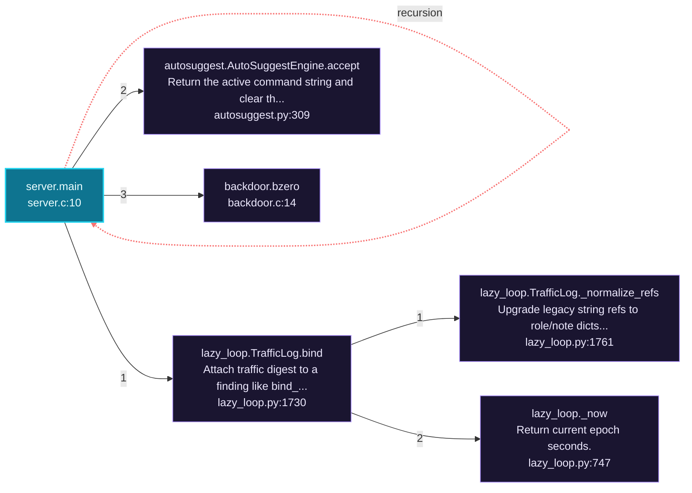
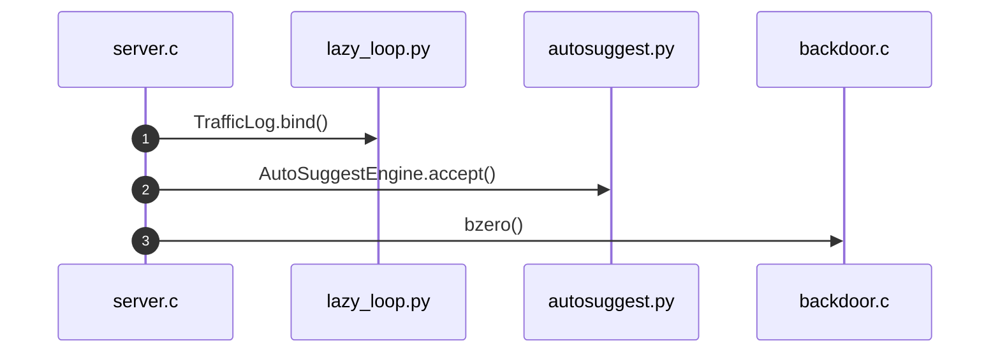
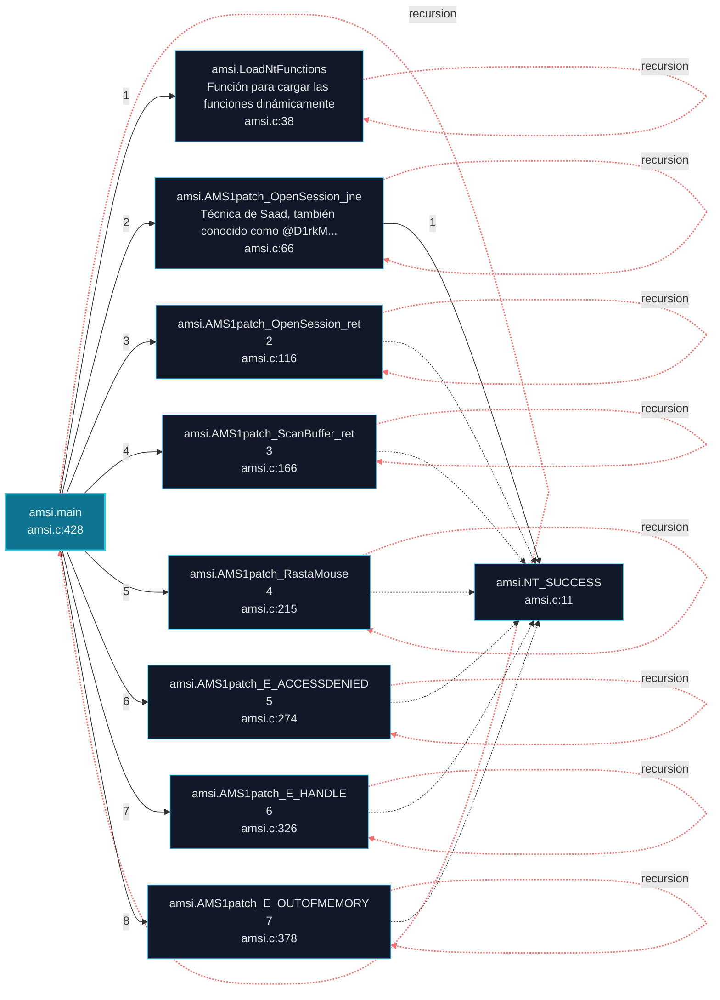
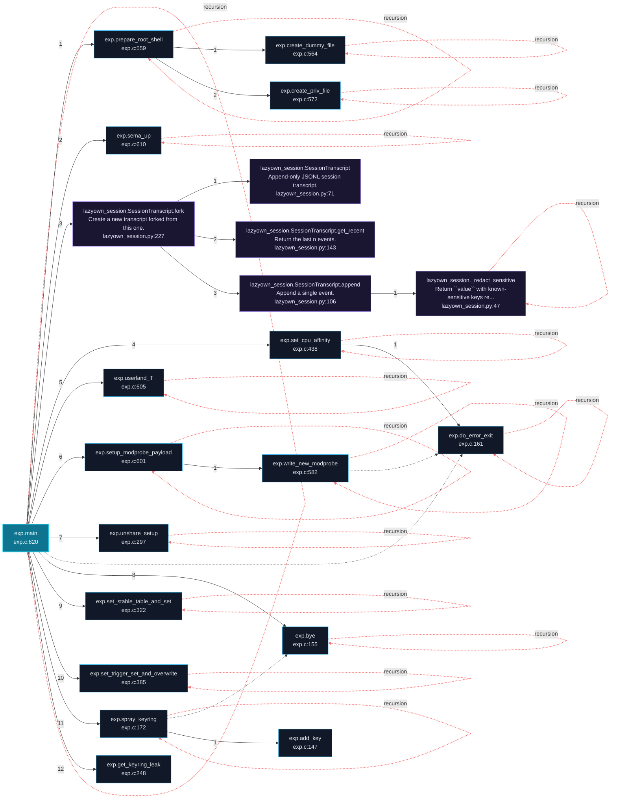
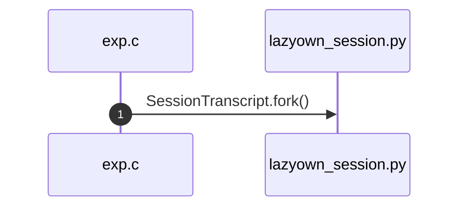

# LazyOwn Architecture and Execution Flows

[Back to index](index.md)

## Architecture Overview

36 components stacked in 10 dependency tiers (weighted Eades-Lin-Smyth ordering: arrows point from dependent to dependency, top to bottom). Labels are import counts, thick arrows the top quartile; 34 transitively implied edges are omitted. Dashed red arrows are upward dependencies: the smallest set of imports that closes every cycle and breaks the layering. Cyan components hold entry points. Interactive version: `readmenator-apidocs/index.html#/flows`.

Upward dependencies to fix first: `modules: world_model` -> `modules: lazyown_mcp` (40 imports); `modules: lazyown_mcp` -> `modules: lazy_loop` (33 imports); `modules: world_model` -> `cli/commands` (27 imports); `cli/commands` -> `cli` (25 imports); `modules: lazyown_mcp` -> `cli/commands` (23 imports); `cli/commands` -> `modules: html2pdf.bundle.min` (19 imports); `modules: world_model` -> `modules: lazy_loop` (19 imports); `cli/commands` -> `modules: lazy_loop` (13 imports); `modules: world_model` -> `cli` (13 imports); `cli` -> `lazyc2/security` (13 imports); `modules: llm_budget` -> `modules: lazy_loop` (13 imports); `modules: lazyown_mcp` -> `modules: llm_budget` (12 imports); `modules: html2pdf.bundle.min` -> `modules: lazy_loop` (12 imports); `modules: lazyown_mcp` -> `modules: html2pdf.bundle.min` (10 imports); `modules: lazyown_mcp` -> `cli` (9 imports); `modules: chain_runner` -> `modules: lazy_loop` (9 imports); `modules: lazyown_mcp` -> `lazyc2/security` (8 imports); `cli` -> `modules: lazy_loop` (8 imports); `modules: html2pdf.bundle.min` -> `cli` (7 imports); `modules: llm_budget` -> `cli` (6 imports); `modules: world_model` -> `modules: chain_runner` (5 imports); `modules: llm_budget` -> `modules: html2pdf.bundle.min` (5 imports); `cli/commands` -> `modules: llm_budget` (4 imports); `modules: world_model` -> `modules: html2pdf.bundle.min` (4 imports); `skills/claude_md_orchestrator` -> `modules: lazyown_mcp` (3 imports); `skills/claude_md_orchestrator` -> `modules: html2pdf.bundle.min` (3 imports); `modules: lazyown_mcp` -> `modules: chain_runner` (2 imports); `skills/claude_md_orchestrator` -> `cli/commands` (2 imports); `modules: world_model` -> `lazyc2/security` (2 imports); `modules: html2pdf.bundle.min` -> `lazyc2/security` (2 imports); `skills/claude_md_orchestrator` -> `modules: llm_budget` (1 imports); `modules: llm_budget` -> `lazyc2/security` (1 imports)

```mermaid
flowchart TB
    classDef cycle fill:#1f1530,stroke:#f472b6,color:#fce7f3,stroke-width:2px;
    classDef default fill:#111827,stroke:#38bdf8,color:#e5e7eb;
    classDef entry fill:#0e7490,stroke:#22d3ee,color:#ecfeff,stroke-width:2px;
    subgraph lane_0["Tier 1 - entry / orchestration"]
        direction LR
        n_c11["modules: kerberos_core<br/>7 files, 138 symbols<br/>Core / utility"]:::default
        n_c12["modules: saas_attacks<br/>7 files, 77 symbols<br/>Core / utility"]:::default
        n_c13["skills/hermes-lazyown<br/>7 files, 120 symbols<br/>Core / utility"]:::default
        n_c14["modules: polymorphic_engine<br/>6 files, 89 symbols<br/>Core / utility"]:::default
        n_c7["lazygui/panels<br/>51 files, 405 symbols<br/>Core / utility"]:::entry
        n_d_tools["tools<br/>4 files, 15 symbols<br/>Core / utility"]:::default
        n_d_tests["tests<br/>3 files, 9 symbols<br/>Presentation / entry"]:::default
        n_d_static["static<br/>2 files, 4 symbols<br/>Core / utility"]:::default
        n_d_source["source<br/>1 files, 0 symbols<br/>Core / utility"]:::default
        n_d_skills["skills<br/>5 files, 659 symbols<br/>Core / utility"]:::default
        n_d_scripts["scripts<br/>24 files, 125 symbols<br/>Core / utility"]:::default
        n_d_plugins["plugins<br/>26 files, 45 symbols<br/>Infrastructure"]:::default
        n_d_modules["modules<br/>73 files, 599 symbols<br/>Core / utility"]:::default
        n_d_lazyown_docker["lazyown-docker<br/>3 files, 14 symbols<br/>Core / utility"]:::entry
        n_d_deploy["deploy<br/>1 files, 2 symbols<br/>Core / utility"]:::default
        n_d_contrib["contrib<br/>19 files, 109 symbols<br/>Core / utility"]:::default
        n_d__claude[".claude<br/>1 files, 0 symbols<br/>Infrastructure"]:::default
        n_d__root_["(root)<br/>13 files, 61 symbols<br/>Core / utility"]:::entry
        n_c22["tools<br/>2 files, 4 symbols<br/>Core / utility"]:::default
        n_c21["scripts: migrate_lazyown<br/>1 files, 6 symbols<br/>Core / utility"]:::default
        n_c20["scripts: check_contract_manifest<br/>1 files, 13 symbols<br/>Core / utility"]:::default
        n_c19["poc_tui<br/>2 files, 33 symbols<br/>Infrastructure"]:::default
        n_c18["modules/backdoor<br/>2 files, 7 symbols<br/>Core / utility"]:::default
        n_c17["scripts: journal<br/>2 files, 16 symbols<br/>Core / utility"]:::default
        n_c16["tests<br/>1 files, 1 symbols<br/>Business logic"]:::default
    end
    subgraph lane_1["Tier 2"]
        direction LR
        n_c6["lazyc2/security<br/>39 files, 833 symbols<br/>Core / utility"]:::cycle
    end
    subgraph lane_2["Tier 3"]
        direction LR
        n_c2["modules: lazy_loop<br/>64 files, 1520 symbols<br/>Core / utility"]:::cycle
    end
    subgraph lane_3["Tier 4"]
        direction LR
        n_c9["modules: chain_runner<br/>20 files, 281 symbols<br/>Core / utility"]:::cycle
    end
    subgraph lane_4["Tier 5"]
        direction LR
        n_c4["cli<br/>52 files, 1055 symbols<br/>Core / utility"]:::entry
    end
    subgraph lane_5["Tier 6"]
        direction LR
        n_c5["modules: html2pdf.bundle.min<br/>43 files, 673 symbols<br/>Core / utility"]:::cycle
    end
    subgraph lane_6["Tier 7"]
        direction LR
        n_c8["modules: llm_budget<br/>34 files, 601 symbols<br/>Core / utility"]:::cycle
    end
    subgraph lane_7["Tier 8"]
        direction LR
        n_c1["cli/commands<br/>108 files, 1879 symbols<br/>Core / utility"]:::entry
    end
    subgraph lane_8["Tier 9"]
        direction LR
        n_c0["modules: lazyown_mcp<br/>110 files, 2533 symbols<br/>Core / utility"]:::cycle
        n_c15["contrib/legacy<br/>4 files, 15 symbols<br/>Core / utility"]:::default
    end
    subgraph lane_9["Tier 10 - foundation"]
        direction LR
        n_c3["modules: world_model<br/>73 files, 1302 symbols<br/>Core / utility"]:::cycle
        n_c10["skills/claude_md_orchestrator<br/>22 files, 321 symbols<br/>Core / utility"]:::cycle
    end
    n_c0 -->|"1"| n_c10
    n_c0 ==>|"51"| n_c3
    n_c1 ==>|"21"| n_c0
    n_c1 -->|"1"| n_c15
    n_c11 -->|"1"| n_c1
    n_c12 -->|"1"| n_c1
    n_c13 -->|"1"| n_c1
    n_c14 -->|"1"| n_c1
    n_c2 ==>|"10"| n_c9
    n_c4 ==>|"17"| n_c5
    n_c5 -->|"2"| n_c8
    n_c6 ==>|"7"| n_c2
    n_c7 -->|"1"| n_c6
    n_c8 -->|"6"| n_c1
    n_c9 -->|"2"| n_c4
    n_c1 <-.-|"23 upward"| n_c0
    n_c2 <-.-|"33 upward"| n_c0
    n_c4 <-.-|"9 upward"| n_c0
    n_c5 <-.-|"10 upward"| n_c0
    n_c6 <-.-|"8 upward"| n_c0
    n_c8 <-.-|"12 upward"| n_c0
    n_c9 <-.-|"2 upward"| n_c0
    n_c2 <-.-|"13 upward"| n_c1
    n_c4 <-.-|"25 upward"| n_c1
    n_c5 <-.-|"19 upward"| n_c1
    n_c8 <-.-|"4 upward"| n_c1
    n_c0 <-.-|"3 upward"| n_c10
    n_c1 <-.-|"2 upward"| n_c10
    n_c5 <-.-|"3 upward"| n_c10
    n_c8 <-.-|"1 upward"| n_c10
    n_c0 <-.-|"40 upward"| n_c3
    n_c1 <-.-|"27 upward"| n_c3
    n_c2 <-.-|"19 upward"| n_c3
    n_c4 <-.-|"13 upward"| n_c3
    n_c5 <-.-|"4 upward"| n_c3
    n_c6 <-.-|"2 upward"| n_c3
    n_c9 <-.-|"5 upward"| n_c3
    n_c2 <-.-|"8 upward"| n_c4
    n_c6 <-.-|"13 upward"| n_c4
    n_c2 <-.-|"12 upward"| n_c5
    n_c4 <-.-|"7 upward"| n_c5
    n_c6 <-.-|"2 upward"| n_c5
    n_c2 <-.-|"13 upward"| n_c8
    n_c4 <-.-|"6 upward"| n_c8
    n_c5 <-.-|"5 upward"| n_c8
    n_c6 <-.-|"1 upward"| n_c8
    n_c2 <-.-|"9 upward"| n_c9
    linkStyle 15,16,17,18,19,20,21,22,23,24,25,26,27,28,29,30,31,32,33,34,35,36,37,38,39,40,41,42,43,44,45,46 stroke:#f87171,stroke-width:2px;
    n_c11 ~~~ n_c6
    n_c6 ~~~ n_c2
    n_c2 ~~~ n_c9
    n_c9 ~~~ n_c4
    n_c4 ~~~ n_c5
    n_c5 ~~~ n_c8
    n_c8 ~~~ n_c1
    n_c1 ~~~ n_c0
    n_c0 ~~~ n_c3
```

---

## Execution Flows

Entry points are scored from `__main__` guards, `main` functions, entry-style names and files, and call-graph sources. Each flow walks resolved calls in call-site order (depth <= 4, <= 40 steps); numbers give the call order, dashed arrows revisit an already expanded callee, red arrows are recursion. Interactive version with zoom and per-node docs: `readmenator-apidocs/index.html#/flows`.

### `server.main`

`modules/backdoor/server.c:10`, score 13: `main` in a compiled-language file; entry-style name `main`; defined in entry file `server.c`.

Call tree:

Cross-file sequence:

### `amsi.main`

`modules/amsi.c:428`, score 11: `main` in a compiled-language file; entry-style name `main`.

Call tree:

### `exp.main`

`modules/exp.c:620`, score 11: `main` in a compiled-language file; entry-style name `main`.

Call tree:

Cross-file sequence:

---
