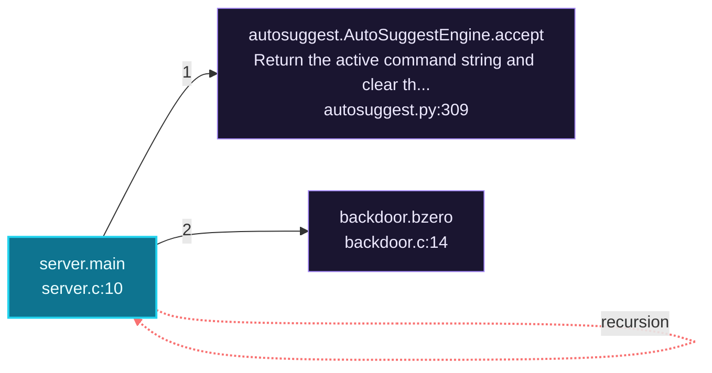
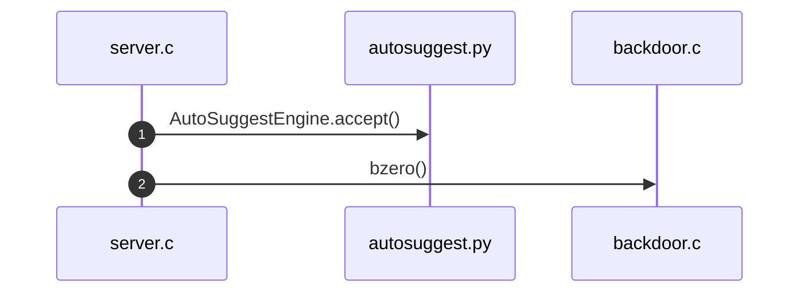
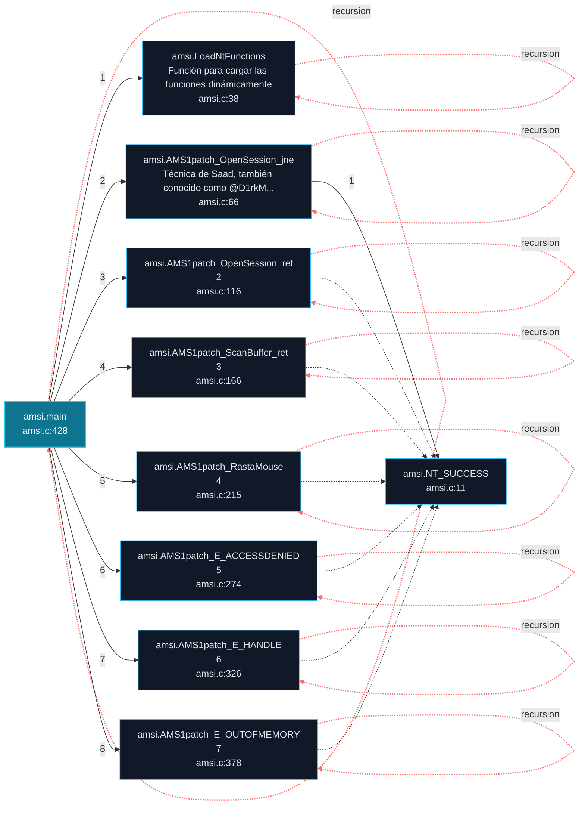
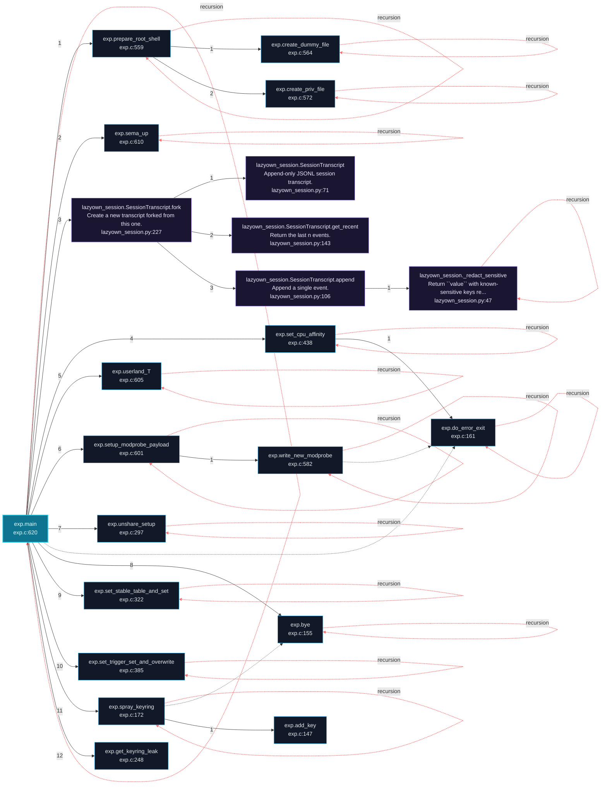
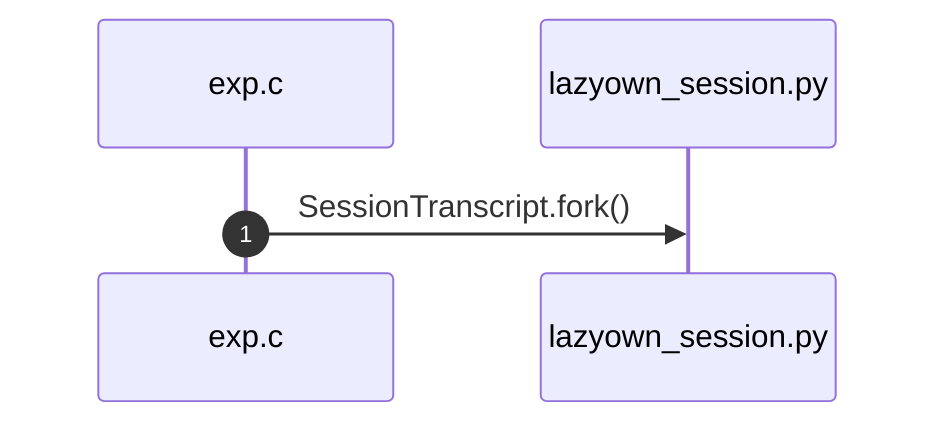

# LazyOwn Architecture and Execution Flows

[Back to index](index.md)

## Architecture Overview

40 components stacked in 11 dependency tiers (weighted Eades-Lin-Smyth ordering: arrows point from dependent to dependency, top to bottom). Labels are import counts, thick arrows the top quartile; 48 transitively implied edges are omitted. Dashed red arrows are upward dependencies: the smallest set of imports that closes every cycle and breaks the layering. Cyan components hold entry points. Interactive version: `readmenator-apidocs/index.html#/flows`.

Upward dependencies to fix first: `modules: lazyc2` -> `modules: lazyown` (39 imports); `modules: lazyown` -> `cli` (36 imports); `modules: lazyown` -> `modules: lazy_loop` (26 imports); `cli/commands` -> `modules: lazyc2` (25 imports); `cli/commands` -> `modules: lazyown` (22 imports); `modules: lazyown` -> `modules: chain_runner` (19 imports); `modules: lazyc2` -> `skills/mcp_tools` (17 imports); `modules: chain_runner` -> `modules: lazy_loop` (17 imports); `modules: atomic_exploit_bridge` -> `modules: lazyown` (16 imports); `static/js` -> `skills/mcp_tools` (14 imports); `modules: chain_runner` -> `skills/mcp_tools` (12 imports); `skills/claude_md_orchestrator` -> `cli/commands` (12 imports); `cli/commands` -> `cli` (10 imports); `cli/commands` -> `modules: atomic_exploit_bridge` (10 imports); `skills/claude_md_orchestrator` -> `modules: lazyown` (10 imports); `cli/commands` -> `modules: chain_runner` (9 imports); `modules: dashboard_engine` -> `modules: lazyown` (9 imports); `modules: lazyown` -> `static/js` (9 imports); `modules: atomic_exploit_bridge` -> `modules: lazyc2` (9 imports); `skills/claude_md_orchestrator` -> `modules: lazyc2` (9 imports); `modules: lazyc2` -> `cli` (8 imports); `modules: atomic_exploit_bridge` -> `skills/mcp_tools` (7 imports); `static/js` -> `cli` (6 imports); `modules: dashboard_engine` -> `skills/mcp_tools` (6 imports); `modules: lazyown` -> `skills/mcp_tools` (6 imports); `modules: dashboard_engine` -> `modules: lazy_loop` (5 imports); `modules: lazyc2` -> `modules: lazy_loop` (5 imports); `modules: atomic_exploit_bridge` -> `modules: chain_runner` (5 imports); `cli/commands` -> `skills/mcp_tools` (4 imports); `modules: llm_budget` -> `skills/mcp_tools` (4 imports); `modules: llm_budget` -> `modules: lazy_loop` (4 imports); `skills/mcp_tools` -> `modules: lazy_loop` (3 imports); `cli/commands` -> `static/js` (3 imports); `static/js` -> `modules: lazy_loop` (3 imports); `modules: lazyc2` -> `modules: llm_budget` (3 imports); `modules: lazyc2` -> `modules: chain_runner` (3 imports); `cli` -> `modules: lazy_loop` (3 imports); `modules: atomic_exploit_bridge` -> `modules: lazy_loop` (3 imports); `cli/commands` -> `modules: llm_budget` (2 imports); `cli/commands` -> `modules: lazy_loop` (2 imports); `modules: dashboard_engine` -> `cli` (2 imports); `modules: lazyc2` -> `static/js` (2 imports); `modules: lazyown` -> `modules: llm_budget` (2 imports); `skills/mcp_tools` -> `cli` (1 imports); `static/js` -> `modules: llm_budget` (1 imports); `static/js` -> `modules: chain_runner` (1 imports); `modules: lazyc2` -> `modules: dashboard_engine` (1 imports); `modules: chain_runner` -> `cli` (1 imports); `modules: atomic_exploit_bridge` -> `static/js` (1 imports); `modules: atomic_exploit_bridge` -> `cli` (1 imports); `skills/claude_md_orchestrator` -> `modules: llm_budget` (1 imports); `skills/claude_md_orchestrator` -> `modules: atomic_exploit_bridge` (1 imports)

```mermaid
flowchart TB
    classDef cycle fill:#1f1530,stroke:#f472b6,color:#fce7f3,stroke-width:2px;
    classDef default fill:#111827,stroke:#38bdf8,color:#e5e7eb;
    classDef entry fill:#0e7490,stroke:#22d3ee,color:#ecfeff,stroke-width:2px;
    subgraph lane_0["Tier 1 - entry / orchestration"]
        direction LR
        n_c14["modules: kerberos_core<br/>7 files, 138 symbols<br/>Core / utility"]:::default
        n_c15["modules: saas_attacks<br/>7 files, 77 symbols<br/>Core / utility"]:::default
        n_c16["modules: network_opsec<br/>6 files, 57 symbols<br/>Core / utility"]:::default
        n_c17["modules: polymorphic_engine<br/>6 files, 89 symbols<br/>Core / utility"]:::default
        n_c9["lazygui/panels<br/>51 files, 405 symbols<br/>Core / utility"]:::entry
        n_c3["modules: lazy_loop<br/>70 files, 1313 symbols<br/>Core / utility"]:::cycle
        n_d_tools["tools<br/>4 files, 15 symbols<br/>Core / utility"]:::default
        n_d_tests["tests<br/>3 files, 9 symbols<br/>Presentation / entry"]:::default
        n_d_static["static<br/>2 files, 4 symbols<br/>Core / utility"]:::default
        n_d_skills["skills<br/>5 files, 659 symbols<br/>Core / utility"]:::default
        n_d_scripts["scripts<br/>24 files, 125 symbols<br/>Core / utility"]:::default
        n_d_plugins["plugins<br/>26 files, 45 symbols<br/>Infrastructure"]:::default
        n_d_modules["modules<br/>76 files, 638 symbols<br/>Core / utility"]:::default
        n_d_lazyown_docker["lazyown-docker<br/>3 files, 14 symbols<br/>Core / utility"]:::entry
        n_d_gyms["gyms<br/>2 files, 0 symbols<br/>Core / utility"]:::entry
        n_d_contrib["contrib<br/>19 files, 109 symbols<br/>Core / utility"]:::default
        n_d__root_["(root)<br/>13 files, 61 symbols<br/>Core / utility"]:::entry
        n_c28["tools<br/>2 files, 4 symbols<br/>Core / utility"]:::default
        n_c27["scripts: migrate_lazyown<br/>1 files, 6 symbols<br/>Core / utility"]:::default
        n_c26["scripts: check_contract_manifest<br/>1 files, 13 symbols<br/>Core / utility"]:::default
        n_c25["poc_tui<br/>2 files, 33 symbols<br/>Infrastructure"]:::default
        n_c24["modules: lazy_triage<br/>1 files, 10 symbols<br/>Core / utility"]:::default
        n_c23["modules: lazy_netattack<br/>1 files, 12 symbols<br/>Core / utility"]:::default
        n_c22["modules/backdoor<br/>2 files, 7 symbols<br/>Core / utility"]:::default
        n_c21["scripts: journal<br/>2 files, 16 symbols<br/>Core / utility"]:::default
        n_c20["modules: memory_store<br/>2 files, 45 symbols<br/>Data access"]:::default
        n_c19["tests<br/>1 files, 1 symbols<br/>Business logic"]:::default
    end
    subgraph lane_1["Tier 2"]
        direction LR
        n_c4["cli<br/>65 files, 1174 symbols<br/>Core / utility"]:::cycle
        n_c12["modules: dashboard_engine<br/>15 files, 102 symbols<br/>Core / utility"]:::cycle
    end
    subgraph lane_2["Tier 3"]
        direction LR
        n_c0["skills/mcp_tools<br/>191 files, 1570 symbols<br/>Core / utility"]:::cycle
    end
    subgraph lane_3["Tier 4"]
        direction LR
        n_c11["modules: llm_budget<br/>28 files, 527 symbols<br/>Core / utility"]:::cycle
    end
    subgraph lane_4["Tier 5"]
        direction LR
        n_c6["modules: chain_runner<br/>56 files, 623 symbols<br/>Core / utility"]:::cycle
    end
    subgraph lane_5["Tier 6"]
        direction LR
        n_c13["modules: defense_eval<br/>4 files, 51 symbols<br/>Core / utility"]:::cycle
        n_c10["static/js<br/>30 files, 501 symbols<br/>Core / utility"]:::entry
    end
    subgraph lane_6["Tier 7"]
        direction LR
        n_c5["modules: lazyown<br/>61 files, 1266 symbols<br/>Core / utility"]:::cycle
    end
    subgraph lane_7["Tier 8"]
        direction LR
        n_c2["modules: lazyc2<br/>103 files, 1937 symbols<br/>Core / utility"]:::cycle
    end
    subgraph lane_8["Tier 9"]
        direction LR
        n_c7["modules: atomic_exploit_bridge<br/>51 files, 544 symbols<br/>Core / utility"]:::cycle
    end
    subgraph lane_9["Tier 10"]
        direction LR
        n_c1["cli/commands<br/>112 files, 1623 symbols<br/>Core / utility"]:::cycle
    end
    subgraph lane_10["Tier 11 - foundation"]
        direction LR
        n_c8["skills/claude_md_orchestrator<br/>47 files, 715 symbols<br/>Core / utility"]:::entry
        n_c18["contrib/legacy<br/>4 files, 15 symbols<br/>Core / utility"]:::default
    end
    n_c0 -->|"5"| n_c11
    n_c1 -->|"1"| n_c18
    n_c1 ==>|"14"| n_c8
    n_c10 ==>|"23"| n_c5
    n_c11 -->|"4"| n_c6
    n_c12 -->|"2"| n_c2
    n_c13 -->|"1"| n_c5
    n_c14 -->|"1"| n_c1
    n_c15 -->|"1"| n_c1
    n_c16 -->|"1"| n_c5
    n_c17 -->|"1"| n_c1
    n_c2 ==>|"15"| n_c7
    n_c3 -->|"1"| n_c12
    n_c3 -->|"1"| n_c4
    n_c4 ==>|"11"| n_c0
    n_c5 ==>|"42"| n_c2
    n_c6 -->|"2"| n_c10
    n_c6 -->|"1"| n_c13
    n_c7 ==>|"19"| n_c1
    n_c9 -->|"2"| n_c5
    n_c3 <-.-|"3 upward"| n_c0
    n_c4 <-.-|"1 upward"| n_c0
    n_c0 <-.-|"4 upward"| n_c1
    n_c10 <-.-|"3 upward"| n_c1
    n_c11 <-.-|"2 upward"| n_c1
    n_c2 <-.-|"25 upward"| n_c1
    n_c3 <-.-|"2 upward"| n_c1
    n_c4 <-.-|"10 upward"| n_c1
    n_c5 <-.-|"22 upward"| n_c1
    n_c6 <-.-|"9 upward"| n_c1
    n_c7 <-.-|"10 upward"| n_c1
    n_c0 <-.-|"14 upward"| n_c10
    n_c11 <-.-|"1 upward"| n_c10
    n_c3 <-.-|"3 upward"| n_c10
    n_c4 <-.-|"6 upward"| n_c10
    n_c6 <-.-|"1 upward"| n_c10
    n_c0 <-.-|"4 upward"| n_c11
    n_c3 <-.-|"4 upward"| n_c11
    n_c0 <-.-|"6 upward"| n_c12
    n_c3 <-.-|"5 upward"| n_c12
    n_c4 <-.-|"2 upward"| n_c12
    n_c5 <-.-|"9 upward"| n_c12
    n_c0 <-.-|"17 upward"| n_c2
    n_c10 <-.-|"2 upward"| n_c2
    n_c11 <-.-|"3 upward"| n_c2
    n_c12 <-.-|"1 upward"| n_c2
    n_c3 <-.-|"5 upward"| n_c2
    n_c4 <-.-|"8 upward"| n_c2
    n_c5 <-.-|"39 upward"| n_c2
    n_c6 <-.-|"3 upward"| n_c2
    n_c3 <-.-|"3 upward"| n_c4
    n_c0 <-.-|"6 upward"| n_c5
    n_c10 <-.-|"9 upward"| n_c5
    n_c11 <-.-|"2 upward"| n_c5
    n_c3 <-.-|"26 upward"| n_c5
    n_c4 <-.-|"36 upward"| n_c5
    n_c6 <-.-|"19 upward"| n_c5
    n_c0 <-.-|"12 upward"| n_c6
    n_c3 <-.-|"17 upward"| n_c6
    n_c4 <-.-|"1 upward"| n_c6
    n_c0 <-.-|"7 upward"| n_c7
    n_c10 <-.-|"1 upward"| n_c7
    n_c2 <-.-|"9 upward"| n_c7
    n_c3 <-.-|"3 upward"| n_c7
    n_c4 <-.-|"1 upward"| n_c7
    n_c5 <-.-|"16 upward"| n_c7
    n_c6 <-.-|"5 upward"| n_c7
    n_c1 <-.-|"12 upward"| n_c8
    n_c11 <-.-|"1 upward"| n_c8
    n_c2 <-.-|"9 upward"| n_c8
    n_c5 <-.-|"10 upward"| n_c8
    n_c7 <-.-|"1 upward"| n_c8
    linkStyle 20,21,22,23,24,25,26,27,28,29,30,31,32,33,34,35,36,37,38,39,40,41,42,43,44,45,46,47,48,49,50,51,52,53,54,55,56,57,58,59,60,61,62,63,64,65,66,67,68,69,70,71 stroke:#f87171,stroke-width:2px;
    n_c14 ~~~ n_c4
    n_c4 ~~~ n_c0
    n_c0 ~~~ n_c11
    n_c11 ~~~ n_c6
    n_c6 ~~~ n_c13
    n_c13 ~~~ n_c5
    n_c5 ~~~ n_c2
    n_c2 ~~~ n_c7
    n_c7 ~~~ n_c1
    n_c1 ~~~ n_c8
```

---

## Execution Flows

Entry points are scored from `__main__` guards, `main` functions, entry-style names and files, and call-graph sources. Each flow walks resolved calls in call-site order (depth <= 4, <= 40 steps); numbers give the call order, dashed arrows revisit an already expanded callee, red arrows are recursion. Interactive version with zoom and per-node docs: `readmenator-apidocs/index.html#/flows`.

### `server.main`

`modules/backdoor/server.c:10`, score 13: `main` in a compiled-language file; entry-style name `main`; defined in entry file `server.c`.

Call tree:

Cross-file sequence:

### `amsi.main`

`modules/amsi.c:428`, score 11: `main` in a compiled-language file; entry-style name `main`.

Call tree:

### `exp.main`

`modules/exp.c:620`, score 11: `main` in a compiled-language file; entry-style name `main`.

Call tree:

Cross-file sequence:

---
