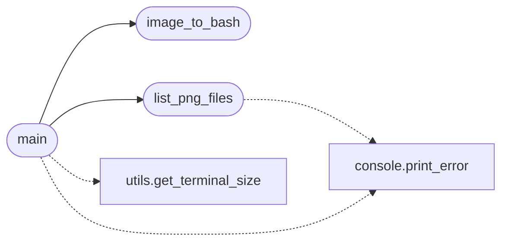

# `banner`

> Source: [banner.py:1](../../banner.py#L1) | language `py` | coverage 25.0% | [API index](../index.md)

banner.py

Autor: Gris Iscomeback
Correo electrónico: grisiscomeback[at]gmail[dot]com
Fecha de creación: 09/06/2024
Licencia: GPL v3

Descripción: Este archivo contiene la definición
de la lógica banners de la aplicaciòn LazyOwn RedTeam Framework

██╗      █████╗ ███████╗██╗   ██╗ ██████╗ ██╗    ██╗███╗   ██╗
██║     ██╔══██╗╚══███╔╝╚██╗ ██╔╝██╔═══██╗██║    ██║████╗  ██║
██║     ███████║  ███╔╝  ╚████╔╝ ██║   ██║██║ █╗ ██║██╔██╗ ██║
██║     ██╔══██║ ███╔╝    ╚██╔╝  ██║   ██║██║███╗██║██║╚██╗██║
███████╗██║  ██║███████╗   ██║   ╚██████╔╝╚███╔███╔╝██║ ╚████║
╚══════╝╚═╝  ╚═╝╚══════╝   ╚═╝    ╚═════╝  ╚══╝╚══╝ ╚═╝  ╚═══╝

## Contents

- **Functions:** [`image_to_bash`](#image_to_bash), [`list_png_files`](#list_png_files), [`main`](#main)
- **Constants:** [`ANSI_COLOR_TEMPLATE`](#ansi_color_template)

## Call Graph

Solid arrows stay in this module, dashed arrows leave it.



## Functions

<a id="image_to_bash"></a>

### `image_to_bash`

`function` | [banner.py:26](../../banner.py#L26)

```python
def image_to_bash(image_path, image_res)
```

**Parameters**

| Name | Type | Default | Description |
|---|---|---|---|
| `image_path` |  |  |  |
| `image_res` |  |  |  |

*Called by:* [`main`](#main)

---

<a id="list_png_files"></a>

### `list_png_files`

`function` | [banner.py:50](../../banner.py#L50)

```python
def list_png_files()
```

*Calls:* [`print_error`](core.console.py.md#print_error)

*Called by:* [`main`](#main)

---

<a id="main"></a>

### `main`

`function` | [banner.py:60](../../banner.py#L60)

```python
def main()
```

*Calls:* [`image_to_bash`](#image_to_bash), [`list_png_files`](#list_png_files), [`print_error`](core.console.py.md#print_error), [`get_terminal_size`](utils.py.md#get_terminal_size)

---

## Constants

<a id="ansi_color_template"></a>

### `ANSI_COLOR_TEMPLATE`

`constant` | [banner.py:23](../../banner.py#L23)

```python
ANSI_COLOR_TEMPLATE = '\x1b[48;2;{r};{g};{b}m  \x1b[0m'
```

---
