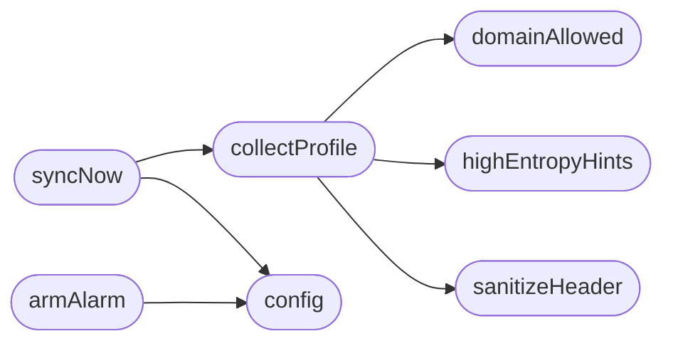

# `browser_sync_extension/background.js`

> Source: [browser_sync_extension/background.js:1](../../browser_sync_extension/background.js#L1) | language `js` | coverage 0.0% | [API index](../index.md)

## Contents

- **Functions:** [`config`](#config), [`domainAllowed`](#domainallowed), [`highEntropyHints`](#highentropyhints), [`sanitizeHeader`](#sanitizeheader), [`collectProfile`](#collectprofile), [`syncNow`](#syncnow), [`armAlarm`](#armalarm)

## Call Graph

Solid arrows stay in this module, dashed arrows leave it.



## Functions

<a id="config"></a>

### `config`

`function` `async` | [browser_sync_extension/background.js:8](../../browser_sync_extension/background.js#L8)

```javascript
async function config()
```

*Called by:* [`armAlarm`](#armalarm), [`syncNow`](#syncnow)

---

<a id="domainallowed"></a>

### `domainAllowed`

`function` | [browser_sync_extension/background.js:18](../../browser_sync_extension/background.js#L18)

```javascript
function domainAllowed(domain, filter)
```

**Parameters**

| Name | Type | Default | Description |
|---|---|---|---|
| `domain` |  |  |  |
| `filter` |  |  |  |

*Called by:* [`collectProfile`](#collectprofile)

---

<a id="highentropyhints"></a>

### `highEntropyHints`

`function` `async` | [browser_sync_extension/background.js:30](../../browser_sync_extension/background.js#L30)

```javascript
async function highEntropyHints()
```

*Called by:* [`collectProfile`](#collectprofile)

---

<a id="sanitizeheader"></a>

### `sanitizeHeader`

`function` | [browser_sync_extension/background.js:64](../../browser_sync_extension/background.js#L64)

```javascript
function sanitizeHeader(value)
```

**Parameters**

| Name | Type | Default | Description |
|---|---|---|---|
| `value` |  |  |  |

*Called by:* [`collectProfile`](#collectprofile)

---

<a id="collectprofile"></a>

### `collectProfile`

`function` `async` | [browser_sync_extension/background.js:68](../../browser_sync_extension/background.js#L68)

```javascript
async function collectProfile(filter)
```

**Parameters**

| Name | Type | Default | Description |
|---|---|---|---|
| `filter` |  |  |  |

*Calls:* [`domainAllowed`](#domainallowed), [`highEntropyHints`](#highentropyhints), [`sanitizeHeader`](#sanitizeheader)

*Called by:* [`syncNow`](#syncnow)

---

<a id="syncnow"></a>

### `syncNow`

`function` `async` | [browser_sync_extension/background.js:94](../../browser_sync_extension/background.js#L94)

```javascript
async function syncNow()
```

*Calls:* [`collectProfile`](#collectprofile), [`config`](#config)

---

<a id="armalarm"></a>

### `armAlarm`

`function` `async` | [browser_sync_extension/background.js:123](../../browser_sync_extension/background.js#L123)

```javascript
async function armAlarm()
```

*Calls:* [`config`](#config)

---
