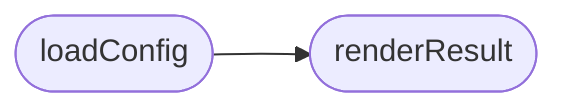

# `browser_sync_extension/popup.js`

> Source: [browser_sync_extension/popup.js:1](../../browser_sync_extension/popup.js#L1) | language `js` | coverage 0.0% | [API index](../index.md)

## Contents

- **Functions:** [`loadConfig`](#loadconfig), [`renderResult`](#renderresult)

## Call Graph

Solid arrows stay in this module, dashed arrows leave it.



## Functions

<a id="loadconfig"></a>

### `loadConfig`

`function` `async` | [browser_sync_extension/popup.js:4](../../browser_sync_extension/popup.js#L4)

```javascript
async function loadConfig()
```

*Calls:* [`renderResult`](#renderresult)

---

<a id="renderresult"></a>

### `renderResult`

`function` | [browser_sync_extension/popup.js:13](../../browser_sync_extension/popup.js#L13)

```javascript
function renderResult(result)
```

**Parameters**

| Name | Type | Default | Description |
|---|---|---|---|
| `result` |  |  |  |

*Called by:* [`loadConfig`](#loadconfig)

---
