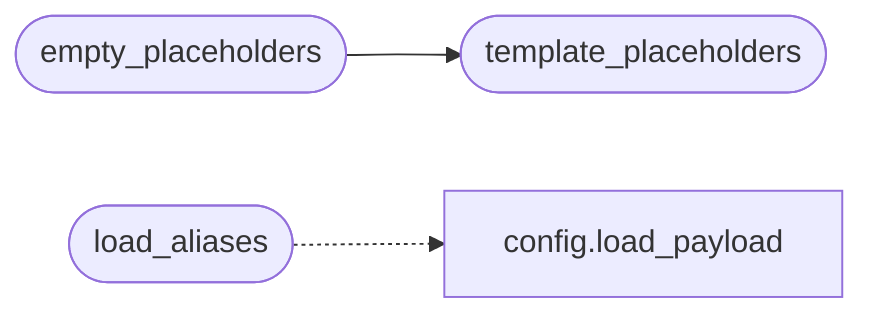

# `cli.aliases`

> Source: [cli/aliases.py:1](../../cli/aliases.py#L1) | language `py` | coverage 100.0% | [API index](../index.md)

Declarative cmd2 alias loader.

Reads ``cli/aliases.yaml`` and substitutes ``{name}`` placeholders against a
payload dict (typically loaded from ``payload.json``). Missing keys substitute
to an empty string so a partially configured shell still loads every alias.

Usage::

    from core.config import load_payload
    from cli.aliases import load_aliases

    aliases = load_aliases(load_payload())
    self.aliases.update(aliases)

## Contents

- **Functions:** [`template_placeholders`](#template_placeholders), [`empty_placeholders`](#empty_placeholders), [`load_aliases`](#load_aliases)
- **Constants:** [`ALIASES_PATH`](#aliases_path), [`REQUIRED_PLACEHOLDERS`](#required_placeholders)

## Call Graph

Solid arrows stay in this module, dashed arrows leave it.



## Functions

<a id="template_placeholders"></a>

### `template_placeholders`

`function` | [cli/aliases.py:56](../../cli/aliases.py#L56)

```python
def template_placeholders(template: str) -> set[str]
```

Return the ``{name}`` placeholders referenced by ``template``.

Malformed templates (unbalanced braces from legacy strings) yield an
empty set — the same fail-safe spirit as `_substitute`.

**Parameters**

| Name | Type | Default | Description |
|---|---|---|---|
| `template` | `str` |  |  |

**Returns:** `set[str]`

*Called by:* [`empty_placeholders`](#empty_placeholders)

---

<a id="empty_placeholders"></a>

### `empty_placeholders`

`function` | [cli/aliases.py:72](../../cli/aliases.py#L72)

```python
def empty_placeholders(template: str, context: dict[str, Any]) -> list[str]
```

Return placeholders whose rendered value against ``context`` is empty.

**Parameters**

| Name | Type | Default | Description |
|---|---|---|---|
| `template` | `str` |  |  |
| `context` | `dict[str, Any]` |  |  |

**Returns:** `list[str]`

*Calls:* [`template_placeholders`](#template_placeholders)

---

<a id="load_aliases"></a>

### `load_aliases`

`function` | [cli/aliases.py:77](../../cli/aliases.py#L77)

```python
def load_aliases(payload: dict[str, Any] | None = None, path: Path = ALIASES_PATH, lazy: bool = True) -> dict[str, str]
```

Return the cmd2 alias map.

**Parameters**

| Name | Type | Default | Description |
|---|---|---|---|
| `payload` | `dict[str, Any] \| None` | `None` | Configuration dict for placeholder substitution. Used only when ``lazy=False``. If ``None`` the function reads ``payload.json`` lazily so callers don't have to import [`core.config`](core.config.py.md) themselves. |
| `path` | `Path` | `ALIASES_PATH` | Override the YAML location (used by tests). |
| `lazy` | `bool` | `True` | When ``True`` (default), preserve ``{name}`` placeholders so `[`LazyOwnShell.onecmd_plus_hooks`](lazyown.py.md#lazyownshell-onecmd_plus_hooks)` can re-render them against the *current* params at execution time — meaning ``set rhost X`` instantly updates every alias that references ``{rhost}``. Pass ``lazy=False`` for the legacy snapshot behaviour. |

**Returns:** `dict[str, str]` - Flat ``{name: command}`` dict suitable for ``self.aliases.update(...)``.

**Raises**

- `FileNotFoundError`: ``path`` does not exist.
- `yaml.YAMLError`: file is malformed YAML.
- `TypeError`: top-level YAML is not a mapping.
- `ValueError`: a key or value has the wrong type.

*Calls:* [`load_payload`](core.config.py.md#load_payload)

---

## Constants

<a id="aliases_path"></a>

### `ALIASES_PATH`

`constant` | [cli/aliases.py:24](../../cli/aliases.py#L24)

```python
ALIASES_PATH = Path(__file__).resolve().parent / 'aliases.yaml'
```

---

<a id="required_placeholders"></a>

### `REQUIRED_PLACEHOLDERS`

`constant` | [cli/aliases.py:26](../../cli/aliases.py#L26)

```python
REQUIRED_PLACEHOLDERS = frozenset({'rhost', 'lhost', 'lport'})
```

---
