# `cli.apt_chain_support`

> Source: [cli/apt_chain_support.py:1](../../cli/apt_chain_support.py#L1) | language `py` | coverage 100.0% | [API index](../index.md)

Parsing, printing and replanning support for the ``apt_chain`` CLI.

Keeps `[`cli.commands.command_and_control_migrated`](cli.commands.command_and_control_migrated.py.md)` thin: argument
parsing, step selection, checkpoint/resume wiring, result rendering and
the reactive replanner live here. Options are parsed manually so any
unknown flag fails loudly instead of being silently swallowed.

## Contents

- **Classes:** [`ChainArgs`](#chainargs)
- **Functions:** [`parse_chain_args`](#parse_chain_args), [`resolve_invocation`](#resolve_invocation), [`resolve_admin`](#resolve_admin), [`select_step_ids`](#select_step_ids), [`render_result`](#render_result), [`render_admin`](#render_admin), [`build_cli_approver`](#build_cli_approver), [`build_adaptive_replanner`](#build_adaptive_replanner), [`compose_replanners`](#compose_replanners), [`build_reactive_replanner`](#build_reactive_replanner), [`build_llm_recovery_chain`](#build_llm_recovery_chain)

## Call Graph

Solid arrows stay in this module, dashed arrows leave it.

```mermaid
flowchart LR
    n_cli_apt_chain_support_py__parse_chain_args(["parse_chain_args"])
    n_cli_apt_chain_support_py__ChainArgs(["ChainArgs"])
    n_cli_apt_chain_support_py__resolve_admin(["resolve_admin"])
    n_modules_chain_approval_py__PendingStore___init__["chain_approval.PendingStore.__init__"]
    n_modules_chain_approval_py__PendingStore_decide["chain_approval.PendingStore.decide"]
    n_modules_chain_approval_py__PendingStore_expire_stale["chain_approval.PendingStore.expire_stale"]
    n_modules_chain_family_py__default_registry["chain_family.default_registry"]
    n_modules_chain_family_py__family_signature["chain_family.family_signature"]
    n_modules_chain_registry_py__scan_all["chain_registry.scan_all"]
    n_modules_chain_registry_py__set_enabled["chain_registry.set_enabled"]
    n_modules_chain_registry_py__validate_chain["chain_registry.validate_chain"]
    n_modules_chain_state_py__list_checkpoints["chain_state.list_checkpoints"]
    n_modules_chain_synth_py__facts_for_target["chain_synth.facts_for_target"]
    n_modules_chain_synth_py__synth_chain_data["chain_synth.synth_chain_data"]
    n_modules_chain_synth_py__write_generated_chain["chain_synth.write_generated_chain"]
    n_cli_apt_chain_support_py__render_result(["render_result"])
    n_modules_failure_verdict_py__classify_outcome["failure_verdict.classify_outcome"]
    n_cli_apt_chain_support_py__build_adaptive_replanner(["build_adaptive_replanner"])
    n_modules_chain_runner_py__ReplanContext_insert_step["chain_runner.ReplanContext.insert_step"]
    n_modules_lazy_fallback_py__AdaptiveFallbackArbiter___init__["lazy_fallback.AdaptiveFallbackArbiter.__init__"]
    n_cli_apt_chain_support_py__build_reactive_replanner(["build_reactive_replanner"])
    n_modules_reactive_engine_py__get_engine["reactive_engine.get_engine"]
    n_cli_apt_chain_support_py__build_llm_recovery_chain(["build_llm_recovery_chain"])
    n_modules_chain_registry_py__Chain["chain_registry.Chain"]
    n_modules_chain_registry_py__Chain_resolve["chain_registry.Chain.resolve"]
    n_modules_chain_registry_py__ChainStep["chain_registry.ChainStep"]
    n_modules_guardrails_harness_py__global_harness["harness.global_harness"]
    n_cli_apt_chain_support_py__parse_chain_args --> n_cli_apt_chain_support_py__ChainArgs
    n_cli_apt_chain_support_py__resolve_admin -.-> n_modules_chain_approval_py__PendingStore___init__
    n_cli_apt_chain_support_py__resolve_admin -.-> n_modules_chain_approval_py__PendingStore_decide
    n_cli_apt_chain_support_py__resolve_admin -.-> n_modules_chain_approval_py__PendingStore_expire_stale
    n_cli_apt_chain_support_py__resolve_admin -.-> n_modules_chain_family_py__default_registry
    n_cli_apt_chain_support_py__resolve_admin -.-> n_modules_chain_family_py__family_signature
    n_cli_apt_chain_support_py__resolve_admin -.-> n_modules_chain_registry_py__scan_all
    n_cli_apt_chain_support_py__resolve_admin -.-> n_modules_chain_registry_py__set_enabled
    n_cli_apt_chain_support_py__resolve_admin -.-> n_modules_chain_registry_py__validate_chain
    n_cli_apt_chain_support_py__resolve_admin -.-> n_modules_chain_state_py__list_checkpoints
    n_cli_apt_chain_support_py__resolve_admin -.-> n_modules_chain_synth_py__facts_for_target
    n_cli_apt_chain_support_py__resolve_admin -.-> n_modules_chain_synth_py__synth_chain_data
    n_cli_apt_chain_support_py__resolve_admin -.-> n_modules_chain_synth_py__write_generated_chain
    n_cli_apt_chain_support_py__render_result -.-> n_modules_failure_verdict_py__classify_outcome
    n_cli_apt_chain_support_py__build_adaptive_replanner -.-> n_modules_chain_runner_py__ReplanContext_insert_step
    n_cli_apt_chain_support_py__build_adaptive_replanner -.-> n_modules_failure_verdict_py__classify_outcome
    n_cli_apt_chain_support_py__build_adaptive_replanner -.-> n_modules_lazy_fallback_py__AdaptiveFallbackArbiter___init__
    n_cli_apt_chain_support_py__build_reactive_replanner -.-> n_modules_chain_runner_py__ReplanContext_insert_step
    n_cli_apt_chain_support_py__build_reactive_replanner -.-> n_modules_reactive_engine_py__get_engine
    n_cli_apt_chain_support_py__build_llm_recovery_chain -.-> n_modules_chain_registry_py__Chain
    n_cli_apt_chain_support_py__build_llm_recovery_chain -.-> n_modules_chain_registry_py__Chain_resolve
    n_cli_apt_chain_support_py__build_llm_recovery_chain -.-> n_modules_chain_registry_py__ChainStep
    n_cli_apt_chain_support_py__build_llm_recovery_chain -.-> n_modules_guardrails_harness_py__global_harness
```



## Classes

<a id="chainargs"></a>

### `ChainArgs`

`class` `dataclass` | [cli/apt_chain_support.py:88](../../cli/apt_chain_support.py#L88)

Decorators: `@dataclass`

```python
class ChainArgs
```

Parsed ``apt_chain`` invocation.

**Attributes**

| Name | Type | Default | Description |
|---|---|---|---|
| [`admin_action`](#chainargs-admin_action) | `str` | `''` |  |
| [`admin_args`](#chainargs-admin_args) | `list[str]` | `field(default_factory=list)` |  |
| [`positional`](#chainargs-positional) | `list[str]` | `field(default_factory=list)` |  |
| [`dry_run`](#chainargs-dry_run) | `bool` | `False` |  |
| [`json_out`](#chainargs-json_out) | `bool` | `False` |  |
| [`continue_all`](#chainargs-continue_all) | `bool` | `False` |  |
| [`replan`](#chainargs-replan) | `bool` | `False` |  |
| [`adaptive`](#chainargs-adaptive) | `bool` | `False` |  |
| [`no_checkpoint`](#chainargs-no_checkpoint) | `bool` | `False` |  |
| [`target`](#chainargs-target) | `str` | `''` |  |
| [`timeout`](#chainargs-timeout) | `float` | `0.0` |  |
| [`limit`](#chainargs-limit) | `int` | `0` |  |
| [`vars`](#chainargs-vars) | `dict[str, str]` | `field(default_factory=dict)` |  |
| [`step_ids`](#chainargs-step_ids) | `list[str]` | `field(default_factory=list)` |  |
| [`from_step`](#chainargs-from_step) | `str` | `''` |  |
| [`to_step`](#chainargs-to_step) | `str` | `''` |  |
| [`resume_run_id`](#chainargs-resume_run_id) | `str` | `''` |  |
| [`playbook`](#chainargs-playbook) | `str` | `''` |  |
| [`chain_override`](#chainargs-chain_override) | `str` | `''` |  |
| [`techniques`](#chainargs-techniques) | `list[str]` | `field(default_factory=list)` |  |
| [`errors`](#chainargs-errors) | `list[str]` | `field(default_factory=list)` |  |

---

## Functions

<a id="parse_chain_args"></a>

### `parse_chain_args`

`function` | [cli/apt_chain_support.py:114](../../cli/apt_chain_support.py#L114)

```python
def parse_chain_args(line: str) -> ChainArgs
```

Parse one ``apt_chain`` command line into structured args.

Unknown dash-flags become errors: the old silent-swallow behavior
hid operator intent and is gone.

**Parameters**

| Name | Type | Default | Description |
|---|---|---|---|
| `line` | `str` |  |  |

**Returns:** `ChainArgs`

*Calls:* [`ChainArgs`](#chainargs)

*Called by:* [`CommandAndControlMigratedCommandSet.do_apt_chain`](cli.commands.command_and_control_migrated.py.md#commandandcontrolmigratedcommandset-do_apt_chain), [`parse_chain_invocation`](modules.chain_loop.py.md#parse_chain_invocation)

---

<a id="resolve_invocation"></a>

### `resolve_invocation`

`function` | [cli/apt_chain_support.py:234](../../cli/apt_chain_support.py#L234)

```python
def resolve_invocation(positionals: list[str], target_seed: str = '', preset_target: str = '', playbook_engine: Any = None, playbook_seed: str = '', policy: str = 'strict') -> tuple[str, str, str, str]
```

Classify positional tokens into chain, target and playbook override.

Single classification shared by the ``apt_chain`` CLI command and the
loop stepwise adapter. Both surfaces share one classification table
(chain file, target-shaped token, known playbook, ``apt_<name>``
fallback) while keeping their two codified policies:

- ``strict`` (CLI): a chain must exist as a file; bare tokens are
  targets when they parse as hosts, playbook names otherwise.
- ``lenient`` (loop): the first positional is always the chain name
  unless it is an address and no target is known; later tokens only
  supply the target (first match wins).

**Parameters**

| Name | Type | Default | Description |
|---|---|---|---|
| `positionals` | `list[str]` |  | Free tokens left after flag parsing. |
| `target_seed` | `str` | `''` | Fallback target (``rhost``); a positional target replaces it when ``--target`` is not preset. |
| `preset_target` | `str` | `''` | ``--target`` flag value; suppresses positional target capture. |
| `playbook_engine` | `Any` | `None` | AptPlaybookEngine (or None) for playbook lookup. |
| `playbook_seed` | `str` | `''` | ``--playbook`` flag value; kept unless a positional token resolves to a playbook override first. |
| `policy` | `str` | `'strict'` | ``strict`` (CLI rules) or ``lenient`` (loop rules). |

**Returns:** `tuple[str, str, str, str]` - ``(chain_name, target, playbook_override, disabled_chain)``.
``disabled_chain`` is a strict-policy name whose YAML exists but
is disabled; callers decide the UX (the CLI warns and stops).

*Called by:* [`CommandAndControlMigratedCommandSet.do_apt_chain`](cli.commands.command_and_control_migrated.py.md#commandandcontrolmigratedcommandset-do_apt_chain), [`parse_chain_invocation`](modules.chain_loop.py.md#parse_chain_invocation)

---

<a id="resolve_admin"></a>

### `resolve_admin`

`function` | [cli/apt_chain_support.py:322](../../cli/apt_chain_support.py#L322)

```python
def resolve_admin(args: ChainArgs) -> dict[str, Any]
```

Execute an admin action against the registry and checkpoint store.

**Parameters**

| Name | Type | Default | Description |
|---|---|---|---|
| `args` | `ChainArgs` |  |  |

**Returns:** `dict[str, Any]`

*Calls:* [`PendingStore.__init__`](modules.chain_approval.py.md#pendingstore-__init__), [`PendingStore.decide`](modules.chain_approval.py.md#pendingstore-decide), [`PendingStore.expire_stale`](modules.chain_approval.py.md#pendingstore-expire_stale), [`default_registry`](modules.chain_family.py.md#default_registry), [`family_signature`](modules.chain_family.py.md#family_signature), [`scan_all`](modules.chain_registry.py.md#scan_all), [`set_enabled`](modules.chain_registry.py.md#set_enabled), [`validate_chain`](modules.chain_registry.py.md#validate_chain), [`list_checkpoints`](modules.chain_state.py.md#list_checkpoints), [`facts_for_target`](modules.chain_synth.py.md#facts_for_target), [`synth_chain_data`](modules.chain_synth.py.md#synth_chain_data), [`write_generated_chain`](modules.chain_synth.py.md#write_generated_chain)

*Called by:* [`CommandAndControlMigratedCommandSet.do_apt_chain`](cli.commands.command_and_control_migrated.py.md#commandandcontrolmigratedcommandset-do_apt_chain)

---

<a id="select_step_ids"></a>

### `select_step_ids`

`function` | [cli/apt_chain_support.py:457](../../cli/apt_chain_support.py#L457)

```python
def select_step_ids(chain: Chain, args: ChainArgs) -> tuple[set[str] | None, list[str]]
```

Resolve --step/--from-step/--to-step into one id set.

**Parameters**

| Name | Type | Default | Description |
|---|---|---|---|
| `chain` | `Chain` |  |  |
| `args` | `ChainArgs` |  |  |

**Returns:** `tuple[set[str] | None, list[str]]`

*Called by:* [`CommandAndControlMigratedCommandSet.do_apt_chain`](cli.commands.command_and_control_migrated.py.md#commandandcontrolmigratedcommandset-do_apt_chain)

---

<a id="render_result"></a>

### `render_result`

`function` | [cli/apt_chain_support.py:497](../../cli/apt_chain_support.py#L497)

```python
def render_result(result: ChainRunResult) -> list[str]
```

Render one chain result as operator lines (JSON mode prints dict).

**Parameters**

| Name | Type | Default | Description |
|---|---|---|---|
| `result` | `ChainRunResult` |  |  |

**Returns:** `list[str]`

*Calls:* [`classify_outcome`](modules.failure_verdict.py.md#classify_outcome)

*Called by:* [`CommandAndControlMigratedCommandSet.do_apt_chain`](cli.commands.command_and_control_migrated.py.md#commandandcontrolmigratedcommandset-do_apt_chain)

---

<a id="render_admin"></a>

### `render_admin`

`function` | [cli/apt_chain_support.py:538](../../cli/apt_chain_support.py#L538)

```python
def render_admin(payload: dict[str, Any], action: str) -> list[tuple[str, str]]
```

Render an ``apt_chain`` admin payload as severity-tagged operator lines.

Keeps table and summary formatting out of the command handler. Each entry
is a ``(level, text)`` pair where level is one of `[`msg`](modules.exp.c.md#msg)`, ``warn``,
``error`` or ``succ`` so the caller maps it to the matching printer.

**Parameters**

| Name | Type | Default | Description |
|---|---|---|---|
| `payload` | `dict[str, Any]` |  | The dict returned by [`resolve_admin`](#resolve_admin). |
| `action` | `str` |  | The admin verb that produced the payload. |

**Returns:** `list[tuple[str, str]]` - Ordered ``(level, text)`` lines ready for the caller to print.

*Called by:* [`CommandAndControlMigratedCommandSet.do_apt_chain`](cli.commands.command_and_control_migrated.py.md#commandandcontrolmigratedcommandset-do_apt_chain)

---

<a id="build_cli_approver"></a>

### `build_cli_approver`

`function` | [cli/apt_chain_support.py:616](../../cli/apt_chain_support.py#L616)

```python
def build_cli_approver(printer, input_fn=None)
```

Return an approver baked for interactive operators.

Autonomous mode (``LAZYOWN_AUTONOMOUS=1``) auto-approves and logs
the decision; interactive mode asks the operator failure-closed.

**Parameters**

| Name | Type | Default | Description |
|---|---|---|---|
| `printer` |  |  |  |
| `input_fn` |  | `None` |  |

*Called by:* [`CommandAndControlMigratedCommandSet.do_apt_chain`](cli.commands.command_and_control_migrated.py.md#commandandcontrolmigratedcommandset-do_apt_chain), [`retry_chain`](cli.retry_support.py.md#retry_chain)

---

<a id="build_adaptive_replanner"></a>

### `build_adaptive_replanner`

`function` | [cli/apt_chain_support.py:676](../../cli/apt_chain_support.py#L676)

```python
def build_adaptive_replanner()
```

Return a replanner driven by `[`modules.lazy_fallback`](modules.lazy_fallback.py.md)`.

On a fallback-eligible step failure the arbiter proposes the next
untried Atomic technique whose service and credential prerequisites
are observable; the runner's insert cap bounds total churn. Lockout
and scope verdicts insert nothing, by contract.

*Calls:* [`ReplanContext.insert_step`](modules.chain_runner.py.md#replancontext-insert_step), [`classify_outcome`](modules.failure_verdict.py.md#classify_outcome), [`AdaptiveFallbackArbiter.__init__`](modules.lazy_fallback.py.md#adaptivefallbackarbiter-__init__)

*Called by:* [`CommandAndControlMigratedCommandSet.do_apt_chain`](cli.commands.command_and_control_migrated.py.md#commandandcontrolmigratedcommandset-do_apt_chain)

---

<a id="compose_replanners"></a>

### `compose_replanners`

`function` | [cli/apt_chain_support.py:714](../../cli/apt_chain_support.py#L714)

```python
def compose_replanners(replanners: list)
```

Return one replanner running every non-None replanner in order.

**Parameters**

| Name | Type | Default | Description |
|---|---|---|---|
| `replanners` | `list` |  | List of replanner callables or None entries. |

**Returns:** A composed callable; None when the list has no replanner.

*Called by:* [`CommandAndControlMigratedCommandSet.do_apt_chain`](cli.commands.command_and_control_migrated.py.md#commandandcontrolmigratedcommandset-do_apt_chain)

---

<a id="build_reactive_replanner"></a>

### `build_reactive_replanner`

`function` | [cli/apt_chain_support.py:734](../../cli/apt_chain_support.py#L734)

```python
def build_reactive_replanner()
```

Return a replanner driven by `[`modules.reactive_engine`](modules.reactive_engine.py.md)`.

*Calls:* [`ReplanContext.insert_step`](modules.chain_runner.py.md#replancontext-insert_step), [`get_engine`](modules.reactive_engine.py.md#get_engine)

*Called by:* [`CommandAndControlMigratedCommandSet.do_apt_chain`](cli.commands.command_and_control_migrated.py.md#commandandcontrolmigratedcommandset-do_apt_chain)

---

<a id="build_llm_recovery_chain"></a>

### `build_llm_recovery_chain`

`function` | [cli/apt_chain_support.py:818](../../cli/apt_chain_support.py#L818)

```python
def build_llm_recovery_chain(result: ChainRunResult, target: str = '', task_id: str = '') -> Chain | None
```

Ask the LLM pool for a temporary recovery chain after a failed run.

The prompt carries the original objective shape (chain name and
target), the steps that already succeeded and the failed steps with
their last errors. The model proposes up to three alternative shell
commands; each becomes a ``continue_on_error`` step so one bad
suggestion cannot abort the whole recovery. Returns None when the
pool is unavailable or replies nothing usable.

**Parameters**

| Name | Type | Default | Description |
|---|---|---|---|
| `result` | `ChainRunResult` |  |  |
| `target` | `str` | `''` |  |
| `task_id` | `str` | `''` |  |

**Returns:** `Chain | None`

*Calls:* [`Chain`](modules.chain_registry.py.md#chain), [`Chain.resolve`](modules.chain_registry.py.md#chain-resolve), [`ChainStep`](modules.chain_registry.py.md#chainstep), [`global_harness`](modules.guardrails.harness.py.md#global_harness)

*Called by:* [`CommandAndControlMigratedCommandSet.do_apt_chain`](cli.commands.command_and_control_migrated.py.md#commandandcontrolmigratedcommandset-do_apt_chain)

---
