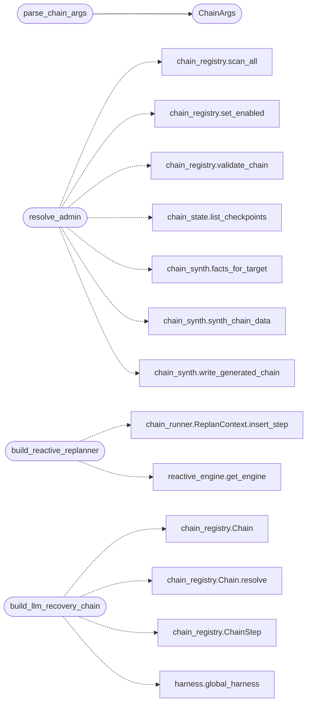

# `cli.apt_chain_support`

> Source: [cli/apt_chain_support.py:1](../../cli/apt_chain_support.py#L1) | language `py` | coverage 100.0% | [API index](../index.md)

Parsing, printing and replanning support for the ``apt_chain`` CLI.

Keeps `[`cli.commands.command_and_control_migrated`](cli.commands.command_and_control_migrated.py.md)` thin: argument
parsing, step selection, checkpoint/resume wiring, result rendering and
the reactive replanner live here. Options are parsed manually so any
unknown flag fails loudly instead of being silently swallowed.

## Contents

- **Classes:** [`ChainArgs`](#chainargs)
- **Functions:** [`parse_chain_args`](#parse_chain_args), [`resolve_admin`](#resolve_admin), [`select_step_ids`](#select_step_ids), [`render_result`](#render_result), [`build_cli_approver`](#build_cli_approver), [`build_reactive_replanner`](#build_reactive_replanner), [`build_llm_recovery_chain`](#build_llm_recovery_chain)

## Call Graph

Solid arrows stay in this module, dashed arrows leave it.



## Classes

<a id="chainargs"></a>

### `ChainArgs`

`class` `dataclass` | [cli/apt_chain_support.py:48](../../cli/apt_chain_support.py#L48)

Decorators: `@dataclass`

```python
class ChainArgs
```

Parsed ``apt_chain`` invocation.

**Attributes**

| Name | Type | Default | Description |
|---|---|---|---|
| [`admin_action`](#chainargs-admin_action) | `str` | `''` |  |
| [`admin_args`](#chainargs-admin_args) | `list[str]` | `field(default_factory=list)` |  |
| [`positional`](#chainargs-positional) | `list[str]` | `field(default_factory=list)` |  |
| [`dry_run`](#chainargs-dry_run) | `bool` | `False` |  |
| [`json_out`](#chainargs-json_out) | `bool` | `False` |  |
| [`continue_all`](#chainargs-continue_all) | `bool` | `False` |  |
| [`replan`](#chainargs-replan) | `bool` | `False` |  |
| [`no_checkpoint`](#chainargs-no_checkpoint) | `bool` | `False` |  |
| [`target`](#chainargs-target) | `str` | `''` |  |
| [`timeout`](#chainargs-timeout) | `float` | `0.0` |  |
| [`limit`](#chainargs-limit) | `int` | `0` |  |
| [`vars`](#chainargs-vars) | `dict[str, str]` | `field(default_factory=dict)` |  |
| [`step_ids`](#chainargs-step_ids) | `list[str]` | `field(default_factory=list)` |  |
| [`from_step`](#chainargs-from_step) | `str` | `''` |  |
| [`to_step`](#chainargs-to_step) | `str` | `''` |  |
| [`resume_run_id`](#chainargs-resume_run_id) | `str` | `''` |  |
| [`playbook`](#chainargs-playbook) | `str` | `''` |  |
| [`chain_override`](#chainargs-chain_override) | `str` | `''` |  |
| [`errors`](#chainargs-errors) | `list[str]` | `field(default_factory=list)` |  |

---

## Functions

<a id="parse_chain_args"></a>

### `parse_chain_args`

`function` | [cli/apt_chain_support.py:72](../../cli/apt_chain_support.py#L72)

```python
def parse_chain_args(line: str) -> ChainArgs
```

Parse one ``apt_chain`` command line into structured args.

Unknown dash-flags become errors: the old silent-swallow behavior
hid operator intent and is gone.

**Parameters**

| Name | Type | Default | Description |
|---|---|---|---|
| `line` | `str` |  |  |

**Returns:** `ChainArgs`

*Calls:* [`ChainArgs`](#chainargs)

*Called by:* [`CommandAndControlMigratedCommandSet.do_apt_chain`](cli.commands.command_and_control_migrated.py.md#commandandcontrolmigratedcommandset-do_apt_chain)

---

<a id="resolve_admin"></a>

### `resolve_admin`

`function` | [cli/apt_chain_support.py:169](../../cli/apt_chain_support.py#L169)

```python
def resolve_admin(args: ChainArgs) -> dict[str, Any]
```

Execute an admin action against the registry and checkpoint store.

**Parameters**

| Name | Type | Default | Description |
|---|---|---|---|
| `args` | `ChainArgs` |  |  |

**Returns:** `dict[str, Any]`

*Calls:* [`scan_all`](modules.chain_registry.py.md#scan_all), [`set_enabled`](modules.chain_registry.py.md#set_enabled), [`validate_chain`](modules.chain_registry.py.md#validate_chain), [`list_checkpoints`](modules.chain_state.py.md#list_checkpoints), [`facts_for_target`](modules.chain_synth.py.md#facts_for_target), [`synth_chain_data`](modules.chain_synth.py.md#synth_chain_data), [`write_generated_chain`](modules.chain_synth.py.md#write_generated_chain)

*Called by:* [`CommandAndControlMigratedCommandSet.do_apt_chain`](cli.commands.command_and_control_migrated.py.md#commandandcontrolmigratedcommandset-do_apt_chain)

---

<a id="select_step_ids"></a>

### `select_step_ids`

`function` | [cli/apt_chain_support.py:257](../../cli/apt_chain_support.py#L257)

```python
def select_step_ids(chain: Chain, args: ChainArgs) -> tuple[set[str] | None, list[str]]
```

Resolve --step/--from-step/--to-step into one id set.

**Parameters**

| Name | Type | Default | Description |
|---|---|---|---|
| `chain` | `Chain` |  |  |
| `args` | `ChainArgs` |  |  |

**Returns:** `tuple[set[str] | None, list[str]]`

*Called by:* [`CommandAndControlMigratedCommandSet.do_apt_chain`](cli.commands.command_and_control_migrated.py.md#commandandcontrolmigratedcommandset-do_apt_chain)

---

<a id="render_result"></a>

### `render_result`

`function` | [cli/apt_chain_support.py:297](../../cli/apt_chain_support.py#L297)

```python
def render_result(result: ChainRunResult) -> list[str]
```

Render one chain result as operator lines (JSON mode prints dict).

**Parameters**

| Name | Type | Default | Description |
|---|---|---|---|
| `result` | `ChainRunResult` |  |  |

**Returns:** `list[str]`

*Called by:* [`CommandAndControlMigratedCommandSet.do_apt_chain`](cli.commands.command_and_control_migrated.py.md#commandandcontrolmigratedcommandset-do_apt_chain)

---

<a id="build_cli_approver"></a>

### `build_cli_approver`

`function` | [cli/apt_chain_support.py:330](../../cli/apt_chain_support.py#L330)

```python
def build_cli_approver(printer, input_fn=None)
```

Return an approver baked for interactive operators.

Autonomous mode (``LAZYOWN_AUTONOMOUS=1``) auto-approves and logs
the decision; interactive mode asks the operator failure-closed.

**Parameters**

| Name | Type | Default | Description |
|---|---|---|---|
| `printer` |  |  |  |
| `input_fn` |  | `None` |  |

*Called by:* [`CommandAndControlMigratedCommandSet.do_apt_chain`](cli.commands.command_and_control_migrated.py.md#commandandcontrolmigratedcommandset-do_apt_chain), [`retry_chain`](cli.retry_support.py.md#retry_chain)

---

<a id="build_reactive_replanner"></a>

### `build_reactive_replanner`

`function` | [cli/apt_chain_support.py:352](../../cli/apt_chain_support.py#L352)

```python
def build_reactive_replanner()
```

Return a replanner driven by `[`modules.reactive_engine`](modules.reactive_engine.py.md)`.

*Calls:* [`ReplanContext.insert_step`](modules.chain_runner.py.md#replancontext-insert_step), [`get_engine`](modules.reactive_engine.py.md#get_engine)

*Called by:* [`CommandAndControlMigratedCommandSet.do_apt_chain`](cli.commands.command_and_control_migrated.py.md#commandandcontrolmigratedcommandset-do_apt_chain)

---

<a id="build_llm_recovery_chain"></a>

### `build_llm_recovery_chain`

`function` | [cli/apt_chain_support.py:408](../../cli/apt_chain_support.py#L408)

```python
def build_llm_recovery_chain(result: ChainRunResult, target: str = '', task_id: str = '') -> Chain | None
```

Ask the LLM pool for a temporary recovery chain after a failed run.

The prompt carries the original objective shape (chain name and
target), the steps that already succeeded and the failed steps with
their last errors. The model proposes up to three alternative shell
commands; each becomes a `[`continue_on_error`](modules.chain_registry.py.md#chainstep-continue_on_error)` step so one bad
suggestion cannot abort the whole recovery. Returns None when the
pool is unavailable or replies nothing usable.

**Parameters**

| Name | Type | Default | Description |
|---|---|---|---|
| `result` | `ChainRunResult` |  |  |
| `target` | `str` | `''` |  |
| `task_id` | `str` | `''` |  |

**Returns:** `Chain | None`

*Calls:* [`Chain`](modules.chain_registry.py.md#chain), [`Chain.resolve`](modules.chain_registry.py.md#chain-resolve), [`ChainStep`](modules.chain_registry.py.md#chainstep), [`global_harness`](modules.guardrails.harness.py.md#global_harness)

*Called by:* [`CommandAndControlMigratedCommandSet.do_apt_chain`](cli.commands.command_and_control_migrated.py.md#commandandcontrolmigratedcommandset-do_apt_chain)

---
