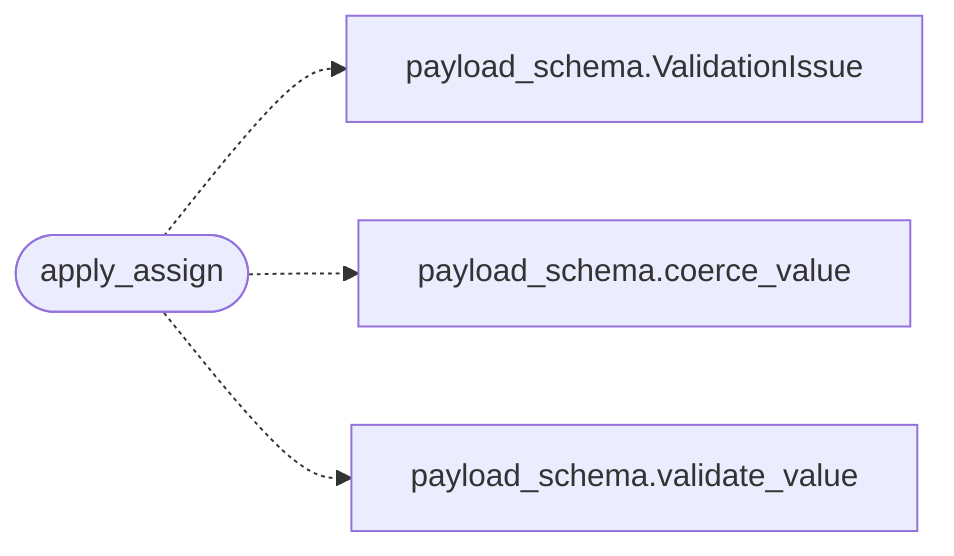

# `cli.assign`

> Source: [cli/assign.py:1](../../cli/assign.py#L1) | language `py` | coverage 100.0% | [API index](../index.md)

``assign`` business logic.

Extracted from `LazyOwnShell.do_assign` so the persistence and validation
behaviour can be unit-tested without booting the cmd2 shell.

Tier 2.5 promises:

- ``assign <key> <value>`` only succeeds when `[`key`](key.py.md)` is already part of the
  payload (no silent introduction of new keys).
- On success the live ``params`` dict is mutated in place AND a save callback
  is invoked so the change survives a shell restart.
- On failure (unknown key) nothing is mutated and no save callback fires.

Schema integration (additive, backwards compatible):

- When the key is registered in [`core.payload_schema.SCHEMA`](core.payload_schema.py.md#schema), the value
  is coerced to the canonical type (``"5555"`` → ``5555`` for ports) before
  being stored, so downstream consumers no longer have to defensively cast.
- A schema validation failure for an existing key is reported through the
  optional ``on_issue`` callback. The assignment still proceeds (legacy
  lenient contract) except when the value contains shell metacharacters —
  those are rejected fail-closed so injection payloads never persist.

## Contents

- **Functions:** [`apply_assign`](#apply_assign)

## Call Graph

Solid arrows stay in this module, dashed arrows leave it.



## Functions

<a id="apply_assign"></a>

### `apply_assign`

`function` | [cli/assign.py:36](../../cli/assign.py#L36)

```python
def apply_assign(params: dict[str, Any], key: str, value: Any, *, save: SaveFn | None = None, on_issue: IssueFn | None = None, history: Any | None = None) -> bool
```

Validate, mutate and persist a single payload assignment.

**Parameters**

| Name | Type | Default | Description |
|---|---|---|---|
| `params` | `dict[str, Any]` |  | Live parameter dict. Mutated in place when `[`key`](key.py.md)` exists. |
| `key` | `str` |  | Parameter name. |
| `value` | `Any` |  | New value to store. |
| `save` | `SaveFn \| None` | `None` | Optional callable invoked with ``params`` after a successful mutation. Pass [`core.config.save_payload`](core.config.py.md#save_payload) to persist to ``payload.json``. ``None`` skips persistence (useful for tests). |
| `on_issue` | `IssueFn \| None` | `None` | Optional callback invoked with the validation issue when the value fails the schema for `[`key`](key.py.md)`. Values containing shell metacharacters are rejected fail-closed and never persist. |
| `history` | `Any \| None` | `None` | Optional [`cli.config_history.ConfigHistory`](cli.config_history.py.md#confighistory) that receives a snapshot before mutation so `[`undo`](cli.config_history.py.md#confighistory-undo)` can restore it. |

**Returns:** `bool` - ``True`` if `[`key`](key.py.md)` existed in ``params`` and was updated;
``False`` otherwise. Callers can use the return value to decide
whether to refresh dependent state (e.g. aliases).

*Calls:* [`ValidationIssue`](core.payload_schema.py.md#validationissue), [`coerce_value`](core.payload_schema.py.md#coerce_value), [`validate_value`](core.payload_schema.py.md#validate_value)

---
