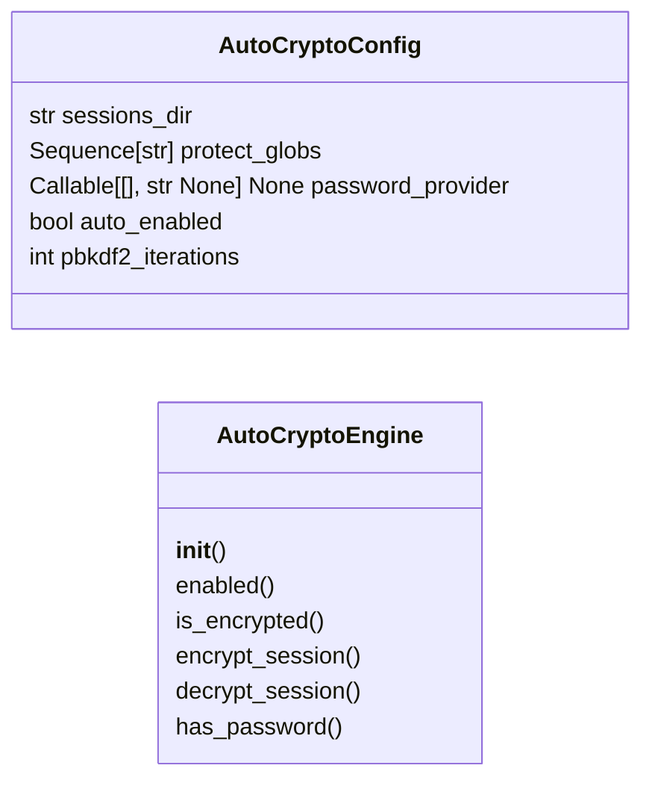
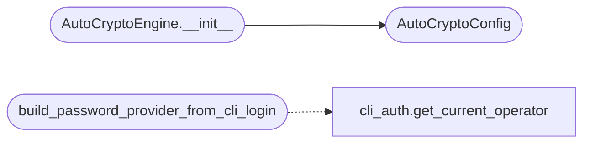

# `cli.auto_crypto`

> Source: [cli/auto_crypto.py:1](../../cli/auto_crypto.py#L1) | language `py` | coverage 100.0% | [API index](../index.md)

Automatic encryption of sensitive session data on app open/close.

Before this module the operator had to manually run ``lazyenc.py encrypt``
and ``lazyenc.py decrypt`` to protect session data at rest. This module
provides automatic encryption when the application closes and automatic
decryption when an authenticated user opens it.

Scope of protection:
    - ``sessions/credentials_*.txt`` — captured credentials
    - ``sessions/*.key`` — cryptographic key material
    - ``sessions/*.pem`` — TLS certificates and keys
    - ``sessions/world_model.json`` — operational state
    - ``sessions/hash*.txt`` — captured hashes
    - ``sessions/.secret_key`` — Flask secret
    - ``sessions/key.aes`` — C2 beacon key

The module uses the same PBKDF2HMAC + Fernet cryptography as
``lazyenc.py``. The key is derived from the operator's login password
(available after ``login`` command) or a stored master password hash.

Design contract (SOLID):
    - Single responsibility: encrypt/decrypt session data on lifecycle events.
    - Open/Closed: the list of protected globs is configurable via
      `[`AutoCryptoConfig.protect_globs`](#autocryptoconfig-protect_globs)` without changing the engine logic.
    - Dependency Inversion: the engine accepts a ``key_provider`` callable
      so the key source (CLI login, C2 session, env var) is injected.
    - Zero imports from ``lazyown.py`` or ``lazyc2.py``.
    - Atomic writes via temp-file rename.

## Contents

- **Classes:** [`AutoCryptoConfig`](#autocryptoconfig), [`AutoCryptoEngine`](#autocryptoengine)
- **Functions:** [`build_password_provider_from_cli_login`](#build_password_provider_from_cli_login)
- **Constants:** [`SALT_FILE`](#salt_file), [`ENCRYPTED_SUFFIX`](#encrypted_suffix)

## Type Diagram



## Call Graph

Solid arrows stay in this module, dashed arrows leave it.



## Classes

<a id="autocryptoconfig"></a>

### `AutoCryptoConfig`

`class` `dataclass` | [cli/auto_crypto.py:48](../../cli/auto_crypto.py#L48)

Decorators: `@dataclass`

```python
class AutoCryptoConfig
```

Centralised configuration for automatic session encryption.

**Attributes**

| Name | Type | Default | Description |
|---|---|---|---|
| [`sessions_dir`](#autocryptoconfig-sessions_dir) | `str` | `DEFAULT_SESSIONS_DIR` | Path to the sessions directory. |
| [`protect_globs`](#autocryptoconfig-protect_globs) | `Sequence[str]` | `field(default_factory=lambda: ['credentials_*.txt', 'hash*.txt', 'world_model.json', '*.key', '*.pem', '.secret_key', 'key.aes'])` | Glob patterns matching files to protect. |
| [`password_provider`](#autocryptoconfig-password_provider) | `Callable[[], str \| None] \| None` | `None` | Callable that returns the operator's password (or None when unauthenticated). |
| [`auto_enabled`](#autocryptoconfig-auto_enabled) | `bool` | `True` | When False the engine is a no-op. |
| [`pbkdf2_iterations`](#autocryptoconfig-pbkdf2_iterations) | `int` | `100000` | Iteration count for PBKDF2 key derivation. |

---

<a id="autocryptoengine"></a>

### `AutoCryptoEngine`

`class` | [cli/auto_crypto.py:77](../../cli/auto_crypto.py#L77)

```python
class AutoCryptoEngine
```

Encrypt and decrypt sensitive session files with a derived key.

**Parameters**

| Name | Type | Default | Description |
|---|---|---|---|
| `config` |  |  | Engine configuration. Defaults are sensible for the standard LazyOwn sessions layout. |

**Members**

| Member | Kind | Summary |
|---|---|---|
| [`__init__`](#autocryptoengine-__init__) | constructor |  |
| [`enabled`](#autocryptoengine-enabled) | property | Whether the engine performs any I/O. |
| [`is_encrypted`](#autocryptoengine-is_encrypted) | property | Check whether session data appears encrypted. |
| [`encrypt_session`](#autocryptoengine-encrypt_session) | method | Encrypt all protected session files. |
| [`decrypt_session`](#autocryptoengine-decrypt_session) | method | Decrypt all protected session files. |
| [`has_password`](#autocryptoengine-has_password) | method | Return True when the configured provider yields a password now. |

<a id="autocryptoengine-__init__"></a>

#### `AutoCryptoEngine.__init__`

`constructor` | [cli/auto_crypto.py:85](../../cli/auto_crypto.py#L85)

```python
def __init__(self, config: AutoCryptoConfig | None = None) -> None
```

**Parameters**

| Name | Type | Default | Description |
|---|---|---|---|
| `config` | `AutoCryptoConfig \| None` | `None` | Engine configuration. Defaults are sensible for the standard LazyOwn sessions layout. |

*Calls:* [`AutoCryptoConfig`](#autocryptoconfig)

<a id="autocryptoengine-enabled"></a>

#### `AutoCryptoEngine.enabled`

`property` | [cli/auto_crypto.py:90](../../cli/auto_crypto.py#L90)

Decorators: `@property`

```python
def enabled(self) -> bool
```

Whether the engine performs any I/O.

**Returns:** `bool`

<a id="autocryptoengine-is_encrypted"></a>

#### `AutoCryptoEngine.is_encrypted`

`property` | [cli/auto_crypto.py:95](../../cli/auto_crypto.py#L95)

Decorators: `@property`

```python
def is_encrypted(self) -> bool
```

Check whether session data appears encrypted.

Returns True when at least one protected file has the encrypted
suffix marker applied. A directory with no protected files at all
returns False (nothing to protect).

**Returns:** `bool`

<a id="autocryptoengine-encrypt_session"></a>

#### `AutoCryptoEngine.encrypt_session`

`method` | [cli/auto_crypto.py:124](../../cli/auto_crypto.py#L124)

```python
def encrypt_session(self) -> bool
```

Encrypt all protected session files.

Returns True when at least one file was encrypted, False when no
password is available or no files exist to protect.

**Returns:** `bool`

<a id="autocryptoengine-decrypt_session"></a>

#### `AutoCryptoEngine.decrypt_session`

`method` | [cli/auto_crypto.py:174](../../cli/auto_crypto.py#L174)

```python
def decrypt_session(self) -> bool
```

Decrypt all protected session files.

Returns True when at least one file was decrypted, False when no
encrypted files exist or the password is wrong/absent.

**Returns:** `bool`

<a id="autocryptoengine-has_password"></a>

#### `AutoCryptoEngine.has_password`

`method` | [cli/auto_crypto.py:239](../../cli/auto_crypto.py#L239)

```python
def has_password(self) -> bool
```

Return True when the configured provider yields a password now.

Exit paths use this to distinguish "nothing to protect" from
"no credential available", so a skipped encryption is never
silent.

**Returns:** `bool` - True when a non-empty password is available.

---

## Functions

<a id="build_password_provider_from_cli_login"></a>

### `build_password_provider_from_cli_login`

`function` | [cli/auto_crypto.py:297](../../cli/auto_crypto.py#L297)

```python
def build_password_provider_from_cli_login() -> Callable[[], str | None]
```

Return a password provider that reads the CLI login session.

The provider tries:
1. `[`modules.cli_auth.get_current_operator`](modules.cli_auth.py.md#get_current_operator)` for username,
   then reads the operator's stored credential hash from ``users.json``.
2. Falls back to ``LAZYOWN_MASTER_PASSWORD`` environment variable.
3. Returns None when no credential is available (crypto is skipped).

**Returns:** `Callable[[], str | None]` - A zero-argument callable returning the operator's password or None.

*Calls:* [`get_current_operator`](modules.cli_auth.py.md#get_current_operator)

---

## Constants

<a id="salt_file"></a>

### `SALT_FILE`

`constant` | [cli/auto_crypto.py:42](../../cli/auto_crypto.py#L42)

```python
SALT_FILE: str = '.auto_crypto_salt'
```

---

<a id="encrypted_suffix"></a>

### `ENCRYPTED_SUFFIX`

`constant` | [cli/auto_crypto.py:43](../../cli/auto_crypto.py#L43)

```python
ENCRYPTED_SUFFIX: str = '.encrypted'
```

---
