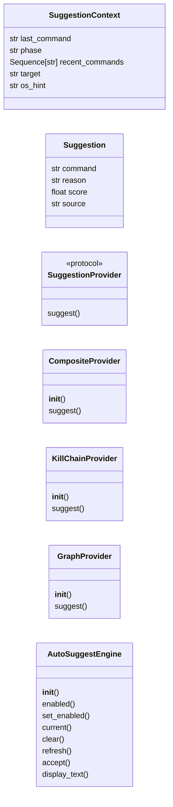
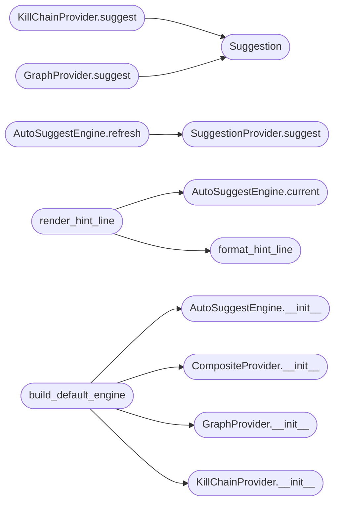

# `cli.autosuggest`

> Source: [cli/autosuggest.py:1](../../cli/autosuggest.py#L1) | language `py` | coverage 96.2% | [API index](../index.md)

Ghost-text autosuggest engine for the LazyOwn cmd2 shell.

After every command, the engine consults its provider chain to pick the
most likely next command. The selected [`Suggestion`](#suggestion) is held as
state, surfaced as a dim ANSI fragment inside the cmd2 prompt, and
executed with a single keystroke via the `[`do_next`](cli.commands.session_ops.py.md#sessionopscommandset-do_next)` shell command (or
its ``.`` alias).

The module is pure presentation + state. It does not import cmd2,
Flask, or any LazyOwn module so providers and the engine remain
unit-testable in isolation. Concrete providers receive their backing
data structures via constructor injection (Dependency Inversion).

## Contents

- **Classes:** [`SuggestionContext`](#suggestioncontext), [`Suggestion`](#suggestion), [`CompositeProvider`](#compositeprovider), [`KillChainProvider`](#killchainprovider), [`GraphProvider`](#graphprovider), [`AutoSuggestEngine`](#autosuggestengine)
- **Protocols:** [`SuggestionProvider`](#suggestionprovider)
- **Functions:** [`format_hint_line`](#format_hint_line), [`render_hint_line`](#render_hint_line), [`build_default_engine`](#build_default_engine)
- **Constants:** [`GHOST_TEXT_LIMIT`](#ghost_text_limit), [`HINT_COMMAND_LIMIT`](#hint_command_limit), [`HINT_REASON_LIMIT`](#hint_reason_limit), [`ANSI_DIM_GREY`](#ansi_dim_grey), [`ANSI_RESET`](#ansi_reset), [`ACCEPT_KEY_HINT`](#accept_key_hint), [`SKIP_TRIGGER_COMMANDS`](#skip_trigger_commands)

## Type Diagram



## Call Graph

Solid arrows stay in this module, dashed arrows leave it.



## Classes

<a id="suggestioncontext"></a>

### `SuggestionContext`

`class` `dataclass` | [cli/autosuggest.py:50](../../cli/autosuggest.py#L50)

Decorators: `@dataclass(frozen=True)`

```python
class SuggestionContext
```

Inputs available to every suggestion provider.

**Parameters**

| Name | Type | Default | Description |
|---|---|---|---|
| `last_command` | `str` | `''` | First token of the last command executed. |
| `phase` | `str` | `''` | Current engagement phase (recon, enum, exploit, ...). |
| `recent_commands` | `Sequence[str]` | `()` | Last N commands from the session transcript, newest entries appearing last. |
| `target` | `str` | `''` | Active rhost loaded from ``payload.json``. |
| `os_hint` | `str` | `'unknown'` | Detected target OS — ``"linux"``, ``"windows"``, or ``"unknown"``. |

**Attributes**

| Name | Type | Default | Description |
|---|---|---|---|
| [`last_command`](#suggestioncontext-last_command) | `str` | `''` |  |
| [`phase`](#suggestioncontext-phase) | `str` | `''` |  |
| [`recent_commands`](#suggestioncontext-recent_commands) | `Sequence[str]` | `()` |  |
| [`target`](#suggestioncontext-target) | `str` | `''` |  |
| [`os_hint`](#suggestioncontext-os_hint) | `str` | `'unknown'` |  |

---

<a id="suggestion"></a>

### `Suggestion`

`class` `dataclass` | [cli/autosuggest.py:71](../../cli/autosuggest.py#L71)

Decorators: `@dataclass(frozen=True)`

```python
class Suggestion
```

One next-command suggestion with its rationale.

**Parameters**

| Name | Type | Default | Description |
|---|---|---|---|
| `command` | `str` |  | Shell command executed when the operator accepts the suggestion via `[`do_next`](cli.commands.session_ops.py.md#sessionopscommandset-do_next)`. |
| `reason` | `str` | `''` | Human-readable explanation surfaced in the prompt and event log. |
| `score` | `float` | `0.0` | Provider-specific confidence. Higher is better. The [`CompositeProvider`](#compositeprovider) uses it to arbitrate across providers. |
| `source` | `str` | `''` | Short label identifying which provider produced the suggestion (`[`graph`](lazyc2.py.md#graph)`, `[`killchain`](lazygui.panels.registry.py.md#panelregistry-killchain)`, `[`phase`](#suggestioncontext-phase)`, ...). |

**Attributes**

| Name | Type | Default | Description |
|---|---|---|---|
| [`command`](#suggestion-command) | `str` |  |  |
| [`reason`](#suggestion-reason) | `str` | `''` |  |
| [`score`](#suggestion-score) | `float` | `0.0` |  |
| [`source`](#suggestion-source) | `str` | `''` |  |

---

<a id="compositeprovider"></a>

### `CompositeProvider`

`class` | [cli/autosuggest.py:98](../../cli/autosuggest.py#L98)

```python
class CompositeProvider
```

Aggregator that returns the highest-scoring suggestion across providers.

Adding a provider is a constructor argument; the engine itself
never changes, honouring the Open/Closed principle.

**Members**

| Member | Kind | Summary |
|---|---|---|
| [`__init__`](#compositeprovider-__init__) | constructor | Store the provider chain. |
| [`suggest`](#compositeprovider-suggest) | method | Return the best suggestion across the chain, or ``None``. |

<a id="compositeprovider-__init__"></a>

#### `CompositeProvider.__init__`

`constructor` | [cli/autosuggest.py:105](../../cli/autosuggest.py#L105)

```python
def __init__(self, providers: Sequence[SuggestionProvider]) -> None
```

Store the provider chain.

**Parameters**

| Name | Type | Default | Description |
|---|---|---|---|
| `providers` | `Sequence[SuggestionProvider]` |  | Sequence of objects implementing [`SuggestionProvider`](#suggestionprovider). Order is irrelevant for correctness; the highest score wins. |

*Called by:* [`build_default_engine`](#build_default_engine)

<a id="compositeprovider-suggest"></a>

#### `CompositeProvider.suggest`

`method` | [cli/autosuggest.py:115](../../cli/autosuggest.py#L115)

```python
def suggest(self, context: SuggestionContext) -> Suggestion | None
```

Return the best suggestion across the chain, or ``None``.

A misbehaving provider that raises is silently skipped so a
single broken adapter cannot break the prompt.

**Parameters**

| Name | Type | Default | Description |
|---|---|---|---|
| `context` | `SuggestionContext` |  |  |

**Returns:** `Suggestion | None`

---

<a id="killchainprovider"></a>

### `KillChainProvider`

`class` | [cli/autosuggest.py:134](../../cli/autosuggest.py#L134)

```python
class KillChainProvider
```

Provider backed by the static kill-chain adjacency map.

Falls back to the phase-priority table when no adjacency entry
exists for the last command. Commands already present in
[`SuggestionContext.recent_commands`](#suggestioncontext-recent_commands) are skipped so the
suggestion is always forward-looking.

**Members**

| Member | Kind | Summary |
|---|---|---|
| [`__init__`](#killchainprovider-__init__) | constructor | Configure the provider. |
| [`suggest`](#killchainprovider-suggest) | method | Return the first unseen adjacency, or phase fallback, or ``None``. |

<a id="killchainprovider-__init__"></a>

#### `KillChainProvider.__init__`

`constructor` | [cli/autosuggest.py:143](../../cli/autosuggest.py#L143)

```python
def __init__(self, chain: dict[str, list[str]], phase_priority: dict[str, list[str]], *, base_score: float = KILLCHAIN_BASE_SCORE) -> None
```

Configure the provider.

**Parameters**

| Name | Type | Default | Description |
|---|---|---|---|
| `chain` | `dict[str, list[str]]` |  | ``command -> [next_command, ...]`` adjacency map. |
| `phase_priority` | `dict[str, list[str]]` |  | ``phase -> [command, ...]`` fallback map. |
| `base_score` | `float` | `KILLCHAIN_BASE_SCORE` | Score assigned to adjacency matches. Phase fallbacks receive ``base_score * PHASE_FALLBACK_FACTOR``. |

*Called by:* [`build_default_engine`](#build_default_engine)

<a id="killchainprovider-suggest"></a>

#### `KillChainProvider.suggest`

`method` | [cli/autosuggest.py:162](../../cli/autosuggest.py#L162)

```python
def suggest(self, context: SuggestionContext) -> Suggestion | None
```

Return the first unseen adjacency, or phase fallback, or ``None``.

**Parameters**

| Name | Type | Default | Description |
|---|---|---|---|
| `context` | `SuggestionContext` |  |  |

**Returns:** `Suggestion | None`

*Calls:* [`Suggestion`](#suggestion)

---

<a id="graphprovider"></a>

### `GraphProvider`

`class` | [cli/autosuggest.py:189](../../cli/autosuggest.py#L189)

```python
class GraphProvider
```

Provider backed by the graphify knowledge-graph advisor.

Accepts any object exposing ``suggest_next(recent_commands, limit)``
returning a list of dicts so this module stays decoupled from the
concrete [`cli.graph_advisor.GraphAdvisor`](cli.graph_advisor.py.md#graphadvisor) implementation.

**Members**

| Member | Kind | Summary |
|---|---|---|
| [`__init__`](#graphprovider-__init__) | constructor | Configure the provider. |
| [`suggest`](#graphprovider-suggest) | method | Query the advisor and adapt the top result to a [`Suggestion`](#suggestion). |

<a id="graphprovider-__init__"></a>

#### `GraphProvider.__init__`

`constructor` | [cli/autosuggest.py:197](../../cli/autosuggest.py#L197)

```python
def __init__(self, advisor: Any, *, limit: int = 1, base_score: float = GRAPH_BASE_SCORE, score_weight: float = GRAPH_SCORE_WEIGHT) -> None
```

Configure the provider.

**Parameters**

| Name | Type | Default | Description |
|---|---|---|---|
| `advisor` | `Any` |  | Object exposing `[`suggest_next`](cli.graph_advisor.py.md#graphadvisor-suggest_next)` with the contract described in the class docstring. |
| `limit` | `int` | `1` | Number of candidates to request from the advisor. The top-ranked entry is returned to the engine. |
| `base_score` | `float` | `GRAPH_BASE_SCORE` | Floor score for any non-empty graph result. |
| `score_weight` | `float` | `GRAPH_SCORE_WEIGHT` | Multiplier applied to the advisor-supplied score when blending with ``base_score``. |

*Called by:* [`build_default_engine`](#build_default_engine)

<a id="graphprovider-suggest"></a>

#### `GraphProvider.suggest`

`method` | [cli/autosuggest.py:221](../../cli/autosuggest.py#L221)

```python
def suggest(self, context: SuggestionContext) -> Suggestion | None
```

Query the advisor and adapt the top result to a [`Suggestion`](#suggestion).

**Parameters**

| Name | Type | Default | Description |
|---|---|---|---|
| `context` | `SuggestionContext` |  |  |

**Returns:** `Suggestion | None`

*Calls:* [`Suggestion`](#suggestion)

---

<a id="autosuggestengine"></a>

### `AutoSuggestEngine`

`class` | [cli/autosuggest.py:245](../../cli/autosuggest.py#L245)

```python
class AutoSuggestEngine
```

Stateful holder for the active ghost-text suggestion.

The engine is a thin coordinator: it never decides what to suggest
(delegated to its [`SuggestionProvider`](#suggestionprovider)) and only owns the
current-suggestion state machine plus the rendering surface for the
prompt.

**Members**

| Member | Kind | Summary |
|---|---|---|
| [`__init__`](#autosuggestengine-__init__) | constructor | Store the provider and enabled flag. |
| [`enabled`](#autosuggestengine-enabled) | property | Whether the engine refreshes suggestions on each command. |
| [`set_enabled`](#autosuggestengine-set_enabled) | method | Toggle the engine without losing the provider chain. |
| [`current`](#autosuggestengine-current) | method | Return the suggestion last computed, or ``None`` when cleared. |
| [`clear`](#autosuggestengine-clear) | method | Drop the active suggestion (called after accept or abort). |
| [`refresh`](#autosuggestengine-refresh) | method | Recompute the suggestion from the provider chain. |
| [`accept`](#autosuggestengine-accept) | method | Return the active command string and clear the suggestion. |
| [`display_text`](#autosuggestengine-display_text) | method | Return the ANSI-coloured ghost-text fragment for legacy callers. |

<a id="autosuggestengine-__init__"></a>

#### `AutoSuggestEngine.__init__`

`constructor` | [cli/autosuggest.py:254](../../cli/autosuggest.py#L254)

```python
def __init__(self, provider: SuggestionProvider, *, enabled: bool = True) -> None
```

Store the provider and enabled flag.

**Parameters**

| Name | Type | Default | Description |
|---|---|---|---|
| `provider` | `SuggestionProvider` |  | Object implementing [`SuggestionProvider`](#suggestionprovider). Typically a [`CompositeProvider`](#compositeprovider). |
| `enabled` | `bool` | `True` | Whether the engine refreshes suggestions on each postcmd hook. The shell flips this from ``payload.json["enable_autosuggest"]`` so the operator can toggle without a restart. |

*Called by:* [`build_default_engine`](#build_default_engine)

<a id="autosuggestengine-enabled"></a>

#### `AutoSuggestEngine.enabled`

`property` | [cli/autosuggest.py:270](../../cli/autosuggest.py#L270)

Decorators: `@property`

```python
def enabled(self) -> bool
```

Whether the engine refreshes suggestions on each command.

**Returns:** `bool`

<a id="autosuggestengine-set_enabled"></a>

#### `AutoSuggestEngine.set_enabled`

`method` | [cli/autosuggest.py:274](../../cli/autosuggest.py#L274)

```python
def set_enabled(self, value: bool) -> None
```

Toggle the engine without losing the provider chain.

Disabling clears the active suggestion so the prompt returns to
its plain form on the next render.

**Parameters**

| Name | Type | Default | Description |
|---|---|---|---|
| `value` | `bool` |  |  |

<a id="autosuggestengine-current"></a>

#### `AutoSuggestEngine.current`

`method` | [cli/autosuggest.py:284](../../cli/autosuggest.py#L284)

```python
def current(self) -> Suggestion | None
```

Return the suggestion last computed, or ``None`` when cleared.

**Returns:** `Suggestion | None`

*Called by:* [`render_hint_line`](#render_hint_line)

<a id="autosuggestengine-clear"></a>

#### `AutoSuggestEngine.clear`

`method` | [cli/autosuggest.py:288](../../cli/autosuggest.py#L288)

```python
def clear(self) -> None
```

Drop the active suggestion (called after accept or abort).

<a id="autosuggestengine-refresh"></a>

#### `AutoSuggestEngine.refresh`

`method` | [cli/autosuggest.py:292](../../cli/autosuggest.py#L292)

```python
def refresh(self, context: SuggestionContext) -> Suggestion | None
```

Recompute the suggestion from the provider chain.

Commands listed in [`SKIP_TRIGGER_COMMANDS`](#skip_trigger_commands) are ignored so
refreshing after ``help`` or `[`next`](cli.command_chain.py.md#commandchain-next)` is meaningless or
recursive. When the engine is disabled the current suggestion
is cleared and ``None`` is returned.

**Parameters**

| Name | Type | Default | Description |
|---|---|---|---|
| `context` | `SuggestionContext` |  |  |

**Returns:** `Suggestion | None`

*Calls:* [`SuggestionProvider.suggest`](#suggestionprovider-suggest)

<a id="autosuggestengine-accept"></a>

#### `AutoSuggestEngine.accept`

`method` | [cli/autosuggest.py:309](../../cli/autosuggest.py#L309)

```python
def accept(self) -> str | None
```

Return the active command string and clear the suggestion.

**Returns:** `str | None`

*Called by:* [`main`](modules.backdoor.server.c.md#main), [`main`](modules.rootkit.mr.c.md#main), [`main`](modules.win_rootkit.backup.c.md#main), [`main`](modules.win_rootkit.win_ring3_rootkit.c.md#main)

<a id="autosuggestengine-display_text"></a>

#### `AutoSuggestEngine.display_text`

`method` | [cli/autosuggest.py:317](../../cli/autosuggest.py#L317)

```python
def display_text(self) -> str
```

Return the ANSI-coloured ghost-text fragment for legacy callers.

The fragment is empty when no suggestion is active or when the
engine is disabled. The rendered command is truncated to
[`GHOST_TEXT_LIMIT`](#ghost_text_limit) characters. This API is preserved for
callers that want to embed the suggestion inline; the cmd2
shell uses [`render_hint_line`](#render_hint_line) instead so the prompt
itself stays clean.

**Returns:** `str`

---

## Protocols

<a id="suggestionprovider"></a>

### `SuggestionProvider`

`protocol` | [cli/autosuggest.py:92](../../cli/autosuggest.py#L92)

```python
class SuggestionProvider(Protocol)
```

Bases: `Protocol`

Provider contract: examine context, return one suggestion or ``None``.

**Members**

| Member | Kind | Summary |
|---|---|---|
| [`suggest`](#suggestionprovider-suggest) | method |  |

<a id="suggestionprovider-suggest"></a>

#### `SuggestionProvider.suggest`

`method` | [cli/autosuggest.py:95](../../cli/autosuggest.py#L95)

```python
def suggest(self, context: SuggestionContext) -> Suggestion | None
```

**Parameters**

| Name | Type | Default | Description |
|---|---|---|---|
| `context` | `SuggestionContext` |  |  |

**Returns:** `Suggestion | None`

*Called by:* [`AutoSuggestEngine.refresh`](#autosuggestengine-refresh)

---

## Functions

<a id="format_hint_line"></a>

### `format_hint_line`

`function` | [cli/autosuggest.py:342](../../cli/autosuggest.py#L342)

```python
def format_hint_line(suggestion: Suggestion, *, accept_key: str = ACCEPT_KEY_HINT, command_limit: int = HINT_COMMAND_LIMIT, reason_limit: int = HINT_REASON_LIMIT) -> str
```

Build the dim hint string surfaced after each command.

The format is deliberately compact and unambiguous about the
accept key: ``  >> press '.' to run: gobuster (reason via graph)``.
Truncation honours [`HINT_COMMAND_LIMIT`](#hint_command_limit) and
[`HINT_REASON_LIMIT`](#hint_reason_limit) so the line never exceeds one terminal
row at the typical 100-column width.

**Parameters**

| Name | Type | Default | Description |
|---|---|---|---|
| `suggestion` | `Suggestion` |  | Suggestion to render. |
| `accept_key` | `str` | `ACCEPT_KEY_HINT` | Visible key the operator presses to accept. |
| `command_limit` | `int` | `HINT_COMMAND_LIMIT` | Maximum command-fragment length. |
| `reason_limit` | `int` | `HINT_REASON_LIMIT` | Maximum reason-fragment length. |

**Returns:** `str` - Plain string (no ANSI). The shell wraps it in dim style at
render time so callers can pipe the value into logs without
carrying escape codes.

*Called by:* [`render_hint_line`](#render_hint_line)

---

<a id="render_hint_line"></a>

### `render_hint_line`

`function` | [cli/autosuggest.py:375](../../cli/autosuggest.py#L375)

```python
def render_hint_line(engine: AutoSuggestEngine, *, console: Any = None, prefix: str = '  >> ', accept_key: str = ACCEPT_KEY_HINT) -> bool
```

Print one dim hint line for the engine's active suggestion.

Returns ``True`` when something was printed, ``False`` otherwise.
The function is a no-op when the engine is disabled or has no
active suggestion so callers can register it unconditionally as a
cmd2 postcmd hook.

**Parameters**

| Name | Type | Default | Description |
|---|---|---|---|
| `engine` | `AutoSuggestEngine` |  | [`AutoSuggestEngine`](#autosuggestengine) whose current suggestion to render. |
| `console` | `Any` | `None` | Optional ``rich.console.Console`` instance. When ``None`` a module-private console is used so tests can inject a capturing console. |
| `prefix` | `str` | `' >> '` | Leading marker, default matches `[`cli.reactive_hints`](cli.reactive_hints.py.md)`. |
| `accept_key` | `str` | `ACCEPT_KEY_HINT` | Visible accept-key hint passed through to [`format_hint_line`](#format_hint_line). |

**Returns:** `bool`

*Calls:* [`AutoSuggestEngine.current`](#autosuggestengine-current), [`format_hint_line`](#format_hint_line)

---

<a id="build_default_engine"></a>

### `build_default_engine`

`function` | [cli/autosuggest.py:427](../../cli/autosuggest.py#L427)

```python
def build_default_engine(advisor: Any | None, chain: dict[str, list[str]], phase_priority: dict[str, list[str]], *, enabled: bool = True) -> AutoSuggestEngine
```

Wire the canonical provider chain used by the cmd2 shell.

Order is: graph provider (high signal) followed by the kill-chain
fallback. Each provider is wrapped defensively so a misbehaving
advisor cannot break the prompt.

**Parameters**

| Name | Type | Default | Description |
|---|---|---|---|
| `advisor` | `Any \| None` |  | Optional graph advisor. When ``None`` or when ``advisor.is_available()`` returns ``False`` the graph provider is omitted. |
| `chain` | `dict[str, list[str]]` |  | Static kill-chain adjacency map shared with `[`cli.reactive_hints`](cli.reactive_hints.py.md)`. |
| `phase_priority` | `dict[str, list[str]]` |  | Phase-priority map shared with the same module. |
| `enabled` | `bool` | `True` | Initial enable state for the engine. |

**Returns:** `AutoSuggestEngine` - An [`AutoSuggestEngine`](#autosuggestengine) ready to register with cmd2.

*Calls:* [`AutoSuggestEngine.__init__`](#autosuggestengine-__init__), [`CompositeProvider.__init__`](#compositeprovider-__init__), [`GraphProvider.__init__`](#graphprovider-__init__), [`KillChainProvider.__init__`](#killchainprovider-__init__)

*Called by:* [`MiscMigratedCommandSet.do_recommend_next`](cli.commands.misc_migrated.py.md#miscmigratedcommandset-do_recommend_next)

---

## Constants

<a id="ghost_text_limit"></a>

### `GHOST_TEXT_LIMIT`

`constant` | [cli/autosuggest.py:21](../../cli/autosuggest.py#L21)

```python
GHOST_TEXT_LIMIT: int = 48
```

---

<a id="hint_command_limit"></a>

### `HINT_COMMAND_LIMIT`

`constant` | [cli/autosuggest.py:22](../../cli/autosuggest.py#L22)

```python
HINT_COMMAND_LIMIT: int = 72
```

---

<a id="hint_reason_limit"></a>

### `HINT_REASON_LIMIT`

`constant` | [cli/autosuggest.py:23](../../cli/autosuggest.py#L23)

```python
HINT_REASON_LIMIT: int = 40
```

---

<a id="ansi_dim_grey"></a>

### `ANSI_DIM_GREY`

`constant` | [cli/autosuggest.py:28](../../cli/autosuggest.py#L28)

```python
ANSI_DIM_GREY: str = '\x1b[2;37m'
```

---

<a id="ansi_reset"></a>

### `ANSI_RESET`

`constant` | [cli/autosuggest.py:29](../../cli/autosuggest.py#L29)

```python
ANSI_RESET: str = '\x1b[0m'
```

---

<a id="accept_key_hint"></a>

### `ACCEPT_KEY_HINT`

`constant` | [cli/autosuggest.py:30](../../cli/autosuggest.py#L30)

```python
ACCEPT_KEY_HINT: str = '.'
```

---

<a id="skip_trigger_commands"></a>

### `SKIP_TRIGGER_COMMANDS`

`constant` | [cli/autosuggest.py:32](../../cli/autosuggest.py#L32)

```python
SKIP_TRIGGER_COMMANDS: frozenset[str]
```

---
