# `cli.banner_config`

> Source: [cli/banner_config.py:1](../../cli/banner_config.py#L1) | language `py` | coverage 23.2% | [API index](../index.md)

Configurable Neon Box banner for the LazyOwn interactive shell.

The module exposes a single, self-contained banner subsystem with three
extension axes the operator can tune through a curses wizard or directly
inside ``payload.json``:

1. **Segments** — which pieces of information appear in the prompt
   (``user_host``, ``iface``, `[`rhost`](#rendercontext-rhost)`, `[`domain`](#rendercontext-domain)`, `[`cwd`](#rendercontext-cwd)`, ``git`` …).
2. **Colors** — a per-segment named ANSI color picked from
   [`ColorRegistry`](#colorregistry).
3. **Glyphs** — the box-drawing characters, segment markers, arrows and
   prompt characters drawn between values, picked from
   [`GlyphRegistry`](#glyphregistry).

The wizard mirrors Powerlevel10k's flow: three tabs (Segments / Colors /
Glyphs) navigable with ``Tab`` / ``Shift+Tab``, arrow keys plus ``Space``
or ``←/→`` to toggle/cycle, a live preview anchored beneath the body, and
``Enter`` to commit. ``payload.json`` carries the result under the
`[`banner`](banner.py.md)` block so it survives shell restarts.

Design (SOLID):

- `[`BannerConfig`](#bannerconfig)` centralises every magic constant (keys, key codes,
  palette pair ids, layout, payload field names, cache TTLs).
- `[`ColorRegistry`](#colorregistry)` and `[`GlyphRegistry`](#glyphregistry)` are Open/Closed extension
  points: adding a new color name or glyph slot only requires extending
  the preset map.
- `[`SegmentSpec`](#segmentspec)` describes a segment; `[`SegmentRenderer`](#segmentrenderer)` is the only
  thing that knows how to format a value (Single Responsibility).
- `[`SegmentRegistry`](#segmentregistry)` holds the canonical segment set; `[`BannerSettings`](#bannersettings)`
  references segments only by id and round-trips through the payload.
- `[`BannerRenderer`](#bannerrenderer)` orchestrates settings + registries into a final
  ANSI string and never touches curses (Dependency Inversion).
- `[`BannerConfigurator`](#bannerconfigurator)` is the only piece bound to curses; tests can
  drive any renderer behaviour without a TTY.
- `[`configure_banner_interactive`](#configure_banner_interactive)` / `[`render_prompt`](#render_prompt)` / `[`banner_summary`](#banner_summary)`
  are the public entry points used by ``lazyown.py`` and ``utils.py``.

## Contents

- **Classes:** [`BannerConfig`](#bannerconfig), [`ColorRegistry`](#colorregistry), [`GlyphRegistry`](#glyphregistry), [`SegmentSpec`](#segmentspec), [`ColorPalette`](#colorpalette), [`RenderContext`](#rendercontext), [`SegmentRenderer`](#segmentrenderer), [`UserHostSegment`](#userhostsegment), [`IfaceSegment`](#ifacesegment), [`LhostSegment`](#lhostsegment), [`RhostSegment`](#rhostsegment), [`DomainSegment`](#domainsegment), [`PublicIpSegment`](#publicipsegment), [`CwdSegment`](#cwdsegment), [`GitSegment`](#gitsegment), [`VenvSegment`](#venvsegment), [`TimeSegment`](#timesegment), [`KernelSegment`](#kernelsegment), [`VersionSegment`](#versionsegment), [`BatteryLoadSegment`](#batteryloadsegment), [`SegmentRegistry`](#segmentregistry), [`BannerSettings`](#bannersettings), [`ContextResolver`](#contextresolver), [`BannerRenderer`](#bannerrenderer), [`BannerConfigurator`](#bannerconfigurator)
- **Functions:** [`build_default_registry`](#build_default_registry), [`default_palette`](#default_palette), [`strip_readline_markers`](#strip_readline_markers), [`render_prompt`](#render_prompt), [`configure_banner_interactive`](#configure_banner_interactive), [`banner_summary`](#banner_summary)

## Type Diagram

```mermaid
classDiagram
    direction LR
    class BannerConfig
    BannerConfig : str payload_key
    BannerConfig : str payload_filename
    BannerConfig : str version_filename
    BannerConfig : str middle_segment_gap
    BannerConfig : str fallback_user
    BannerConfig : str fallback_iface_ip_token
    BannerConfig : str fallback_label_lhost
    BannerConfig : str fallback_label_rhost
    BannerConfig : str fallback_label_iface
    BannerConfig : str fallback_label_git
    BannerConfig : str fallback_label_env
    BannerConfig : str fallback_label_kernel
    BannerConfig : str fallback_label_version
    BannerConfig : str fallback_label_public_ip
    BannerConfig : str fallback_label_battery
    BannerConfig : str time_format
    BannerConfig : str readline_start_marker
    BannerConfig : str readline_end_marker
    BannerConfig : float public_ip_cache_seconds
    BannerConfig : float public_ip_timeout_seconds
    BannerConfig : str public_ip_endpoint
    BannerConfig : float kernel_cache_seconds
    BannerConfig : float version_cache_seconds
    BannerConfig : str wizard_title
    class ColorRegistry
    ColorRegistry : names()
    ColorRegistry : has()
    ColorRegistry : resolve()
    ColorRegistry : cycle()
    ColorRegistry : default_name()
    class GlyphRegistry
    GlyphRegistry : slots()
    GlyphRegistry : choices()
    GlyphRegistry : has()
    GlyphRegistry : default()
    GlyphRegistry : cycle()
    class SegmentSpec
    SegmentSpec : str id
    SegmentSpec : str label
    SegmentSpec : str description
    SegmentSpec : str group
    SegmentSpec : bool default_enabled
    SegmentSpec : int order
    SegmentSpec : str default_color
    class ColorPalette
    ColorPalette : str reset
    ColorPalette : str primary
    ColorPalette : str secondary
    ColorPalette : str accent
    ColorPalette : str info
    ColorPalette : str danger
    ColorPalette : str success
    class RenderContext
    RenderContext : str user
    RenderContext : str hostname
    RenderContext : str iface_name
    RenderContext : str iface_ip
    RenderContext : str lhost
    RenderContext : str rhost
    RenderContext : str domain
    RenderContext : str cwd
    RenderContext : bool git_dirty
    RenderContext : str git_branch
    RenderContext : str venv_name
    RenderContext : str now_str
    RenderContext : str kernel
    RenderContext : str version
    RenderContext : str public_ip
    RenderContext : str battery_or_load
    RenderContext : ColorPalette palette
    RenderContext : int elo
    RenderContext : str karma_name
    RenderContext : str operator
    class SegmentRenderer
    SegmentRenderer : spec()
    SegmentRenderer : render()
    class UserHostSegment
    UserHostSegment : spec
    UserHostSegment : render()
    class IfaceSegment
    IfaceSegment : spec
    IfaceSegment : render()
    class LhostSegment
    LhostSegment : spec
    LhostSegment : render()
    class RhostSegment
    RhostSegment : spec
    RhostSegment : render()
    class DomainSegment
    DomainSegment : spec
    DomainSegment : render()
    class PublicIpSegment
    PublicIpSegment : spec
    PublicIpSegment : render()
    class CwdSegment
    CwdSegment : spec
    CwdSegment : render()
    class GitSegment
    GitSegment : spec
    GitSegment : render()
    class VenvSegment
    VenvSegment : spec
    VenvSegment : render()
    class TimeSegment
    TimeSegment : spec
    TimeSegment : render()
    class KernelSegment
    KernelSegment : spec
    KernelSegment : render()
    class VersionSegment
    VersionSegment : spec
    VersionSegment : render()
    class BatteryLoadSegment
    BatteryLoadSegment : spec
    BatteryLoadSegment : render()
    class SegmentRegistry
    SegmentRegistry : __init__()
    SegmentRegistry : register()
    SegmentRegistry : get()
    SegmentRegistry : all()
    SegmentRegistry : by_group()
    class BannerSettings
    BannerSettings : set[str] enabled
    BannerSettings : dict[str, str] colors
    BannerSettings : dict[str, str] glyphs
    BannerSettings : defaults()
    BannerSettings : from_payload()
    BannerSettings : is_enabled()
    BannerSettings : toggle()
    BannerSettings : enable_all()
    BannerSettings : disable_all()
    BannerSettings : reset_segments()
    BannerSettings : reset_colors()
    BannerSettings : reset_color_for()
    BannerSettings : reset_glyphs()
    BannerSettings : reset_glyph_for()
    BannerSettings : cycle_color()
    BannerSettings : cycle_glyph()
    BannerSettings : to_payload_block()
    class ContextResolver
    ContextResolver : __init__()
    ContextResolver : resolve()
    class BannerRenderer
    BannerRenderer : __init__()
    BannerRenderer : render()
    SegmentRenderer <|-- UserHostSegment
    SegmentRenderer <|-- IfaceSegment
    SegmentRenderer <|-- LhostSegment
    SegmentRenderer <|-- RhostSegment
    SegmentRenderer <|-- DomainSegment
    SegmentRenderer <|-- PublicIpSegment
    SegmentRenderer <|-- CwdSegment
    SegmentRenderer <|-- GitSegment
    SegmentRenderer <|-- VenvSegment
    SegmentRenderer <|-- TimeSegment
    SegmentRenderer <|-- KernelSegment
    SegmentRenderer <|-- VersionSegment
    SegmentRenderer <|-- BatteryLoadSegment
```



## Call Graph

Solid arrows stay in this module, dashed arrows leave it.

```mermaid
flowchart LR
    n_cli_banner_config_py__ColorRegistry_cycle(["ColorRegistry.cycle"])
    n_cli_banner_config_py__ColorRegistry_names(["ColorRegistry.names"])
    n_cli_banner_config_py__GlyphRegistry_default(["GlyphRegistry.default"])
    n_cli_banner_config_py__GlyphRegistry_choices(["GlyphRegistry.choices"])
    n_cli_banner_config_py__GlyphRegistry_cycle(["GlyphRegistry.cycle"])
    n_cli_banner_config_py__build_default_registry(["build_default_registry"])
    n_cli_banner_config_py__BatteryLoadSegment(["BatteryLoadSegment"])
    n_cli_banner_config_py__CwdSegment(["CwdSegment"])
    n_cli_banner_config_py__DomainSegment(["DomainSegment"])
    n_cli_banner_config_py__GitSegment(["GitSegment"])
    n_cli_banner_config_py__IfaceSegment(["IfaceSegment"])
    n_cli_banner_config_py__KernelSegment(["KernelSegment"])
    n_cli_banner_config_py__LhostSegment(["LhostSegment"])
    n_cli_banner_config_py__PublicIpSegment(["PublicIpSegment"])
    n_cli_banner_config_py__RhostSegment(["RhostSegment"])
    n_cli_banner_config_py__SegmentRegistry___init__(["SegmentRegistry.__init__"])
    n_cli_banner_config_py__SegmentRegistry_register(["SegmentRegistry.register"])
    n_cli_banner_config_py__TimeSegment(["TimeSegment"])
    n_cli_banner_config_py__UserHostSegment(["UserHostSegment"])
    n_cli_banner_config_py__VenvSegment(["VenvSegment"])
    n_cli_banner_config_py__VersionSegment(["VersionSegment"])
    n_cli_banner_config_py__BannerSettings_defaults(["BannerSettings.defaults"])
    n_cli_banner_config_py__ColorRegistry(["ColorRegistry"])
    n_cli_banner_config_py__GlyphRegistry(["GlyphRegistry"])
    n_cli_banner_config_py__BannerSettings_from_payload(["BannerSettings.from_payload"])
    n_cli_banner_config_py__BannerSettings_reset_color_for(["BannerSettings.reset_color_for"])
    n_cli_banner_config_py__SegmentRegistry_get(["SegmentRegistry.get"])
    n_cli_banner_config_py__ColorRegistry_cycle --> n_cli_banner_config_py__ColorRegistry_names
    n_cli_banner_config_py__GlyphRegistry_default --> n_cli_banner_config_py__GlyphRegistry_choices
    n_cli_banner_config_py__GlyphRegistry_cycle --> n_cli_banner_config_py__GlyphRegistry_choices
    n_cli_banner_config_py__build_default_registry --> n_cli_banner_config_py__BatteryLoadSegment
    n_cli_banner_config_py__build_default_registry --> n_cli_banner_config_py__CwdSegment
    n_cli_banner_config_py__build_default_registry --> n_cli_banner_config_py__DomainSegment
    n_cli_banner_config_py__build_default_registry --> n_cli_banner_config_py__GitSegment
    n_cli_banner_config_py__build_default_registry --> n_cli_banner_config_py__IfaceSegment
    n_cli_banner_config_py__build_default_registry --> n_cli_banner_config_py__KernelSegment
    n_cli_banner_config_py__build_default_registry --> n_cli_banner_config_py__LhostSegment
    n_cli_banner_config_py__build_default_registry --> n_cli_banner_config_py__PublicIpSegment
    n_cli_banner_config_py__build_default_registry --> n_cli_banner_config_py__RhostSegment
    n_cli_banner_config_py__build_default_registry --> n_cli_banner_config_py__SegmentRegistry___init__
    n_cli_banner_config_py__build_default_registry --> n_cli_banner_config_py__SegmentRegistry_register
    n_cli_banner_config_py__build_default_registry --> n_cli_banner_config_py__TimeSegment
    n_cli_banner_config_py__build_default_registry --> n_cli_banner_config_py__UserHostSegment
    n_cli_banner_config_py__build_default_registry --> n_cli_banner_config_py__VenvSegment
    n_cli_banner_config_py__build_default_registry --> n_cli_banner_config_py__VersionSegment
    n_cli_banner_config_py__BannerSettings_defaults --> n_cli_banner_config_py__ColorRegistry
    n_cli_banner_config_py__BannerSettings_defaults --> n_cli_banner_config_py__GlyphRegistry
    n_cli_banner_config_py__BannerSettings_from_payload --> n_cli_banner_config_py__BannerSettings_defaults
    n_cli_banner_config_py__BannerSettings_from_payload --> n_cli_banner_config_py__ColorRegistry
    n_cli_banner_config_py__BannerSettings_from_payload --> n_cli_banner_config_py__GlyphRegistry
    n_cli_banner_config_py__BannerSettings_reset_color_for --> n_cli_banner_config_py__SegmentRegistry_get
```



## Classes

<a id="bannerconfig"></a>

### `BannerConfig`

`class` `dataclass` | [cli/banner_config.py:59](../../cli/banner_config.py#L59)

Decorators: `@dataclass(frozen=True)`

```python
class BannerConfig
```

Centralised constants for the banner renderer and configurator.

**Attributes**

| Name | Type | Default | Description |
|---|---|---|---|
| [`payload_key`](#bannerconfig-payload_key) | `str` | `'banner'` |  |
| [`payload_filename`](#bannerconfig-payload_filename) | `str` | `'payload.json'` |  |
| [`version_filename`](#bannerconfig-version_filename) | `str` | `'version.json'` |  |
| [`middle_segment_gap`](#bannerconfig-middle_segment_gap) | `str` | `' '` |  |
| [`fallback_user`](#bannerconfig-fallback_user) | `str` | `'user'` |  |
| [`fallback_iface_ip_token`](#bannerconfig-fallback_iface_ip_token) | `str` | `'tun'` |  |
| [`fallback_label_lhost`](#bannerconfig-fallback_label_lhost) | `str` | `'LHOST'` |  |
| [`fallback_label_rhost`](#bannerconfig-fallback_label_rhost) | `str` | `'RHOST'` |  |
| [`fallback_label_iface`](#bannerconfig-fallback_label_iface) | `str` | `'tun0'` |  |
| [`fallback_label_git`](#bannerconfig-fallback_label_git) | `str` | `'git'` |  |
| [`fallback_label_env`](#bannerconfig-fallback_label_env) | `str` | `'env'` |  |
| [`fallback_label_kernel`](#bannerconfig-fallback_label_kernel) | `str` | `'kernel'` |  |
| [`fallback_label_version`](#bannerconfig-fallback_label_version) | `str` | `'lazyown'` |  |
| [`fallback_label_public_ip`](#bannerconfig-fallback_label_public_ip) | `str` | `'PUB'` |  |
| [`fallback_label_battery`](#bannerconfig-fallback_label_battery) | `str` | `'PWR'` |  |
| [`time_format`](#bannerconfig-time_format) | `str` | `'%H:%M:%S'` |  |
| [`readline_start_marker`](#bannerconfig-readline_start_marker) | `str` | `'\x01'` |  |
| [`readline_end_marker`](#bannerconfig-readline_end_marker) | `str` | `'\x02'` |  |
| [`public_ip_cache_seconds`](#bannerconfig-public_ip_cache_seconds) | `float` | `60.0` |  |
| [`public_ip_timeout_seconds`](#bannerconfig-public_ip_timeout_seconds) | `float` | `1.5` |  |
| [`public_ip_endpoint`](#bannerconfig-public_ip_endpoint) | `str` | `'https://api.ipify.org'` |  |
| [`kernel_cache_seconds`](#bannerconfig-kernel_cache_seconds) | `float` | `600.0` |  |
| [`version_cache_seconds`](#bannerconfig-version_cache_seconds) | `float` | `600.0` |  |
| [`wizard_title`](#bannerconfig-wizard_title) | `str` | `'LazyOwn Banner Configurator'` |  |
| [`wizard_subtitle`](#bannerconfig-wizard_subtitle) | `str` | `'Powerlevel10k-style segment / color / glyph picker'` |  |
| [`wizard_preview_label`](#bannerconfig-wizard_preview_label) | `str` | `'Preview:'` |  |
| [`wizard_footer_segments`](#bannerconfig-wizard_footer_segments) | `str` | `'[↑/↓] move [space] toggle [a/n] all/none [d] defaults [tab] next tab [enter] save [esc] cancel'` |  |
| [`wizard_footer_colors`](#bannerconfig-wizard_footer_colors) | `str` | `'[↑/↓] move [space/→] next color [←] prev color [d] default [tab] next tab [enter] save [esc] cancel'` |  |
| [`wizard_footer_glyphs`](#bannerconfig-wizard_footer_glyphs) | `str` | `'[↑/↓] move [space/→] next glyph [←] prev glyph [d] default [tab] next tab [enter] save [esc] cancel'` |  |
| [`wizard_padding_x`](#bannerconfig-wizard_padding_x) | `int` | `2` |  |
| [`wizard_min_width`](#bannerconfig-wizard_min_width) | `int` | `88` |  |
| [`wizard_max_width`](#bannerconfig-wizard_max_width) | `int` | `132` |  |
| [`wizard_color_swatch_width`](#bannerconfig-wizard_color_swatch_width) | `int` | `12` |  |
| [`wizard_glyph_choices_width`](#bannerconfig-wizard_glyph_choices_width) | `int` | `28` |  |
| [`wizard_segment_label_width`](#bannerconfig-wizard_segment_label_width) | `int` | `16` |  |
| [`color_pair_border`](#bannerconfig-color_pair_border) | `int` | `1` |  |
| [`color_pair_title`](#bannerconfig-color_pair_title) | `int` | `2` |  |
| [`color_pair_help`](#bannerconfig-color_pair_help) | `int` | `3` |  |
| [`color_pair_row`](#bannerconfig-color_pair_row) | `int` | `4` |  |
| [`color_pair_selected`](#bannerconfig-color_pair_selected) | `int` | `5` |  |
| [`color_pair_enabled`](#bannerconfig-color_pair_enabled) | `int` | `6` |  |
| [`color_pair_disabled`](#bannerconfig-color_pair_disabled) | `int` | `7` |  |
| [`color_pair_preview`](#bannerconfig-color_pair_preview) | `int` | `8` |  |
| [`color_pair_tab_active`](#bannerconfig-color_pair_tab_active) | `int` | `9` |  |
| [`color_pair_tab_inactive`](#bannerconfig-color_pair_tab_inactive) | `int` | `10` |  |
| [`color_border_fg`](#bannerconfig-color_border_fg) | `int` | `curses.COLOR_CYAN` |  |
| [`color_title_fg`](#bannerconfig-color_title_fg) | `int` | `curses.COLOR_GREEN` |  |
| [`color_help_fg`](#bannerconfig-color_help_fg) | `int` | `curses.COLOR_YELLOW` |  |
| [`color_row_fg`](#bannerconfig-color_row_fg) | `int` | `curses.COLOR_WHITE` |  |
| [`color_selected_bg`](#bannerconfig-color_selected_bg) | `int` | `curses.COLOR_BLUE` |  |
| [`color_selected_fg`](#bannerconfig-color_selected_fg) | `int` | `curses.COLOR_WHITE` |  |
| [`color_enabled_fg`](#bannerconfig-color_enabled_fg) | `int` | `curses.COLOR_GREEN` |  |
| [`color_disabled_fg`](#bannerconfig-color_disabled_fg) | `int` | `curses.COLOR_MAGENTA` |  |
| [`color_preview_fg`](#bannerconfig-color_preview_fg) | `int` | `curses.COLOR_CYAN` |  |
| [`color_tab_active_fg`](#bannerconfig-color_tab_active_fg) | `int` | `curses.COLOR_BLACK` |  |
| [`color_tab_active_bg`](#bannerconfig-color_tab_active_bg) | `int` | `curses.COLOR_GREEN` |  |
| [`color_tab_inactive_fg`](#bannerconfig-color_tab_inactive_fg) | `int` | `curses.COLOR_WHITE` |  |
| [`key_tab`](#bannerconfig-key_tab) | `int` | `9` |  |
| [`key_btab`](#bannerconfig-key_btab) | `int` | `353` |  |
| [`key_enter`](#bannerconfig-key_enter) | `int` | `10` |  |
| [`key_carriage_return`](#bannerconfig-key_carriage_return) | `int` | `13` |  |
| [`key_escape`](#bannerconfig-key_escape) | `int` | `27` |  |
| [`key_ctrl_c`](#bannerconfig-key_ctrl_c) | `int` | `3` |  |
| [`key_space`](#bannerconfig-key_space) | `int` | `ord(' ')` |  |
| [`key_d_lower`](#bannerconfig-key_d_lower) | `int` | `ord('d')` |  |
| [`key_a_lower`](#bannerconfig-key_a_lower) | `int` | `ord('a')` |  |
| [`key_n_lower`](#bannerconfig-key_n_lower) | `int` | `ord('n')` |  |

---

<a id="colorregistry"></a>

### `ColorRegistry`

`class` | [cli/banner_config.py:143](../../cli/banner_config.py#L143)

```python
class ColorRegistry
```

Named ANSI colors operators can assign to any segment.

Names are stable identifiers; the underlying escape codes are an
implementation detail. Cycling through names produces a deterministic
ordering so the wizard never surprises the operator.

**Members**

| Member | Kind | Summary |
|---|---|---|
| [`names`](#colorregistry-names) | method |  |
| [`has`](#colorregistry-has) | method |  |
| [`resolve`](#colorregistry-resolve) | method |  |
| [`cycle`](#colorregistry-cycle) | method |  |
| [`default_name`](#colorregistry-default_name) | method |  |

<a id="colorregistry-names"></a>

#### `ColorRegistry.names`

`method` | [cli/banner_config.py:170](../../cli/banner_config.py#L170)

```python
def names(self) -> list[str]
```

**Returns:** `list[str]`

*Called by:* [`ColorRegistry.cycle`](#colorregistry-cycle)

<a id="colorregistry-has"></a>

#### `ColorRegistry.has`

`method` | [cli/banner_config.py:173](../../cli/banner_config.py#L173)

```python
def has(self, name: str) -> bool
```

**Parameters**

| Name | Type | Default | Description |
|---|---|---|---|
| `name` | `str` |  |  |

**Returns:** `bool`

<a id="colorregistry-resolve"></a>

#### `ColorRegistry.resolve`

`method` | [cli/banner_config.py:176](../../cli/banner_config.py#L176)

```python
def resolve(self, name: str) -> str
```

**Parameters**

| Name | Type | Default | Description |
|---|---|---|---|
| `name` | `str` |  |  |

**Returns:** `str`

<a id="colorregistry-cycle"></a>

#### `ColorRegistry.cycle`

`method` | [cli/banner_config.py:179](../../cli/banner_config.py#L179)

```python
def cycle(self, current: str, direction: int = 1) -> str
```

**Parameters**

| Name | Type | Default | Description |
|---|---|---|---|
| `current` | `str` |  |  |
| `direction` | `int` | `1` |  |

**Returns:** `str`

*Calls:* [`ColorRegistry.names`](#colorregistry-names)

*Called by:* [`BannerSettings.cycle_color`](#bannersettings-cycle_color)

<a id="colorregistry-default_name"></a>

#### `ColorRegistry.default_name`

`method` | [cli/banner_config.py:187](../../cli/banner_config.py#L187)

```python
def default_name(self) -> str
```

**Returns:** `str`

*Called by:* [`BannerSettings.cycle_color`](#bannersettings-cycle_color)

---

<a id="glyphregistry"></a>

### `GlyphRegistry`

`class` | [cli/banner_config.py:191](../../cli/banner_config.py#L191)

```python
class GlyphRegistry
```

Glyph slots used by the Neon Box renderer with cyclable choices.

**Members**

| Member | Kind | Summary |
|---|---|---|
| [`slots`](#glyphregistry-slots) | method |  |
| [`choices`](#glyphregistry-choices) | method |  |
| [`has`](#glyphregistry-has) | method |  |
| [`default`](#glyphregistry-default) | method |  |
| [`cycle`](#glyphregistry-cycle) | method |  |

<a id="glyphregistry-slots"></a>

#### `GlyphRegistry.slots`

`method` | [cli/banner_config.py:212](../../cli/banner_config.py#L212)

```python
def slots(self) -> list[str]
```

**Returns:** `list[str]`

*Called by:* [`BannerSettings.reset_glyphs`](#bannersettings-reset_glyphs)

<a id="glyphregistry-choices"></a>

#### `GlyphRegistry.choices`

`method` | [cli/banner_config.py:215](../../cli/banner_config.py#L215)

```python
def choices(self, slot: str) -> list[str]
```

**Parameters**

| Name | Type | Default | Description |
|---|---|---|---|
| `slot` | `str` |  |  |

**Returns:** `list[str]`

*Called by:* [`GlyphRegistry.cycle`](#glyphregistry-cycle), [`GlyphRegistry.default`](#glyphregistry-default)

<a id="glyphregistry-has"></a>

#### `GlyphRegistry.has`

`method` | [cli/banner_config.py:218](../../cli/banner_config.py#L218)

```python
def has(self, slot: str) -> bool
```

**Parameters**

| Name | Type | Default | Description |
|---|---|---|---|
| `slot` | `str` |  |  |

**Returns:** `bool`

<a id="glyphregistry-default"></a>

#### `GlyphRegistry.default`

`method` | [cli/banner_config.py:221](../../cli/banner_config.py#L221)

```python
def default(self, slot: str) -> str
```

**Parameters**

| Name | Type | Default | Description |
|---|---|---|---|
| `slot` | `str` |  |  |

**Returns:** `str`

*Calls:* [`GlyphRegistry.choices`](#glyphregistry-choices)

*Called by:* [`BannerSettings.cycle_glyph`](#bannersettings-cycle_glyph), [`BannerSettings.reset_glyph_for`](#bannersettings-reset_glyph_for), [`BannerSettings.reset_glyphs`](#bannersettings-reset_glyphs)

<a id="glyphregistry-cycle"></a>

#### `GlyphRegistry.cycle`

`method` | [cli/banner_config.py:225](../../cli/banner_config.py#L225)

```python
def cycle(self, slot: str, current: str, direction: int = 1) -> str
```

**Parameters**

| Name | Type | Default | Description |
|---|---|---|---|
| `slot` | `str` |  |  |
| `current` | `str` |  |  |
| `direction` | `int` | `1` |  |

**Returns:** `str`

*Calls:* [`GlyphRegistry.choices`](#glyphregistry-choices)

*Called by:* [`BannerSettings.cycle_glyph`](#bannersettings-cycle_glyph)

---

<a id="segmentspec"></a>

### `SegmentSpec`

`class` `dataclass` | [cli/banner_config.py:237](../../cli/banner_config.py#L237)

Decorators: `@dataclass(frozen=True)`

```python
class SegmentSpec
```

Metadata describing a prompt segment available for toggling.

**Attributes**

| Name | Type | Default | Description |
|---|---|---|---|
| [`id`](#segmentspec-id) | `str` |  |  |
| [`label`](#segmentspec-label) | `str` |  |  |
| [`description`](#segmentspec-description) | `str` |  |  |
| [`group`](#segmentspec-group) | `str` |  |  |
| [`default_enabled`](#segmentspec-default_enabled) | `bool` | `True` |  |
| [`order`](#segmentspec-order) | `int` | `0` |  |
| [`default_color`](#segmentspec-default_color) | `str` | `'default'` |  |

---

<a id="colorpalette"></a>

### `ColorPalette`

`class` `dataclass` | [cli/banner_config.py:250](../../cli/banner_config.py#L250)

Decorators: `@dataclass(frozen=True)`

```python
class ColorPalette
```

ANSI escape codes for the box chrome itself.

The chrome (corners, fillers, brackets, accents) keeps a coherent
look; only the per-segment *value* color is operator-tunable through
[`ColorRegistry`](#colorregistry).

**Attributes**

| Name | Type | Default | Description |
|---|---|---|---|
| [`reset`](#colorpalette-reset) | `str` |  |  |
| [`primary`](#colorpalette-primary) | `str` |  |  |
| [`secondary`](#colorpalette-secondary) | `str` |  |  |
| [`accent`](#colorpalette-accent) | `str` |  |  |
| [`info`](#colorpalette-info) | `str` |  |  |
| [`danger`](#colorpalette-danger) | `str` |  |  |
| [`success`](#colorpalette-success) | `str` |  |  |

---

<a id="rendercontext"></a>

### `RenderContext`

`class` `dataclass` | [cli/banner_config.py:268](../../cli/banner_config.py#L268)

Decorators: `@dataclass(frozen=True)`

```python
class RenderContext
```

Pre-resolved data delivered to every [`SegmentRenderer`](#segmentrenderer).

**Attributes**

| Name | Type | Default | Description |
|---|---|---|---|
| [`user`](#rendercontext-user) | `str` |  |  |
| [`hostname`](#rendercontext-hostname) | `str` |  |  |
| [`iface_name`](#rendercontext-iface_name) | `str` |  |  |
| [`iface_ip`](#rendercontext-iface_ip) | `str` |  |  |
| [`lhost`](#rendercontext-lhost) | `str` |  |  |
| [`rhost`](#rendercontext-rhost) | `str` |  |  |
| [`domain`](#rendercontext-domain) | `str` |  |  |
| [`cwd`](#rendercontext-cwd) | `str` |  |  |
| [`git_dirty`](#rendercontext-git_dirty) | `bool` |  |  |
| [`git_branch`](#rendercontext-git_branch) | `str` |  |  |
| [`venv_name`](#rendercontext-venv_name) | `str` |  |  |
| [`now_str`](#rendercontext-now_str) | `str` |  |  |
| [`kernel`](#rendercontext-kernel) | `str` |  |  |
| [`version`](#rendercontext-version) | `str` |  |  |
| [`public_ip`](#rendercontext-public_ip) | `str` |  |  |
| [`battery_or_load`](#rendercontext-battery_or_load) | `str` |  |  |
| [`palette`](#rendercontext-palette) | `ColorPalette` |  |  |
| [`elo`](#rendercontext-elo) | `int` | `0` |  |
| [`karma_name`](#rendercontext-karma_name) | `str` | `''` |  |
| [`operator`](#rendercontext-operator) | `str` | `''` |  |

---

<a id="segmentrenderer"></a>

### `SegmentRenderer`

`class` `abstract` | [cli/banner_config.py:314](../../cli/banner_config.py#L314)

```python
class SegmentRenderer(ABC)
```

Bases: `ABC`

Subclasses: [`BatteryLoadSegment`](#batteryloadsegment), [`CwdSegment`](#cwdsegment), [`DomainSegment`](#domainsegment), [`GitSegment`](#gitsegment), [`IfaceSegment`](#ifacesegment), [`KernelSegment`](#kernelsegment), [`LhostSegment`](#lhostsegment), [`PublicIpSegment`](#publicipsegment), [`RhostSegment`](#rhostsegment), [`TimeSegment`](#timesegment), [`UserHostSegment`](#userhostsegment), [`VenvSegment`](#venvsegment), [`VersionSegment`](#versionsegment)

Contract for a single prompt segment.

**Members**

| Member | Kind | Summary |
|---|---|---|
| [`spec`](#segmentrenderer-spec) | property |  |
| [`render`](#segmentrenderer-render) | method |  |

<a id="segmentrenderer-spec"></a>

#### `SegmentRenderer.spec`

`property` `abstract` | [cli/banner_config.py:319](../../cli/banner_config.py#L319)

Decorators: `@property`, `@abstractmethod`

```python
def spec(self) -> SegmentSpec
```

**Returns:** `SegmentSpec`

<a id="segmentrenderer-render"></a>

#### `SegmentRenderer.render`

`method` `abstract` | [cli/banner_config.py:322](../../cli/banner_config.py#L322)

Decorators: `@abstractmethod`

```python
def render(self, ctx: RenderContext, cfg: BannerConfig, color: str, glyphs: dict[str, str]) -> str
```

**Parameters**

| Name | Type | Default | Description |
|---|---|---|---|
| `ctx` | `RenderContext` |  |  |
| `cfg` | `BannerConfig` |  |  |
| `color` | `str` |  |  |
| `glyphs` | `dict[str, str]` |  |  |

**Returns:** `str`

---

<a id="userhostsegment"></a>

### `UserHostSegment`

`class` | [cli/banner_config.py:325](../../cli/banner_config.py#L325)

```python
class UserHostSegment(SegmentRenderer)
```

Bases: [`SegmentRenderer`](#segmentrenderer)

**Attributes**

| Name | Type | Default | Description |
|---|---|---|---|
| [`spec`](#userhostsegment-spec) |  | `SegmentSpec(id='user_host', label='user@host', description='Operator user and hostname', group='top', default_enabled=True, order=0, default_color='bright_green')` |  |

**Members**

| Member | Kind | Summary |
|---|---|---|
| [`render`](#userhostsegment-render) | method |  |

<a id="userhostsegment-render"></a>

#### `UserHostSegment.render`

`method` | [cli/banner_config.py:336](../../cli/banner_config.py#L336)

```python
def render(self, ctx, cfg, color, glyphs)
```

**Parameters**

| Name | Type | Default | Description |
|---|---|---|---|
| `ctx` |  |  |  |
| `cfg` |  |  |  |
| `color` |  |  |  |
| `glyphs` |  |  |  |

---

<a id="ifacesegment"></a>

### `IfaceSegment`

`class` | [cli/banner_config.py:340](../../cli/banner_config.py#L340)

```python
class IfaceSegment(SegmentRenderer)
```

Bases: [`SegmentRenderer`](#segmentrenderer)

**Attributes**

| Name | Type | Default | Description |
|---|---|---|---|
| [`spec`](#ifacesegment-spec) |  | `SegmentSpec(id='iface', label='iface', description='Local network interface IP (tun0, wlan0, ...)', group='top', default_enabled=True, order=10, default_color='bright_green')` |  |

**Members**

| Member | Kind | Summary |
|---|---|---|
| [`render`](#ifacesegment-render) | method |  |

<a id="ifacesegment-render"></a>

#### `IfaceSegment.render`

`method` | [cli/banner_config.py:351](../../cli/banner_config.py#L351)

```python
def render(self, ctx, cfg, color, glyphs)
```

**Parameters**

| Name | Type | Default | Description |
|---|---|---|---|
| `ctx` |  |  |  |
| `cfg` |  |  |  |
| `color` |  |  |  |
| `glyphs` |  |  |  |

---

<a id="lhostsegment"></a>

### `LhostSegment`

`class` | [cli/banner_config.py:359](../../cli/banner_config.py#L359)

```python
class LhostSegment(SegmentRenderer)
```

Bases: [`SegmentRenderer`](#segmentrenderer)

**Attributes**

| Name | Type | Default | Description |
|---|---|---|---|
| [`spec`](#lhostsegment-spec) |  | `SegmentSpec(id='lhost', label='lhost', description='Explicit LHOST from payload.json', group='top', default_enabled=False, order=15, default_color='bright_cyan')` |  |

**Members**

| Member | Kind | Summary |
|---|---|---|
| [`render`](#lhostsegment-render) | method |  |

<a id="lhostsegment-render"></a>

#### `LhostSegment.render`

`method` | [cli/banner_config.py:370](../../cli/banner_config.py#L370)

```python
def render(self, ctx, cfg, color, glyphs)
```

**Parameters**

| Name | Type | Default | Description |
|---|---|---|---|
| `ctx` |  |  |  |
| `cfg` |  |  |  |
| `color` |  |  |  |
| `glyphs` |  |  |  |

---

<a id="rhostsegment"></a>

### `RhostSegment`

`class` | [cli/banner_config.py:376](../../cli/banner_config.py#L376)

```python
class RhostSegment(SegmentRenderer)
```

Bases: [`SegmentRenderer`](#segmentrenderer)

**Attributes**

| Name | Type | Default | Description |
|---|---|---|---|
| [`spec`](#rhostsegment-spec) |  | `SegmentSpec(id='rhost', label='rhost', description='Target RHOST from payload.json', group='top', default_enabled=True, order=20, default_color='bright_red')` |  |

**Members**

| Member | Kind | Summary |
|---|---|---|
| [`render`](#rhostsegment-render) | method |  |

<a id="rhostsegment-render"></a>

#### `RhostSegment.render`

`method` | [cli/banner_config.py:387](../../cli/banner_config.py#L387)

```python
def render(self, ctx, cfg, color, glyphs)
```

**Parameters**

| Name | Type | Default | Description |
|---|---|---|---|
| `ctx` |  |  |  |
| `cfg` |  |  |  |
| `color` |  |  |  |
| `glyphs` |  |  |  |

---

<a id="domainsegment"></a>

### `DomainSegment`

`class` | [cli/banner_config.py:393](../../cli/banner_config.py#L393)

```python
class DomainSegment(SegmentRenderer)
```

Bases: [`SegmentRenderer`](#segmentrenderer)

**Attributes**

| Name | Type | Default | Description |
|---|---|---|---|
| [`spec`](#domainsegment-spec) |  | `SegmentSpec(id='domain', label='domain', description='Target domain from payload.json', group='top', default_enabled=True, order=30, default_color='bright_yellow')` |  |

**Members**

| Member | Kind | Summary |
|---|---|---|
| [`render`](#domainsegment-render) | method |  |

<a id="domainsegment-render"></a>

#### `DomainSegment.render`

`method` | [cli/banner_config.py:404](../../cli/banner_config.py#L404)

```python
def render(self, ctx, cfg, color, glyphs)
```

**Parameters**

| Name | Type | Default | Description |
|---|---|---|---|
| `ctx` |  |  |  |
| `cfg` |  |  |  |
| `color` |  |  |  |
| `glyphs` |  |  |  |

---

<a id="publicipsegment"></a>

### `PublicIpSegment`

`class` | [cli/banner_config.py:410](../../cli/banner_config.py#L410)

```python
class PublicIpSegment(SegmentRenderer)
```

Bases: [`SegmentRenderer`](#segmentrenderer)

**Attributes**

| Name | Type | Default | Description |
|---|---|---|---|
| [`spec`](#publicipsegment-spec) |  | `SegmentSpec(id='public_ip', label='public_ip', description='Egress public IP (cached 60s)', group='top', default_enabled=False, order=40, default_color='bright_magenta')` |  |

**Members**

| Member | Kind | Summary |
|---|---|---|
| [`render`](#publicipsegment-render) | method |  |

<a id="publicipsegment-render"></a>

#### `PublicIpSegment.render`

`method` | [cli/banner_config.py:421](../../cli/banner_config.py#L421)

```python
def render(self, ctx, cfg, color, glyphs)
```

**Parameters**

| Name | Type | Default | Description |
|---|---|---|---|
| `ctx` |  |  |  |
| `cfg` |  |  |  |
| `color` |  |  |  |
| `glyphs` |  |  |  |

---

<a id="cwdsegment"></a>

### `CwdSegment`

`class` | [cli/banner_config.py:427](../../cli/banner_config.py#L427)

```python
class CwdSegment(SegmentRenderer)
```

Bases: [`SegmentRenderer`](#segmentrenderer)

**Attributes**

| Name | Type | Default | Description |
|---|---|---|---|
| [`spec`](#cwdsegment-spec) |  | `SegmentSpec(id='cwd', label='cwd', description='Current working directory', group='middle', default_enabled=True, order=0, default_color='bright_green')` |  |

**Members**

| Member | Kind | Summary |
|---|---|---|
| [`render`](#cwdsegment-render) | method |  |

<a id="cwdsegment-render"></a>

#### `CwdSegment.render`

`method` | [cli/banner_config.py:438](../../cli/banner_config.py#L438)

```python
def render(self, ctx, cfg, color, glyphs)
```

**Parameters**

| Name | Type | Default | Description |
|---|---|---|---|
| `ctx` |  |  |  |
| `cfg` |  |  |  |
| `color` |  |  |  |
| `glyphs` |  |  |  |

---

<a id="gitsegment"></a>

### `GitSegment`

`class` | [cli/banner_config.py:443](../../cli/banner_config.py#L443)

```python
class GitSegment(SegmentRenderer)
```

Bases: [`SegmentRenderer`](#segmentrenderer)

**Attributes**

| Name | Type | Default | Description |
|---|---|---|---|
| [`spec`](#gitsegment-spec) |  | `SegmentSpec(id='git', label='git', description='Git branch and dirty marker', group='middle', default_enabled=True, order=10, default_color='bright_yellow')` |  |

**Members**

| Member | Kind | Summary |
|---|---|---|
| [`render`](#gitsegment-render) | method |  |

<a id="gitsegment-render"></a>

#### `GitSegment.render`

`method` | [cli/banner_config.py:454](../../cli/banner_config.py#L454)

```python
def render(self, ctx, cfg, color, glyphs)
```

**Parameters**

| Name | Type | Default | Description |
|---|---|---|---|
| `ctx` |  |  |  |
| `cfg` |  |  |  |
| `color` |  |  |  |
| `glyphs` |  |  |  |

---

<a id="venvsegment"></a>

### `VenvSegment`

`class` | [cli/banner_config.py:465](../../cli/banner_config.py#L465)

```python
class VenvSegment(SegmentRenderer)
```

Bases: [`SegmentRenderer`](#segmentrenderer)

**Attributes**

| Name | Type | Default | Description |
|---|---|---|---|
| [`spec`](#venvsegment-spec) |  | `SegmentSpec(id='venv', label='venv', description='Active Python virtualenv', group='middle', default_enabled=True, order=20, default_color='bright_blue')` |  |

**Members**

| Member | Kind | Summary |
|---|---|---|
| [`render`](#venvsegment-render) | method |  |

<a id="venvsegment-render"></a>

#### `VenvSegment.render`

`method` | [cli/banner_config.py:476](../../cli/banner_config.py#L476)

```python
def render(self, ctx, cfg, color, glyphs)
```

**Parameters**

| Name | Type | Default | Description |
|---|---|---|---|
| `ctx` |  |  |  |
| `cfg` |  |  |  |
| `color` |  |  |  |
| `glyphs` |  |  |  |

---

<a id="timesegment"></a>

### `TimeSegment`

`class` | [cli/banner_config.py:482](../../cli/banner_config.py#L482)

```python
class TimeSegment(SegmentRenderer)
```

Bases: [`SegmentRenderer`](#segmentrenderer)

**Attributes**

| Name | Type | Default | Description |
|---|---|---|---|
| [`spec`](#timesegment-spec) |  | `SegmentSpec(id='time', label='time', description='Local clock HH:MM:SS', group='middle', default_enabled=True, order=30, default_color='bright_cyan')` |  |

**Members**

| Member | Kind | Summary |
|---|---|---|
| [`render`](#timesegment-render) | method |  |

<a id="timesegment-render"></a>

#### `TimeSegment.render`

`method` | [cli/banner_config.py:493](../../cli/banner_config.py#L493)

```python
def render(self, ctx, cfg, color, glyphs)
```

**Parameters**

| Name | Type | Default | Description |
|---|---|---|---|
| `ctx` |  |  |  |
| `cfg` |  |  |  |
| `color` |  |  |  |
| `glyphs` |  |  |  |

---

<a id="kernelsegment"></a>

### `KernelSegment`

`class` | [cli/banner_config.py:497](../../cli/banner_config.py#L497)

```python
class KernelSegment(SegmentRenderer)
```

Bases: [`SegmentRenderer`](#segmentrenderer)

**Attributes**

| Name | Type | Default | Description |
|---|---|---|---|
| [`spec`](#kernelsegment-spec) |  | `SegmentSpec(id='kernel', label='kernel', description='uname -r kernel release', group='middle', default_enabled=False, order=40, default_color='bright_white')` |  |

**Members**

| Member | Kind | Summary |
|---|---|---|
| [`render`](#kernelsegment-render) | method |  |

<a id="kernelsegment-render"></a>

#### `KernelSegment.render`

`method` | [cli/banner_config.py:508](../../cli/banner_config.py#L508)

```python
def render(self, ctx, cfg, color, glyphs)
```

**Parameters**

| Name | Type | Default | Description |
|---|---|---|---|
| `ctx` |  |  |  |
| `cfg` |  |  |  |
| `color` |  |  |  |
| `glyphs` |  |  |  |

---

<a id="versionsegment"></a>

### `VersionSegment`

`class` | [cli/banner_config.py:514](../../cli/banner_config.py#L514)

```python
class VersionSegment(SegmentRenderer)
```

Bases: [`SegmentRenderer`](#segmentrenderer)

**Attributes**

| Name | Type | Default | Description |
|---|---|---|---|
| [`spec`](#versionsegment-spec) |  | `SegmentSpec(id='version', label='version', description='LazyOwn version from version.json', group='middle', default_enabled=False, order=50, default_color='bright_blue')` |  |

**Members**

| Member | Kind | Summary |
|---|---|---|
| [`render`](#versionsegment-render) | method |  |

<a id="versionsegment-render"></a>

#### `VersionSegment.render`

`method` | [cli/banner_config.py:525](../../cli/banner_config.py#L525)

```python
def render(self, ctx, cfg, color, glyphs)
```

**Parameters**

| Name | Type | Default | Description |
|---|---|---|---|
| `ctx` |  |  |  |
| `cfg` |  |  |  |
| `color` |  |  |  |
| `glyphs` |  |  |  |

---

<a id="batteryloadsegment"></a>

### `BatteryLoadSegment`

`class` | [cli/banner_config.py:561](../../cli/banner_config.py#L561)

```python
class BatteryLoadSegment(SegmentRenderer)
```

Bases: [`SegmentRenderer`](#segmentrenderer)

**Attributes**

| Name | Type | Default | Description |
|---|---|---|---|
| [`spec`](#batteryloadsegment-spec) |  | `SegmentSpec(id='battery_load', label='battery/load', description='Battery % or 1m load average', group='middle', default_enabled=False, order=60, default_color='bright_yellow')` |  |

**Members**

| Member | Kind | Summary |
|---|---|---|
| [`render`](#batteryloadsegment-render) | method |  |

<a id="batteryloadsegment-render"></a>

#### `BatteryLoadSegment.render`

`method` | [cli/banner_config.py:572](../../cli/banner_config.py#L572)

```python
def render(self, ctx, cfg, color, glyphs)
```

**Parameters**

| Name | Type | Default | Description |
|---|---|---|---|
| `ctx` |  |  |  |
| `cfg` |  |  |  |
| `color` |  |  |  |
| `glyphs` |  |  |  |

---

<a id="segmentregistry"></a>

### `SegmentRegistry`

`class` | [cli/banner_config.py:578](../../cli/banner_config.py#L578)

```python
class SegmentRegistry
```

Open/Closed registry of available prompt segments.

**Members**

| Member | Kind | Summary |
|---|---|---|
| [`__init__`](#segmentregistry-__init__) | constructor |  |
| [`register`](#segmentregistry-register) | method |  |
| [`get`](#segmentregistry-get) | method |  |
| [`all`](#segmentregistry-all) | method |  |
| [`by_group`](#segmentregistry-by_group) | method |  |

<a id="segmentregistry-__init__"></a>

#### `SegmentRegistry.__init__`

`constructor` | [cli/banner_config.py:581](../../cli/banner_config.py#L581)

```python
def __init__(self) -> None
```

*Called by:* [`build_default_registry`](#build_default_registry)

<a id="segmentregistry-register"></a>

#### `SegmentRegistry.register`

`method` | [cli/banner_config.py:584](../../cli/banner_config.py#L584)

```python
def register(self, segment: SegmentRenderer) -> None
```

**Parameters**

| Name | Type | Default | Description |
|---|---|---|---|
| `segment` | `SegmentRenderer` |  |  |

*Called by:* [`build_default_registry`](#build_default_registry)

<a id="segmentregistry-get"></a>

#### `SegmentRegistry.get`

`method` | [cli/banner_config.py:587](../../cli/banner_config.py#L587)

```python
def get(self, segment_id: str) -> SegmentRenderer | None
```

**Parameters**

| Name | Type | Default | Description |
|---|---|---|---|
| `segment_id` | `str` |  |  |

**Returns:** `SegmentRenderer | None`

*Called by:* [`BannerSettings.reset_color_for`](#bannersettings-reset_color_for)

<a id="segmentregistry-all"></a>

#### `SegmentRegistry.all`

`method` | [cli/banner_config.py:590](../../cli/banner_config.py#L590)

```python
def all(self) -> list[SegmentRenderer]
```

**Returns:** `list[SegmentRenderer]`

<a id="segmentregistry-by_group"></a>

#### `SegmentRegistry.by_group`

`method` | [cli/banner_config.py:600](../../cli/banner_config.py#L600)

```python
def by_group(self, group: str) -> list[SegmentRenderer]
```

**Parameters**

| Name | Type | Default | Description |
|---|---|---|---|
| `group` | `str` |  |  |

**Returns:** `list[SegmentRenderer]`

---

<a id="bannersettings"></a>

### `BannerSettings`

`class` `dataclass` | [cli/banner_config.py:628](../../cli/banner_config.py#L628)

Decorators: `@dataclass`

```python
class BannerSettings
```

Mutable banner state: enabled segments + per-segment color + glyph slots.

**Attributes**

| Name | Type | Default | Description |
|---|---|---|---|
| [`enabled`](#bannersettings-enabled) | `set[str]` | `field(default_factory=set)` |  |
| [`colors`](#bannersettings-colors) | `dict[str, str]` | `field(default_factory=dict)` |  |
| [`glyphs`](#bannersettings-glyphs) | `dict[str, str]` | `field(default_factory=dict)` |  |

**Members**

| Member | Kind | Summary |
|---|---|---|
| [`defaults`](#bannersettings-defaults) | classmethod |  |
| [`from_payload`](#bannersettings-from_payload) | classmethod |  |
| [`is_enabled`](#bannersettings-is_enabled) | method |  |
| [`toggle`](#bannersettings-toggle) | method |  |
| [`enable_all`](#bannersettings-enable_all) | method |  |
| [`disable_all`](#bannersettings-disable_all) | method |  |
| [`reset_segments`](#bannersettings-reset_segments) | method |  |
| [`reset_colors`](#bannersettings-reset_colors) | method |  |
| [`reset_color_for`](#bannersettings-reset_color_for) | method |  |
| [`reset_glyphs`](#bannersettings-reset_glyphs) | method |  |
| [`reset_glyph_for`](#bannersettings-reset_glyph_for) | method |  |
| [`cycle_color`](#bannersettings-cycle_color) | method |  |
| [`cycle_glyph`](#bannersettings-cycle_glyph) | method |  |
| [`to_payload_block`](#bannersettings-to_payload_block) | method |  |

<a id="bannersettings-defaults"></a>

#### `BannerSettings.defaults`

`classmethod` | [cli/banner_config.py:636](../../cli/banner_config.py#L636)

Decorators: `@classmethod`

```python
def defaults(cls, registry: SegmentRegistry, color_registry: ColorRegistry | None = None, glyph_registry: GlyphRegistry | None = None) -> BannerSettings
```

**Parameters**

| Name | Type | Default | Description |
|---|---|---|---|
| `registry` | `SegmentRegistry` |  |  |
| `color_registry` | `ColorRegistry \| None` | `None` |  |
| `glyph_registry` | `GlyphRegistry \| None` | `None` |  |

**Returns:** `BannerSettings`

*Calls:* [`ColorRegistry`](#colorregistry), [`GlyphRegistry`](#glyphregistry)

*Called by:* [`BannerSettings.from_payload`](#bannersettings-from_payload), [`MiscMigratedCommandSet.do_config_banner`](cli.commands.misc_migrated.py.md#miscmigratedcommandset-do_config_banner)

<a id="bannersettings-from_payload"></a>

#### `BannerSettings.from_payload`

`classmethod` | [cli/banner_config.py:651](../../cli/banner_config.py#L651)

Decorators: `@classmethod`

```python
def from_payload(cls, registry: SegmentRegistry, payload: dict | None, key: str, color_registry: ColorRegistry | None = None, glyph_registry: GlyphRegistry | None = None) -> BannerSettings
```

**Parameters**

| Name | Type | Default | Description |
|---|---|---|---|
| `registry` | `SegmentRegistry` |  |  |
| `payload` | `dict \| None` |  |  |
| `key` | `str` |  |  |
| `color_registry` | `ColorRegistry \| None` | `None` |  |
| `glyph_registry` | `GlyphRegistry \| None` | `None` |  |

**Returns:** `BannerSettings`

*Calls:* [`BannerSettings.defaults`](#bannersettings-defaults), [`ColorRegistry`](#colorregistry), [`GlyphRegistry`](#glyphregistry)

*Called by:* [`configure_banner_interactive`](#configure_banner_interactive), [`render_prompt`](#render_prompt), [`MiscMigratedCommandSet.do_config_banner`](cli.commands.misc_migrated.py.md#miscmigratedcommandset-do_config_banner)

<a id="bannersettings-is_enabled"></a>

#### `BannerSettings.is_enabled`

`method` | [cli/banner_config.py:685](../../cli/banner_config.py#L685)

```python
def is_enabled(self, segment_id: str) -> bool
```

**Parameters**

| Name | Type | Default | Description |
|---|---|---|---|
| `segment_id` | `str` |  |  |

**Returns:** `bool`

*Called by:* [`banner_summary`](#banner_summary)

<a id="bannersettings-toggle"></a>

#### `BannerSettings.toggle`

`method` | [cli/banner_config.py:688](../../cli/banner_config.py#L688)

```python
def toggle(self, segment_id: str) -> None
```

**Parameters**

| Name | Type | Default | Description |
|---|---|---|---|
| `segment_id` | `str` |  |  |

<a id="bannersettings-enable_all"></a>

#### `BannerSettings.enable_all`

`method` | [cli/banner_config.py:694](../../cli/banner_config.py#L694)

```python
def enable_all(self, registry: SegmentRegistry) -> None
```

**Parameters**

| Name | Type | Default | Description |
|---|---|---|---|
| `registry` | `SegmentRegistry` |  |  |

<a id="bannersettings-disable_all"></a>

#### `BannerSettings.disable_all`

`method` | [cli/banner_config.py:697](../../cli/banner_config.py#L697)

```python
def disable_all(self) -> None
```

<a id="bannersettings-reset_segments"></a>

#### `BannerSettings.reset_segments`

`method` | [cli/banner_config.py:700](../../cli/banner_config.py#L700)

```python
def reset_segments(self, registry: SegmentRegistry) -> None
```

**Parameters**

| Name | Type | Default | Description |
|---|---|---|---|
| `registry` | `SegmentRegistry` |  |  |

<a id="bannersettings-reset_colors"></a>

#### `BannerSettings.reset_colors`

`method` | [cli/banner_config.py:703](../../cli/banner_config.py#L703)

```python
def reset_colors(self, registry: SegmentRegistry) -> None
```

**Parameters**

| Name | Type | Default | Description |
|---|---|---|---|
| `registry` | `SegmentRegistry` |  |  |

<a id="bannersettings-reset_color_for"></a>

#### `BannerSettings.reset_color_for`

`method` | [cli/banner_config.py:706](../../cli/banner_config.py#L706)

```python
def reset_color_for(self, segment_id: str, registry: SegmentRegistry) -> None
```

**Parameters**

| Name | Type | Default | Description |
|---|---|---|---|
| `segment_id` | `str` |  |  |
| `registry` | `SegmentRegistry` |  |  |

*Calls:* [`SegmentRegistry.get`](#segmentregistry-get)

<a id="bannersettings-reset_glyphs"></a>

#### `BannerSettings.reset_glyphs`

`method` | [cli/banner_config.py:711](../../cli/banner_config.py#L711)

```python
def reset_glyphs(self, glyph_registry: GlyphRegistry) -> None
```

**Parameters**

| Name | Type | Default | Description |
|---|---|---|---|
| `glyph_registry` | `GlyphRegistry` |  |  |

*Calls:* [`GlyphRegistry.default`](#glyphregistry-default), [`GlyphRegistry.slots`](#glyphregistry-slots)

<a id="bannersettings-reset_glyph_for"></a>

#### `BannerSettings.reset_glyph_for`

`method` | [cli/banner_config.py:714](../../cli/banner_config.py#L714)

```python
def reset_glyph_for(self, slot: str, glyph_registry: GlyphRegistry) -> None
```

**Parameters**

| Name | Type | Default | Description |
|---|---|---|---|
| `slot` | `str` |  |  |
| `glyph_registry` | `GlyphRegistry` |  |  |

*Calls:* [`GlyphRegistry.default`](#glyphregistry-default)

<a id="bannersettings-cycle_color"></a>

#### `BannerSettings.cycle_color`

`method` | [cli/banner_config.py:718](../../cli/banner_config.py#L718)

```python
def cycle_color(self, segment_id: str, color_registry: ColorRegistry, direction: int = 1) -> None
```

**Parameters**

| Name | Type | Default | Description |
|---|---|---|---|
| `segment_id` | `str` |  |  |
| `color_registry` | `ColorRegistry` |  |  |
| `direction` | `int` | `1` |  |

*Calls:* [`ColorRegistry.cycle`](#colorregistry-cycle), [`ColorRegistry.default_name`](#colorregistry-default_name)

<a id="bannersettings-cycle_glyph"></a>

#### `BannerSettings.cycle_glyph`

`method` | [cli/banner_config.py:722](../../cli/banner_config.py#L722)

```python
def cycle_glyph(self, slot: str, glyph_registry: GlyphRegistry, direction: int = 1) -> None
```

**Parameters**

| Name | Type | Default | Description |
|---|---|---|---|
| `slot` | `str` |  |  |
| `glyph_registry` | `GlyphRegistry` |  |  |
| `direction` | `int` | `1` |  |

*Calls:* [`GlyphRegistry.cycle`](#glyphregistry-cycle), [`GlyphRegistry.default`](#glyphregistry-default)

<a id="bannersettings-to_payload_block"></a>

#### `BannerSettings.to_payload_block`

`method` | [cli/banner_config.py:726](../../cli/banner_config.py#L726)

```python
def to_payload_block(self) -> dict
```

**Returns:** `dict`

---

<a id="contextresolver"></a>

### `ContextResolver`

`class` | [cli/banner_config.py:734](../../cli/banner_config.py#L734)

```python
class ContextResolver
```

Resolve a [`RenderContext`](#rendercontext) once per prompt render, with caches.

**Members**

| Member | Kind | Summary |
|---|---|---|
| [`__init__`](#contextresolver-__init__) | constructor |  |
| [`resolve`](#contextresolver-resolve) | method |  |

<a id="contextresolver-__init__"></a>

#### `ContextResolver.__init__`

`constructor` | [cli/banner_config.py:741](../../cli/banner_config.py#L741)

```python
def __init__(self, cfg: BannerConfig, palette: ColorPalette) -> None
```

**Parameters**

| Name | Type | Default | Description |
|---|---|---|---|
| `cfg` | `BannerConfig` |  |  |
| `palette` | `ColorPalette` |  |  |

*Called by:* [`configure_banner_interactive`](#configure_banner_interactive), [`render_prompt`](#render_prompt)

<a id="contextresolver-resolve"></a>

#### `ContextResolver.resolve`

`method` | [cli/banner_config.py:745](../../cli/banner_config.py#L745)

```python
def resolve(self, payload: dict | None, network: dict[str, str] | None = None) -> RenderContext
```

**Parameters**

| Name | Type | Default | Description |
|---|---|---|---|
| `payload` | `dict \| None` |  |  |
| `network` | `dict[str, str] \| None` | `None` |  |

**Returns:** `RenderContext`

*Calls:* [`RenderContext`](#rendercontext)

*Called by:* [`configure_banner_interactive`](#configure_banner_interactive), [`render_prompt`](#render_prompt)

---

<a id="bannerrenderer"></a>

### `BannerRenderer`

`class` | [cli/banner_config.py:961](../../cli/banner_config.py#L961)

```python
class BannerRenderer
```

Pure renderer of the three-line Neon Box prompt.

**Members**

| Member | Kind | Summary |
|---|---|---|
| [`__init__`](#bannerrenderer-__init__) | constructor |  |
| [`render`](#bannerrenderer-render) | method |  |

<a id="bannerrenderer-__init__"></a>

#### `BannerRenderer.__init__`

`constructor` | [cli/banner_config.py:964](../../cli/banner_config.py#L964)

```python
def __init__(self, config: BannerConfig, registry: SegmentRegistry, color_registry: ColorRegistry | None = None, glyph_registry: GlyphRegistry | None = None) -> None
```

**Parameters**

| Name | Type | Default | Description |
|---|---|---|---|
| `config` | `BannerConfig` |  |  |
| `registry` | `SegmentRegistry` |  |  |
| `color_registry` | `ColorRegistry \| None` | `None` |  |
| `glyph_registry` | `GlyphRegistry \| None` | `None` |  |

*Calls:* [`ColorRegistry`](#colorregistry), [`GlyphRegistry`](#glyphregistry)

*Called by:* [`configure_banner_interactive`](#configure_banner_interactive), [`render_prompt`](#render_prompt)

<a id="bannerrenderer-render"></a>

#### `BannerRenderer.render`

`method` | [cli/banner_config.py:976](../../cli/banner_config.py#L976)

```python
def render(self, settings: BannerSettings, ctx: RenderContext) -> str
```

**Parameters**

| Name | Type | Default | Description |
|---|---|---|---|
| `settings` | `BannerSettings` |  |  |
| `ctx` | `RenderContext` |  |  |

**Returns:** `str`

*Called by:* [`render_prompt`](#render_prompt)

---

<a id="bannerconfigurator"></a>

### `BannerConfigurator`

`class` | [cli/banner_config.py:1037](../../cli/banner_config.py#L1037)

```python
class BannerConfigurator
```

Curses-driven p10k-style wizard editing segments, colors and glyphs.

**Members**

| Member | Kind | Summary |
|---|---|---|
| [`__init__`](#bannerconfigurator-__init__) | constructor |  |
| [`run`](#bannerconfigurator-run) | method |  |

<a id="bannerconfigurator-__init__"></a>

#### `BannerConfigurator.__init__`

`constructor` | [cli/banner_config.py:1047](../../cli/banner_config.py#L1047)

```python
def __init__(self, config: BannerConfig, registry: SegmentRegistry, color_registry: ColorRegistry, glyph_registry: GlyphRegistry, renderer: BannerRenderer, ctx: RenderContext, initial: BannerSettings) -> None
```

**Parameters**

| Name | Type | Default | Description |
|---|---|---|---|
| `config` | `BannerConfig` |  |  |
| `registry` | `SegmentRegistry` |  |  |
| `color_registry` | `ColorRegistry` |  |  |
| `glyph_registry` | `GlyphRegistry` |  |  |
| `renderer` | `BannerRenderer` |  |  |
| `ctx` | `RenderContext` |  |  |
| `initial` | `BannerSettings` |  |  |

*Calls:* [`BannerSettings`](#bannersettings)

*Called by:* [`configure_banner_interactive`](#configure_banner_interactive)

<a id="bannerconfigurator-run"></a>

#### `BannerConfigurator.run`

`method` | [cli/banner_config.py:1071](../../cli/banner_config.py#L1071)

```python
def run(self) -> BannerSettings | None
```

**Returns:** `BannerSettings | None`

*Called by:* [`configure_banner_interactive`](#configure_banner_interactive)

---

## Functions

<a id="build_default_registry"></a>

### `build_default_registry`

`function` | [cli/banner_config.py:604](../../cli/banner_config.py#L604)

```python
def build_default_registry() -> SegmentRegistry
```

Return the registry populated with the canonical segment set.

**Returns:** `SegmentRegistry`

*Calls:* [`BatteryLoadSegment`](#batteryloadsegment), [`CwdSegment`](#cwdsegment), [`DomainSegment`](#domainsegment), [`GitSegment`](#gitsegment), [`IfaceSegment`](#ifacesegment), [`KernelSegment`](#kernelsegment), [`LhostSegment`](#lhostsegment), [`PublicIpSegment`](#publicipsegment), [`RhostSegment`](#rhostsegment), [`SegmentRegistry.__init__`](#segmentregistry-__init__), [`SegmentRegistry.register`](#segmentregistry-register), [`TimeSegment`](#timesegment) and 3 more

*Called by:* [`banner_summary`](#banner_summary), [`configure_banner_interactive`](#configure_banner_interactive), [`render_prompt`](#render_prompt), [`MiscMigratedCommandSet.do_config_banner`](cli.commands.misc_migrated.py.md#miscmigratedcommandset-do_config_banner)

---

<a id="default_palette"></a>

### `default_palette`

`function` | [cli/banner_config.py:948](../../cli/banner_config.py#L948)

```python
def default_palette() -> ColorPalette
```

Box-chrome palette used around segment values.

**Returns:** `ColorPalette`

*Calls:* [`ColorPalette`](#colorpalette)

*Called by:* [`configure_banner_interactive`](#configure_banner_interactive), [`render_prompt`](#render_prompt)

---

<a id="strip_readline_markers"></a>

### `strip_readline_markers`

`function` | [cli/banner_config.py:1382](../../cli/banner_config.py#L1382)

```python
def strip_readline_markers(text: str, config: BannerConfig | None = None) -> str
```

Remove readline zero-width markers from prompt text.

**Parameters**

| Name | Type | Default | Description |
|---|---|---|---|
| `text` | `str` |  | Prompt that may contain SOH/STX markers. |
| `config` | `BannerConfig \| None` | `None` | Centralised constants. ``None`` uses defaults. |

**Returns:** `str` - Text without readline markers. ANSI escapes are preserved.

*Calls:* [`BannerConfig`](#bannerconfig)

---

<a id="render_prompt"></a>

### `render_prompt`

`function` | [cli/banner_config.py:1396](../../cli/banner_config.py#L1396)

```python
def render_prompt(payload: dict | None, config: BannerConfig | None = None, readline_safe: bool = False) -> str
```

Render the Neon Box prompt from a payload dictionary.

Reads the operator's segment, color and glyph selection from
``payload[banner]`` and walks the canonical registry. Segments whose
underlying value cannot be resolved (no git, no venv, no network) drop
silently so the prompt never shows empty brackets.

The shell runs on cmd2 with prompt_toolkit, which parses ANSI
natively and renders SOH/STX bytes as visible ``^A``/``^B`` glyphs.
Marker fencing therefore defaults to off. Enable it only for
genuine GNU-readline consumers, never for the interactive shell.

**Parameters**

| Name | Type | Default | Description |
|---|---|---|---|
| `payload` | `dict \| None` |  | Loaded ``payload.json`` mapping. ``None`` uses defaults. |
| `config` | `BannerConfig \| None` | `None` | Centralised constants. ``None`` uses defaults. |
| `readline_safe` | `bool` | `False` | When ``True`` wrap ANSI escapes with readline zero-width markers for GNU-readline `[`input`](core.llm_budget.py.md#modelprice-input)` consumption. When ``False`` return the raw ANSI prompt for prompt_toolkit and every direct-display surface. |

**Returns:** `str` - Three-line Neon Box prompt string.

*Calls:* [`BannerConfig`](#bannerconfig), [`BannerRenderer.__init__`](#bannerrenderer-__init__), [`BannerRenderer.render`](#bannerrenderer-render), [`BannerSettings.from_payload`](#bannersettings-from_payload), [`ColorRegistry`](#colorregistry), [`ContextResolver.__init__`](#contextresolver-__init__), [`ContextResolver.resolve`](#contextresolver-resolve), [`GlyphRegistry`](#glyphregistry), [`build_default_registry`](#build_default_registry), [`default_palette`](#default_palette)

*Called by:* [`getprompt`](utils.py.md#getprompt)

---

<a id="configure_banner_interactive"></a>

### `configure_banner_interactive`

`function` | [cli/banner_config.py:1436](../../cli/banner_config.py#L1436)

```python
def configure_banner_interactive(payload: dict | None, config: BannerConfig | None = None) -> BannerSettings | None
```

Open the multi-tab curses wizard and return updated settings on save.

Returns ``None`` when the operator cancels or the environment cannot
host a curses session. Callers persist the returned
[`BannerSettings`](#bannersettings) through `[`BannerSettings.to_payload_block`](#bannersettings-to_payload_block)`.

**Parameters**

| Name | Type | Default | Description |
|---|---|---|---|
| `payload` | `dict \| None` |  |  |
| `config` | `BannerConfig \| None` | `None` |  |

**Returns:** `BannerSettings | None`

*Calls:* [`BannerConfig`](#bannerconfig), [`BannerConfigurator.__init__`](#bannerconfigurator-__init__), [`BannerConfigurator.run`](#bannerconfigurator-run), [`BannerRenderer.__init__`](#bannerrenderer-__init__), [`BannerSettings.from_payload`](#bannersettings-from_payload), [`ColorRegistry`](#colorregistry), [`ContextResolver.__init__`](#contextresolver-__init__), [`ContextResolver.resolve`](#contextresolver-resolve), [`GlyphRegistry`](#glyphregistry), [`build_default_registry`](#build_default_registry), [`default_palette`](#default_palette)

---

<a id="banner_summary"></a>

### `banner_summary`

`function` | [cli/banner_config.py:1456](../../cli/banner_config.py#L1456)

```python
def banner_summary(settings: BannerSettings, registry: SegmentRegistry | None = None) -> str
```

Return a single-line summary listing enabled segment ids.

**Parameters**

| Name | Type | Default | Description |
|---|---|---|---|
| `settings` | `BannerSettings` |  |  |
| `registry` | `SegmentRegistry \| None` | `None` |  |

**Returns:** `str`

*Calls:* [`BannerSettings.is_enabled`](#bannersettings-is_enabled), [`build_default_registry`](#build_default_registry)

---
