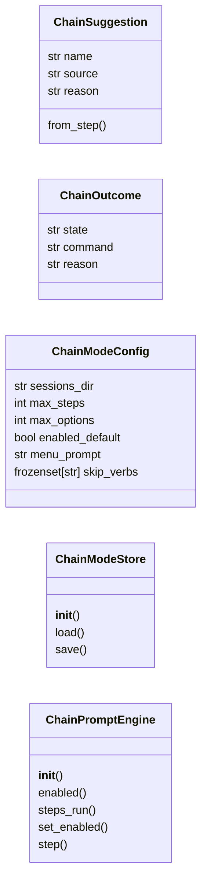
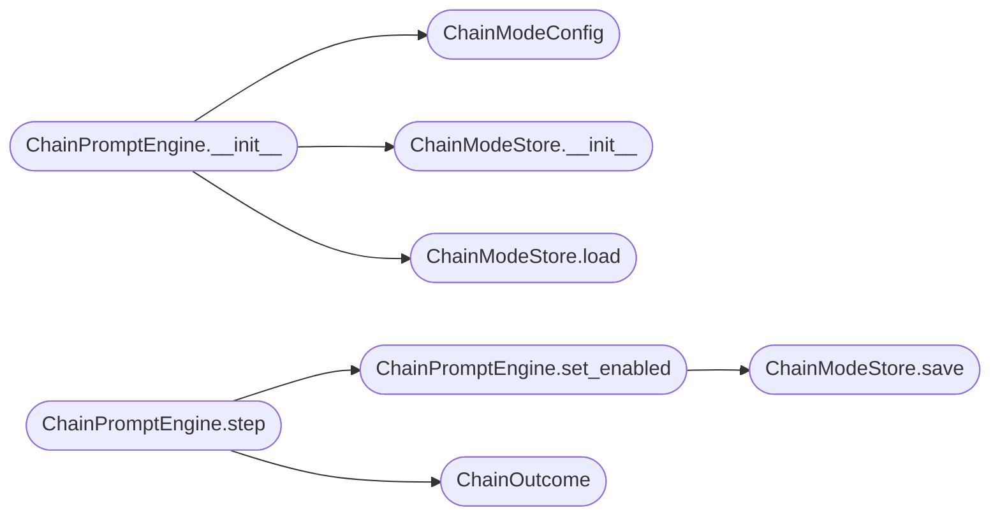

# `cli.chain_mode`

> Source: [cli/chain_mode.py:1](../../cli/chain_mode.py#L1) | language `py` | coverage 100.0% | [API index](../index.md)

Interactive kill-chain chaining coordinator.

This module glues the framework's existing "what next" brains
([`cli.command_chain.CommandChain`](cli.command_chain.py.md#commandchain), which fuses the static
kill-chain tables with nmap-discovered services, addon triggers and the
engagement phase) to an interactive prompt loop so the operator can walk
every kill-chain phase without ever leaving the shell flow.

After a command executes the operator is shown the world-model-driven
next steps and may:

* press **Enter** to run the top suggestion,
* type ``1..N`` to run that ranked alternative,
* type **any command** to override the suggestion ("no, run nmap
  instead") — that command executes and the chain continues from it,
* type `[`skip`](skills.lazyown_objective.py.md#objectivestore-skip)` to step out of the chain while keeping chain mode on,
* press **ESC**, **Ctrl+C** or type ``exit``/``quit``/``off`` to leave
  chain mode entirely (persisted, so it stays off until the operator
  runs ``chainmode on`` again).

Design (SOLID):

* `[`ChainModeConfig`](#chainmodeconfig)` centralises every magic value.
* `[`ChainModeStore`](#chainmodestore)` owns atomic persistence to
  ``sessions/chain_mode.json`` (same pattern as ``daemon_control.json``).
* `[`ChainPromptEngine`](#chainpromptengine)` is pure coordination: it receives suggestions
  from an injected ``resolver`` callable, renders via an injected
  ``print_fn``, reads operator input (TTY-aware, with ESC/Ctrl+C
  support) and returns a [`ChainOutcome`](#chainoutcome) — it never executes
  commands itself and has zero coupling to ``cmd2`` or ``lazyown.py``.

## Contents

- **Classes:** [`ChainSuggestion`](#chainsuggestion), [`ChainOutcome`](#chainoutcome), [`ChainModeConfig`](#chainmodeconfig), [`ChainModeStore`](#chainmodestore), [`ChainPromptEngine`](#chainpromptengine)
- **Constants:** [`MAX_STEPS_DEFAULT`](#max_steps_default), [`LOOP_GUARD_MARGIN`](#loop_guard_margin), [`OUTCOME_RUN`](#outcome_run), [`OUTCOME_SKIP`](#outcome_skip), [`OUTCOME_OFF`](#outcome_off), [`OUTCOME_NONE`](#outcome_none), [`EXIT_WORDS`](#exit_words), [`SKIP_WORDS`](#skip_words), [`CHAIN_SKIP_VERBS`](#chain_skip_verbs)

## Type Diagram



## Call Graph

Solid arrows stay in this module, dashed arrows leave it.



## Classes

<a id="chainsuggestion"></a>

### `ChainSuggestion`

`class` `dataclass` | [cli/chain_mode.py:183](../../cli/chain_mode.py#L183)

Decorators: `@dataclass`

```python
class ChainSuggestion
```

A single next-step proposal, normalised from any resolver output.

**Attributes**

| Name | Type | Default | Description |
|---|---|---|---|
| [`name`](#chainsuggestion-name) | `str` |  |  |
| [`source`](#chainsuggestion-source) | `str` | `''` |  |
| [`reason`](#chainsuggestion-reason) | `str` | `''` |  |

**Members**

| Member | Kind | Summary |
|---|---|---|
| [`from_step`](#chainsuggestion-from_step) | classmethod | Build a suggestion from a duck-typed resolver step object. |

<a id="chainsuggestion-from_step"></a>

#### `ChainSuggestion.from_step`

`classmethod` | [cli/chain_mode.py:191](../../cli/chain_mode.py#L191)

Decorators: `@classmethod`

```python
def from_step(cls, step: Any) -> ChainSuggestion
```

Build a suggestion from a duck-typed resolver step object.

**Parameters**

| Name | Type | Default | Description |
|---|---|---|---|
| `step` | `Any` |  | Any object exposing `[`name`](#chainsuggestion-name)`, `[`source`](#chainsuggestion-source)` and `[`reason`](#chainsuggestion-reason)` attributes (e.g. [`cli.command_chain.NextStep`](cli.command_chain.py.md#nextstep)) or a plain string. |

**Returns:** `ChainSuggestion` - A normalised [`ChainSuggestion`](#chainsuggestion).

---

<a id="chainoutcome"></a>

### `ChainOutcome`

`class` `dataclass` | [cli/chain_mode.py:212](../../cli/chain_mode.py#L212)

Decorators: `@dataclass(frozen=True)`

```python
class ChainOutcome
```

Result of one chain prompt round.

**Attributes**

| Name | Type | Default | Description |
|---|---|---|---|
| [`state`](#chainoutcome-state) | `str` |  | One of `[`OUTCOME_RUN`](#outcome_run)` (execute `[`command`](#chainoutcome-command)`), `[`OUTCOME_SKIP`](#outcome_skip)`, `[`OUTCOME_OFF`](#outcome_off)` (chain mode disabled) or `[`OUTCOME_NONE`](#outcome_none)` (no interaction happened). |
| [`command`](#chainoutcome-command) | `str` | `''` | The command line to execute when state is ``run``. This is either the top suggestion, a numbered alternative, or the operator's own override. |
| [`reason`](#chainoutcome-reason) | `str` | `''` | Human-readable explanation for the outcome. |

---

<a id="chainmodeconfig"></a>

### `ChainModeConfig`

`class` `dataclass` | [cli/chain_mode.py:231](../../cli/chain_mode.py#L231)

Decorators: `@dataclass`

```python
class ChainModeConfig
```

Centralised configuration for the chain prompt engine.

**Attributes**

| Name | Type | Default | Description |
|---|---|---|---|
| [`sessions_dir`](#chainmodeconfig-sessions_dir) | `str` | `'sessions'` |  |
| [`max_steps`](#chainmodeconfig-max_steps) | `int` | `MAX_STEPS_DEFAULT` |  |
| [`max_options`](#chainmodeconfig-max_options) | `int` | `MAX_OPTIONS_DEFAULT` |  |
| [`enabled_default`](#chainmodeconfig-enabled_default) | `bool` | `False` |  |
| [`menu_prompt`](#chainmodeconfig-menu_prompt) | `str` | `' chain> '` |  |
| [`skip_verbs`](#chainmodeconfig-skip_verbs) | `frozenset[str]` | `field(default_factory=lambda: frozenset(CHAIN_SKIP_VERBS))` |  |

---

<a id="chainmodestore"></a>

### `ChainModeStore`

`class` | [cli/chain_mode.py:242](../../cli/chain_mode.py#L242)

```python
class ChainModeStore
```

Atomic persistence of the chain-mode toggle in the sessions dir.

Persistence is best-effort by design: a read-only sessions directory
must never break the interactive chain flow. Failures are logged so
operators and developers can see them instead of failing silently.

**Members**

| Member | Kind | Summary |
|---|---|---|
| [`__init__`](#chainmodestore-__init__) | constructor | Store the sessions directory that owns the state file. |
| [`load`](#chainmodestore-load) | method | Return the persisted enabled flag, or ``None`` when unset. |
| [`save`](#chainmodestore-save) | method | Persist the enabled flag atomically. |

<a id="chainmodestore-__init__"></a>

#### `ChainModeStore.__init__`

`constructor` | [cli/chain_mode.py:250](../../cli/chain_mode.py#L250)

```python
def __init__(self, sessions_dir: str = 'sessions') -> None
```

Store the sessions directory that owns the state file.

**Parameters**

| Name | Type | Default | Description |
|---|---|---|---|
| `sessions_dir` | `str` | `'sessions'` | Directory under which ``chain_mode.json`` lives. |

*Called by:* [`ChainPromptEngine.__init__`](#chainpromptengine-__init__)

<a id="chainmodestore-load"></a>

#### `ChainModeStore.load`

`method` | [cli/chain_mode.py:258](../../cli/chain_mode.py#L258)

```python
def load(self) -> bool | None
```

Return the persisted enabled flag, or ``None`` when unset.

**Returns:** `bool | None` - The stored boolean, or ``None`` when the file is missing or
malformed.

*Called by:* [`ChainPromptEngine.__init__`](#chainpromptengine-__init__)

<a id="chainmodestore-save"></a>

#### `ChainModeStore.save`

`method` | [cli/chain_mode.py:275](../../cli/chain_mode.py#L275)

```python
def save(self, enabled: bool) -> None
```

Persist the enabled flag atomically.

**Parameters**

| Name | Type | Default | Description |
|---|---|---|---|
| `enabled` | `bool` |  | Whether chain mode is currently active. |

*Called by:* [`ChainPromptEngine.set_enabled`](#chainpromptengine-set_enabled)

---

<a id="chainpromptengine"></a>

### `ChainPromptEngine`

`class` | [cli/chain_mode.py:298](../../cli/chain_mode.py#L298)

```python
class ChainPromptEngine
```

Coordinate one interactive chain prompt round per executed command.

**Members**

| Member | Kind | Summary |
|---|---|---|
| [`__init__`](#chainpromptengine-__init__) | constructor | Wire the engine with its config, resolver and I/O functions. |
| [`enabled`](#chainpromptengine-enabled) | property | Whether the chain prompt loop is currently active. |
| [`steps_run`](#chainpromptengine-steps_run) | property | Number of commands executed through the chain this activation. |
| [`set_enabled`](#chainpromptengine-set_enabled) | method | Toggle chain mode and optionally persist the choice. |
| [`step`](#chainpromptengine-step) | method | Run one chain prompt round for the command that just executed. |

<a id="chainpromptengine-__init__"></a>

#### `ChainPromptEngine.__init__`

`constructor` | [cli/chain_mode.py:301](../../cli/chain_mode.py#L301)

```python
def __init__(self, config: ChainModeConfig | None = None, resolver: Callable[[str, str], Sequence[Any]] | None = None, *, input_fn: Callable[[str], str] = input, print_fn: Callable[[str], None] = print, interactive: bool = True) -> None
```

Wire the engine with its config, resolver and I/O functions.

**Parameters**

| Name | Type | Default | Description |
|---|---|---|---|
| `config` | `ChainModeConfig \| None` | `None` | Centralised configuration. Built from defaults when omitted. |
| `resolver` | `Callable[[str, str], Sequence[Any]] \| None` | `None` | Callable ``(cmd, phase) -> sequence`` returning duck-typed steps with `[`name`](#chainsuggestion-name)`/`[`source`](#chainsuggestion-source)`/`[`reason`](#chainsuggestion-reason)` attributes. ``None`` yields no suggestions. |
| `input_fn` | `Callable[[str], str]` | `input` | Function used to read one line of operator input. |
| `print_fn` | `Callable[[str], None]` | `print` | Function used to render the menu lines. |
| `interactive` | `bool` | `True` | When ``False`` the engine never prompts (used by headless/daemon shells so the flow cannot block). |

*Calls:* [`ChainModeConfig`](#chainmodeconfig), [`ChainModeStore.__init__`](#chainmodestore-__init__), [`ChainModeStore.load`](#chainmodestore-load)

<a id="chainpromptengine-enabled"></a>

#### `ChainPromptEngine.enabled`

`property` | [cli/chain_mode.py:335](../../cli/chain_mode.py#L335)

Decorators: `@property`

```python
def enabled(self) -> bool
```

Whether the chain prompt loop is currently active.

**Returns:** `bool`

<a id="chainpromptengine-steps_run"></a>

#### `ChainPromptEngine.steps_run`

`property` | [cli/chain_mode.py:340](../../cli/chain_mode.py#L340)

Decorators: `@property`

```python
def steps_run(self) -> int
```

Number of commands executed through the chain this activation.

**Returns:** `int`

<a id="chainpromptengine-set_enabled"></a>

#### `ChainPromptEngine.set_enabled`

`method` | [cli/chain_mode.py:344](../../cli/chain_mode.py#L344)

```python
def set_enabled(self, value: bool, persist: bool = True) -> None
```

Toggle chain mode and optionally persist the choice.

**Parameters**

| Name | Type | Default | Description |
|---|---|---|---|
| `value` | `bool` |  | New enabled state. |
| `persist` | `bool` | `True` | When ``True`` write through to the state file. |

*Calls:* [`ChainModeStore.save`](#chainmodestore-save)

*Called by:* [`ChainPromptEngine.step`](#chainpromptengine-step)

<a id="chainpromptengine-step"></a>

#### `ChainPromptEngine.step`

`method` | [cli/chain_mode.py:358](../../cli/chain_mode.py#L358)

```python
def step(self, last_cmd: str, phase: str = '') -> ChainOutcome
```

Run one chain prompt round for the command that just executed.

**Parameters**

| Name | Type | Default | Description |
|---|---|---|---|
| `last_cmd` | `str` |  | First token (or full line) of the command that just ran, used as the resolver seed. |
| `phase` | `str` | `''` | Current engagement phase (``recon``, ``enum``, ...) forwarded to the resolver. |

**Returns:** `ChainOutcome` - A [`ChainOutcome`](#chainoutcome) describing what the caller should do:
execute `[`command`](#chainoutcome-command)`, skip, or disable chain mode. Returns
`[`OUTCOME_NONE`](#outcome_none)` without touching stdin when the engine is
disabled, non-interactive, the verb is in `[`skip_verbs`](#chainmodeconfig-skip_verbs)` or
the auto-pause limit was reached.

*Calls:* [`ChainOutcome`](#chainoutcome), [`ChainPromptEngine.set_enabled`](#chainpromptengine-set_enabled)

---

## Constants

<a id="max_steps_default"></a>

### `MAX_STEPS_DEFAULT`

`constant` | [cli/chain_mode.py:48](../../cli/chain_mode.py#L48)

```python
MAX_STEPS_DEFAULT: int = 12
```

---

<a id="loop_guard_margin"></a>

### `LOOP_GUARD_MARGIN`

`constant` | [cli/chain_mode.py:50](../../cli/chain_mode.py#L50)

```python
LOOP_GUARD_MARGIN: int = 4
```

---

<a id="outcome_run"></a>

### `OUTCOME_RUN`

`constant` | [cli/chain_mode.py:52](../../cli/chain_mode.py#L52)

```python
OUTCOME_RUN: str = 'run'
```

---

<a id="outcome_skip"></a>

### `OUTCOME_SKIP`

`constant` | [cli/chain_mode.py:53](../../cli/chain_mode.py#L53)

```python
OUTCOME_SKIP: str = 'skip'
```

---

<a id="outcome_off"></a>

### `OUTCOME_OFF`

`constant` | [cli/chain_mode.py:54](../../cli/chain_mode.py#L54)

```python
OUTCOME_OFF: str = 'off'
```

---

<a id="outcome_none"></a>

### `OUTCOME_NONE`

`constant` | [cli/chain_mode.py:55](../../cli/chain_mode.py#L55)

```python
OUTCOME_NONE: str = 'none'
```

---

<a id="exit_words"></a>

### `EXIT_WORDS`

`constant` | [cli/chain_mode.py:57](../../cli/chain_mode.py#L57)

```python
EXIT_WORDS: frozenset[str] = frozenset({'off', 'stop', 'exit', 'quit', 'end', 'disable'})
```

---

<a id="skip_words"></a>

### `SKIP_WORDS`

`constant` | [cli/chain_mode.py:58](../../cli/chain_mode.py#L58)

```python
SKIP_WORDS: frozenset[str] = frozenset({'skip', 'none', 'later', 's'})
```

---

<a id="chain_skip_verbs"></a>

### `CHAIN_SKIP_VERBS`

`constant` | [cli/chain_mode.py:179](../../cli/chain_mode.py#L179)

```python
CHAIN_SKIP_VERBS: frozenset[str] = BASE_NOISE_VERBS | CHAIN_EXTRA_VERBS
```

---
