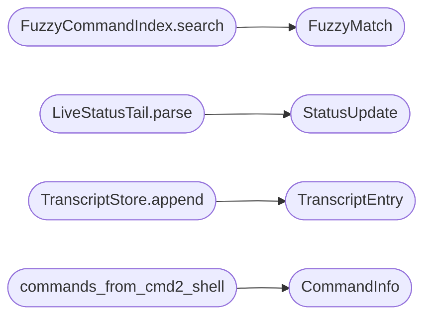

# `cli.cli_enhancements`

> Source: [cli/cli_enhancements.py:1](../../cli/cli_enhancements.py#L1) | language `py` | coverage 54.7% | [API index](../index.md)

CLI enhancement primitives for the LazyOwn interactive shell.

This module exposes SOLID, framework-agnostic building blocks used by the
``cli/commands/audit.py`` CommandSet to extend the LazyOwn shell with:

- Fuzzy command discovery (item 4).
- Payload-aware tab completion (item 5).
- Dynamic alias resolution at execution time (item 6).
- Hot-reload of declarative addons / Lua plugins (item 7).
- Live tail of long-running commands' partial output (item 8).
- Transcript indexing + grep across recent command outputs (item 10).
- Interactive forms for commands with many parameters (item 11).

Design notes
------------
- Each primitive depends on small ``typing.Protocol`` interfaces so unit
  tests can substitute fakes without spinning up a cmd2 shell.
- Filesystem and runtime side effects live in concrete adaptors only;
  the algorithmic core is pure.
- No imports from ``lazyown.py`` are allowed: the shell composes these
  primitives, not the other way around (Dependency Inversion).

## Contents

- **Classes:** [`CommandInfo`](#commandinfo), [`FuzzyMatch`](#fuzzymatch), [`FuzzyCommandIndex`](#fuzzycommandindex), [`CompletionResult`](#completionresult), [`PayloadAwareCompleter`](#payloadawarecompleter), [`AliasResolver`](#aliasresolver), [`DynamicAliasResolver`](#dynamicaliasresolver), [`HotReloader`](#hotreloader), [`AddonHotReloader`](#addonhotreloader), [`StatusUpdate`](#statusupdate), [`LiveStatusTail`](#livestatustail), [`TranscriptEntry`](#transcriptentry), [`TranscriptStore`](#transcriptstore), [`FormField`](#formfield), [`FormSpec`](#formspec), [`InteractiveForm`](#interactiveform), [`DictPayloadProvider`](#dictpayloadprovider), [`StaticCommandLister`](#staticcommandlister)
- **Protocols:** [`PayloadProvider`](#payloadprovider), [`CommandLister`](#commandlister), [`TerminalIO`](#terminalio)
- **Functions:** [`commands_from_cmd2_shell`](#commands_from_cmd2_shell)

## Type Diagram

```mermaid
classDiagram
    direction LR
    class PayloadProvider
    <<protocol>> PayloadProvider
    PayloadProvider : get()
    PayloadProvider : keys()
    class CommandLister
    <<protocol>> CommandLister
    CommandLister : commands()
    class TerminalIO
    <<protocol>> TerminalIO
    TerminalIO : prompt()
    TerminalIO : emit()
    class CommandInfo
    CommandInfo : str name
    CommandInfo : str summary
    CommandInfo : str phase
    CommandInfo : str category
    CommandInfo : tuple[str, ] aliases
    class FuzzyMatch
    FuzzyMatch : CommandInfo info
    FuzzyMatch : float score
    FuzzyMatch : str matched_field
    class FuzzyCommandIndex
    FuzzyCommandIndex : __init__()
    FuzzyCommandIndex : search()
    class CompletionResult
    CompletionResult : str text
    CompletionResult : str description
    class PayloadAwareCompleter
    PayloadAwareCompleter : __init__()
    PayloadAwareCompleter : complete()
    class AliasResolver
    AliasResolver : expand()
    class DynamicAliasResolver
    DynamicAliasResolver : expand()
    class HotReloader
    HotReloader : start()
    HotReloader : stop()
    class AddonHotReloader
    AddonHotReloader : __init__()
    AddonHotReloader : start()
    AddonHotReloader : stop()
    AddonHotReloader : poll_once()
    class StatusUpdate
    StatusUpdate : int ports_seen
    StatusUpdate : tuple[int, ] open_ports
    StatusUpdate : str last_line
    StatusUpdate : float  None completed_pct
    class LiveStatusTail
    LiveStatusTail : parse()
    class TranscriptEntry
    TranscriptEntry : float timestamp
    TranscriptEntry : str command
    TranscriptEntry : str output
    TranscriptEntry : tuple[str, ] artefacts
    class TranscriptStore
    TranscriptStore : __init__()
    TranscriptStore : append()
    TranscriptStore : grep()
    TranscriptStore : list()
    class FormField
    FormField : str name
    FormField : str description
    FormField : Any default
    FormField : bool required
    FormField : tuple[str, ] options
    class FormSpec
    FormSpec : str command
    FormSpec : tuple[FormField, ] fields
    FormSpec : str summary
    class InteractiveForm
    InteractiveForm : __init__()
    InteractiveForm : render()
    class DictPayloadProvider
    DictPayloadProvider : __init__()
    DictPayloadProvider : get()
    DictPayloadProvider : keys()
    DictPayloadProvider : update()
    class StaticCommandLister
    StaticCommandLister : __init__()
    StaticCommandLister : commands()
    AliasResolver <|-- DynamicAliasResolver
    HotReloader <|-- AddonHotReloader
```



## Call Graph

Solid arrows stay in this module, dashed arrows leave it.



## Classes

<a id="commandinfo"></a>

### `CommandInfo`

`class` `dataclass` | [cli/cli_enhancements.py:61](../../cli/cli_enhancements.py#L61)

Decorators: `@dataclass(frozen=True)`

```python
class CommandInfo
```

Lightweight description of a shell command.

**Attributes**

| Name | Type | Default | Description |
|---|---|---|---|
| [`name`](#commandinfo-name) | `str` |  |  |
| [`summary`](#commandinfo-summary) | `str` | `''` |  |
| [`phase`](#commandinfo-phase) | `str` | `''` |  |
| [`category`](#commandinfo-category) | `str` | `''` |  |
| [`aliases`](#commandinfo-aliases) | `tuple[str, ...]` | `()` |  |

---

<a id="fuzzymatch"></a>

### `FuzzyMatch`

`class` `dataclass` | [cli/cli_enhancements.py:75](../../cli/cli_enhancements.py#L75)

Decorators: `@dataclass(frozen=True)`

```python
class FuzzyMatch
```

A scored fuzzy match against a CommandInfo.

**Attributes**

| Name | Type | Default | Description |
|---|---|---|---|
| [`info`](#fuzzymatch-info) | `CommandInfo` |  |  |
| [`score`](#fuzzymatch-score) | `float` |  |  |
| [`matched_field`](#fuzzymatch-matched_field) | `str` |  |  |

---

<a id="fuzzycommandindex"></a>

### `FuzzyCommandIndex`

`class` | [cli/cli_enhancements.py:83](../../cli/cli_enhancements.py#L83)

```python
class FuzzyCommandIndex
```

Search a command catalogue with token-aware fuzzy matching.

Scoring favours exact and prefix matches over substring and
similarity-only hits, then falls back to ``difflib.SequenceMatcher``
so the index degrades gracefully when ``rapidfuzz`` is missing.

**Members**

| Member | Kind | Summary |
|---|---|---|
| [`__init__`](#fuzzycommandindex-__init__) | constructor |  |
| [`search`](#fuzzycommandindex-search) | method | Return the top ``limit`` matches ordered by descending score. |

<a id="fuzzycommandindex-__init__"></a>

#### `FuzzyCommandIndex.__init__`

`constructor` | [cli/cli_enhancements.py:91](../../cli/cli_enhancements.py#L91)

```python
def __init__(self, source: CommandLister) -> None
```

**Parameters**

| Name | Type | Default | Description |
|---|---|---|---|
| `source` | `CommandLister` |  |  |

<a id="fuzzycommandindex-search"></a>

#### `FuzzyCommandIndex.search`

`method` | [cli/cli_enhancements.py:94](../../cli/cli_enhancements.py#L94)

```python
def search(self, query: str, limit: int = 25) -> list[FuzzyMatch]
```

Return the top ``limit`` matches ordered by descending score.

**Parameters**

| Name | Type | Default | Description |
|---|---|---|---|
| `query` | `str` |  |  |
| `limit` | `int` | `25` |  |

**Returns:** `list[FuzzyMatch]`

*Calls:* [`FuzzyMatch`](#fuzzymatch)

---

<a id="completionresult"></a>

### `CompletionResult`

`class` `dataclass` | [cli/cli_enhancements.py:138](../../cli/cli_enhancements.py#L138)

Decorators: `@dataclass(frozen=True)`

```python
class CompletionResult
```

A single tab-completion suggestion.

**Attributes**

| Name | Type | Default | Description |
|---|---|---|---|
| [`text`](#completionresult-text) | `str` |  |  |
| [`description`](#completionresult-description) | `str` | `''` |  |

---

<a id="payloadawarecompleter"></a>

### `PayloadAwareCompleter`

`class` | [cli/cli_enhancements.py:145](../../cli/cli_enhancements.py#L145)

```python
class PayloadAwareCompleter
```

Suggest values from ``payload.json`` for context-sensitive arguments.

The completer is intentionally simple — it inspects the command name and
the partial token under the cursor and returns suggestions drawn from:

- ``rhost`` and ``targets[*].ip`` for ``set rhost``, ``set domain`` etc.
- Wordlist files on disk for ``gobuster``, `[`ffuf`](contrib.legacy.lazyseo.py.md#ffuf)`, ``hashcat``.
- Available addons and Lua plugins for ``run`` / `[`reload`](modules.orchestrator_config.py.md#reload)`.
- Stored credentials for ``evil``, ``cme``, ``secretsdump``.

The shell's existing ``complete_*`` per-command hooks remain authoritative
where they exist; this helper is invoked from `[`completedefault`](lazyown.py.md#lazyownshell-completedefault)` to fill
the gap for the ~280 commands that don't define their own.

**Members**

| Member | Kind | Summary |
|---|---|---|
| [`__init__`](#payloadawarecompleter-__init__) | constructor |  |
| [`complete`](#payloadawarecompleter-complete) | method | Return suggestions for ``partial`` given the leading `[`command`](#transcriptentry-command)`. |

<a id="payloadawarecompleter-__init__"></a>

#### `PayloadAwareCompleter.__init__`

`constructor` | [cli/cli_enhancements.py:164](../../cli/cli_enhancements.py#L164)

```python
def __init__(self, payload: PayloadProvider, addon_lister: Callable[[], Sequence[str]] | None = None, plugin_lister: Callable[[], Sequence[str]] | None = None, credential_lister: Callable[[], Sequence[str]] | None = None) -> None
```

**Parameters**

| Name | Type | Default | Description |
|---|---|---|---|
| `payload` | `PayloadProvider` |  |  |
| `addon_lister` | `Callable[[], Sequence[str]] \| None` | `None` |  |
| `plugin_lister` | `Callable[[], Sequence[str]] \| None` | `None` |  |
| `credential_lister` | `Callable[[], Sequence[str]] \| None` | `None` |  |

*Called by:* [`LazyOwnShell.completedefault`](lazyown.py.md#lazyownshell-completedefault)

<a id="payloadawarecompleter-complete"></a>

#### `PayloadAwareCompleter.complete`

`method` | [cli/cli_enhancements.py:176](../../cli/cli_enhancements.py#L176)

```python
def complete(self, command: str, partial: str) -> list[CompletionResult]
```

Return suggestions for ``partial`` given the leading `[`command`](#transcriptentry-command)`.

**Parameters**

| Name | Type | Default | Description |
|---|---|---|---|
| `command` | `str` |  |  |
| `partial` | `str` |  |  |

**Returns:** `list[CompletionResult]`

*Called by:* [`LazyOwnShell.completedefault`](lazyown.py.md#lazyownshell-completedefault)

---

<a id="aliasresolver"></a>

### `AliasResolver`

`class` `abstract` | [cli/cli_enhancements.py:234](../../cli/cli_enhancements.py#L234)

```python
class AliasResolver(ABC)
```

Bases: `ABC`

Subclasses: [`DynamicAliasResolver`](#dynamicaliasresolver)

Resolves alias templates into executable command strings.

**Members**

| Member | Kind | Summary |
|---|---|---|
| [`expand`](#aliasresolver-expand) | method | Return the alias rendered against the current payload. |

<a id="aliasresolver-expand"></a>

#### `AliasResolver.expand`

`method` `abstract` | [cli/cli_enhancements.py:238](../../cli/cli_enhancements.py#L238)

Decorators: `@abstractmethod`

```python
def expand(self, alias_name: str, raw_template: str, payload: PayloadProvider) -> str
```

Return the alias rendered against the current payload.

**Parameters**

| Name | Type | Default | Description |
|---|---|---|---|
| `alias_name` | `str` |  |  |
| `raw_template` | `str` |  |  |
| `payload` | `PayloadProvider` |  |  |

**Returns:** `str`

---

<a id="dynamicaliasresolver"></a>

### `DynamicAliasResolver`

`class` | [cli/cli_enhancements.py:242](../../cli/cli_enhancements.py#L242)

```python
class DynamicAliasResolver(AliasResolver)
```

Bases: [`AliasResolver`](#aliasresolver)

Resolve placeholders at execution time, not at shell load.

The previous loader pre-substituted ``{rhost}`` etc. against the payload
snapshot taken at startup. That meant editing ``payload.json`` at runtime
(e.g. via ``set rhost X``) only affected commands invoked through cmd2's
onecmd_plus_hooks pathway. This resolver always renders against the
payload provided by the caller, so a ``set rhost`` immediately propagates
to every alias the operator types next.

**Members**

| Member | Kind | Summary |
|---|---|---|
| [`expand`](#dynamicaliasresolver-expand) | method | Return the alias rendered against the current payload. |

<a id="dynamicaliasresolver-expand"></a>

#### `DynamicAliasResolver.expand`

`method` | [cli/cli_enhancements.py:255](../../cli/cli_enhancements.py#L255)

```python
def expand(self, alias_name: str, raw_template: str, payload: PayloadProvider) -> str
```

Return the alias rendered against the current payload.

**Parameters**

| Name | Type | Default | Description |
|---|---|---|---|
| `alias_name` | `str` |  |  |
| `raw_template` | `str` |  |  |
| `payload` | `PayloadProvider` |  |  |

**Returns:** `str`

> **Inherited:** Documentation from [`AliasResolver.expand`](#aliasresolver-expand) (cli/cli_enhancements.py:238).

*Called by:* [`LazyOwnShell.onecmd_plus_hooks`](lazyown.py.md#lazyownshell-onecmd_plus_hooks)

---

<a id="hotreloader"></a>

### `HotReloader`

`class` `abstract` | [cli/cli_enhancements.py:270](../../cli/cli_enhancements.py#L270)

```python
class HotReloader(ABC)
```

Bases: `ABC`

Subclasses: [`AddonHotReloader`](#addonhotreloader)

Notify subscribers when a watched directory changes.

**Members**

| Member | Kind | Summary |
|---|---|---|
| [`start`](#hotreloader-start) | method |  |
| [`stop`](#hotreloader-stop) | method |  |

<a id="hotreloader-start"></a>

#### `HotReloader.start`

`method` `abstract` | [cli/cli_enhancements.py:274](../../cli/cli_enhancements.py#L274)

Decorators: `@abstractmethod`

```python
def start(self) -> None
```

<a id="hotreloader-stop"></a>

#### `HotReloader.stop`

`method` `abstract` | [cli/cli_enhancements.py:277](../../cli/cli_enhancements.py#L277)

Decorators: `@abstractmethod`

```python
def stop(self) -> None
```

---

<a id="addonhotreloader"></a>

### `AddonHotReloader`

`class` | [cli/cli_enhancements.py:280](../../cli/cli_enhancements.py#L280)

```python
class AddonHotReloader(HotReloader)
```

Bases: [`HotReloader`](#hotreloader)

Polling watcher over ``lazyaddons/`` and ``plugins/``.

A polling loop is intentionally chosen over watchdog inotify so this
works on remote shells, in containers, and over NFS — environments where
inotify is unreliable. Pass a fast tick (e.g. 2.0s) when used interactively.

**Members**

| Member | Kind | Summary |
|---|---|---|
| [`__init__`](#addonhotreloader-__init__) | constructor |  |
| [`start`](#addonhotreloader-start) | method |  |
| [`stop`](#addonhotreloader-stop) | method |  |
| [`poll_once`](#addonhotreloader-poll_once) | method | Run a single scan, fire callbacks for changed paths, return them. |

<a id="addonhotreloader-__init__"></a>

#### `AddonHotReloader.__init__`

`constructor` | [cli/cli_enhancements.py:288](../../cli/cli_enhancements.py#L288)

```python
def __init__(self, directories: Sequence[Path | str], on_change: Callable[[Path], None], tick_seconds: float = 2.0) -> None
```

**Parameters**

| Name | Type | Default | Description |
|---|---|---|---|
| `directories` | `Sequence[Path \| str]` |  |  |
| `on_change` | `Callable[[Path], None]` |  |  |
| `tick_seconds` | `float` | `2.0` |  |

<a id="addonhotreloader-start"></a>

#### `AddonHotReloader.start`

`method` | [cli/cli_enhancements.py:301](../../cli/cli_enhancements.py#L301)

```python
def start(self) -> None
```

<a id="addonhotreloader-stop"></a>

#### `AddonHotReloader.stop`

`method` | [cli/cli_enhancements.py:313](../../cli/cli_enhancements.py#L313)

```python
def stop(self) -> None
```

<a id="addonhotreloader-poll_once"></a>

#### `AddonHotReloader.poll_once`

`method` | [cli/cli_enhancements.py:319](../../cli/cli_enhancements.py#L319)

```python
def poll_once(self) -> list[Path]
```

Run a single scan, fire callbacks for changed paths, return them.

**Returns:** `list[Path]`

---

<a id="statusupdate"></a>

### `StatusUpdate`

`class` `dataclass` | [cli/cli_enhancements.py:362](../../cli/cli_enhancements.py#L362)

Decorators: `@dataclass(frozen=True)`

```python
class StatusUpdate
```

One progress observation parsed from a partial scan output.

**Attributes**

| Name | Type | Default | Description |
|---|---|---|---|
| [`ports_seen`](#statusupdate-ports_seen) | `int` | `0` |  |
| [`open_ports`](#statusupdate-open_ports) | `tuple[int, ...]` | `()` |  |
| [`last_line`](#statusupdate-last_line) | `str` | `''` |  |
| [`completed_pct`](#statusupdate-completed_pct) | `float \| None` | `None` |  |

---

<a id="livestatustail"></a>

### `LiveStatusTail`

`class` | [cli/cli_enhancements.py:371](../../cli/cli_enhancements.py#L371)

```python
class LiveStatusTail
```

Parse a partial nmap / pwntomate file and emit a structured update.

The parser is best-effort and forgiving: anything it doesn't recognise
becomes `[`last_line`](#statusupdate-last_line)` so the operator still sees something live.

**Members**

| Member | Kind | Summary |
|---|---|---|
| [`parse`](#livestatustail-parse) | method |  |

<a id="livestatustail-parse"></a>

#### `LiveStatusTail.parse`

`method` | [cli/cli_enhancements.py:382](../../cli/cli_enhancements.py#L382)

```python
def parse(self, content: str) -> StatusUpdate
```

**Parameters**

| Name | Type | Default | Description |
|---|---|---|---|
| `content` | `str` |  |  |

**Returns:** `StatusUpdate`

*Calls:* [`StatusUpdate`](#statusupdate)

*Called by:* [`AuditCommandSet.do_status_tail`](cli.commands.audit.py.md#auditcommandset-do_status_tail)

---

<a id="transcriptentry"></a>

### `TranscriptEntry`

`class` `dataclass` | [cli/cli_enhancements.py:418](../../cli/cli_enhancements.py#L418)

Decorators: `@dataclass`

```python
class TranscriptEntry
```

A captured command + output pair.

**Attributes**

| Name | Type | Default | Description |
|---|---|---|---|
| [`timestamp`](#transcriptentry-timestamp) | `float` |  |  |
| [`command`](#transcriptentry-command) | `str` |  |  |
| [`output`](#transcriptentry-output) | `str` |  |  |
| [`artefacts`](#transcriptentry-artefacts) | `tuple[str, ...]` | `()` |  |

---

<a id="transcriptstore"></a>

### `TranscriptStore`

`class` | [cli/cli_enhancements.py:427](../../cli/cli_enhancements.py#L427)

```python
class TranscriptStore
```

In-memory ring buffer of recent command outputs with regex grep.

Persists to ``sessions/_cli_transcript.jsonl`` so a restart does not lose
the history; on startup the most recent `[`capacity`](lazygui.services.event_log.py.md#eventlog-capacity)` entries are loaded
back. Each entry stores: timestamp, command, output (truncated to
`[`max_output_chars`](modules.llm_pool.py.md#poolconfig-max_output_chars)`), and artefact paths the command claims to have
produced (informational only).

**Members**

| Member | Kind | Summary |
|---|---|---|
| [`__init__`](#transcriptstore-__init__) | constructor |  |
| [`append`](#transcriptstore-append) | method |  |
| [`grep`](#transcriptstore-grep) | method | Return matching lines across all stored outputs. |
| [`list`](#transcriptstore-list) | method |  |

<a id="transcriptstore-__init__"></a>

#### `TranscriptStore.__init__`

`constructor` | [cli/cli_enhancements.py:437](../../cli/cli_enhancements.py#L437)

```python
def __init__(self, sessions_dir: Path | str, capacity: int = 200, max_output_chars: int = 64 * 1024) -> None
```

**Parameters**

| Name | Type | Default | Description |
|---|---|---|---|
| `sessions_dir` | `Path \| str` |  |  |
| `capacity` | `int` | `200` |  |
| `max_output_chars` | `int` | `64 * 1024` |  |

<a id="transcriptstore-append"></a>

#### `TranscriptStore.append`

`method` | [cli/cli_enhancements.py:451](../../cli/cli_enhancements.py#L451)

```python
def append(self, command: str, output: str, artefacts: Iterable[str] = ()) -> None
```

**Parameters**

| Name | Type | Default | Description |
|---|---|---|---|
| `command` | `str` |  |  |
| `output` | `str` |  |  |
| `artefacts` | `Iterable[str]` | `()` |  |

*Calls:* [`TranscriptEntry`](#transcriptentry)

<a id="transcriptstore-grep"></a>

#### `TranscriptStore.grep`

`method` | [cli/cli_enhancements.py:465](../../cli/cli_enhancements.py#L465)

```python
def grep(self, pattern: str, command_filter: str | None = None, limit: int = 50, case_insensitive: bool = True) -> list[dict[str, Any]]
```

Return matching lines across all stored outputs.

**Parameters**

| Name | Type | Default | Description |
|---|---|---|---|
| `pattern` | `str` |  |  |
| `command_filter` | `str \| None` | `None` |  |
| `limit` | `int` | `50` |  |
| `case_insensitive` | `bool` | `True` |  |

**Returns:** `list[dict[str, Any]]`

<a id="transcriptstore-list"></a>

#### `TranscriptStore.list`

`method` | [cli/cli_enhancements.py:497](../../cli/cli_enhancements.py#L497)

```python
def list(self, limit: int = 20) -> list[dict[str, Any]]
```

**Parameters**

| Name | Type | Default | Description |
|---|---|---|---|
| `limit` | `int` | `20` |  |

**Returns:** `list[dict[str, Any]]`

---

<a id="formfield"></a>

### `FormField`

`class` `dataclass` | [cli/cli_enhancements.py:555](../../cli/cli_enhancements.py#L555)

Decorators: `@dataclass(frozen=True)`

```python
class FormField
```

Specification for one input in an interactive form.

**Attributes**

| Name | Type | Default | Description |
|---|---|---|---|
| [`name`](#formfield-name) | `str` |  |  |
| [`description`](#formfield-description) | `str` | `''` |  |
| [`default`](#formfield-default) | `Any` | `None` |  |
| [`required`](#formfield-required) | `bool` | `False` |  |
| [`options`](#formfield-options) | `tuple[str, ...]` | `()` |  |

---

<a id="formspec"></a>

### `FormSpec`

`class` `dataclass` | [cli/cli_enhancements.py:566](../../cli/cli_enhancements.py#L566)

Decorators: `@dataclass(frozen=True)`

```python
class FormSpec
```

A bundle of form fields plus a target command name.

**Attributes**

| Name | Type | Default | Description |
|---|---|---|---|
| [`command`](#formspec-command) | `str` |  |  |
| [`fields`](#formspec-fields) | `tuple[FormField, ...]` |  |  |
| [`summary`](#formspec-summary) | `str` | `''` |  |

---

<a id="interactiveform"></a>

### `InteractiveForm`

`class` | [cli/cli_enhancements.py:588](../../cli/cli_enhancements.py#L588)

```python
class InteractiveForm
```

Walk the operator through a form, returning a populated dict.

Validates required fields and accepts `[`options`](#formfield-options)` constraints. Falls back
to defaults silently when the IO layer is non-interactive (CI, scripts).

**Members**

| Member | Kind | Summary |
|---|---|---|
| [`__init__`](#interactiveform-__init__) | constructor |  |
| [`render`](#interactiveform-render) | method |  |

<a id="interactiveform-__init__"></a>

#### `InteractiveForm.__init__`

`constructor` | [cli/cli_enhancements.py:595](../../cli/cli_enhancements.py#L595)

```python
def __init__(self, io: TerminalIO | None = None) -> None
```

**Parameters**

| Name | Type | Default | Description |
|---|---|---|---|
| `io` | `TerminalIO \| None` | `None` |  |

*Called by:* [`AuditCommandSet.do_form`](cli.commands.audit.py.md#auditcommandset-do_form)

<a id="interactiveform-render"></a>

#### `InteractiveForm.render`

`method` | [cli/cli_enhancements.py:598](../../cli/cli_enhancements.py#L598)

```python
def render(self, spec: FormSpec, defaults: dict[str, Any] | None = None) -> dict[str, Any]
```

**Parameters**

| Name | Type | Default | Description |
|---|---|---|---|
| `spec` | `FormSpec` |  |  |
| `defaults` | `dict[str, Any] \| None` | `None` |  |

**Returns:** `dict[str, Any]`

*Called by:* [`AuditCommandSet.do_form`](cli.commands.audit.py.md#auditcommandset-do_form)

---

<a id="dictpayloadprovider"></a>

### `DictPayloadProvider`

`class` | [cli/cli_enhancements.py:635](../../cli/cli_enhancements.py#L635)

```python
class DictPayloadProvider
```

Wrap any plain ``dict`` so it satisfies [`PayloadProvider`](#payloadprovider).

**Members**

| Member | Kind | Summary |
|---|---|---|
| [`__init__`](#dictpayloadprovider-__init__) | constructor |  |
| [`get`](#dictpayloadprovider-get) | method |  |
| [`keys`](#dictpayloadprovider-keys) | method |  |
| [`update`](#dictpayloadprovider-update) | method |  |

<a id="dictpayloadprovider-__init__"></a>

#### `DictPayloadProvider.__init__`

`constructor` | [cli/cli_enhancements.py:638](../../cli/cli_enhancements.py#L638)

```python
def __init__(self, data: dict[str, Any] | None = None) -> None
```

**Parameters**

| Name | Type | Default | Description |
|---|---|---|---|
| `data` | `dict[str, Any] \| None` | `None` |  |

*Called by:* [`LazyOwnShell.completedefault`](lazyown.py.md#lazyownshell-completedefault), [`LazyOwnShell.onecmd_plus_hooks`](lazyown.py.md#lazyownshell-onecmd_plus_hooks)

<a id="dictpayloadprovider-get"></a>

#### `DictPayloadProvider.get`

`method` | [cli/cli_enhancements.py:641](../../cli/cli_enhancements.py#L641)

```python
def get(self, key: str, default: Any = None) -> Any
```

**Parameters**

| Name | Type | Default | Description |
|---|---|---|---|
| `key` | `str` |  |  |
| `default` | `Any` | `None` |  |

**Returns:** `Any`

<a id="dictpayloadprovider-keys"></a>

#### `DictPayloadProvider.keys`

`method` | [cli/cli_enhancements.py:644](../../cli/cli_enhancements.py#L644)

```python
def keys(self) -> Iterable[str]
```

**Returns:** `Iterable[str]`

<a id="dictpayloadprovider-update"></a>

#### `DictPayloadProvider.update`

`method` | [cli/cli_enhancements.py:647](../../cli/cli_enhancements.py#L647)

```python
def update(self, data: dict[str, Any]) -> None
```

**Parameters**

| Name | Type | Default | Description |
|---|---|---|---|
| `data` | `dict[str, Any]` |  |  |

---

<a id="staticcommandlister"></a>

### `StaticCommandLister`

`class` | [cli/cli_enhancements.py:651](../../cli/cli_enhancements.py#L651)

```python
class StaticCommandLister
```

Source for FuzzyCommandIndex backed by a fixed list of CommandInfo.

**Members**

| Member | Kind | Summary |
|---|---|---|
| [`__init__`](#staticcommandlister-__init__) | constructor |  |
| [`commands`](#staticcommandlister-commands) | method |  |

<a id="staticcommandlister-__init__"></a>

#### `StaticCommandLister.__init__`

`constructor` | [cli/cli_enhancements.py:654](../../cli/cli_enhancements.py#L654)

```python
def __init__(self, commands: Sequence[CommandInfo]) -> None
```

**Parameters**

| Name | Type | Default | Description |
|---|---|---|---|
| `commands` | `Sequence[CommandInfo]` |  |  |

<a id="staticcommandlister-commands"></a>

#### `StaticCommandLister.commands`

`method` | [cli/cli_enhancements.py:657](../../cli/cli_enhancements.py#L657)

```python
def commands(self) -> list[CommandInfo]
```

**Returns:** `list[CommandInfo]`

---

## Protocols

<a id="payloadprovider"></a>

### `PayloadProvider`

`protocol` | [cli/cli_enhancements.py:40](../../cli/cli_enhancements.py#L40)

```python
class PayloadProvider(Protocol)
```

Bases: `Protocol`

Read-only view onto ``payload.json`` style configuration.

**Members**

| Member | Kind | Summary |
|---|---|---|
| [`get`](#payloadprovider-get) | method |  |
| [`keys`](#payloadprovider-keys) | method |  |

<a id="payloadprovider-get"></a>

#### `PayloadProvider.get`

`method` | [cli/cli_enhancements.py:43](../../cli/cli_enhancements.py#L43)

```python
def get(self, key: str, default: Any = None) -> Any
```

**Parameters**

| Name | Type | Default | Description |
|---|---|---|---|
| `key` | `str` |  |  |
| `default` | `Any` | `None` |  |

**Returns:** `Any`

<a id="payloadprovider-keys"></a>

#### `PayloadProvider.keys`

`method` | [cli/cli_enhancements.py:44](../../cli/cli_enhancements.py#L44)

```python
def keys(self) -> Iterable[str]
```

**Returns:** `Iterable[str]`

---

<a id="commandlister"></a>

### `CommandLister`

`protocol` | [cli/cli_enhancements.py:47](../../cli/cli_enhancements.py#L47)

```python
class CommandLister(Protocol)
```

Bases: `Protocol`

Source of command metadata for indexing / fuzzy matching.

**Members**

| Member | Kind | Summary |
|---|---|---|
| [`commands`](#commandlister-commands) | method |  |

<a id="commandlister-commands"></a>

#### `CommandLister.commands`

`method` | [cli/cli_enhancements.py:50](../../cli/cli_enhancements.py#L50)

```python
def commands(self) -> list[CommandInfo]
```

**Returns:** `list[CommandInfo]`

---

<a id="terminalio"></a>

### `TerminalIO`

`protocol` | [cli/cli_enhancements.py:53](../../cli/cli_enhancements.py#L53)

```python
class TerminalIO(Protocol)
```

Bases: `Protocol`

Minimal duck-typed prompt/print pair so tests can fake it.

**Members**

| Member | Kind | Summary |
|---|---|---|
| [`prompt`](#terminalio-prompt) | method |  |
| [`emit`](#terminalio-emit) | method |  |

<a id="terminalio-prompt"></a>

#### `TerminalIO.prompt`

`method` | [cli/cli_enhancements.py:56](../../cli/cli_enhancements.py#L56)

```python
def prompt(self, message: str, default: str = '') -> str
```

**Parameters**

| Name | Type | Default | Description |
|---|---|---|---|
| `message` | `str` |  |  |
| `default` | `str` | `''` |  |

**Returns:** `str`

<a id="terminalio-emit"></a>

#### `TerminalIO.emit`

`method` | [cli/cli_enhancements.py:57](../../cli/cli_enhancements.py#L57)

```python
def emit(self, line: str) -> None
```

**Parameters**

| Name | Type | Default | Description |
|---|---|---|---|
| `line` | `str` |  |  |

---

## Functions

<a id="commands_from_cmd2_shell"></a>

### `commands_from_cmd2_shell`

`function` | [cli/cli_enhancements.py:661](../../cli/cli_enhancements.py#L661)

```python
def commands_from_cmd2_shell(shell: Any) -> list[CommandInfo]
```

Best-effort extraction of CommandInfo entries from a live cmd2 shell.

Uses ``shell.get_all_commands()`` when available; otherwise falls back
to scanning ``do_*`` attributes. Aliases are pulled from ``shell.aliases``.

**Parameters**

| Name | Type | Default | Description |
|---|---|---|---|
| `shell` | `Any` |  |  |

**Returns:** `list[CommandInfo]`

*Calls:* [`CommandInfo`](#commandinfo)

---
