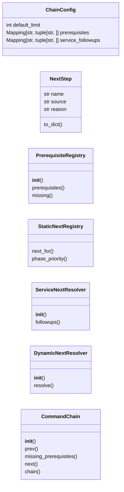
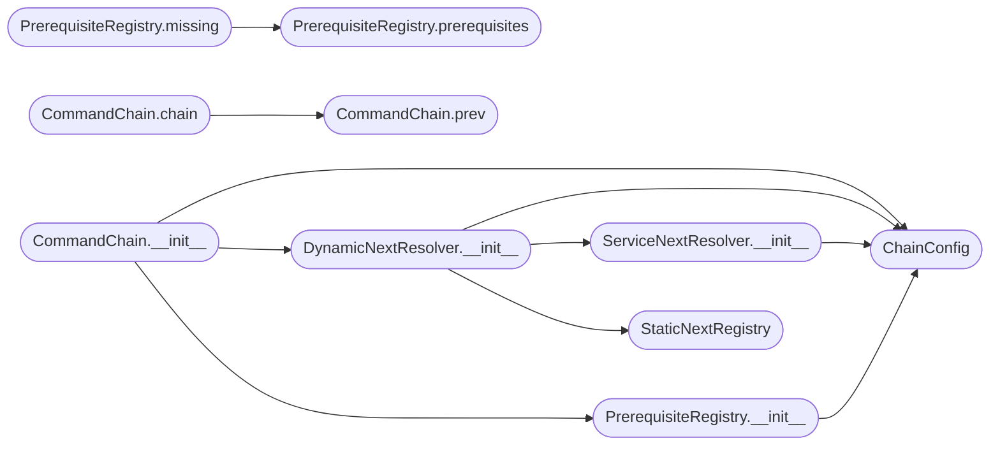

# `cli.command_chain`

> Source: [cli/command_chain.py:1](../../cli/command_chain.py#L1) | language `py` | coverage 100.0% | [API index](../index.md)

Command chain registry: explicit prerequisites and dynamic next steps.

The chain answers two questions for both the human operator and the AI:

1. ``prev(cmd)`` — what should have run **before** `[`cmd`](lazyown.py.md#lazyownshell-cmd)` so it makes sense.
   These are static prerequisites declared once and shared by CLI and MCP.
2. ``next(cmd, params, target)`` — what to run **after** `[`cmd`](lazyown.py.md#lazyownshell-cmd)`. Combines a
   static kill-chain map (deterministic, fast) with a dynamic resolver that
   consults the latest nmap services and the exploration engine so the
   recommendation reflects the actual attack surface.

Design (SOLID):

- `[`ChainConfig`](#chainconfig)` centralises every magic value (history filename, default
  fan-out, service-to-followup table).
- `[`PrerequisiteRegistry`](#prerequisiteregistry)` owns the static prev map (one reason to change).
- `[`StaticNextRegistry`](#staticnextregistry)` reuses ``cli.reactive_hints._KILL_CHAIN_NEXT`` so the
  static next-hop table stays single-source.
- `[`ServiceNextResolver`](#servicenextresolver)` is a pure ranking primitive over discovered
  services.
- `[`DynamicNextResolver`](#dynamicnextresolver)` composes static + service + exploration-engine
  signals into an ordered, de-duplicated suggestion list with provenance.
- `[`CommandChain`](#commandchain)` is the facade consumed by CLI (`[`do_prev`](cli.commands.misc_migrated.py.md#miscmigratedcommandset-do_prev)` / `[`do_next`](cli.commands.session_ops.py.md#sessionopscommandset-do_next)`),
  MCP (``lazyown_command_prev`` / ``lazyown_command_next``), and any future
  TUI widget.

Zero coupling to ``cmd2``, ``flask``, ``rich`` or ``lazyown.py``.

## Contents

- **Classes:** [`ChainConfig`](#chainconfig), [`NextStep`](#nextstep), [`PrerequisiteRegistry`](#prerequisiteregistry), [`StaticNextRegistry`](#staticnextregistry), [`ServiceNextResolver`](#servicenextresolver), [`DynamicNextResolver`](#dynamicnextresolver), [`CommandChain`](#commandchain)
- **Constants:** [`SOURCE_STATIC`](#source_static), [`SOURCE_SERVICE`](#source_service), [`SOURCE_ADDON`](#source_addon), [`SOURCE_TOOL`](#source_tool), [`SOURCE_PHASE`](#source_phase)

## Type Diagram



## Call Graph

Solid arrows stay in this module, dashed arrows leave it.



## Classes

<a id="chainconfig"></a>

### `ChainConfig`

`class` `dataclass` | [cli/command_chain.py:123](../../cli/command_chain.py#L123)

Decorators: `@dataclass(frozen=True)`

```python
class ChainConfig
```

Centralised constants for the command chain module.

**Attributes**

| Name | Type | Default | Description |
|---|---|---|---|
| [`default_limit`](#chainconfig-default_limit) | `int` | `5` |  |
| [`prerequisites`](#chainconfig-prerequisites) | `Mapping[str, tuple[str, ...]]` | `field(default_factory=lambda: dict(_DEFAULT_PREREQUISITES))` |  |
| [`service_followups`](#chainconfig-service_followups) | `Mapping[str, tuple[str, ...]]` | `field(default_factory=lambda: dict(_DEFAULT_SERVICE_FOLLOWUPS))` |  |

---

<a id="nextstep"></a>

### `NextStep`

`class` `dataclass` | [cli/command_chain.py:132](../../cli/command_chain.py#L132)

Decorators: `@dataclass(frozen=True)`

```python
class NextStep
```

A single recommended next command, with provenance for the operator.

**Attributes**

| Name | Type | Default | Description |
|---|---|---|---|
| [`name`](#nextstep-name) | `str` |  |  |
| [`source`](#nextstep-source) | `str` |  |  |
| [`reason`](#nextstep-reason) | `str` |  |  |

**Members**

| Member | Kind | Summary |
|---|---|---|
| [`to_dict`](#nextstep-to_dict) | method | Return a JSON-friendly representation of the step. |

<a id="nextstep-to_dict"></a>

#### `NextStep.to_dict`

`method` | [cli/command_chain.py:139](../../cli/command_chain.py#L139)

```python
def to_dict(self) -> dict[str, str]
```

Return a JSON-friendly representation of the step.

**Returns:** `dict[str, str]`

---

<a id="prerequisiteregistry"></a>

### `PrerequisiteRegistry`

`class` | [cli/command_chain.py:156](../../cli/command_chain.py#L156)

```python
class PrerequisiteRegistry
```

Static prev-map registry.

One reason to change: the prerequisite table.

**Members**

| Member | Kind | Summary |
|---|---|---|
| [`__init__`](#prerequisiteregistry-__init__) | constructor | Store the configuration that owns the prerequisite table. |
| [`prerequisites`](#prerequisiteregistry-prerequisites) | method | Return the ordered list of prerequisite commands for `[`cmd`](lazyown.py.md#lazyownshell-cmd)`. |
| [`missing`](#prerequisiteregistry-missing) | method | Return prerequisites that have **not** yet appeared in `[`history`](modules.collab_bp.py.md#history)`. |

<a id="prerequisiteregistry-__init__"></a>

#### `PrerequisiteRegistry.__init__`

`constructor` | [cli/command_chain.py:159](../../cli/command_chain.py#L159)

```python
def __init__(self, config: ChainConfig | None = None) -> None
```

Store the configuration that owns the prerequisite table.

**Parameters**

| Name | Type | Default | Description |
|---|---|---|---|
| `config` | `ChainConfig \| None` | `None` |  |

*Calls:* [`ChainConfig`](#chainconfig)

*Called by:* [`CommandChain.__init__`](#commandchain-__init__)

<a id="prerequisiteregistry-prerequisites"></a>

#### `PrerequisiteRegistry.prerequisites`

`method` | [cli/command_chain.py:164](../../cli/command_chain.py#L164)

```python
def prerequisites(self, cmd: str) -> list[str]
```

Return the ordered list of prerequisite commands for `[`cmd`](lazyown.py.md#lazyownshell-cmd)`.

**Parameters**

| Name | Type | Default | Description |
|---|---|---|---|
| `cmd` | `str` |  |  |

**Returns:** `list[str]`

*Called by:* [`PrerequisiteRegistry.missing`](#prerequisiteregistry-missing), [`do_doctor`](scripts.broadcom_wps_drive.sh.md#do_doctor), [`do_doctor`](scripts.dirtyinit_drive.sh.md#do_doctor)

<a id="prerequisiteregistry-missing"></a>

#### `PrerequisiteRegistry.missing`

`method` | [cli/command_chain.py:170](../../cli/command_chain.py#L170)

```python
def missing(self, cmd: str, history: Sequence[str]) -> list[str]
```

Return prerequisites that have **not** yet appeared in `[`history`](modules.collab_bp.py.md#history)`.

**Parameters**

| Name | Type | Default | Description |
|---|---|---|---|
| `cmd` | `str` |  |  |
| `history` | `Sequence[str]` |  |  |

**Returns:** `list[str]`

*Calls:* [`PrerequisiteRegistry.prerequisites`](#prerequisiteregistry-prerequisites)

---

<a id="staticnextregistry"></a>

### `StaticNextRegistry`

`class` | [cli/command_chain.py:177](../../cli/command_chain.py#L177)

```python
class StaticNextRegistry
```

Wrapper over the legacy ``_KILL_CHAIN_NEXT`` map (shared source).

**Members**

| Member | Kind | Summary |
|---|---|---|
| [`next_for`](#staticnextregistry-next_for) | method | Return the deterministic kill-chain successors of `[`cmd`](lazyown.py.md#lazyownshell-cmd)`. |
| [`phase_priority`](#staticnextregistry-phase_priority) | method | Return the phase-priority verbs used as a fallback. |

<a id="staticnextregistry-next_for"></a>

#### `StaticNextRegistry.next_for`

`method` | [cli/command_chain.py:180](../../cli/command_chain.py#L180)

```python
def next_for(self, cmd: str) -> list[str]
```

Return the deterministic kill-chain successors of `[`cmd`](lazyown.py.md#lazyownshell-cmd)`.

**Parameters**

| Name | Type | Default | Description |
|---|---|---|---|
| `cmd` | `str` |  |  |

**Returns:** `list[str]`

<a id="staticnextregistry-phase_priority"></a>

#### `StaticNextRegistry.phase_priority`

`method` | [cli/command_chain.py:186](../../cli/command_chain.py#L186)

```python
def phase_priority(self, phase: str) -> list[str]
```

Return the phase-priority verbs used as a fallback.

**Parameters**

| Name | Type | Default | Description |
|---|---|---|---|
| `phase` | `str` |  |  |

**Returns:** `list[str]`

---

<a id="servicenextresolver"></a>

### `ServiceNextResolver`

`class` | [cli/command_chain.py:193](../../cli/command_chain.py#L193)

```python
class ServiceNextResolver
```

Map nmap-discovered services to follow-up verbs.

**Members**

| Member | Kind | Summary |
|---|---|---|
| [`__init__`](#servicenextresolver-__init__) | constructor | Store the configuration providing the service follow-up table. |
| [`followups`](#servicenextresolver-followups) | method | Return ``(verb, reason)`` pairs for every triggered follow-up. |

<a id="servicenextresolver-__init__"></a>

#### `ServiceNextResolver.__init__`

`constructor` | [cli/command_chain.py:196](../../cli/command_chain.py#L196)

```python
def __init__(self, config: ChainConfig | None = None) -> None
```

Store the configuration providing the service follow-up table.

**Parameters**

| Name | Type | Default | Description |
|---|---|---|---|
| `config` | `ChainConfig \| None` | `None` |  |

*Calls:* [`ChainConfig`](#chainconfig)

*Called by:* [`DynamicNextResolver.__init__`](#dynamicnextresolver-__init__)

<a id="servicenextresolver-followups"></a>

#### `ServiceNextResolver.followups`

`method` | [cli/command_chain.py:201](../../cli/command_chain.py#L201)

```python
def followups(self, services: Sequence[DiscoveredService]) -> list[tuple[str, str]]
```

Return ``(verb, reason)`` pairs for every triggered follow-up.

**Parameters**

| Name | Type | Default | Description |
|---|---|---|---|
| `services` | `Sequence[DiscoveredService]` |  |  |

**Returns:** `list[tuple[str, str]]`

---

<a id="dynamicnextresolver"></a>

### `DynamicNextResolver`

`class` | [cli/command_chain.py:219](../../cli/command_chain.py#L219)

```python
class DynamicNextResolver
```

Compose static, service, and exploration signals into an ordered list.

**Members**

| Member | Kind | Summary |
|---|---|---|
| [`__init__`](#dynamicnextresolver-__init__) | constructor | Wire collaborators together. |
| [`resolve`](#dynamicnextresolver-resolve) | method | Return the ordered, de-duplicated next-step recommendations. |

<a id="dynamicnextresolver-__init__"></a>

#### `DynamicNextResolver.__init__`

`constructor` | [cli/command_chain.py:222](../../cli/command_chain.py#L222)

```python
def __init__(self, config: ChainConfig | None = None, static_registry: StaticNextRegistry | None = None, service_resolver: ServiceNextResolver | None = None, exploration_engine: ExplorationEngine | None = None) -> None
```

Wire collaborators together.

All arguments are injectable for tests.

**Parameters**

| Name | Type | Default | Description |
|---|---|---|---|
| `config` | `ChainConfig \| None` | `None` |  |
| `static_registry` | `StaticNextRegistry \| None` | `None` |  |
| `service_resolver` | `ServiceNextResolver \| None` | `None` |  |
| `exploration_engine` | `ExplorationEngine \| None` | `None` |  |

*Calls:* [`ChainConfig`](#chainconfig), [`ServiceNextResolver.__init__`](#servicenextresolver-__init__), [`StaticNextRegistry`](#staticnextregistry)

*Called by:* [`CommandChain.__init__`](#commandchain-__init__)

<a id="dynamicnextresolver-resolve"></a>

#### `DynamicNextResolver.resolve`

`method` | [cli/command_chain.py:236](../../cli/command_chain.py#L236)

```python
def resolve(self, cmd: str, params: Mapping[str, object] | None = None, target: str | None = None, phase: str = '', limit: int | None = None) -> list[NextStep]
```

Return the ordered, de-duplicated next-step recommendations.

**Parameters**

| Name | Type | Default | Description |
|---|---|---|---|
| `cmd` | `str` |  | The command that just ran. Pass an empty string when the caller wants suggestions for the current engagement instead of a specific predecessor. |
| `params` | `Mapping[str, object] \| None` | `None` | Live payload mapping (used to resolve victim OS for addon/tool filtering). Optional. |
| `target` | `str \| None` | `None` | Optional rhost filter for nmap XML lookups. |
| `phase` | `str` | `''` | Current engagement phase identifier. Used only when the static and dynamic resolvers return nothing. |
| `limit` | `int \| None` | `None` | Maximum number of steps to return. Defaults to `[`ChainConfig.default_limit`](#chainconfig-default_limit)`. |

**Returns:** `list[NextStep]` - Ordered list of [`NextStep`](#nextstep). Empty when no signal exists.

---

<a id="commandchain"></a>

### `CommandChain`

`class` | [cli/command_chain.py:335](../../cli/command_chain.py#L335)

```python
class CommandChain
```

Facade exposing prev + next to CLI, MCP, and future TUI widgets.

**Members**

| Member | Kind | Summary |
|---|---|---|
| [`__init__`](#commandchain-__init__) | constructor | Wire collaborators together using the supplied configuration. |
| [`prev`](#commandchain-prev) | method | Return the ordered prerequisite commands for `[`cmd`](lazyown.py.md#lazyownshell-cmd)`. |
| [`missing_prerequisites`](#commandchain-missing_prerequisites) | method | Return prerequisites of `[`cmd`](lazyown.py.md#lazyownshell-cmd)` not present in `[`history`](modules.collab_bp.py.md#history)`. |
| [`next`](#commandchain-next) | method | Return ordered next-step recommendations. |
| [`chain`](#commandchain-chain) | method | Return a serialisable ``{prev, next}`` view for the given command. |

<a id="commandchain-__init__"></a>

#### `CommandChain.__init__`

`constructor` | [cli/command_chain.py:338](../../cli/command_chain.py#L338)

```python
def __init__(self, config: ChainConfig | None = None, prerequisites: PrerequisiteRegistry | None = None, next_resolver: DynamicNextResolver | None = None) -> None
```

Wire collaborators together using the supplied configuration.

**Parameters**

| Name | Type | Default | Description |
|---|---|---|---|
| `config` | `ChainConfig \| None` | `None` |  |
| `prerequisites` | `PrerequisiteRegistry \| None` | `None` |  |
| `next_resolver` | `DynamicNextResolver \| None` | `None` |  |

*Calls:* [`ChainConfig`](#chainconfig), [`DynamicNextResolver.__init__`](#dynamicnextresolver-__init__), [`PrerequisiteRegistry.__init__`](#prerequisiteregistry-__init__)

*Called by:* [`MiscMigratedCommandSet.do_prev`](cli.commands.misc_migrated.py.md#miscmigratedcommandset-do_prev)

<a id="commandchain-prev"></a>

#### `CommandChain.prev`

`method` | [cli/command_chain.py:350](../../cli/command_chain.py#L350)

```python
def prev(self, cmd: str) -> list[str]
```

Return the ordered prerequisite commands for `[`cmd`](lazyown.py.md#lazyownshell-cmd)`.

**Parameters**

| Name | Type | Default | Description |
|---|---|---|---|
| `cmd` | `str` |  |  |

**Returns:** `list[str]`

*Called by:* [`CommandChain.chain`](#commandchain-chain), [`MiscMigratedCommandSet.do_prev`](cli.commands.misc_migrated.py.md#miscmigratedcommandset-do_prev)

<a id="commandchain-missing_prerequisites"></a>

#### `CommandChain.missing_prerequisites`

`method` | [cli/command_chain.py:355](../../cli/command_chain.py#L355)

```python
def missing_prerequisites(self, cmd: str, history: Sequence[str]) -> list[str]
```

Return prerequisites of `[`cmd`](lazyown.py.md#lazyownshell-cmd)` not present in `[`history`](modules.collab_bp.py.md#history)`.

**Parameters**

| Name | Type | Default | Description |
|---|---|---|---|
| `cmd` | `str` |  |  |
| `history` | `Sequence[str]` |  |  |

**Returns:** `list[str]`

<a id="commandchain-next"></a>

#### `CommandChain.next`

`method` | [cli/command_chain.py:360](../../cli/command_chain.py#L360)

```python
def next(self, cmd: str, params: Mapping[str, object] | None = None, target: str | None = None, phase: str = '', limit: int | None = None) -> list[NextStep]
```

Return ordered next-step recommendations.

See [`DynamicNextResolver.resolve`](#dynamicnextresolver-resolve).

**Parameters**

| Name | Type | Default | Description |
|---|---|---|---|
| `cmd` | `str` |  |  |
| `params` | `Mapping[str, object] \| None` | `None` |  |
| `target` | `str \| None` | `None` |  |
| `phase` | `str` | `''` |  |
| `limit` | `int \| None` | `None` |  |

**Returns:** `list[NextStep]`

<a id="commandchain-chain"></a>

#### `CommandChain.chain`

`method` | [cli/command_chain.py:372](../../cli/command_chain.py#L372)

```python
def chain(self, cmd: str, params: Mapping[str, object] | None = None, target: str | None = None, phase: str = '', limit: int | None = None) -> dict[str, object]
```

Return a serialisable ``{prev, next}`` view for the given command.

**Parameters**

| Name | Type | Default | Description |
|---|---|---|---|
| `cmd` | `str` |  |  |
| `params` | `Mapping[str, object] \| None` | `None` |  |
| `target` | `str \| None` | `None` |  |
| `phase` | `str` | `''` |  |
| `limit` | `int \| None` | `None` |  |

**Returns:** `dict[str, object]`

*Calls:* [`CommandChain.prev`](#commandchain-prev)

---

## Constants

<a id="source_static"></a>

### `SOURCE_STATIC`

`constant` | [cli/command_chain.py:44](../../cli/command_chain.py#L44)

```python
SOURCE_STATIC: str = 'static'
```

---

<a id="source_service"></a>

### `SOURCE_SERVICE`

`constant` | [cli/command_chain.py:45](../../cli/command_chain.py#L45)

```python
SOURCE_SERVICE: str = 'service'
```

---

<a id="source_addon"></a>

### `SOURCE_ADDON`

`constant` | [cli/command_chain.py:46](../../cli/command_chain.py#L46)

```python
SOURCE_ADDON: str = 'addon'
```

---

<a id="source_tool"></a>

### `SOURCE_TOOL`

`constant` | [cli/command_chain.py:47](../../cli/command_chain.py#L47)

```python
SOURCE_TOOL: str = 'tool'
```

---

<a id="source_phase"></a>

### `SOURCE_PHASE`

`constant` | [cli/command_chain.py:48](../../cli/command_chain.py#L48)

```python
SOURCE_PHASE: str = 'phase'
```

---
