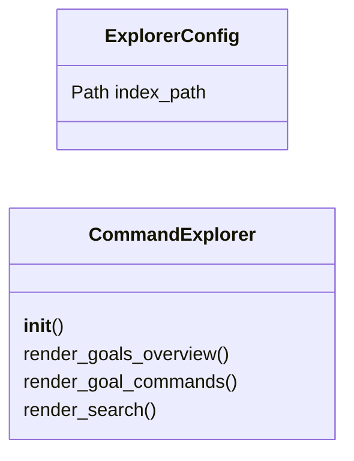

# `cli.command_explorer`

> Source: [cli/command_explorer.py:1](../../cli/command_explorer.py#L1) | language `py` | coverage 100.0% | [API index](../index.md)

Interactive command explorer by phase and goal for the LazyOwn shell.

Organizes the 727+ commands into user-friendly categories based on what
the operator wants to accomplish, not technical groupings.

Design contract:
    - Zero imports from ``lazyown.py`` or ``lazyc2.py``.
    - All output through ``rich.console.Console``.
    - `[`CommandExplorer`](#commandexplorer)` receives its dependencies via constructor.

## Contents

- **Classes:** [`ExplorerConfig`](#explorerconfig), [`CommandExplorer`](#commandexplorer)
- **Constants:** [`COMMAND_INDEX_PATH`](#command_index_path), [`GOALS`](#goals)

## Type Diagram



## Call Graph

Solid arrows stay in this module, dashed arrows leave it.


## Classes

<a id="explorerconfig"></a>

### `ExplorerConfig`

`class` `dataclass` | [cli/command_explorer.py:189](../../cli/command_explorer.py#L189)

Decorators: `@dataclass(frozen=True)`

```python
class ExplorerConfig
```

Centralised constants for the command explorer.

**Attributes**

| Name | Type | Default | Description |
|---|---|---|---|
| [`index_path`](#explorerconfig-index_path) | `Path` | `COMMAND_INDEX_PATH` |  |

---

<a id="commandexplorer"></a>

### `CommandExplorer`

`class` | [cli/command_explorer.py:207](../../cli/command_explorer.py#L207)

```python
class CommandExplorer
```

Interactive command explorer organized by user goals.

**Parameters**

| Name | Type | Default | Description |
|---|---|---|---|
| `aliases` |  |  | Live aliases dict from the shell. |
| `params` |  |  | Live params dict from the shell. |
| `config` |  |  | Optional config override. |

**Members**

| Member | Kind | Summary |
|---|---|---|
| [`__init__`](#commandexplorer-__init__) | constructor |  |
| [`render_goals_overview`](#commandexplorer-render_goals_overview) | method | Print the goals table showing all available categories. |
| [`render_goal_commands`](#commandexplorer-render_goal_commands) | method | Print commands for a specific goal. |
| [`render_search`](#commandexplorer-render_search) | method | Search commands by keyword across all goals. |

<a id="commandexplorer-__init__"></a>

#### `CommandExplorer.__init__`

`constructor` | [cli/command_explorer.py:216](../../cli/command_explorer.py#L216)

```python
def __init__(self, aliases: dict[str, str] | None = None, params: dict[str, Any] | None = None, config: ExplorerConfig | None = None) -> None
```

**Parameters**

| Name | Type | Default | Description |
|---|---|---|---|
| `aliases` | `dict[str, str] \| None` | `None` | Live aliases dict from the shell. |
| `params` | `dict[str, Any] \| None` | `None` | Live params dict from the shell. |
| `config` | `ExplorerConfig \| None` | `None` | Optional config override. |

*Calls:* [`ExplorerConfig`](#explorerconfig)

*Called by:* [`HelpUiCommandSet.do_command_explorer`](cli.commands.help_ui.py.md#helpuicommandset-do_command_explorer)

<a id="commandexplorer-render_goals_overview"></a>

#### `CommandExplorer.render_goals_overview`

`method` | [cli/command_explorer.py:227](../../cli/command_explorer.py#L227)

```python
def render_goals_overview(self) -> None
```

Print the goals table showing all available categories.

*Called by:* [`HelpUiCommandSet.do_command_explorer`](cli.commands.help_ui.py.md#helpuicommandset-do_command_explorer)

<a id="commandexplorer-render_goal_commands"></a>

#### `CommandExplorer.render_goal_commands`

`method` | [cli/command_explorer.py:240](../../cli/command_explorer.py#L240)

```python
def render_goal_commands(self, goal_key: str) -> None
```

Print commands for a specific goal.

**Parameters**

| Name | Type | Default | Description |
|---|---|---|---|
| `goal_key` | `str` |  |  |

*Called by:* [`HelpUiCommandSet.do_command_explorer`](cli.commands.help_ui.py.md#helpuicommandset-do_command_explorer)

<a id="commandexplorer-render_search"></a>

#### `CommandExplorer.render_search`

`method` | [cli/command_explorer.py:260](../../cli/command_explorer.py#L260)

```python
def render_search(self, query: str) -> None
```

Search commands by keyword across all goals.

**Parameters**

| Name | Type | Default | Description |
|---|---|---|---|
| `query` | `str` |  |  |

*Called by:* [`HelpUiCommandSet.do_command_explorer`](cli.commands.help_ui.py.md#helpuicommandset-do_command_explorer)

---

## Constants

<a id="command_index_path"></a>

### `COMMAND_INDEX_PATH`

`constant` | [cli/command_explorer.py:23](../../cli/command_explorer.py#L23)

```python
COMMAND_INDEX_PATH = Path('cli/command_index.json')
```

---

<a id="goals"></a>

### `GOALS`

`constant` | [cli/command_explorer.py:25](../../cli/command_explorer.py#L25)

```python
GOALS: dict[str, dict[str, Any]]
```

---
