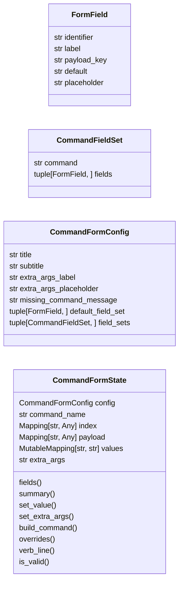
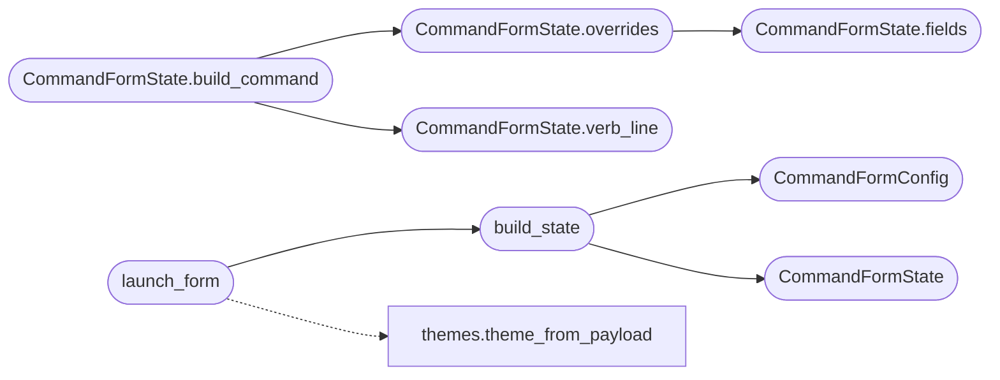

# `cli.command_form`

> Source: [cli/command_form.py:1](../../cli/command_form.py#L1) | language `py` | coverage 100.0% | [API index](../index.md)

Textual form-mode launcher for LazyOwn commands.

The form turns any ``do_*`` command into a guided launcher: the operator
picks a command name, sees the inferred summary, reviews the relevant
``payload.json`` values that the command would read, types optional
extra arguments, and confirms with Enter. The launcher returns the final
command string so the cmd2 shell can dispatch it as if the operator had
typed it.

The form does not parse argparser specifications today — it surfaces the
fields most commonly tuned per invocation (target, ports, wordlists,
custom args) so the operator no longer has to remember flag names from
the docs. New per-command fields are added by extending
[`CommandFormConfig.field_sets`](#commandformconfig-field_sets).

Design (SOLID):

- Single Responsibility: [`CommandFormConfig`](#commandformconfig) owns constants,
  [`CommandFormState`](#commandformstate) builds the field list and assembles the final
  command, `CommandFormApp` renders.
- Open/Closed: a new per-command field set is one tuple entry in the
  config; the state and the app do not change.
- Dependency Inversion: the state takes a pre-loaded command index +
  payload mapping; tests inject in-memory dicts.

## Contents

- **Classes:** [`FormField`](#formfield), [`CommandFieldSet`](#commandfieldset), [`CommandFormConfig`](#commandformconfig), [`CommandFormState`](#commandformstate)
- **Functions:** [`build_state`](#build_state), [`launch_form`](#launch_form)

## Type Diagram



## Call Graph

Solid arrows stay in this module, dashed arrows leave it.



## Classes

<a id="formfield"></a>

### `FormField`

`class` `dataclass` | [cli/command_form.py:37](../../cli/command_form.py#L37)

Decorators: `@dataclass(frozen=True)`

```python
class FormField
```

Single editable input in the form.

**Attributes**

| Name | Type | Default | Description |
|---|---|---|---|
| [`identifier`](#formfield-identifier) | `str` |  |  |
| [`label`](#formfield-label) | `str` |  |  |
| [`payload_key`](#formfield-payload_key) | `str` |  |  |
| [`default`](#formfield-default) | `str` | `''` |  |
| [`placeholder`](#formfield-placeholder) | `str` | `''` |  |

---

<a id="commandfieldset"></a>

### `CommandFieldSet`

`class` `dataclass` | [cli/command_form.py:48](../../cli/command_form.py#L48)

Decorators: `@dataclass(frozen=True)`

```python
class CommandFieldSet
```

Fields the form surfaces for a given command name.

**Attributes**

| Name | Type | Default | Description |
|---|---|---|---|
| [`command`](#commandfieldset-command) | `str` |  |  |
| [`fields`](#commandfieldset-fields) | `tuple[FormField, ...]` |  |  |

---

<a id="commandformconfig"></a>

### `CommandFormConfig`

`class` `dataclass` | [cli/command_form.py:56](../../cli/command_form.py#L56)

Decorators: `@dataclass(frozen=True)`

```python
class CommandFormConfig
```

Centralised constants for the form-mode launcher.

**Attributes**

| Name | Type | Default | Description |
|---|---|---|---|
| [`title`](#commandformconfig-title) | `str` | `'Command form'` |  |
| [`subtitle`](#commandformconfig-subtitle) | `str` | `'Tab to switch fields, Enter to run, Esc to cancel'` |  |
| [`extra_args_label`](#commandformconfig-extra_args_label) | `str` | `'Extra arguments'` |  |
| [`extra_args_placeholder`](#commandformconfig-extra_args_placeholder) | `str` | `'Optional positional or flag-style args'` |  |
| [`missing_command_message`](#commandformconfig-missing_command_message) | `str` | `'Command not found in index.'` |  |
| [`default_field_set`](#commandformconfig-default_field_set) | `tuple[FormField, ...]` | `(FormField('target', 'Target (rhost)', 'rhost', placeholder='10.0.0.1'), FormField('attacker', 'Attacker (lhost)', 'lhost', placeholder='10.10.14.20'), FormField('port', 'Target port (rport)', 'rport'))` |  |
| [`field_sets`](#commandformconfig-field_sets) | `tuple[CommandFieldSet, ...]` | `(CommandFieldSet('do_lazynmap', (FormField('target', 'Target (rhost)', 'rhost', placeholder='10.0.0.1'), FormField('port', 'Target port (rport)', 'rport'), FormField('device', 'Interface (device)', 'device'))), CommandFieldSet('do_gobuster', (FormField('target', 'Target (rhost)', 'rhost'), FormField('port', 'Target port (rport)', 'rport'), FormField('wordlist', 'Directory wordlist', 'dirwordlist'))), CommandFieldSet('do_ffuf', (FormField('url', 'Target URL', 'url'), FormField('wordlist', 'Directory wordlist', 'dirwordlist'))), CommandFieldSet('do_enum4linux', (FormField('target', 'Target (rhost)', 'rhost'), FormField('domain', 'Domain', 'domain'))), CommandFieldSet('do_kerbrute', (FormField('target', 'Target (rhost)', 'rhost'), FormField('domain', 'Domain', 'domain'), FormField('wordlist', 'Username wordlist', 'usrwordlist'))), CommandFieldSet('do_searchsploit', (FormField('target', 'Target (rhost)', 'rhost'),)))` |  |

---

<a id="commandformstate"></a>

### `CommandFormState`

`class` `dataclass` | [cli/command_form.py:116](../../cli/command_form.py#L116)

Decorators: `@dataclass`

```python
class CommandFormState
```

Pure data layer for the form.

**Attributes**

| Name | Type | Default | Description |
|---|---|---|---|
| [`config`](#commandformstate-config) | `CommandFormConfig` |  |  |
| [`command_name`](#commandformstate-command_name) | `str` |  |  |
| [`index`](#commandformstate-index) | `Mapping[str, Any]` |  |  |
| [`payload`](#commandformstate-payload) | `Mapping[str, Any]` |  |  |
| [`values`](#commandformstate-values) | `MutableMapping[str, str]` | `field(default_factory=dict)` |  |
| [`extra_args`](#commandformstate-extra_args) | `str` | `''` |  |

**Members**

| Member | Kind | Summary |
|---|---|---|
| [`fields`](#commandformstate-fields) | method | Return the fields associated with [`command_name`](#commandformstate-command_name). |
| [`summary`](#commandformstate-summary) | method | Return the command summary from the index, or an empty string. |
| [`set_value`](#commandformstate-set_value) | method | Update the value of one field. |
| [`set_extra_args`](#commandformstate-set_extra_args) | method | Replace the extra-args buffer. |
| [`build_command`](#commandformstate-build_command) | method | Return the cmd-line preview string the operator sees. |
| [`overrides`](#commandformstate-overrides) | method | Return ``[(payload_key, value), ...]`` for fields the operator changed. |
| [`verb_line`](#commandformstate-verb_line) | method | Return ``"<verb> <extra_args>"`` ready for the shell. |
| [`is_valid`](#commandformstate-is_valid) | method | Return ``True`` when the command name is known in the index. |

<a id="commandformstate-fields"></a>

#### `CommandFormState.fields`

`method` | [cli/command_form.py:131](../../cli/command_form.py#L131)

```python
def fields(self) -> tuple[FormField, ...]
```

Return the fields associated with [`command_name`](#commandformstate-command_name).

**Returns:** `tuple[FormField, ...]`

*Called by:* [`CommandFormState.overrides`](#commandformstate-overrides), [`SecurityConfig.from_payload`](modules.security_sanitizers.py.md#securityconfig-from_payload)

<a id="commandformstate-summary"></a>

#### `CommandFormState.summary`

`method` | [cli/command_form.py:139](../../cli/command_form.py#L139)

```python
def summary(self) -> str
```

Return the command summary from the index, or an empty string.

**Returns:** `str`

<a id="commandformstate-set_value"></a>

#### `CommandFormState.set_value`

`method` | [cli/command_form.py:150](../../cli/command_form.py#L150)

```python
def set_value(self, identifier: str, value: str) -> None
```

Update the value of one field.

**Parameters**

| Name | Type | Default | Description |
|---|---|---|---|
| `identifier` | `str` |  |  |
| `value` | `str` |  |  |

<a id="commandformstate-set_extra_args"></a>

#### `CommandFormState.set_extra_args`

`method` | [cli/command_form.py:154](../../cli/command_form.py#L154)

```python
def set_extra_args(self, value: str) -> None
```

Replace the extra-args buffer.

**Parameters**

| Name | Type | Default | Description |
|---|---|---|---|
| `value` | `str` |  |  |

<a id="commandformstate-build_command"></a>

#### `CommandFormState.build_command`

`method` | [cli/command_form.py:158](../../cli/command_form.py#L158)

```python
def build_command(self) -> str
```

Return the cmd-line preview string the operator sees.

The preview is a single readable line — overrides are rendered
as inline ``key=value`` annotations. The actual dispatch in
`LazyOwnShell.do_form` applies overrides one at a time
through ``assign`` (see [`overrides`](#commandformstate-overrides) + [`verb_line`](#commandformstate-verb_line))
so the form never depends on cmd2's settable subsystem.

**Returns:** `str`

*Calls:* [`CommandFormState.overrides`](#commandformstate-overrides), [`CommandFormState.verb_line`](#commandformstate-verb_line)

<a id="commandformstate-overrides"></a>

#### `CommandFormState.overrides`

`method` | [cli/command_form.py:173](../../cli/command_form.py#L173)

```python
def overrides(self) -> list[tuple[str, str]]
```

Return ``[(payload_key, value), ...]`` for fields the operator changed.

Each pair is applied through ``assign`` by the dispatcher so the
mutation is validated and persisted just like a manual
``assign rhost 10.0.0.5`` would be.

**Returns:** `list[tuple[str, str]]`

*Calls:* [`CommandFormState.fields`](#commandformstate-fields)

*Called by:* [`CommandFormState.build_command`](#commandformstate-build_command)

<a id="commandformstate-verb_line"></a>

#### `CommandFormState.verb_line`

`method` | [cli/command_form.py:188](../../cli/command_form.py#L188)

```python
def verb_line(self) -> str
```

Return ``"<verb> <extra_args>"`` ready for the shell.

**Returns:** `str`

*Called by:* [`CommandFormState.build_command`](#commandformstate-build_command)

<a id="commandformstate-is_valid"></a>

#### `CommandFormState.is_valid`

`method` | [cli/command_form.py:195](../../cli/command_form.py#L195)

```python
def is_valid(self) -> bool
```

Return ``True`` when the command name is known in the index.

**Returns:** `bool`

---

## Functions

<a id="build_state"></a>

### `build_state`

`function` | [cli/command_form.py:247](../../cli/command_form.py#L247)

```python
def build_state(command_name: str, payload: Mapping[str, Any] | None = None, index: Mapping[str, Any] | None = None, config: CommandFormConfig | None = None) -> CommandFormState
```

Wire the canonical state used by [`launch_form`](#launch_form).

**Parameters**

| Name | Type | Default | Description |
|---|---|---|---|
| `command_name` | `str` |  |  |
| `payload` | `Mapping[str, Any] \| None` | `None` |  |
| `index` | `Mapping[str, Any] \| None` | `None` |  |
| `config` | `CommandFormConfig \| None` | `None` |  |

**Returns:** `CommandFormState`

*Calls:* [`CommandFormConfig`](#commandformconfig), [`CommandFormState`](#commandformstate)

*Called by:* [`launch_form`](#launch_form)

---

<a id="launch_form"></a>

### `launch_form`

`function` | [cli/command_form.py:262](../../cli/command_form.py#L262)

```python
def launch_form(command_name: str, payload: Mapping[str, Any] | None = None, state: CommandFormState | None = None, runner: Any | None = None) -> CommandFormState | None
```

Open the form and return the populated state on submit.

**Parameters**

| Name | Type | Default | Description |
|---|---|---|---|
| `command_name` | `str` |  | ``do_*`` (or plain verb) to pre-fill. |
| `payload` | `Mapping[str, Any] \| None` | `None` | Loaded ``payload.json``. |
| `state` | `CommandFormState \| None` | `None` | Optional pre-built state (tests inject one). |
| `runner` | `Any \| None` | `None` | Optional callable used by tests instead of Textual. |

**Returns:** `CommandFormState | None` - The [`CommandFormState`](#commandformstate) the operator confirmed, or
``None`` when cancelled / Textual is unavailable. The caller
applies [`CommandFormState.overrides`](#commandformstate-overrides) through ``assign``
and dispatches [`CommandFormState.verb_line`](#commandformstate-verb_line).

*Calls:* [`build_state`](#build_state), [`theme_from_payload`](cli.themes.py.md#theme_from_payload)

---
