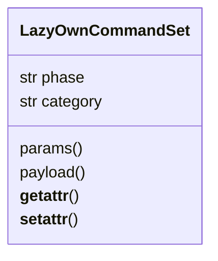

# `cli.commands._base`

> Source: [cli/commands/_base.py:1](../../cli/commands/_base.py#L1) | language `py` | coverage 100.0% | [API index](../index.md)

Base class for phase-scoped ``CommandSet`` modules.

`[`LazyOwnCommandSet`](#lazyowncommandset)` extends `cmd2.CommandSet` with the affordances
that the legacy ``do_*`` methods rely on when they are lifted out of
`[`LazyOwnShell`](lazyown.py.md#lazyownshell)` and into per-phase modules under ``cli/commands/``.

Two design constraints shape this base class:

1. The migrated methods must execute verbatim. They reference shell
   attributes such as ``self.params``, ``self.scripts``, ``self.c2_url``
   and instance helpers like ``self.run_script``. Rewriting hundreds of
   call sites is unsafe; instead this base forwards unknown attribute
   reads to the bound shell once ``cmd2`` injects it through
   ``register_command_set``.

2. Forwarding must remain inert before registration. Tests instantiate
   sets directly to assert structure (method presence, decorators); those
   instances have no parent shell, so unknown attribute access must raise
   `AttributeError` exactly as a plain class would.

## Contents

- **Classes:** [`LazyOwnCommandSet`](#lazyowncommandset)
- **Functions:** [`extract_flag`](#extract_flag)
- **Constants:** [`SHELL_INJECTION_ATTRIBUTE`](#shell_injection_attribute)

## Type Diagram



## Classes

<a id="lazyowncommandset"></a>

### `LazyOwnCommandSet`

`class` | [cli/commands/_base.py:53](../../cli/commands/_base.py#L53)

```python
class LazyOwnCommandSet(CommandSet)
```

Bases: `CommandSet`

Subclasses: [`PendingCommandSet`](cli.commands._dormancy.py.md#pendingcommandset), [`ActiveDirectoryCommandSet`](cli.commands.active_directory.py.md#activedirectorycommandset), [`AiCommandSet`](cli.commands.ai.py.md#aicommandset), [`AntiForensicsCommandSet`](cli.commands.anti_forensics.py.md#antiforensicscommandset), [`AppLockerBypassCommandSet`](cli.commands.applocker_bypass.py.md#applockerbypasscommandset), [`AuditCommandSet`](cli.commands.audit.py.md#auditcommandset), [`AutomationCommandSet`](cli.commands.automation.py.md#automationcommandset), [`BitMCommandSet`](cli.commands.bitm.py.md#bitmcommandset), [`BofMarketplaceCommandSet`](cli.commands.bof_registry.py.md#bofmarketplacecommandset), [`C2ProfileCommandSet`](cli.commands.c2_profile.py.md#c2profilecommandset), [`C2SessionCommandSet`](cli.commands.c2_session.py.md#c2sessioncommandset), [`CalderaCommandSet`](cli.commands.caldera.py.md#calderacommandset), [`CampaignCommandSet`](cli.commands.campaign.py.md#campaigncommandset), [`CatalogCommandSet`](cli.commands.catalog.py.md#catalogcommandset), [`CICDCommandSet`](cli.commands.cicd.py.md#cicdcommandset), [`CliAuthCommandSet`](cli.commands.cli_auth.py.md#cliauthcommandset), [`CloudCommandSet`](cli.commands.cloud.py.md#cloudcommandset), [`CloudAttackCommandSet`](cli.commands.cloud_attacks.py.md#cloudattackcommandset), [`CollaborationCommandSet`](cli.commands.collaboration.py.md#collaborationcommandset), [`CommandAndControlCommandSet`](cli.commands.command_and_control.py.md#commandandcontrolcommandset), [`CommandAndControlMigratedCommandSet`](cli.commands.command_and_control_migrated.py.md#commandandcontrolmigratedcommandset), [`ContainerCommandSet`](cli.commands.containers.py.md#containercommandset), [`CredentialAccessCommandSet`](cli.commands.cred.py.md#credentialaccesscommandset), [`CredMigratedCommandSet`](cli.commands.cred_migrated.py.md#credmigratedcommandset), [`CrystalBallCommandSet`](cli.commands.crystal_ball.py.md#crystalballcommandset), [`DaemonControlCommandSet`](cli.commands.daemon_ctl.py.md#daemoncontrolcommandset), [`DatabaseCommandSet`](cli.commands.database.py.md#databasecommandset), [`DefaultsCommandSet`](cli.commands.defaults.py.md#defaultscommandset), [`DemoCommandSet`](cli.commands.demo.py.md#democommandset), [`DiagnosticsCommandSet`](cli.commands.diagnostics.py.md#diagnosticscommandset), [`DNSExfilCommandSet`](cli.commands.dns_exfil.py.md#dnsexfilcommandset), [`DPAPICommandSet`](cli.commands.dpapi.py.md#dpapicommandset), [`EDRDetectCommandSet`](cli.commands.edr_detect.py.md#edrdetectcommandset), [`EncodingCommandSet`](cli.commands.encoding.py.md#encodingcommandset), [`EnumCommandSet`](cli.commands.enum.py.md#enumcommandset), [`EstoridesCommandSet`](cli.commands.estorides.py.md#estoridescommandset), [`EvasivePayloadCommandSet`](cli.commands.evasive_payload.py.md#evasivepayloadcommandset), [`ExfiltrationCommandSet`](cli.commands.exfiltration.py.md#exfiltrationcommandset), [`ExploitCommandSet`](cli.commands.exploit.py.md#exploitcommandset), [`ExploitMigratedCommandSet`](cli.commands.exploit_migrated.py.md#exploitmigratedcommandset), [`ExploitGymCommandSet`](cli.commands.exploitgym.py.md#exploitgymcommandset), [`GoldenPathsCommandSet`](cli.commands.golden_paths.py.md#goldenpathscommandset), [`GymMetasploitableCommandSet`](cli.commands.gym_matrix.py.md#gymmetasploitablecommandset), [`HelpUiCommandSet`](cli.commands.help_ui.py.md#helpuicommandset), [`InfraCommandSet`](cli.commands.infra.py.md#infracommandset), [`LabCommandSet`](cli.commands.lab.py.md#labcommandset), [`LateralMovementCommandSet`](cli.commands.lateral.py.md#lateralmovementcommandset), [`LateralMigratedCommandSet`](cli.commands.lateral_migrated.py.md#lateralmigratedcommandset), [`LazyQueueCommandSet`](cli.commands.lazyloop.py.md#lazyqueuecommandset), [`LazyCommandSet`](cli.commands.lazyops.py.md#lazycommandset), [`MarketplaceCommandSet`](cli.commands.marketplace.py.md#marketplacecommandset), [`McpBridgeCommandSet`](cli.commands.mcp_bridge.py.md#mcpbridgecommandset), [`MiscMigratedCommandSet`](cli.commands.misc_migrated.py.md#miscmigratedcommandset), [`MobileMacOSCommandSet`](cli.commands.mobile_macos.py.md#mobilemacoscommandset), [`ModuleManagerCommandSet`](cli.commands.module_manager.py.md#modulemanagercommandset), [`NetworkHelpersCommandSet`](cli.commands.nethelpers.py.md#networkhelperscommandset), [`OpsecCleanupCommandSet`](cli.commands.opsec_cleanup.py.md#opseccleanupcommandset), [`OrchestrationCommandSet`](cli.commands.orchestration.py.md#orchestrationcommandset), [`ParamCommandSet`](cli.commands.params_ops.py.md#paramcommandset), [`PayloadArsenalCommandSet`](cli.commands.payload_arsenal.py.md#payloadarsenalcommandset), [`PayloadCommandSet`](cli.commands.payload_generation.py.md#payloadcommandset), [`PersistenceCommandSet`](cli.commands.persist.py.md#persistencecommandset), [`PersistMigratedCommandSet`](cli.commands.persist_migrated.py.md#persistmigratedcommandset), [`PhishingWizardCommandSet`](cli.commands.phishing_wizard.py.md#phishingwizardcommandset), [`PivotingCommandSet`](cli.commands.pivoting.py.md#pivotingcommandset), [`PostExploitationCommandSet`](cli.commands.postexp.py.md#postexploitationcommandset), [`PostexpMigratedCommandSet`](cli.commands.postexp_migrated.py.md#postexpmigratedcommandset), [`PrivilegeEscalationCommandSet`](cli.commands.privilege_escalation.py.md#privilegeescalationcommandset), [`PurpleTeamCommandSet`](cli.commands.purple_team.py.md#purpleteamcommandset), [`PwnCommandSet`](cli.commands.pwn.py.md#pwncommandset), [`ReconCommandSet`](cli.commands.recon.py.md#reconcommandset), [`ReconMigratedCommandSet`](cli.commands.recon_migrated.py.md#reconmigratedcommandset), [`RedTeamGymCommandSet`](cli.commands.redteam_gym.py.md#redteamgymcommandset), [`ResourceCommandSet`](cli.commands.resource_scripting.py.md#resourcecommandset), [`RetryOpsCommandSet`](cli.commands.retry_ops.py.md#retryopscommandset), [`ScanCommandSet`](cli.commands.scan.py.md#scancommandset), [`ScanMigratedCommandSet`](cli.commands.scan_migrated.py.md#scanmigratedcommandset), [`SecurityCommandSet`](cli.commands.security.py.md#securitycommandset), [`SessionOpsCommandSet`](cli.commands.session_ops.py.md#sessionopscommandset), [`ShellSysCommandSet`](cli.commands.shellsys.py.md#shellsyscommandset), [`SleepObfuscationCommandSet`](cli.commands.sleep_obfuscation.py.md#sleepobfuscationcommandset), [`SocksProxyCommandSet`](cli.commands.socks_proxy.py.md#socksproxycommandset), [`SupplyChainCommandSet`](cli.commands.supply_chain.py.md#supplychaincommandset), [`SurfaceCommandSet`](cli.commands.surface.py.md#surfacecommandset), [`UxCommandSet`](cli.commands.ux.py.md#uxcommandset), [`VerbCommandSet`](cli.commands.verb_admin.py.md#verbcommandset)

Base class for every phase ``CommandSet`` defined under `[`cli.commands`](cli.commands.__init__.py.md)`.

**Attributes**

| Name | Type | Default | Description |
|---|---|---|---|
| [`phase`](#lazyowncommandset-phase) | `str` | `''` | Kill-chain phase identifier (``recon``, ``enum``, ...). Used by tooling such as ``lazyown_phase_guide`` and the autonomous daemon to filter commands by phase. |
| [`category`](#lazyowncommandset-category) | `str` | `''` | cmd2 help category label. Defaults to a Title-Case form of `[`phase`](#lazyowncommandset-phase)` when not set explicitly. |

**Members**

| Member | Kind | Summary |
|---|---|---|
| [`params`](#lazyowncommandset-params) | property | Return the live `[`params`](#lazyowncommandset-params)` dict owned by the parent shell. |
| [`payload`](#lazyowncommandset-payload) | property | Return the parent shell's ``Config`` wrapper when available. |
| [`__getattr__`](#lazyowncommandset-__getattr__) | method | Forward unknown attribute access to the bound shell or utils. |
| [`__setattr__`](#lazyowncommandset-__setattr__) | method | Forward prompt attribute writes to the bound shell. |

<a id="lazyowncommandset-params"></a>

#### `LazyOwnCommandSet.params`

`property` | [cli/commands/_base.py:88](../../cli/commands/_base.py#L88)

Decorators: `@property`

```python
def params(self) -> dict[str, Any]
```

Return the live `[`params`](#lazyowncommandset-params)` dict owned by the parent shell.

**Returns:** `dict[str, Any]` - The same dict object that ``LazyOwnShell.params`` exposes when
the set is registered, or an empty dict when it is not.

<a id="lazyowncommandset-payload"></a>

#### `LazyOwnCommandSet.payload`

`property` | [cli/commands/_base.py:99](../../cli/commands/_base.py#L99)

Decorators: `@property`

```python
def payload(self) -> Any
```

Return the parent shell's ``Config`` wrapper when available.

**Returns:** `Any` - `[`LazyOwnShell.config`](lazyown.py.md#lazyownshell-config)` when the shell publishes it, otherwise
``LazyOwnShell.params`` so callers always receive a mapping-
like object. Falls back to an empty dict before registration.

<a id="lazyowncommandset-__getattr__"></a>

#### `LazyOwnCommandSet.__getattr__`

`method` | [cli/commands/_base.py:112](../../cli/commands/_base.py#L112)

```python
def __getattr__(self, name: str) -> Any
```

Forward unknown attribute access to the bound shell or utils.

``cmd2`` binds the parent shell to ``self._cmd`` when the
``CommandSet`` is registered. Migrated methods reference shell
state directly (``self.run_script``, ``self.c2_url``, ...) so this
forwarder lets them execute unmodified once they are wired in.

Migrated ``do_*`` methods also call single-underscore shell helpers
that stayed on `[`LazyOwnShell`](lazyown.py.md#lazyownshell)` (``self._scope_save``,
``self._load_adversaries``, ``self._payload_factory``, ...). Those
are forwarded to the bound shell as well; only dunder names and
``complete_*`` completion probes are refused outright, because
forwarding them would leak Python/cmd2 machinery. Private names are
never resolved from `[`utils`](utils.py.md)` — a private helper only ever lives on
the shell.

When a public name is not on the shell, the forwarder falls back to
the `[`utils`](utils.py.md)` module namespace, giving migrated CommandSets access
to every re-exported symbol (``os``, ``json``, ``glob``,
``getprompt``, category constants, etc.) without per-file import
boilerplate.

**Parameters**

| Name | Type | Default | Description |
|---|---|---|---|
| `name` | `str` |  | Attribute name requested by the caller. |

**Returns:** `Any` - The attribute value resolved on the bound shell or utils.

**Raises**

- `AttributeError`: When ``name`` is a dunder or ``complete_*``
probe, when the shell is not yet bound (inert before
registration), or when neither the shell nor `[`utils`](utils.py.md)`
expose a public ``name``.

<a id="lazyowncommandset-__setattr__"></a>

#### `LazyOwnCommandSet.__setattr__`

`method` | [cli/commands/_base.py:164](../../cli/commands/_base.py#L164)

```python
def __setattr__(self, name: str, value: Any) -> None
```

Forward prompt attribute writes to the bound shell.

The migrated ``do_*`` methods were written against `[`LazyOwnShell`](lazyown.py.md#lazyownshell)`
and assign ``self.custom_prompt`` / ``self.prompt`` expecting the
shell to hold them. Without forwarding, those writes landed on the
CommandSet and the Neon Box prompt never refreshed after ``assign``.
Only the two prompt names are forwarded; every other attribute stays
on the CommandSet so cmd2 internals remain untouched.

**Parameters**

| Name | Type | Default | Description |
|---|---|---|---|
| `name` | `str` |  | Attribute name being set. |
| `value` | `Any` |  | Attribute value. |

---

## Functions

<a id="extract_flag"></a>

### `extract_flag`

`function` | [cli/commands/_base.py:36](../../cli/commands/_base.py#L36)

```python
def extract_flag(args: list[str], flag: str) -> str | None
```

Extract ``--flag <value>`` pair shared by CommandSets.

**Parameters**

| Name | Type | Default | Description |
|---|---|---|---|
| `args` | `list[str]` |  | Tokenised argument list. |
| `flag` | `str` |  | Flag name to locate. |

**Returns:** `str | None` - Value following flag, else None.

*Called by:* [`LazyQueueCommandSet.do_lazy_delete`](cli.commands.lazyloop.py.md#lazyqueuecommandset-do_lazy_delete), [`LazyQueueCommandSet.do_lazy_verdict`](cli.commands.lazyloop.py.md#lazyqueuecommandset-do_lazy_verdict), [`LazyCommandSet.do_lazy_addon`](cli.commands.lazyops.py.md#lazycommandset-do_lazy_addon), [`LazyCommandSet.do_lazy_agent`](cli.commands.lazyops.py.md#lazycommandset-do_lazy_agent), [`LazyCommandSet.do_lazy_ask`](cli.commands.lazyops.py.md#lazycommandset-do_lazy_ask), [`LazyCommandSet.do_lazy_asset`](cli.commands.lazyops.py.md#lazycommandset-do_lazy_asset), [`LazyCommandSet.do_lazy_broadcast`](cli.commands.lazyops.py.md#lazycommandset-do_lazy_broadcast), [`LazyCommandSet.do_lazy_chat`](cli.commands.lazyops.py.md#lazycommandset-do_lazy_chat), [`LazyCommandSet.do_lazy_compact`](cli.commands.lazyops.py.md#lazycommandset-do_lazy_compact), [`LazyCommandSet.do_lazy_context`](cli.commands.lazyops.py.md#lazycommandset-do_lazy_context), [`LazyCommandSet.do_lazy_dispatch`](cli.commands.lazyops.py.md#lazycommandset-do_lazy_dispatch), [`LazyCommandSet.do_lazy_finding`](cli.commands.lazyops.py.md#lazycommandset-do_lazy_finding) and 16 more

---

## Constants

<a id="shell_injection_attribute"></a>

### `SHELL_INJECTION_ATTRIBUTE`

`constant` | [cli/commands/_base.py:31](../../cli/commands/_base.py#L31)

```python
SHELL_INJECTION_ATTRIBUTE = '_cmd'
```

---
