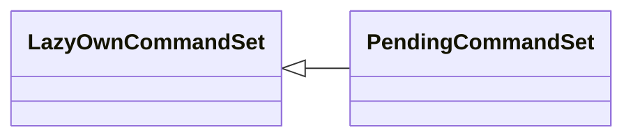

# `cli.commands._dormancy`

> Source: [cli/commands/_dormancy.py:1](../../cli/commands/_dormancy.py#L1) | language `py` | coverage 100.0% | [API index](../index.md)

Dormancy marker for incrementally migrated command sets.

During the staged migration of the ``do_*`` methods from ``lazyown.py`` into
phase-scoped ``CommandSet`` modules under ``cli/commands/``, both sources
temporarily coexist:

* `[`LazyOwnShell`](lazyown.py.md#lazyownshell)` in ``lazyown.py`` still owns the canonical methods.
* The new phase modules carry a parallel copy ready for activation.

If the new modules registered immediately, ``cmd2.register_command_set``
would raise ``CommandSetRegistrationError`` for every method that collides
with an attribute already bound to the shell. To avoid that without
sacrificing discoverability or test coverage, migrated sets inherit from
[`PendingCommandSet`](#pendingcommandset). `[`cli.registry.register_command_sets`](cli.registry.py.md#register_command_sets)` skips
any class flagged this way; once the originals are deleted from
``lazyown.py`` the base class is swapped to [`LazyOwnCommandSet`](cli.commands._base.py.md#lazyowncommandset)
and the set joins the active registry on the next shell start.

Discovery (`[`iter_command_sets`](cli.registry.py.md#iter_command_sets)`) still yields pending sets so tests can
validate their structure independently of activation.

## Contents

- **Classes:** [`PendingCommandSet`](#pendingcommandset)
- **Functions:** [`is_pending`](#is_pending)
- **Constants:** [`PENDING_FLAG_ATTRIBUTE`](#pending_flag_attribute)

## Type Diagram



## Classes

<a id="pendingcommandset"></a>

### `PendingCommandSet`

`class` | [cli/commands/_dormancy.py:30](../../cli/commands/_dormancy.py#L30)

```python
class PendingCommandSet(LazyOwnCommandSet)
```

Bases: [`LazyOwnCommandSet`](cli.commands._base.py.md#lazyowncommandset)

Base class for migrated-but-not-yet-active phase command sets.

Subclasses are discovered by [`cli.registry.iter_command_sets`](cli.registry.py.md#iter_command_sets) but
excluded from [`cli.registry.register_command_sets`](cli.registry.py.md#register_command_sets), so the
framework boots without colliding with the equivalent ``do_*`` methods
still defined on [`LazyOwnShell`](lazyown.py.md#lazyownshell).

Activation procedure:
    1. Remove the equivalent ``do_*`` methods from ``lazyown.py``.
    2. Change the subclass base from [`PendingCommandSet`](#pendingcommandset) to
       [`LazyOwnCommandSet`](cli.commands._base.py.md#lazyowncommandset).
    3. Restart the shell (``./run``) or the MCP server
       (``bash skills/mcp_restart.sh``).

The marker is read via ``getattr(cls, '__lazyown_pending__', False)``
so non-marker subclasses always opt out by absence.

---

## Functions

<a id="is_pending"></a>

### `is_pending`

`function` | [cli/commands/_dormancy.py:52](../../cli/commands/_dormancy.py#L52)

```python
def is_pending(cs_class: type) -> bool
```

Return ``True`` when ``cs_class`` is flagged as a pending migration.

**Parameters**

| Name | Type | Default | Description |
|---|---|---|---|
| `cs_class` | `type` |  | A ``CommandSet`` subclass discovered by the registry. |

**Returns:** `bool` - ``True`` when the class declares ``__lazyown_pending__ = True``,
either directly or through inheritance from [`PendingCommandSet`](#pendingcommandset).
``False`` for active sets and for non-class inputs.

*Called by:* [`iter_command_sets`](cli.registry.py.md#iter_command_sets), [`register_command_sets`](cli.registry.py.md#register_command_sets)

---

## Constants

<a id="pending_flag_attribute"></a>

### `PENDING_FLAG_ATTRIBUTE`

`constant` | [cli/commands/_dormancy.py:27](../../cli/commands/_dormancy.py#L27)

```python
PENDING_FLAG_ATTRIBUTE = '__lazyown_pending__'
```

---
