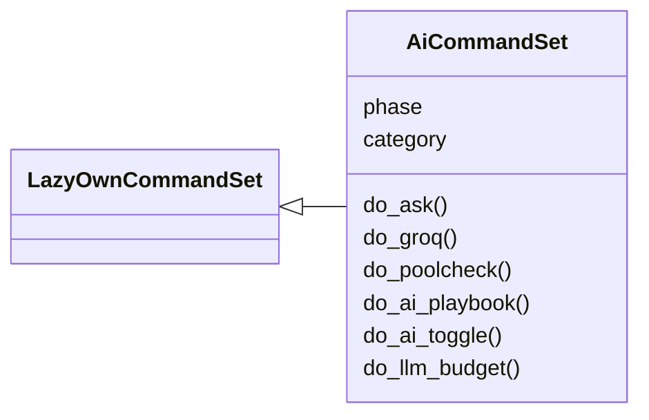
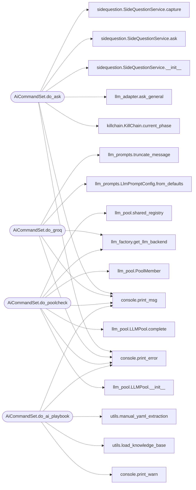

# `cli.commands.ai`

> Source: [cli/commands/ai.py:1](../../cli/commands/ai.py#L1) | language `py` | coverage 100.0% | [API index](../index.md)

Artificial Intelligence command set.

Covers the `[`do_ask`](#aicommandset-do_ask)`, `[`do_groq`](#aicommandset-do_groq)`, `[`do_ai_playbook`](#aicommandset-do_ai_playbook)` and `[`do_ai_toggle`](#aicommandset-do_ai_toggle)`
commands. ``ask`` answers through the configured `[`llm_backend`](skills.claude_md_orchestrator.config.py.md#config-llm_backend)` (any
provider); ``groq`` pins the Groq backend explicitly. Both resolve models,
keys, and budget through [`modules.llm_factory`](modules.llm_factory.py.md) — no subprocess, no
vendored CLI scripts, no shell.

## Contents

- **Classes:** [`AiCommandSet`](#aicommandset)

## Type Diagram



## Call Graph

Solid arrows stay in this module, dashed arrows leave it.



## Classes

<a id="aicommandset"></a>

### `AiCommandSet`

`class` | [cli/commands/ai.py:71](../../cli/commands/ai.py#L71)

```python
class AiCommandSet(LazyOwnCommandSet)
```

Bases: [`LazyOwnCommandSet`](cli.commands._base.py.md#lazyowncommandset)

Pending phase module for the Artificial Intelligence commands.

**Attributes**

| Name | Type | Default | Description |
|---|---|---|---|
| [`phase`](#aicommandset-phase) |  | `'ai'` |  |
| [`category`](#aicommandset-category) |  | `ai_category` |  |

**Members**

| Member | Kind | Summary |
|---|---|---|
| [`do_ask`](#aicommandset-do_ask) | method | Ask the AI a question with current session context pre-loaded. |
| [`do_groq`](#aicommandset-do_groq) | method | Generate a single-line command through the Groq backend. |
| [`do_poolcheck`](#aicommandset-do_poolcheck) | method | Prove the LLM failover pool order with one live prompt. |
| [`do_ai_playbook`](#aicommandset-do_ai_playbook) | method | Generate an offensive playbook from Nmap CSV + KB + Ollama. |
| [`do_ai_toggle`](#aicommandset-do_ai_toggle) | method | Toggle the in-process AI assistant on or off. |
| [`do_llm_budget`](#aicommandset-do_llm_budget) | method | Show the LLM daily cost budget, per call token cap, and current spend. |

<a id="aicommandset-do_ask"></a>

#### `AiCommandSet.do_ask`

`method` | [cli/commands/ai.py:78](../../cli/commands/ai.py#L78)

Decorators: `@cmd2.with_category(ai_category)`

```python
def do_ask(self, line)
```

Ask the AI a question with current session context pre-loaded.

Injects rhost, lhost, phase, OS, latest scan summary, and recent
commands into the prompt so the AI can give targeted advice
without the operator having to copy-paste context manually.

Answers through the configured `[`llm_backend`](skills.claude_md_orchestrator.config.py.md#config-llm_backend)` (any provider).

Usage:
    ``ask what are the best privesc paths for this Linux host?``
    ``ask what services look exploitable on this target?``
    ``ask how do I exploit SMB signing disabled?``
    ``ask snapshot <question>`` answers from a frozen context
    snapshot without touching session state.

**Parameters**

| Name | Type | Default | Description |
|---|---|---|---|
| `line` |  |  | Free-form question forwarded to the LLM. |

**Returns:** None.

*Calls:* [`print_error`](core.console.py.md#print_error), [`print_msg`](core.console.py.md#print_msg), [`KillChain.current_phase`](modules.killchain.py.md#killchain-current_phase), [`ask_general`](modules.llm_adapter.py.md#ask_general), [`SideQuestionService.__init__`](modules.sidequestion.py.md#sidequestionservice-__init__), [`SideQuestionService.ask`](modules.sidequestion.py.md#sidequestionservice-ask), [`SideQuestionService.capture`](modules.sidequestion.py.md#sidequestionservice-capture)

<a id="aicommandset-do_groq"></a>

#### `AiCommandSet.do_groq`

`method` | [cli/commands/ai.py:166](../../cli/commands/ai.py#L166)

Decorators: `@cmd2.with_category(ai_category)`

```python
def do_groq(self, line)
```

Generate a single-line command through the Groq backend.

When the input line is empty the shell's current prompt string is
forwarded as the goal. The backend, model, and key resolve through
[`modules.llm_factory`](modules.llm_factory.py.md) — no subprocess, no shell.

**Parameters**

| Name | Type | Default | Description |
|---|---|---|---|
| `line` |  |  | Goal text. Empty falls back to ``self.prompt``. |

**Returns:** None.

*Calls:* [`print_error`](core.console.py.md#print_error), [`print_msg`](core.console.py.md#print_msg), [`get_llm_backend`](modules.llm_factory.py.md#get_llm_backend), [`LlmPromptConfig.from_defaults`](modules.llm_prompts.py.md#llmpromptconfig-from_defaults), [`truncate_message`](modules.llm_prompts.py.md#truncate_message)

<a id="aicommandset-do_poolcheck"></a>

#### `AiCommandSet.do_poolcheck`

`method` | [cli/commands/ai.py:197](../../cli/commands/ai.py#L197)

Decorators: `@cmd2.with_category(ai_category)`

```python
def do_poolcheck(self, line)
```

Prove the LLM failover pool order with one live prompt.

Usage:
    poolcheck
    poolcheck "Reply with exactly: READY"

Sends one prompt through `[`modules.llm_pool`](modules.llm_pool.py.md)` (groq rank 10, then
ollama rank 1, shared health registry) and prints which member
answered. Kill groq (bad key, offline) and rerun to watch the
failover happen instead of taking it on faith.

**Parameters**

| Name | Type | Default | Description |
|---|---|---|---|
| `line` |  | `a` | Optional prompt. Defaults to a one-word probe. |

**Returns:** None.

*Calls:* [`print_error`](core.console.py.md#print_error), [`print_msg`](core.console.py.md#print_msg), [`get_llm_backend`](modules.llm_factory.py.md#get_llm_backend), [`LLMPool.__init__`](modules.llm_pool.py.md#llmpool-__init__), [`LLMPool.complete`](modules.llm_pool.py.md#llmpool-complete), [`PoolMember`](modules.llm_pool.py.md#poolmember), [`shared_registry`](modules.llm_pool.py.md#shared_registry)

<a id="aicommandset-do_ai_playbook"></a>

#### `AiCommandSet.do_ai_playbook`

`method` | [cli/commands/ai.py:254](../../cli/commands/ai.py#L254)

Decorators: `@cmd2.with_category(ai_category)`

```python
def do_ai_playbook(self, line)
```

Generate an offensive playbook from Nmap CSV + KB + Ollama.

Combines a parsed Nmap CSV export, the local technique knowledge
base, and an Ollama LLM completion to render a YAML playbook
under ``playbooks/``.

Usage:
    ``ai_playbook <csv_file> [playbook_name] [model_name]``

**Parameters**

| Name | Type | Default | Description |
|---|---|---|---|
| `line` |  |  | Whitespace-separated positional arguments. All are optional; missing values fall back to ``sessions/vulns_<rhost>.csv``, ``AutoGeneratedPlaybook`` and the ``llm_model_ollama`` payload value. |

**Returns:** None.

*Calls:* [`print_error`](core.console.py.md#print_error), [`print_msg`](core.console.py.md#print_msg), [`print_warn`](core.console.py.md#print_warn), [`load_knowledge_base`](utils.py.md#load_knowledge_base), [`manual_yaml_extraction`](utils.py.md#manual_yaml_extraction), [`parse_nmap_csv`](utils.py.md#parse_nmap_csv), [`parse_yaml_response`](utils.py.md#parse_yaml_response), [`preprocess_llm_response`](utils.py.md#preprocess_llm_response), [`query_ollama`](utils.py.md#query_ollama), [`save_playbook`](utils.py.md#save_playbook)

<a id="aicommandset-do_ai_toggle"></a>

#### `AiCommandSet.do_ai_toggle`

`method` | [cli/commands/ai.py:361](../../cli/commands/ai.py#L361)

Decorators: `@cmd2.with_category(ai_category)`

```python
def do_ai_toggle(self, _arg)
```

Toggle the in-process AI assistant on or off.

Flips ``use_ai`` on the shell so subsequent prompts either consult
the configured LLM backend or pass through untouched.

**Parameters**

| Name | Type | Default | Description |
|---|---|---|---|
| `_arg` |  |  | Unused command-line argument. |

**Returns:** None.

<a id="aicommandset-do_llm_budget"></a>

#### `AiCommandSet.do_llm_budget`

`method` | [cli/commands/ai.py:378](../../cli/commands/ai.py#L378)

Decorators: `@cmd2.with_category(ai_category)`

```python
def do_llm_budget(self, line)
```

Show the LLM daily cost budget, per call token cap, and current spend.

The framework wraps every LLM call with a budget proxy that
enforces a daily cost cap and a per call token cap. The cap
values live in ``payload.json`` and the proxy persists the
spend to ``sessions/llm_budget.json``.

Subcommands:

- ``llm_budget``            Show the structured status block.
- ``llm_budget json``       Emit the status as a JSON object.
- ``llm_budget reset``      Clear the ledger for the current day.

**Parameters**

| Name | Type | Default | Description |
|---|---|---|---|
| `line` |  |  | Optional subcommand string. |

**Returns:** None. Output is written to stdout through `[`print_msg`](core.console.py.md#print_msg)` so
the LazyOwn history capture picks the result up.

*Calls:* [`confirm`](cli.confirm.py.md#confirm), [`print_msg`](core.console.py.md#print_msg), [`print_warn`](core.console.py.md#print_warn), [`BudgetLedger`](core.llm_budget.py.md#budgetledger), [`BudgetLedger.reset`](core.llm_budget.py.md#budgetledger-reset), [`format_budget_status`](core.llm_budget.py.md#format_budget_status), [`load_budget_config`](core.llm_budget.py.md#load_budget_config), [`read_budget_status`](core.llm_budget.py.md#read_budget_status)

---
