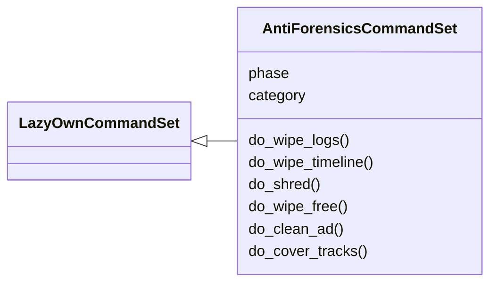
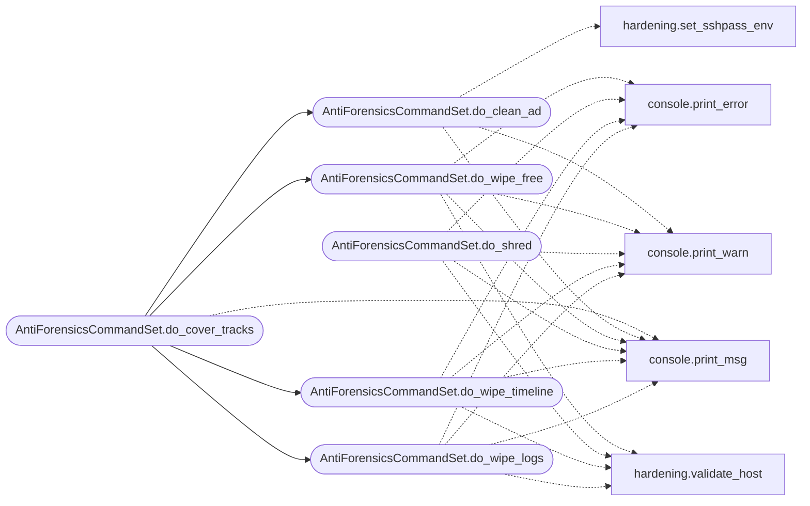

# `cli.commands.anti_forensics`

> Source: [cli/commands/anti_forensics.py:1](../../cli/commands/anti_forensics.py#L1) | language `py` | coverage 100.0% | [API index](../index.md)

Anti-Forensics command set.

Covers post-exploitation cleanup: log wiping, timeline scrubbing, secure
file deletion, free space wiping, AD event-log clearing, and an all-in-one
cover-tracks operation.

## Contents

- **Classes:** [`AntiForensicsCommandSet`](#antiforensicscommandset)

## Type Diagram



## Call Graph

Solid arrows stay in this module, dashed arrows leave it.



## Classes

<a id="antiforensicscommandset"></a>

### `AntiForensicsCommandSet`

`class` | [cli/commands/anti_forensics.py:32](../../cli/commands/anti_forensics.py#L32)

```python
class AntiForensicsCommandSet(LazyOwnCommandSet)
```

Bases: [`LazyOwnCommandSet`](cli.commands._base.py.md#lazyowncommandset)

Anti-forensics operations for post-exploitation cleanup.

**Attributes**

| Name | Type | Default | Description |
|---|---|---|---|
| [`phase`](#antiforensicscommandset-phase) |  | `'post'` |  |
| [`category`](#antiforensicscommandset-category) |  | `ANTI_FORENSICS_CATEGORY` |  |

**Members**

| Member | Kind | Summary |
|---|---|---|
| [`do_wipe_logs`](#antiforensicscommandset-do_wipe_logs) | method | Clear system log files on the remote target. |
| [`do_wipe_timeline`](#antiforensicscommandset-do_wipe_timeline) | method | Scrub file timestamps and shell history on the target. |
| [`do_shred`](#antiforensicscommandset-do_shred) | method | Securely delete files by overwriting before removal. |
| [`do_wipe_free`](#antiforensicscommandset-do_wipe_free) | method | Wipe free disk space to prevent forensic file recovery. |
| [`do_clean_ad`](#antiforensicscommandset-do_clean_ad) | method | Clear Active Directory event logs and cached Kerberos tickets. |
| [`do_cover_tracks`](#antiforensicscommandset-do_cover_tracks) | method | Run all anti-forensics operations in sequence. |

<a id="antiforensicscommandset-do_wipe_logs"></a>

#### `AntiForensicsCommandSet.do_wipe_logs`

`method` | [cli/commands/anti_forensics.py:39](../../cli/commands/anti_forensics.py#L39)

Decorators: `@cmd2.with_category(ANTI_FORENSICS_CATEGORY)`

```python
def do_wipe_logs(self, line)
```

Clear system log files on the remote target.

Usage: wipe_logs [--target <ip>] [--user <username>] [--all] [--force]

Without --target, prepares local commands for manual execution.
With --target, executes cleanup via SSH.

**Parameters**

| Name | Type | Default | Description |
|---|---|---|---|
| `line` |  |  |  |

*Calls:* [`print_error`](core.console.py.md#print_error), [`print_msg`](core.console.py.md#print_msg), [`print_warn`](core.console.py.md#print_warn), [`validate_host`](core.hardening.py.md#validate_host)

*Called by:* [`AntiForensicsCommandSet.do_cover_tracks`](#antiforensicscommandset-do_cover_tracks)

<a id="antiforensicscommandset-do_wipe_timeline"></a>

#### `AntiForensicsCommandSet.do_wipe_timeline`

`method` | [cli/commands/anti_forensics.py:104](../../cli/commands/anti_forensics.py#L104)

Decorators: `@cmd2.with_category(ANTI_FORENSICS_CATEGORY)`

```python
def do_wipe_timeline(self, line)
```

Scrub file timestamps and shell history on the target.

Usage: wipe_timeline [--target <ip>] [--user <username>] [--path <dir>] [--force]

Touches all files under --path with a fixed timestamp to destroy
forensic timeline analysis. Defaults to common writable paths.

**Parameters**

| Name | Type | Default | Description |
|---|---|---|---|
| `line` |  |  |  |

*Calls:* [`print_error`](core.console.py.md#print_error), [`print_msg`](core.console.py.md#print_msg), [`print_warn`](core.console.py.md#print_warn), [`validate_host`](core.hardening.py.md#validate_host)

*Called by:* [`AntiForensicsCommandSet.do_cover_tracks`](#antiforensicscommandset-do_cover_tracks)

<a id="antiforensicscommandset-do_shred"></a>

#### `AntiForensicsCommandSet.do_shred`

`method` | [cli/commands/anti_forensics.py:151](../../cli/commands/anti_forensics.py#L151)

Decorators: `@cmd2.with_category(ANTI_FORENSICS_CATEGORY)`

```python
def do_shred(self, line)
```

Securely delete files by overwriting before removal.

Usage: shred <file_path> [--passes <n>] [--target <ip>] [--user <username>] [--force]

Overwrites the file N times with random data then deletes it.
Defaults to 7 passes (DoD 5220.22-M standard).

**Parameters**

| Name | Type | Default | Description |
|---|---|---|---|
| `line` |  |  |  |

*Calls:* [`print_error`](core.console.py.md#print_error), [`print_msg`](core.console.py.md#print_msg), [`print_warn`](core.console.py.md#print_warn), [`validate_host`](core.hardening.py.md#validate_host)

<a id="antiforensicscommandset-do_wipe_free"></a>

#### `AntiForensicsCommandSet.do_wipe_free`

`method` | [cli/commands/anti_forensics.py:206](../../cli/commands/anti_forensics.py#L206)

Decorators: `@cmd2.with_category(ANTI_FORENSICS_CATEGORY)`

```python
def do_wipe_free(self, line)
```

Wipe free disk space to prevent forensic file recovery.

Usage: wipe_free [--target <ip>] [--user <username>] [--path <mount_point>] [--force]

Fills free space with random data then removes the filler file.
Defaults to /tmp if no path is specified on remote targets.

**Parameters**

| Name | Type | Default | Description |
|---|---|---|---|
| `line` |  |  |  |

*Calls:* [`print_error`](core.console.py.md#print_error), [`print_msg`](core.console.py.md#print_msg), [`print_warn`](core.console.py.md#print_warn), [`validate_host`](core.hardening.py.md#validate_host)

*Called by:* [`AntiForensicsCommandSet.do_cover_tracks`](#antiforensicscommandset-do_cover_tracks)

<a id="antiforensicscommandset-do_clean_ad"></a>

#### `AntiForensicsCommandSet.do_clean_ad`

`method` | [cli/commands/anti_forensics.py:243](../../cli/commands/anti_forensics.py#L243)

Decorators: `@cmd2.with_category(ANTI_FORENSICS_CATEGORY)`

```python
def do_clean_ad(self, line)
```

Clear Active Directory event logs and cached Kerberos tickets.

Usage: clean_ad [--target <dc_ip>] [--user <domain\user>] [--password <pass>] [--force]

Purges Security, System, and Application event logs on the DC.
Clears Kerberos ticket cache on the attacker machine.

**Parameters**

| Name | Type | Default | Description |
|---|---|---|---|
| `line` |  |  |  |

*Calls:* [`print_msg`](core.console.py.md#print_msg), [`print_warn`](core.console.py.md#print_warn), [`set_sshpass_env`](core.hardening.py.md#set_sshpass_env)

*Called by:* [`AntiForensicsCommandSet.do_cover_tracks`](#antiforensicscommandset-do_cover_tracks)

<a id="antiforensicscommandset-do_cover_tracks"></a>

#### `AntiForensicsCommandSet.do_cover_tracks`

`method` | [cli/commands/anti_forensics.py:304](../../cli/commands/anti_forensics.py#L304)

Decorators: `@cmd2.with_category(ANTI_FORENSICS_CATEGORY)`

```python
def do_cover_tracks(self, line)
```

Run all anti-forensics operations in sequence.

Usage: cover_tracks [--target <ip>] [--user <username>] [--password <pass>] [--force]

Executes: wipe_logs -> wipe_timeline -> clean_ad -> wipe_free.

**Parameters**

| Name | Type | Default | Description |
|---|---|---|---|
| `line` |  |  |  |

*Calls:* [`AntiForensicsCommandSet.do_clean_ad`](#antiforensicscommandset-do_clean_ad), [`AntiForensicsCommandSet.do_wipe_free`](#antiforensicscommandset-do_wipe_free), [`AntiForensicsCommandSet.do_wipe_logs`](#antiforensicscommandset-do_wipe_logs), [`AntiForensicsCommandSet.do_wipe_timeline`](#antiforensicscommandset-do_wipe_timeline), [`print_msg`](core.console.py.md#print_msg), [`print_warn`](core.console.py.md#print_warn)

---
