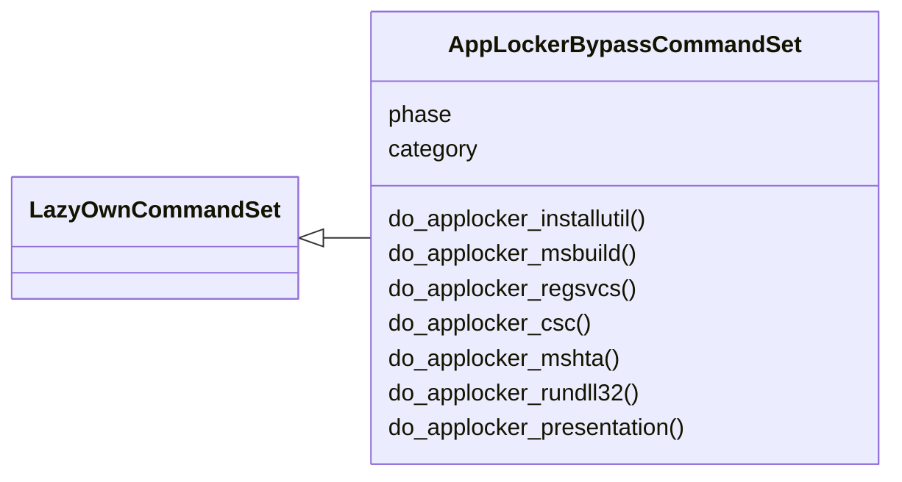
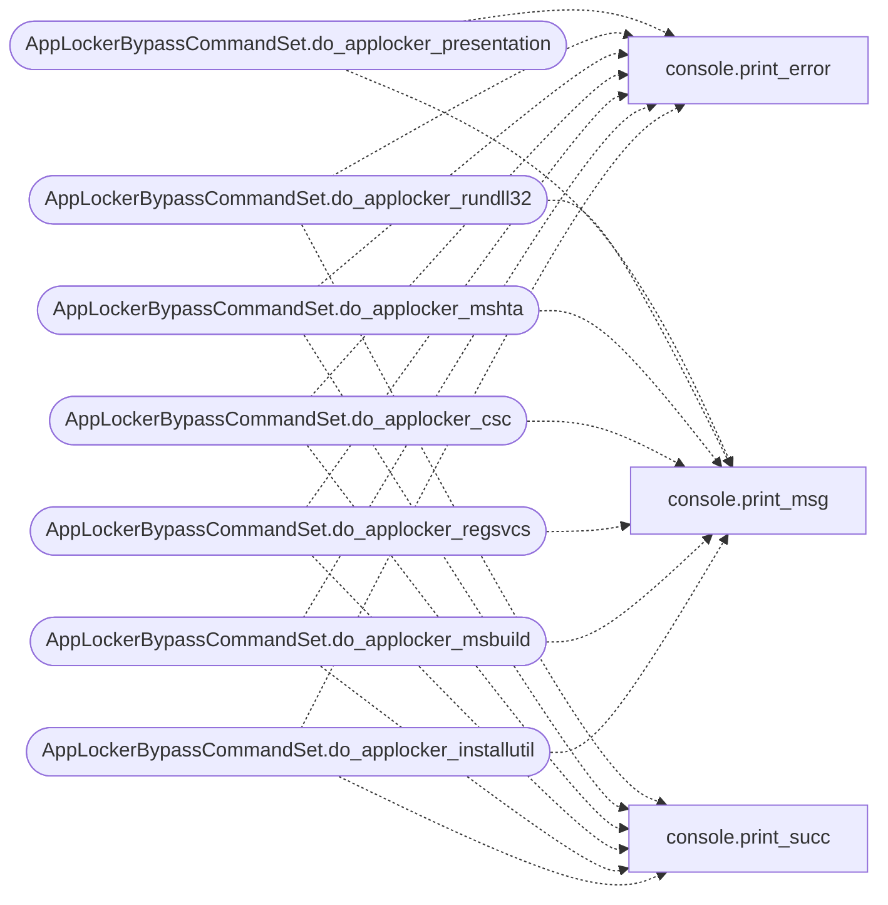

# `cli.commands.applocker_bypass`

> Source: [cli/commands/applocker_bypass.py:1](../../cli/commands/applocker_bypass.py#L1) | language `py` | coverage 100.0% | [API index](../index.md)

AppLocker and WDAC bypass command set.

Generates payloads and bypass scripts for 7 signed Microsoft binaries
that are commonly allowed through AppLocker and Windows Defender
Application Control policies.

## Contents

- **Classes:** [`AppLockerBypassCommandSet`](#applockerbypasscommandset)

## Type Diagram



## Call Graph

Solid arrows stay in this module, dashed arrows leave it.



## Classes

<a id="applockerbypasscommandset"></a>

### `AppLockerBypassCommandSet`

`class` | [cli/commands/applocker_bypass.py:99](../../cli/commands/applocker_bypass.py#L99)

```python
class AppLockerBypassCommandSet(LazyOwnCommandSet)
```

Bases: [`LazyOwnCommandSet`](cli.commands._base.py.md#lazyowncommandset)

AppLocker and WDAC bypass payload generators.

**Attributes**

| Name | Type | Default | Description |
|---|---|---|---|
| [`phase`](#applockerbypasscommandset-phase) |  | `'exploit'` |  |
| [`category`](#applockerbypasscommandset-category) |  | `APP_LOCKER_CATEGORY` |  |

**Members**

| Member | Kind | Summary |
|---|---|---|
| [`do_applocker_installutil`](#applockerbypasscommandset-do_applocker_installutil) | method | Generate an InstallUtil.exe AppLocker bypass payload. |
| [`do_applocker_msbuild`](#applockerbypasscommandset-do_applocker_msbuild) | method | Generate an MSBuild.exe AppLocker bypass payload. |
| [`do_applocker_regsvcs`](#applockerbypasscommandset-do_applocker_regsvcs) | method | Generate a Regsvcs.exe/Regasm.exe AppLocker bypass payload. |
| [`do_applocker_csc`](#applockerbypasscommandset-do_applocker_csc) | method | Generate a csc.exe compile-and-execute AppLocker bypass. |
| [`do_applocker_mshta`](#applockerbypasscommandset-do_applocker_mshta) | method | Generate an mshta.exe AppLocker bypass payload. |
| [`do_applocker_rundll32`](#applockerbypasscommandset-do_applocker_rundll32) | method | Generate a rundll32.exe AppLocker bypass via SCT scriptlet. |
| [`do_applocker_presentation`](#applockerbypasscommandset-do_applocker_presentation) | method | Generate a PresentationHost.exe AppLocker bypass reference. |

<a id="applockerbypasscommandset-do_applocker_installutil"></a>

#### `AppLockerBypassCommandSet.do_applocker_installutil`

`method` | [cli/commands/applocker_bypass.py:109](../../cli/commands/applocker_bypass.py#L109)

Decorators: `@cmd2.with_category(APP_LOCKER_CATEGORY)`

```python
def do_applocker_installutil(self, line='')
```

Generate an InstallUtil.exe AppLocker bypass payload.

Usage: applocker_installutil

Compiles a .NET assembly that downloads and executes a PowerShell
payload, then provides the InstallUtil.exe command for execution.
The assembly uses the required Installer class pattern.

MITRE: T1218.004

**Parameters**

| Name | Type | Default | Description |
|---|---|---|---|
| `line` |  | `''` |  |

*Calls:* [`print_error`](core.console.py.md#print_error), [`print_msg`](core.console.py.md#print_msg), [`print_succ`](core.console.py.md#print_succ)

<a id="applockerbypasscommandset-do_applocker_msbuild"></a>

#### `AppLockerBypassCommandSet.do_applocker_msbuild`

`method` | [cli/commands/applocker_bypass.py:146](../../cli/commands/applocker_bypass.py#L146)

Decorators: `@cmd2.with_category(APP_LOCKER_CATEGORY)`

```python
def do_applocker_msbuild(self, line='')
```

Generate an MSBuild.exe AppLocker bypass payload.

Usage: applocker_msbuild

Creates a .xml MSBuild project file that executes PowerShell.
MSBuild.exe is signed and commonly allowed through WDAC policies.

MITRE: T1127.001

**Parameters**

| Name | Type | Default | Description |
|---|---|---|---|
| `line` |  | `''` |  |

*Calls:* [`print_error`](core.console.py.md#print_error), [`print_msg`](core.console.py.md#print_msg), [`print_succ`](core.console.py.md#print_succ)

<a id="applockerbypasscommandset-do_applocker_regsvcs"></a>

#### `AppLockerBypassCommandSet.do_applocker_regsvcs`

`method` | [cli/commands/applocker_bypass.py:173](../../cli/commands/applocker_bypass.py#L173)

Decorators: `@cmd2.with_category(APP_LOCKER_CATEGORY)`

```python
def do_applocker_regsvcs(self, line='')
```

Generate a Regsvcs.exe/Regasm.exe AppLocker bypass payload.

Usage: applocker_regsvcs

Compiles a .NET assembly inheriting ServicedComponent and
generates the Regsvcs.exe command to execute the payload.

MITRE: T1218.009

**Parameters**

| Name | Type | Default | Description |
|---|---|---|---|
| `line` |  | `''` |  |

*Calls:* [`print_error`](core.console.py.md#print_error), [`print_msg`](core.console.py.md#print_msg), [`print_succ`](core.console.py.md#print_succ)

<a id="applockerbypasscommandset-do_applocker_csc"></a>

#### `AppLockerBypassCommandSet.do_applocker_csc`

`method` | [cli/commands/applocker_bypass.py:209](../../cli/commands/applocker_bypass.py#L209)

Decorators: `@cmd2.with_category(APP_LOCKER_CATEGORY)`

```python
def do_applocker_csc(self, line='')
```

Generate a csc.exe compile-and-execute AppLocker bypass.

Usage: applocker_csc

Creates a pure C# reverse shell source file that can be compiled
with csc.exe (a signed Microsoft binary commonly allowed).
No external dependencies except .NET Framework.

MITRE: T1027.004

**Parameters**

| Name | Type | Default | Description |
|---|---|---|---|
| `line` |  | `''` |  |

*Calls:* [`print_error`](core.console.py.md#print_error), [`print_msg`](core.console.py.md#print_msg), [`print_succ`](core.console.py.md#print_succ)

<a id="applockerbypasscommandset-do_applocker_mshta"></a>

#### `AppLockerBypassCommandSet.do_applocker_mshta`

`method` | [cli/commands/applocker_bypass.py:240](../../cli/commands/applocker_bypass.py#L240)

Decorators: `@cmd2.with_category(APP_LOCKER_CATEGORY)`

```python
def do_applocker_mshta(self, line='')
```

Generate an mshta.exe AppLocker bypass payload.

Usage: applocker_mshta

Creates an HTA file that executes PowerShell via mshta.exe
(a signed Microsoft binary). Can be served via HTTP or run
from local disk.

MITRE: T1218.005

**Parameters**

| Name | Type | Default | Description |
|---|---|---|---|
| `line` |  | `''` |  |

*Calls:* [`print_error`](core.console.py.md#print_error), [`print_msg`](core.console.py.md#print_msg), [`print_succ`](core.console.py.md#print_succ)

<a id="applockerbypasscommandset-do_applocker_rundll32"></a>

#### `AppLockerBypassCommandSet.do_applocker_rundll32`

`method` | [cli/commands/applocker_bypass.py:269](../../cli/commands/applocker_bypass.py#L269)

Decorators: `@cmd2.with_category(APP_LOCKER_CATEGORY)`

```python
def do_applocker_rundll32(self, line='')
```

Generate a rundll32.exe AppLocker bypass via SCT scriptlet.

Usage: applocker_rundll32

Creates a .sct scriptlet file that executes JavaScript via
rundll32.exe (a signed Microsoft binary). Can be served via
HTTP or run from local disk.

MITRE: T1218.011

**Parameters**

| Name | Type | Default | Description |
|---|---|---|---|
| `line` |  | `''` |  |

*Calls:* [`print_error`](core.console.py.md#print_error), [`print_msg`](core.console.py.md#print_msg), [`print_succ`](core.console.py.md#print_succ)

<a id="applockerbypasscommandset-do_applocker_presentation"></a>

#### `AppLockerBypassCommandSet.do_applocker_presentation`

`method` | [cli/commands/applocker_bypass.py:298](../../cli/commands/applocker_bypass.py#L298)

Decorators: `@cmd2.with_category(APP_LOCKER_CATEGORY)`

```python
def do_applocker_presentation(self, line='')
```

Generate a PresentationHost.exe AppLocker bypass reference.

Usage: applocker_presentation

Provides commands to generate and deploy an XBAP payload.
PresentationHost.exe is a signed WPF host that can execute
XAML Browser Applications.

MITRE: T1218

**Parameters**

| Name | Type | Default | Description |
|---|---|---|---|
| `line` |  | `''` |  |

*Calls:* [`print_error`](core.console.py.md#print_error), [`print_msg`](core.console.py.md#print_msg)

---
