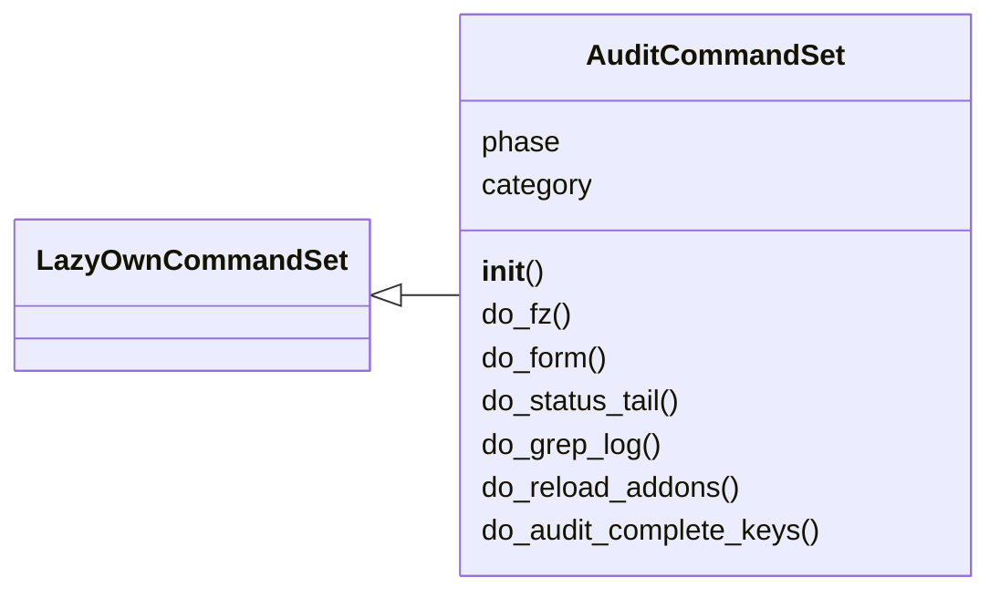
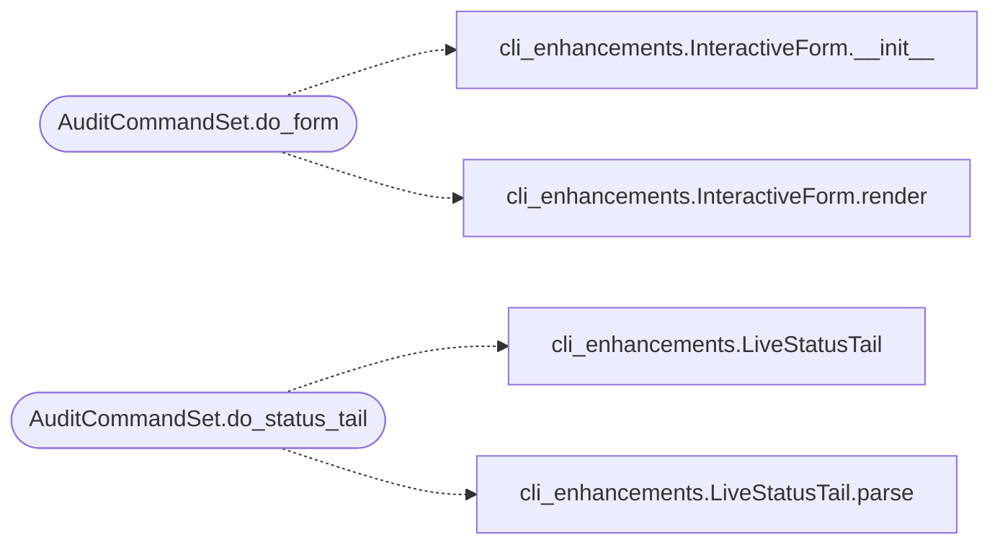

# `cli.commands.audit`

> Source: [cli/commands/audit.py:1](../../cli/commands/audit.py#L1) | language `py` | coverage 88.9% | [API index](../index.md)

Audit-mode CommandSet: fuzzy finder, forms, status tail, transcript grep.

This module wires the SOLID primitives in [`cli.cli_enhancements`](cli.cli_enhancements.py.md) to the
running `[`LazyOwnShell`](lazyown.py.md#lazyownshell)` instance via cmd2's CommandSet auto-discovery.

Commands exposed
----------------
- ``fz [query]`` — fuzzy command finder backed by `[`FuzzyCommandIndex`](cli.cli_enhancements.py.md#fuzzycommandindex)`.
- ``form <command>`` — interactive parameter form for any registered command.
- ``status_tail [target]`` — parse the latest scan partial and print progress.
- ``grep_log <pattern>`` — grep across the recent transcript.
- ``reload_addons`` — trigger one polling sweep over ``lazyaddons/``+``plugins/``.

Design constraints
------------------
- Pull the parent shell instance via ``self._cmd``. Never import lazyown.py.
- Lazily build heavy primitives (transcript store, hot reloader) so cmd2
  startup does not regress.
- Every public command method has a one-line docstring (cmd2 turns it into
  the help text shown by ``help <name>``).

## Contents

- **Classes:** [`AuditCommandSet`](#auditcommandset)

## Type Diagram



## Call Graph

Solid arrows stay in this module, dashed arrows leave it.



## Classes

<a id="auditcommandset"></a>

### `AuditCommandSet`

`class` | [cli/commands/audit.py:92](../../cli/commands/audit.py#L92)

```python
class AuditCommandSet(LazyOwnCommandSet)
```

Bases: [`LazyOwnCommandSet`](cli.commands._base.py.md#lazyowncommandset)

Operator commands that improve audit ergonomics.

Phase: `[`audit`](scripts.devtools.command_audit.py.md#audit)` (cross-cutting; not tied to a kill-chain stage).

**Attributes**

| Name | Type | Default | Description |
|---|---|---|---|
| [`phase`](#auditcommandset-phase) |  | `'audit'` |  |
| [`category`](#auditcommandset-category) |  | `'Audit'` |  |

**Members**

| Member | Kind | Summary |
|---|---|---|
| [`__init__`](#auditcommandset-__init__) | constructor |  |
| [`do_fz`](#auditcommandset-do_fz) | method | Fuzzy command finder. |
| [`do_form`](#auditcommandset-do_form) | method | Open an interactive form for a known command. |
| [`do_status_tail`](#auditcommandset-do_status_tail) | method | Print live progress from the latest sessions/scan_*.partial file. |
| [`do_grep_log`](#auditcommandset-do_grep_log) | method | Grep recent command outputs. |
| [`do_reload_addons`](#auditcommandset-do_reload_addons) | method | Re-scan lazyaddons/ and plugins/ for changes; reloads what's new. |
| [`do_audit_complete_keys`](#auditcommandset-do_audit_complete_keys) | method | Print payload-aware completion suggestions for a partial command. |

<a id="auditcommandset-__init__"></a>

#### `AuditCommandSet.__init__`

`constructor` | [cli/commands/audit.py:101](../../cli/commands/audit.py#L101)

```python
def __init__(self) -> None
```

<a id="auditcommandset-do_fz"></a>

#### `AuditCommandSet.do_fz`

`method` | [cli/commands/audit.py:160](../../cli/commands/audit.py#L160)

Decorators: `@with_category('Audit')`

```python
def do_fz(self, statement) -> None
```

Fuzzy command finder.

Usage: fz [query]. Empty lists every command.

**Parameters**

| Name | Type | Default | Description |
|---|---|---|---|
| `statement` |  |  |  |

<a id="auditcommandset-do_form"></a>

#### `AuditCommandSet.do_form`

`method` | [cli/commands/audit.py:178](../../cli/commands/audit.py#L178)

Decorators: `@with_category('Audit')`

```python
def do_form(self, statement) -> None
```

Open an interactive form for a known command.

Usage: form <command>.

**Parameters**

| Name | Type | Default | Description |
|---|---|---|---|
| `statement` |  |  |  |

*Calls:* [`InteractiveForm.__init__`](cli.cli_enhancements.py.md#interactiveform-__init__), [`InteractiveForm.render`](cli.cli_enhancements.py.md#interactiveform-render)

<a id="auditcommandset-do_status_tail"></a>

#### `AuditCommandSet.do_status_tail`

`method` | [cli/commands/audit.py:196](../../cli/commands/audit.py#L196)

Decorators: `@with_category('Audit')`

```python
def do_status_tail(self, statement) -> None
```

Print live progress from the latest sessions/scan_*.partial file.

**Parameters**

| Name | Type | Default | Description |
|---|---|---|---|
| `statement` |  |  |  |

*Calls:* [`LiveStatusTail`](cli.cli_enhancements.py.md#livestatustail), [`LiveStatusTail.parse`](cli.cli_enhancements.py.md#livestatustail-parse)

<a id="auditcommandset-do_grep_log"></a>

#### `AuditCommandSet.do_grep_log`

`method` | [cli/commands/audit.py:234](../../cli/commands/audit.py#L234)

Decorators: `@with_category('Audit')`

```python
def do_grep_log(self, statement) -> None
```

Grep recent command outputs.

Usage: grep_log <pattern> [--cmd <name>].

**Parameters**

| Name | Type | Default | Description |
|---|---|---|---|
| `statement` |  |  |  |

<a id="auditcommandset-do_reload_addons"></a>

#### `AuditCommandSet.do_reload_addons`

`method` | [cli/commands/audit.py:263](../../cli/commands/audit.py#L263)

Decorators: `@with_category('Audit')`

```python
def do_reload_addons(self, _statement) -> None
```

Re-scan lazyaddons/ and plugins/ for changes; reloads what's new.

**Parameters**

| Name | Type | Default | Description |
|---|---|---|---|
| `_statement` |  |  |  |

<a id="auditcommandset-do_audit_complete_keys"></a>

#### `AuditCommandSet.do_audit_complete_keys`

`method` | [cli/commands/audit.py:288](../../cli/commands/audit.py#L288)

Decorators: `@with_category('Audit')`

```python
def do_audit_complete_keys(self, statement) -> None
```

Print payload-aware completion suggestions for a partial command.

**Parameters**

| Name | Type | Default | Description |
|---|---|---|---|
| `statement` |  |  |  |

---
