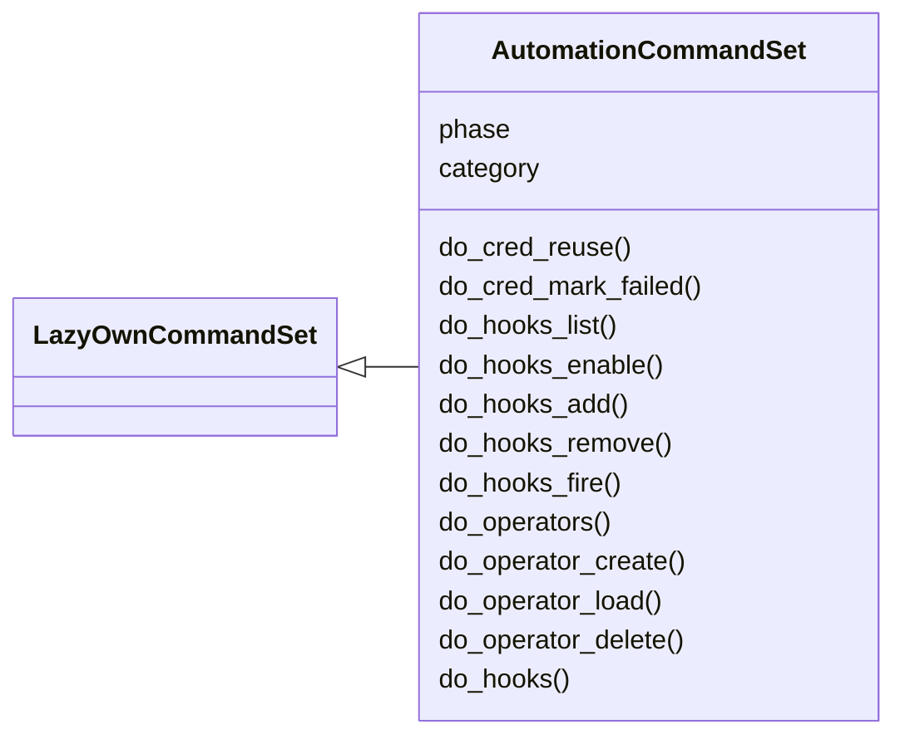
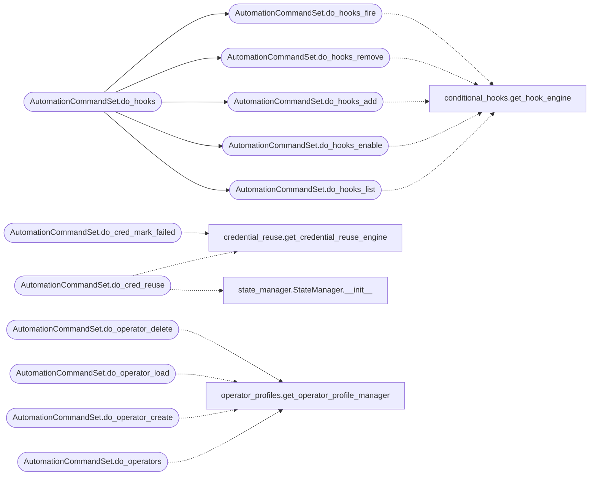

# `cli.commands.automation`

> Source: [cli/commands/automation.py:1](../../cli/commands/automation.py#L1) | language `py` | coverage 100.0% | [API index](../index.md)

Automation command set — credential reuse, conditional hooks, operator profiles.

Provides CLI commands for managing the credential reuse engine,
conditional hook rules, and multi-operator profiles.

## Contents

- **Classes:** [`AutomationCommandSet`](#automationcommandset)

## Type Diagram



## Call Graph

Solid arrows stay in this module, dashed arrows leave it.



## Classes

<a id="automationcommandset"></a>

### `AutomationCommandSet`

`class` | [cli/commands/automation.py:17](../../cli/commands/automation.py#L17)

```python
class AutomationCommandSet(LazyOwnCommandSet)
```

Bases: [`LazyOwnCommandSet`](cli.commands._base.py.md#lazyowncommandset)

Automation & operator workflow commands.

**Attributes**

| Name | Type | Default | Description |
|---|---|---|---|
| [`phase`](#automationcommandset-phase) |  | `'misc'` |  |
| [`category`](#automationcommandset-category) |  | `'12. Automation'` |  |

**Members**

| Member | Kind | Summary |
|---|---|---|
| [`do_cred_reuse`](#automationcommandset-do_cred_reuse) | method | Analyze captured credentials and suggest spray targets. |
| [`do_cred_mark_failed`](#automationcommandset-do_cred_mark_failed) | method | Mark a credential as failed against a host. |
| [`do_hooks_list`](#automationcommandset-do_hooks_list) | method | List all conditional hook rules. |
| [`do_hooks_enable`](#automationcommandset-do_hooks_enable) | method | Enable or disable a hook rule. |
| [`do_hooks_add`](#automationcommandset-do_hooks_add) | method | Add a new conditional hook rule (JSON string). |
| [`do_hooks_remove`](#automationcommandset-do_hooks_remove) | method | Remove a hook rule by name. |
| [`do_hooks_fire`](#automationcommandset-do_hooks_fire) | method | Manually fire a hook event for testing. |
| [`do_operators`](#automationcommandset-do_operators) | method | List all operator profiles. |
| [`do_operator_create`](#automationcommandset-do_operator_create) | method | Create a new operator profile. |
| [`do_operator_load`](#automationcommandset-do_operator_load) | method | Load effective config for an operator (team baseline + overrides). |
| [`do_operator_delete`](#automationcommandset-do_operator_delete) | method | Delete an operator profile. |
| [`do_hooks`](#automationcommandset-do_hooks) | method | Conditional hooks management — list, enable, disable, add, remove rules. |

<a id="automationcommandset-do_cred_reuse"></a>

#### `AutomationCommandSet.do_cred_reuse`

`method` | [cli/commands/automation.py:24](../../cli/commands/automation.py#L24)

Decorators: `@cmd2.with_category(miscellaneous_category)`

```python
def do_cred_reuse(self, line: str)
```

Analyze captured credentials and suggest spray targets.

Usage: cred_reuse [limit=N]

**Parameters**

| Name | Type | Default | Description |
|---|---|---|---|
| `line` | `str` |  |  |

*Calls:* [`get_credential_reuse_engine`](modules.credential_reuse.py.md#get_credential_reuse_engine), [`StateManager.__init__`](modules.state_manager.py.md#statemanager-__init__)

<a id="automationcommandset-do_cred_mark_failed"></a>

#### `AutomationCommandSet.do_cred_mark_failed`

`method` | [cli/commands/automation.py:57](../../cli/commands/automation.py#L57)

Decorators: `@cmd2.with_category(miscellaneous_category)`

```python
def do_cred_mark_failed(self, line: str)
```

Mark a credential as failed against a host.

Usage: cred_mark_failed <user> <password> <host>

**Parameters**

| Name | Type | Default | Description |
|---|---|---|---|
| `line` | `str` |  |  |

*Calls:* [`get_credential_reuse_engine`](modules.credential_reuse.py.md#get_credential_reuse_engine)

<a id="automationcommandset-do_hooks_list"></a>

#### `AutomationCommandSet.do_hooks_list`

`method` | [cli/commands/automation.py:78](../../cli/commands/automation.py#L78)

Decorators: `@cmd2.with_category(miscellaneous_category)`

```python
def do_hooks_list(self, line: str)
```

List all conditional hook rules.

Usage: hooks_list

**Parameters**

| Name | Type | Default | Description |
|---|---|---|---|
| `line` | `str` |  |  |

*Calls:* [`get_hook_engine`](modules.conditional_hooks.py.md#get_hook_engine)

*Called by:* [`AutomationCommandSet.do_hooks`](#automationcommandset-do_hooks)

<a id="automationcommandset-do_hooks_enable"></a>

#### `AutomationCommandSet.do_hooks_enable`

`method` | [cli/commands/automation.py:101](../../cli/commands/automation.py#L101)

Decorators: `@cmd2.with_category(miscellaneous_category)`

```python
def do_hooks_enable(self, line: str)
```

Enable or disable a hook rule.

Usage: hooks_enable <rule_name> [on|off]

**Parameters**

| Name | Type | Default | Description |
|---|---|---|---|
| `line` | `str` |  |  |

*Calls:* [`get_hook_engine`](modules.conditional_hooks.py.md#get_hook_engine)

*Called by:* [`AutomationCommandSet.do_hooks`](#automationcommandset-do_hooks)

<a id="automationcommandset-do_hooks_add"></a>

#### `AutomationCommandSet.do_hooks_add`

`method` | [cli/commands/automation.py:129](../../cli/commands/automation.py#L129)

Decorators: `@cmd2.with_category(miscellaneous_category)`

```python
def do_hooks_add(self, line: str)
```

Add a new conditional hook rule (JSON string).

Usage: hooks_add '{"name":"my-rule","trigger":{"event":"beacon_connected"},"actions":[{"type":"run_command","command":"whoami"}]}'

**Parameters**

| Name | Type | Default | Description |
|---|---|---|---|
| `line` | `str` |  |  |

*Calls:* [`get_hook_engine`](modules.conditional_hooks.py.md#get_hook_engine)

*Called by:* [`AutomationCommandSet.do_hooks`](#automationcommandset-do_hooks)

<a id="automationcommandset-do_hooks_remove"></a>

#### `AutomationCommandSet.do_hooks_remove`

`method` | [cli/commands/automation.py:150](../../cli/commands/automation.py#L150)

Decorators: `@cmd2.with_category(miscellaneous_category)`

```python
def do_hooks_remove(self, line: str)
```

Remove a hook rule by name.

Usage: hooks_remove <rule_name>

**Parameters**

| Name | Type | Default | Description |
|---|---|---|---|
| `line` | `str` |  |  |

*Calls:* [`get_hook_engine`](modules.conditional_hooks.py.md#get_hook_engine)

*Called by:* [`AutomationCommandSet.do_hooks`](#automationcommandset-do_hooks)

<a id="automationcommandset-do_hooks_fire"></a>

#### `AutomationCommandSet.do_hooks_fire`

`method` | [cli/commands/automation.py:172](../../cli/commands/automation.py#L172)

Decorators: `@cmd2.with_category(miscellaneous_category)`

```python
def do_hooks_fire(self, line: str)
```

Manually fire a hook event for testing.

Usage: hooks_fire <event_name> [key=value ...]

**Parameters**

| Name | Type | Default | Description |
|---|---|---|---|
| `line` | `str` |  |  |

*Calls:* [`get_hook_engine`](modules.conditional_hooks.py.md#get_hook_engine)

*Called by:* [`AutomationCommandSet.do_hooks`](#automationcommandset-do_hooks)

<a id="automationcommandset-do_operators"></a>

#### `AutomationCommandSet.do_operators`

`method` | [cli/commands/automation.py:202](../../cli/commands/automation.py#L202)

Decorators: `@cmd2.with_category(miscellaneous_category)`

```python
def do_operators(self, line: str)
```

List all operator profiles.

Usage: operators

**Parameters**

| Name | Type | Default | Description |
|---|---|---|---|
| `line` | `str` |  |  |

*Calls:* [`get_operator_profile_manager`](modules.operator_profiles.py.md#get_operator_profile_manager)

<a id="automationcommandset-do_operator_create"></a>

#### `AutomationCommandSet.do_operator_create`

`method` | [cli/commands/automation.py:229](../../cli/commands/automation.py#L229)

Decorators: `@cmd2.with_category(miscellaneous_category)`

```python
def do_operator_create(self, line: str)
```

Create a new operator profile.

Usage: operator_create <username> [role=operator] [lhost=IP] [lport=PORT]

**Parameters**

| Name | Type | Default | Description |
|---|---|---|---|
| `line` | `str` |  |  |

*Calls:* [`get_operator_profile_manager`](modules.operator_profiles.py.md#get_operator_profile_manager)

<a id="automationcommandset-do_operator_load"></a>

#### `AutomationCommandSet.do_operator_load`

`method` | [cli/commands/automation.py:264](../../cli/commands/automation.py#L264)

Decorators: `@cmd2.with_category(miscellaneous_category)`

```python
def do_operator_load(self, line: str)
```

Load effective config for an operator (team baseline + overrides).

Usage: operator_load <username>

**Parameters**

| Name | Type | Default | Description |
|---|---|---|---|
| `line` | `str` |  |  |

*Calls:* [`get_operator_profile_manager`](modules.operator_profiles.py.md#get_operator_profile_manager)

<a id="automationcommandset-do_operator_delete"></a>

#### `AutomationCommandSet.do_operator_delete`

`method` | [cli/commands/automation.py:292](../../cli/commands/automation.py#L292)

Decorators: `@cmd2.with_category(miscellaneous_category)`

```python
def do_operator_delete(self, line: str)
```

Delete an operator profile.

Usage: operator_delete <username>

**Parameters**

| Name | Type | Default | Description |
|---|---|---|---|
| `line` | `str` |  |  |

*Calls:* [`get_operator_profile_manager`](modules.operator_profiles.py.md#get_operator_profile_manager)

<a id="automationcommandset-do_hooks"></a>

#### `AutomationCommandSet.do_hooks`

`method` | [cli/commands/automation.py:314](../../cli/commands/automation.py#L314)

Decorators: `@cmd2.with_category(miscellaneous_category)`

```python
def do_hooks(self, line: str)
```

Conditional hooks management — list, enable, disable, add, remove rules.

Usage: hooks [subcommand] [args]
Subcommands: list, enable, disable, add, remove, fire

**Parameters**

| Name | Type | Default | Description |
|---|---|---|---|
| `line` | `str` |  |  |

*Calls:* [`AutomationCommandSet.do_hooks_add`](#automationcommandset-do_hooks_add), [`AutomationCommandSet.do_hooks_enable`](#automationcommandset-do_hooks_enable), [`AutomationCommandSet.do_hooks_fire`](#automationcommandset-do_hooks_fire), [`AutomationCommandSet.do_hooks_list`](#automationcommandset-do_hooks_list), [`AutomationCommandSet.do_hooks_remove`](#automationcommandset-do_hooks_remove)

---
