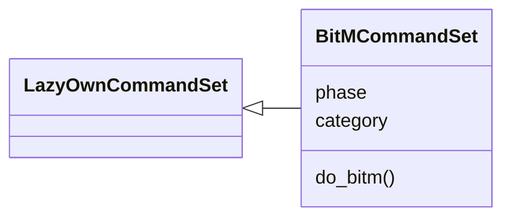
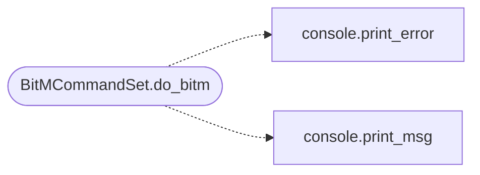

# `cli.commands.bitm`

> Source: [cli/commands/bitm.py:1](../../cli/commands/bitm.py#L1) | language `py` | coverage 100.0% | [API index](../index.md)

Browser-in-the-Middle CLI command set.

Automates ARP spoofing + transparent HTTP injection attacks to harvest
browser sessions, cookies, OAuth tokens, form data, and keystrokes
from target machines on the local network.

## Contents

- **Classes:** [`BitMCommandSet`](#bitmcommandset)

## Type Diagram



## Call Graph

Solid arrows stay in this module, dashed arrows leave it.



## Classes

<a id="bitmcommandset"></a>

### `BitMCommandSet`

`class` | [cli/commands/bitm.py:24](../../cli/commands/bitm.py#L24)

```python
class BitMCommandSet(LazyOwnCommandSet)
```

Bases: [`LazyOwnCommandSet`](cli.commands._base.py.md#lazyowncommandset)

Browser-in-the-Middle — ARP spoofing + JS injection credential harvester.

**Attributes**

| Name | Type | Default | Description |
|---|---|---|---|
| [`phase`](#bitmcommandset-phase) |  | `'lateral'` |  |
| [`category`](#bitmcommandset-category) |  | `lateral_movement_category` |  |

**Members**

| Member | Kind | Summary |
|---|---|---|
| [`do_bitm`](#bitmcommandset-do_bitm) | method | Browser-in-the-Middle attack manager. |

<a id="bitmcommandset-do_bitm"></a>

#### `BitMCommandSet.do_bitm`

`method` | [cli/commands/bitm.py:31](../../cli/commands/bitm.py#L31)

Decorators: `@cmd2.with_category(lateral_movement_category)`

```python
def do_bitm(self, line)
```

Browser-in-the-Middle attack manager.

Usage:
    bitm start <target_ip> [--gateway <ip>] [--interface <iface>] [--lport <port>] [--payloads <p1,p2,...>]
    bitm stop
    bitm status
    bitm inject <payload_name>
    bitm harvest
    bitm cleanup

Starts ARP spoofing (bettercap or arpspoof) against the target and
transparently injects JavaScript payloads into HTTP responses to
harvest browser sessions.

Requires: root/sudo, bettercap or dsniff (arpspoof).

Available JS payloads:
    cookie_harvest  — capture all document.cookie
    form_sniff     — log every form submission
    keylogger      — keystroke capture
    screenshot     — html2canvas page screenshot (needs html2canvas on victim)
    oauth_token_grab — steal OAuth tokens from localStorage/sessionStorage/cookies
    beef_hook      — inject BeEF hook script

**Parameters**

| Name | Type | Default | Description |
|---|---|---|---|
| `line` |  |  |  |

**Example**

```python
bitm start 192.168.1.105
bitm start 192.168.1.105 --payloads cookie_harvest,form_sniff,oauth_token_grab
bitm inject keylogger
bitm harvest
bitm stop
```

*Calls:* [`print_error`](core.console.py.md#print_error), [`print_msg`](core.console.py.md#print_msg)

---
