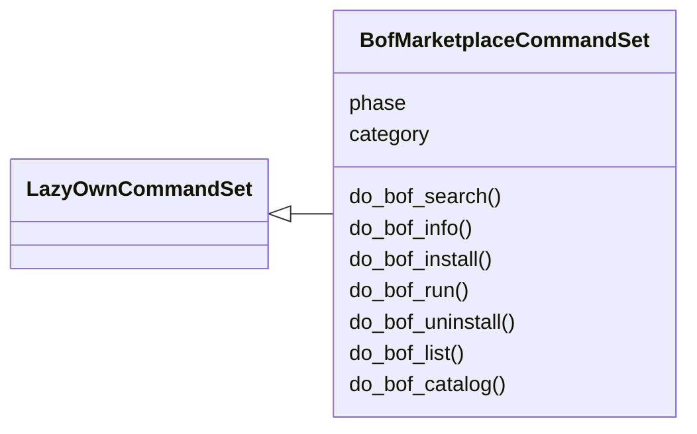
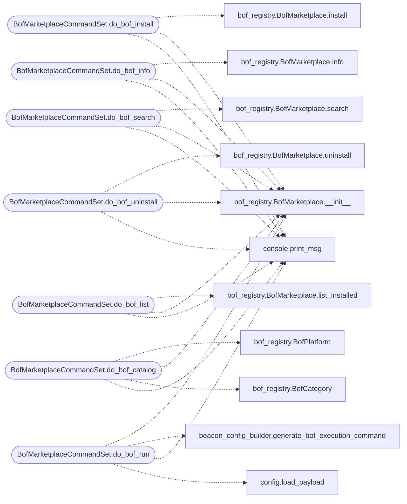

# `cli.commands.bof_registry`

> Source: [cli/commands/bof_registry.py:1](../../cli/commands/bof_registry.py#L1) | language `py` | coverage 100.0% | [API index](../index.md)

BOF marketplace CommandSet — Beacon Object File discovery, install, and execution.

Exposes ``modules/bof_registry`` through the LazyOwn CLI. Install compiles BOFs
and stages them for beacon delivery. Run sends ``bof:URL`` commands to connected
beacons via the C2.

Contracts:
    - bof_install: clones repo, compiles BOF .o, stages to sessions/temp_uploads/bofs/
    - bof_run: generates bof:URL command, queues it on C2 for target beacon
    - bof_search, bof_info, bof_catalog, bof_list, bof_uninstall: as before

## Contents

- **Classes:** [`BofMarketplaceCommandSet`](#bofmarketplacecommandset)

## Type Diagram



## Call Graph

Solid arrows stay in this module, dashed arrows leave it.



## Classes

<a id="bofmarketplacecommandset"></a>

### `BofMarketplaceCommandSet`

`class` | [cli/commands/bof_registry.py:29](../../cli/commands/bof_registry.py#L29)

```python
class BofMarketplaceCommandSet(LazyOwnCommandSet)
```

Bases: [`LazyOwnCommandSet`](cli.commands._base.py.md#lazyowncommandset)

BOF marketplace: search, install, info, list, run BOFs on beacons.

**Attributes**

| Name | Type | Default | Description |
|---|---|---|---|
| [`phase`](#bofmarketplacecommandset-phase) |  | `'c2'` |  |
| [`category`](#bofmarketplacecommandset-category) |  | `CATEGORY` |  |

**Members**

| Member | Kind | Summary |
|---|---|---|
| [`do_bof_search`](#bofmarketplacecommandset-do_bof_search) | method | Search the BOF catalog by keyword. |
| [`do_bof_info`](#bofmarketplacecommandset-do_bof_info) | method | Show detailed information about a BOF. |
| [`do_bof_install`](#bofmarketplacecommandset-do_bof_install) | method | Install and compile a BOF, staging it for beacon delivery. |
| [`do_bof_run`](#bofmarketplacecommandset-do_bof_run) | method | Execute a BOF on a connected beacon. |
| [`do_bof_uninstall`](#bofmarketplacecommandset-do_bof_uninstall) | method | Uninstall a BOF and remove its staged file. |
| [`do_bof_list`](#bofmarketplacecommandset-do_bof_list) | method | List all installed and staged BOFs. |
| [`do_bof_catalog`](#bofmarketplacecommandset-do_bof_catalog) | method | List all BOFs available in the curated catalog. |

<a id="bofmarketplacecommandset-do_bof_search"></a>

#### `BofMarketplaceCommandSet.do_bof_search`

`method` | [cli/commands/bof_registry.py:142](../../cli/commands/bof_registry.py#L142)

Decorators: `@cmd2.with_category(CATEGORY)`

```python
def do_bof_search(self, line: str)
```

Search the BOF catalog by keyword.

Usage: bof_search [query]

**Parameters**

| Name | Type | Default | Description |
|---|---|---|---|
| `line` | `str` |  |  |

*Calls:* [`print_msg`](core.console.py.md#print_msg), [`BofMarketplace.__init__`](modules.bof_registry.py.md#bofmarketplace-__init__), [`BofMarketplace.search`](modules.bof_registry.py.md#bofmarketplace-search)

<a id="bofmarketplacecommandset-do_bof_info"></a>

#### `BofMarketplaceCommandSet.do_bof_info`

`method` | [cli/commands/bof_registry.py:163](../../cli/commands/bof_registry.py#L163)

Decorators: `@cmd2.with_category(CATEGORY)`

```python
def do_bof_info(self, line: str)
```

Show detailed information about a BOF.

Usage: bof_info <name>

**Parameters**

| Name | Type | Default | Description |
|---|---|---|---|
| `line` | `str` |  |  |

*Calls:* [`print_msg`](core.console.py.md#print_msg), [`BofMarketplace.__init__`](modules.bof_registry.py.md#bofmarketplace-__init__), [`BofMarketplace.info`](modules.bof_registry.py.md#bofmarketplace-info)

<a id="bofmarketplacecommandset-do_bof_install"></a>

#### `BofMarketplaceCommandSet.do_bof_install`

`method` | [cli/commands/bof_registry.py:196](../../cli/commands/bof_registry.py#L196)

Decorators: `@cmd2.with_category(CATEGORY)`

```python
def do_bof_install(self, line: str)
```

Install and compile a BOF, staging it for beacon delivery.

Usage: bof_install <name> [<name2> ...]

Clones the BOF source (if available), compiles the object file with
x86_64-w64-mingw32-gcc, and copies the .o to sessions/temp_uploads/bofs/
where the C2's /download/ endpoint can serve it to beacons.

**Parameters**

| Name | Type | Default | Description |
|---|---|---|---|
| `line` | `str` |  |  |

*Calls:* [`print_msg`](core.console.py.md#print_msg), [`BofMarketplace.__init__`](modules.bof_registry.py.md#bofmarketplace-__init__), [`BofMarketplace.install`](modules.bof_registry.py.md#bofmarketplace-install)

<a id="bofmarketplacecommandset-do_bof_run"></a>

#### `BofMarketplaceCommandSet.do_bof_run`

`method` | [cli/commands/bof_registry.py:226](../../cli/commands/bof_registry.py#L226)

Decorators: `@cmd2.with_category(CATEGORY)`

```python
def do_bof_run(self, line: str)
```

Execute a BOF on a connected beacon.

Usage: bof_run <bof_name> <beacon_client_id> [arg1,arg2,...]

Generates a bof:<c2_url>/download/bofs/<name> command and queues it
on the C2 for the specified beacon. The beacon's C client will download
and execute the BOF via its internal COFFLoader.

**Parameters**

| Name | Type | Default | Description |
|---|---|---|---|
| `line` | `str` |  |  |

**Example**

```python
bof_run ldap_enum win10_beacon
bof_run whoami linux_beacon_01
```

*Calls:* [`load_payload`](core.config.py.md#load_payload), [`print_msg`](core.console.py.md#print_msg), [`generate_bof_execution_command`](modules.beacon_config_builder.py.md#generate_bof_execution_command), [`BofMarketplace.__init__`](modules.bof_registry.py.md#bofmarketplace-__init__)

<a id="bofmarketplacecommandset-do_bof_uninstall"></a>

#### `BofMarketplaceCommandSet.do_bof_uninstall`

`method` | [cli/commands/bof_registry.py:267](../../cli/commands/bof_registry.py#L267)

Decorators: `@cmd2.with_category(CATEGORY)`

```python
def do_bof_uninstall(self, line: str)
```

Uninstall a BOF and remove its staged file.

Usage: bof_uninstall <name>

**Parameters**

| Name | Type | Default | Description |
|---|---|---|---|
| `line` | `str` |  |  |

*Calls:* [`print_msg`](core.console.py.md#print_msg), [`BofMarketplace.__init__`](modules.bof_registry.py.md#bofmarketplace-__init__), [`BofMarketplace.uninstall`](modules.bof_registry.py.md#bofmarketplace-uninstall)

<a id="bofmarketplacecommandset-do_bof_list"></a>

#### `BofMarketplaceCommandSet.do_bof_list`

`method` | [cli/commands/bof_registry.py:289](../../cli/commands/bof_registry.py#L289)

Decorators: `@cmd2.with_category(CATEGORY)`

```python
def do_bof_list(self, line: str)
```

List all installed and staged BOFs.

Usage: bof_list

**Parameters**

| Name | Type | Default | Description |
|---|---|---|---|
| `line` | `str` |  |  |

*Calls:* [`print_msg`](core.console.py.md#print_msg), [`BofMarketplace.__init__`](modules.bof_registry.py.md#bofmarketplace-__init__), [`BofMarketplace.list_installed`](modules.bof_registry.py.md#bofmarketplace-list_installed)

<a id="bofmarketplacecommandset-do_bof_catalog"></a>

#### `BofMarketplaceCommandSet.do_bof_catalog`

`method` | [cli/commands/bof_registry.py:321](../../cli/commands/bof_registry.py#L321)

Decorators: `@cmd2.with_category(CATEGORY)`

```python
def do_bof_catalog(self, line: str)
```

List all BOFs available in the curated catalog.

Usage: bof_catalog [--category <name>] [--platform windows|linux]

**Parameters**

| Name | Type | Default | Description |
|---|---|---|---|
| `line` | `str` |  |  |

*Calls:* [`print_msg`](core.console.py.md#print_msg), [`BofCategory`](modules.bof_registry.py.md#bofcategory), [`BofMarketplace.__init__`](modules.bof_registry.py.md#bofmarketplace-__init__), [`BofPlatform`](modules.bof_registry.py.md#bofplatform)

---
