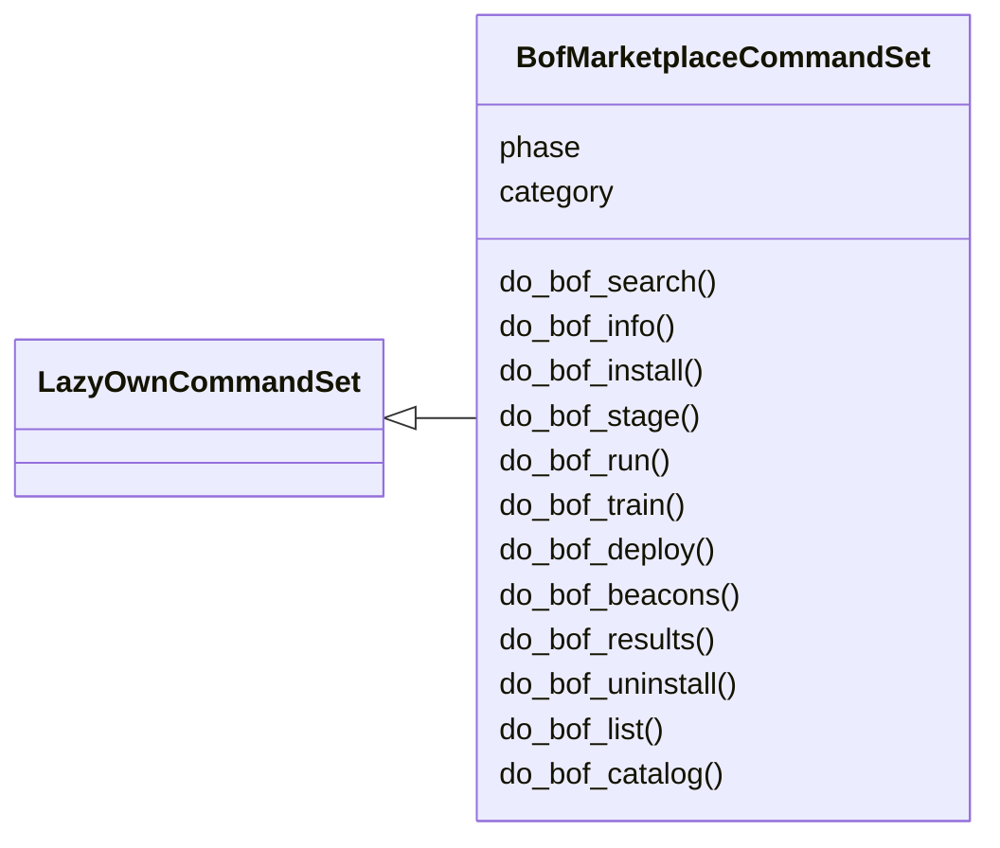
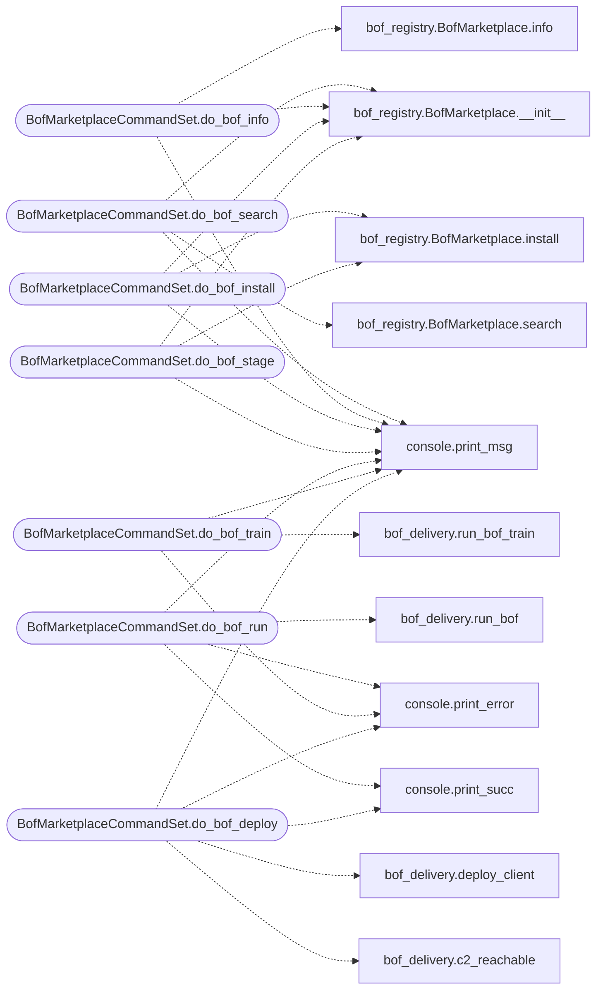

# `cli.commands.bof_registry`

> Source: [cli/commands/bof_registry.py:1](../../cli/commands/bof_registry.py#L1) | language `py` | coverage 100.0% | [API index](../index.md)

BOF marketplace CommandSet — Beacon Object File discovery, staging and delivery.

Exposes [`modules.bof_registry`](modules.bof_registry.py.md) and [`modules.bof_delivery`](modules.bof_delivery.py.md)
through the LazyOwn CLI. Every BOF is declared in ``bofs/*.yaml`` with
its lazyaddon beacon client (``beacon`` or ``blacksandbeacon``); these
commands administer that contract end to end:

    - bof_stage: locate the compiled artifact through the client addon
      and stage it in sessions/temp_uploads/bofs/
    - bof_run: build the ``bof:`` command, queue it on the C2, optionally
      await the result from the beacon history
    - bof_deploy: deliver a staged client beacon onto a target reached by
      an atomic session and wait for its first check-in
    - bof_beacons / bof_results: beacon snapshot and BOF result history
    - bof_search / bof_info / bof_catalog / bof_list / bof_install /
      bof_uninstall: catalog administration

## Contents

- **Classes:** [`BofMarketplaceCommandSet`](#bofmarketplacecommandset)

## Type Diagram



## Call Graph

Solid arrows stay in this module, dashed arrows leave it.



## Classes

<a id="bofmarketplacecommandset"></a>

### `BofMarketplaceCommandSet`

`class` | [cli/commands/bof_registry.py:44](../../cli/commands/bof_registry.py#L44)

```python
class BofMarketplaceCommandSet(LazyOwnCommandSet)
```

Bases: [`LazyOwnCommandSet`](cli.commands._base.py.md#lazyowncommandset)

BOF marketplace: search, install, stage, deploy and run BOFs on beacons.

**Attributes**

| Name | Type | Default | Description |
|---|---|---|---|
| [`phase`](#bofmarketplacecommandset-phase) |  | `'c2'` |  |
| [`category`](#bofmarketplacecommandset-category) |  | `CATEGORY` |  |

**Members**

| Member | Kind | Summary |
|---|---|---|
| [`do_bof_search`](#bofmarketplacecommandset-do_bof_search) | method | Search the BOF catalog by keyword. |
| [`do_bof_info`](#bofmarketplacecommandset-do_bof_info) | method | Show detailed information about a BOF. |
| [`do_bof_install`](#bofmarketplacecommandset-do_bof_install) | method | Install and stage BOFs for beacon delivery. |
| [`do_bof_stage`](#bofmarketplacecommandset-do_bof_stage) | method | Stage a BOF artifact through its lazyaddon beacon client. |
| [`do_bof_run`](#bofmarketplacecommandset-do_bof_run) | method | Execute a BOF on a connected beacon. |
| [`do_bof_train`](#bofmarketplacecommandset-do_bof_train) | method | Run a sequence of BOFs over one beacon, awaiting each result. |
| [`do_bof_deploy`](#bofmarketplacecommandset-do_bof_deploy) | method | Deliver a staged beacon client onto a target and await check-in. |
| [`do_bof_beacons`](#bofmarketplacecommandset-do_bof_beacons) | method | List beacons currently seen by the C2. |
| [`do_bof_results`](#bofmarketplacecommandset-do_bof_results) | method | Show BOF execution history for one beacon. |
| [`do_bof_uninstall`](#bofmarketplacecommandset-do_bof_uninstall) | method | Uninstall a BOF and remove its staged file. |
| [`do_bof_list`](#bofmarketplacecommandset-do_bof_list) | method | List all installed and staged BOFs. |
| [`do_bof_catalog`](#bofmarketplacecommandset-do_bof_catalog) | method | List all BOFs available in the curated catalog. |

<a id="bofmarketplacecommandset-do_bof_search"></a>

#### `BofMarketplaceCommandSet.do_bof_search`

`method` | [cli/commands/bof_registry.py:87](../../cli/commands/bof_registry.py#L87)

Decorators: `@cmd2.with_category(command_and_control_category)`

```python
def do_bof_search(self, line: str)
```

Search the BOF catalog by keyword.

Usage: bof_search [query]

**Parameters**

| Name | Type | Default | Description |
|---|---|---|---|
| `line` | `str` |  |  |

*Calls:* [`print_msg`](core.console.py.md#print_msg), [`BofMarketplace.__init__`](modules.bof_registry.py.md#bofmarketplace-__init__), [`BofMarketplace.search`](modules.bof_registry.py.md#bofmarketplace-search)

<a id="bofmarketplacecommandset-do_bof_info"></a>

#### `BofMarketplaceCommandSet.do_bof_info`

`method` | [cli/commands/bof_registry.py:108](../../cli/commands/bof_registry.py#L108)

Decorators: `@cmd2.with_category(command_and_control_category)`

```python
def do_bof_info(self, line: str)
```

Show detailed information about a BOF.

Usage: bof_info <name>

**Parameters**

| Name | Type | Default | Description |
|---|---|---|---|
| `line` | `str` |  |  |

*Calls:* [`print_msg`](core.console.py.md#print_msg), [`BofMarketplace.__init__`](modules.bof_registry.py.md#bofmarketplace-__init__), [`BofMarketplace.info`](modules.bof_registry.py.md#bofmarketplace-info)

<a id="bofmarketplacecommandset-do_bof_install"></a>

#### `BofMarketplaceCommandSet.do_bof_install`

`method` | [cli/commands/bof_registry.py:143](../../cli/commands/bof_registry.py#L143)

Decorators: `@cmd2.with_category(command_and_control_category)`

```python
def do_bof_install(self, line: str)
```

Install and stage BOFs for beacon delivery.

Usage: bof_install <name> [<name2> ...]

Registers the BOF in the sessions manifest and copies the
compiled artifact to sessions/temp_uploads/bofs/ where the C2's
``/download/bofs/<name>`` endpoint serves it.

**Parameters**

| Name | Type | Default | Description |
|---|---|---|---|
| `line` | `str` |  |  |

*Calls:* [`print_msg`](core.console.py.md#print_msg), [`BofMarketplace.__init__`](modules.bof_registry.py.md#bofmarketplace-__init__), [`BofMarketplace.install`](modules.bof_registry.py.md#bofmarketplace-install)

<a id="bofmarketplacecommandset-do_bof_stage"></a>

#### `BofMarketplaceCommandSet.do_bof_stage`

`method` | [cli/commands/bof_registry.py:171](../../cli/commands/bof_registry.py#L171)

Decorators: `@cmd2.with_category(command_and_control_category)`

```python
def do_bof_stage(self, line: str)
```

Stage a BOF artifact through its lazyaddon beacon client.

Usage: bof_stage <name>

Resolves ``bofs/<name>.yaml``'s ``client`` (``beacon`` or
``blacksandbeacon``), locates `[`client_artifact`](modules.bof_registry.py.md#bofentry-client_artifact)` under the
client addon install path and copies it to the C2 download dir.

**Parameters**

| Name | Type | Default | Description |
|---|---|---|---|
| `line` | `str` |  |  |

*Calls:* [`print_msg`](core.console.py.md#print_msg), [`BofMarketplace.__init__`](modules.bof_registry.py.md#bofmarketplace-__init__), [`BofMarketplace.install`](modules.bof_registry.py.md#bofmarketplace-install)

<a id="bofmarketplacecommandset-do_bof_run"></a>

#### `BofMarketplaceCommandSet.do_bof_run`

`method` | [cli/commands/bof_registry.py:191](../../cli/commands/bof_registry.py#L191)

Decorators: `@cmd2.with_category(command_and_control_category)`

```python
def do_bof_run(self, line: str)
```

Execute a BOF on a connected beacon.

Usage: bof_run <bof_name> <beacon_client_id> [arg1,arg2,...] [--wait <sec>]

Stages the BOF, then queues a ``bof:<c2_url>/download/bofs/<name>
<args>`` command on the C2 for the specified beacon. The beacon
downloads the object over the malleable channel and executes it
in-process (COFFLoader on Windows, RunELF loader on BlackSandBeacon).

**Parameters**

| Name | Type | Default | Description |
|---|---|---|---|
| `line` | `str` |  |  |

**Example**

```python
bof_run whoami_linux linux_beacon_01 --wait 20
```

*Calls:* [`print_error`](core.console.py.md#print_error), [`print_msg`](core.console.py.md#print_msg), [`print_succ`](core.console.py.md#print_succ), [`run_bof`](modules.bof_delivery.py.md#run_bof)

<a id="bofmarketplacecommandset-do_bof_train"></a>

#### `BofMarketplaceCommandSet.do_bof_train`

`method` | [cli/commands/bof_registry.py:247](../../cli/commands/bof_registry.py#L247)

Decorators: `@cmd2.with_category(command_and_control_category)`

```python
def do_bof_train(self, line: str)
```

Run a sequence of BOFs over one beacon, awaiting each result.

Usage: bof_train <beacon_client_id> --bofs <n1,n2,...> [--args <a1,a2>] [--wait <sec>]

Orchestratable single step: the C2 receives one ``bof:`` command
per BOF and the command aggregates the outputs from the beacon
history into one report.

**Parameters**

| Name | Type | Default | Description |
|---|---|---|---|
| `line` | `str` |  |  |

**Example**

```python
bof_train metasploitable --bofs whoami_linux,is_sudo,suid_enum --wait 20
```

*Calls:* [`print_error`](core.console.py.md#print_error), [`print_msg`](core.console.py.md#print_msg), [`run_bof_train`](modules.bof_delivery.py.md#run_bof_train)

<a id="bofmarketplacecommandset-do_bof_deploy"></a>

#### `BofMarketplaceCommandSet.do_bof_deploy`

`method` | [cli/commands/bof_registry.py:309](../../cli/commands/bof_registry.py#L309)

Decorators: `@cmd2.with_category(command_and_control_category)`

```python
def do_bof_deploy(self, line: str)
```

Deliver a staged beacon client onto a target and await check-in.

Usage: bof_deploy [client] [target] [--wait <sec>]

The target must have a live atomic session (atomic_exploit
run/atomic_shell). The beacon fetches its binary from the C2
``/download/`` endpoint itself and runs detached; the first
check-in returns the beacon client id usable by bof_run.

**Parameters**

| Name | Type | Default | Description |
|---|---|---|---|
| `line` | `str` |  |  |

*Calls:* [`print_error`](core.console.py.md#print_error), [`print_msg`](core.console.py.md#print_msg), [`print_succ`](core.console.py.md#print_succ), [`c2_reachable`](modules.bof_delivery.py.md#c2_reachable), [`deploy_client`](modules.bof_delivery.py.md#deploy_client)

<a id="bofmarketplacecommandset-do_bof_beacons"></a>

#### `BofMarketplaceCommandSet.do_bof_beacons`

`method` | [cli/commands/bof_registry.py:358](../../cli/commands/bof_registry.py#L358)

Decorators: `@cmd2.with_category(command_and_control_category)`

```python
def do_bof_beacons(self, line: str)
```

List beacons currently seen by the C2.

Usage: bof_beacons

**Parameters**

| Name | Type | Default | Description |
|---|---|---|---|
| `line` | `str` |  |  |

*Calls:* [`print_msg`](core.console.py.md#print_msg), [`recent_beacons`](modules.bof_delivery.py.md#recent_beacons)

<a id="bofmarketplacecommandset-do_bof_results"></a>

#### `BofMarketplaceCommandSet.do_bof_results`

`method` | [cli/commands/bof_registry.py:377](../../cli/commands/bof_registry.py#L377)

Decorators: `@cmd2.with_category(command_and_control_category)`

```python
def do_bof_results(self, line: str)
```

Show BOF execution history for one beacon.

Usage: bof_results <beacon_client_id> [limit]

**Parameters**

| Name | Type | Default | Description |
|---|---|---|---|
| `line` | `str` |  |  |

*Calls:* [`print_error`](core.console.py.md#print_error), [`print_msg`](core.console.py.md#print_msg), [`bof_results`](modules.bof_delivery.py.md#bof_results)

<a id="bofmarketplacecommandset-do_bof_uninstall"></a>

#### `BofMarketplaceCommandSet.do_bof_uninstall`

`method` | [cli/commands/bof_registry.py:409](../../cli/commands/bof_registry.py#L409)

Decorators: `@cmd2.with_category(command_and_control_category)`

```python
def do_bof_uninstall(self, line: str)
```

Uninstall a BOF and remove its staged file.

Usage: bof_uninstall <name>

**Parameters**

| Name | Type | Default | Description |
|---|---|---|---|
| `line` | `str` |  |  |

*Calls:* [`print_msg`](core.console.py.md#print_msg), [`BofMarketplace.__init__`](modules.bof_registry.py.md#bofmarketplace-__init__), [`BofMarketplace.uninstall`](modules.bof_registry.py.md#bofmarketplace-uninstall)

<a id="bofmarketplacecommandset-do_bof_list"></a>

#### `BofMarketplaceCommandSet.do_bof_list`

`method` | [cli/commands/bof_registry.py:431](../../cli/commands/bof_registry.py#L431)

Decorators: `@cmd2.with_category(command_and_control_category)`

```python
def do_bof_list(self, line: str)
```

List all installed and staged BOFs.

Usage: bof_list

**Parameters**

| Name | Type | Default | Description |
|---|---|---|---|
| `line` | `str` |  |  |

*Calls:* [`print_msg`](core.console.py.md#print_msg), [`BofMarketplace.__init__`](modules.bof_registry.py.md#bofmarketplace-__init__), [`BofMarketplace.list_installed`](modules.bof_registry.py.md#bofmarketplace-list_installed)

<a id="bofmarketplacecommandset-do_bof_catalog"></a>

#### `BofMarketplaceCommandSet.do_bof_catalog`

`method` | [cli/commands/bof_registry.py:463](../../cli/commands/bof_registry.py#L463)

Decorators: `@cmd2.with_category(command_and_control_category)`

```python
def do_bof_catalog(self, line: str)
```

List all BOFs available in the curated catalog.

Usage: bof_catalog [--category <name>] [--platform windows|linux] [--client <addon>]

**Parameters**

| Name | Type | Default | Description |
|---|---|---|---|
| `line` | `str` |  |  |

*Calls:* [`print_msg`](core.console.py.md#print_msg), [`BofCategory`](modules.bof_registry.py.md#bofcategory), [`BofMarketplace.__init__`](modules.bof_registry.py.md#bofmarketplace-__init__), [`BofPlatform`](modules.bof_registry.py.md#bofplatform)

---
