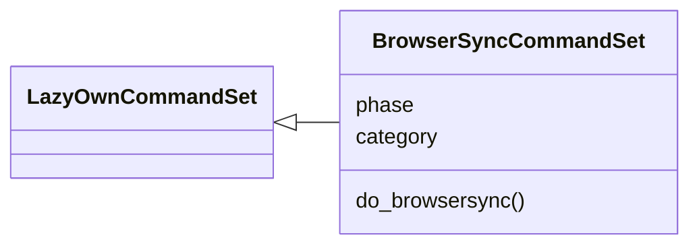
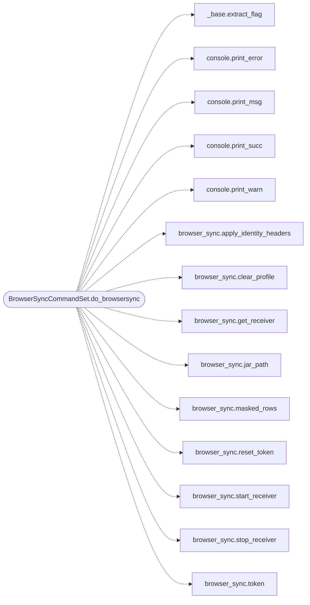

# `cli.commands.browser_sync`

> Source: [cli/commands/browser_sync.py:1](../../cli/commands/browser_sync.py#L1) | language `py` | coverage 100.0% | [API index](../index.md)

BrowserSync shell commands: operator browser identity into the proxy.

## Contents

- **Classes:** [`BrowserSyncCommandSet`](#browsersynccommandset)

## Type Diagram



## Call Graph

Solid arrows stay in this module, dashed arrows leave it.



## Classes

<a id="browsersynccommandset"></a>

### `BrowserSyncCommandSet`

`class` | [cli/commands/browser_sync.py:13](../../cli/commands/browser_sync.py#L13)

```python
class BrowserSyncCommandSet(LazyOwnCommandSet)
```

Bases: [`LazyOwnCommandSet`](cli.commands._base.py.md#lazyowncommandset)

Expose the browser identity sync receiver to the operator.

**Attributes**

| Name | Type | Default | Description |
|---|---|---|---|
| [`phase`](#browsersynccommandset-phase) |  | `'credential_access'` |  |
| [`category`](#browsersynccommandset-category) |  | `miscellaneous_category` |  |

**Members**

| Member | Kind | Summary |
|---|---|---|
| [`do_browsersync`](#browsersynccommandset-do_browsersync) | method | Sync the real browser session into the recorder proxy. |

<a id="browsersynccommandset-do_browsersync"></a>

#### `BrowserSyncCommandSet.do_browsersync`

`method` | [cli/commands/browser_sync.py:20](../../cli/commands/browser_sync.py#L20)

Decorators: `@cmd2.with_category(miscellaneous_category)`

```python
def do_browsersync(self, line)
```

Sync the real browser session into the recorder proxy.

Usage:
    browsersync start [port]    start the loopback receiver
    browsersync stop            stop the receiver
    browsersync status          running state, profile stats, token
    browsersync token           print the receiver token
    browsersync reset-token     regenerate the receiver token
    browsersync show [domain] [--full]   list synced cookies (masked by default)
    browsersync jar             print the Netscape jar path and curl usage
    browsersync rules           show the Burp-style Match and Replace rules file
    browsersync test [path] [--http]   preview injected headers for the payload rhost
    browsersync clear           delete the synced profile and cookie jar

Load browser_sync_extension/ in Chrome or Brave, paste the token in
the popup and every auto_loop / apt_chain / auto_pwn request that
goes through the recorder proxy carries your real cookies.

**Parameters**

| Name | Type | Default | Description |
|---|---|---|---|
| `line` |  |  |  |

*Calls:* [`extract_flag`](cli.commands._base.py.md#extract_flag), [`print_error`](core.console.py.md#print_error), [`print_msg`](core.console.py.md#print_msg), [`print_succ`](core.console.py.md#print_succ), [`print_warn`](core.console.py.md#print_warn), [`apply_identity_headers`](modules.browser_sync.py.md#apply_identity_headers), [`clear_profile`](modules.browser_sync.py.md#clear_profile), [`get_receiver`](modules.browser_sync.py.md#get_receiver), [`jar_path`](modules.browser_sync.py.md#jar_path), [`masked_rows`](modules.browser_sync.py.md#masked_rows), [`reset_token`](modules.browser_sync.py.md#reset_token), [`start_receiver`](modules.browser_sync.py.md#start_receiver) and 2 more

---
