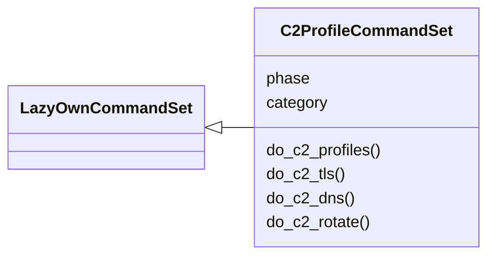
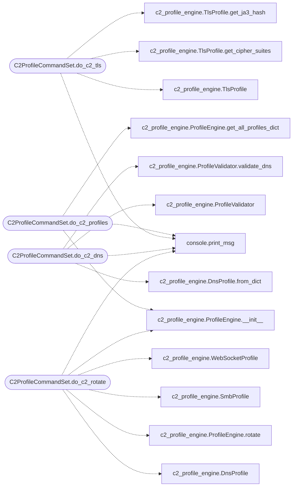

# `cli.commands.c2_profile`

> Source: [cli/commands/c2_profile.py:1](../../cli/commands/c2_profile.py#L1) | language `py` | coverage 100.0% | [API index](../index.md)

C2 profile CommandSet — extended malleable C2 profiles (TLS, DNS, SMB, WS).

Exposes ``modules/c2_profile_engine`` through the LazyOwn CLI.

## Contents

- **Classes:** [`C2ProfileCommandSet`](#c2profilecommandset)

## Type Diagram



## Call Graph

Solid arrows stay in this module, dashed arrows leave it.



## Classes

<a id="c2profilecommandset"></a>

### `C2ProfileCommandSet`

`class` | [cli/commands/c2_profile.py:18](../../cli/commands/c2_profile.py#L18)

```python
class C2ProfileCommandSet(LazyOwnCommandSet)
```

Bases: [`LazyOwnCommandSet`](cli.commands._base.py.md#lazyowncommandset)

Extended C2 profile commands: TLS, DNS, SMB, WebSocket profiles.

**Attributes**

| Name | Type | Default | Description |
|---|---|---|---|
| [`phase`](#c2profilecommandset-phase) |  | `'c2'` |  |
| [`category`](#c2profilecommandset-category) |  | `CATEGORY` |  |

**Members**

| Member | Kind | Summary |
|---|---|---|
| [`do_c2_profiles`](#c2profilecommandset-do_c2_profiles) | method | List all available C2 transport profiles. |
| [`do_c2_tls`](#c2profilecommandset-do_c2_tls) | method | Display the current TLS C2 profile. |
| [`do_c2_dns`](#c2profilecommandset-do_c2_dns) | method | Configure or display the DNS beacon profile. |
| [`do_c2_rotate`](#c2profilecommandset-do_c2_rotate) | method | Rotate to the next C2 transport profile in the rotation queue. |

<a id="c2profilecommandset-do_c2_profiles"></a>

#### `C2ProfileCommandSet.do_c2_profiles`

`method` | [cli/commands/c2_profile.py:25](../../cli/commands/c2_profile.py#L25)

Decorators: `@cmd2.with_category(CATEGORY)`

```python
def do_c2_profiles(self, line: str)
```

List all available C2 transport profiles.

Usage: c2_profiles [--json]

**Parameters**

| Name | Type | Default | Description |
|---|---|---|---|
| `line` | `str` |  |  |

*Calls:* [`print_msg`](core.console.py.md#print_msg), [`ProfileEngine.__init__`](modules.c2_profile_engine.py.md#profileengine-__init__), [`ProfileEngine.get_all_profiles_dict`](modules.c2_profile_engine.py.md#profileengine-get_all_profiles_dict)

<a id="c2profilecommandset-do_c2_tls"></a>

#### `C2ProfileCommandSet.do_c2_tls`

`method` | [cli/commands/c2_profile.py:50](../../cli/commands/c2_profile.py#L50)

Decorators: `@cmd2.with_category(CATEGORY)`

```python
def do_c2_tls(self, line: str)
```

Display the current TLS C2 profile.

Usage: c2_tls [--ja3]

**Parameters**

| Name | Type | Default | Description |
|---|---|---|---|
| `line` | `str` |  |  |

*Calls:* [`print_msg`](core.console.py.md#print_msg), [`TlsProfile`](modules.c2_profile_engine.py.md#tlsprofile), [`TlsProfile.get_cipher_suites`](modules.c2_profile_engine.py.md#tlsprofile-get_cipher_suites), [`TlsProfile.get_ja3_hash`](modules.c2_profile_engine.py.md#tlsprofile-get_ja3_hash)

<a id="c2profilecommandset-do_c2_dns"></a>

#### `C2ProfileCommandSet.do_c2_dns`

`method` | [cli/commands/c2_profile.py:69](../../cli/commands/c2_profile.py#L69)

Decorators: `@cmd2.with_category(CATEGORY)`

```python
def do_c2_dns(self, line: str)
```

Configure or display the DNS beacon profile.

Usage: c2_dns [--domain <fqdn>] [--encoding base32|base64|hex]

**Parameters**

| Name | Type | Default | Description |
|---|---|---|---|
| `line` | `str` |  |  |

*Calls:* [`print_msg`](core.console.py.md#print_msg), [`DnsProfile.from_dict`](modules.c2_profile_engine.py.md#dnsprofile-from_dict), [`ProfileValidator`](modules.c2_profile_engine.py.md#profilevalidator), [`ProfileValidator.validate_dns`](modules.c2_profile_engine.py.md#profilevalidator-validate_dns)

<a id="c2profilecommandset-do_c2_rotate"></a>

#### `C2ProfileCommandSet.do_c2_rotate`

`method` | [cli/commands/c2_profile.py:90](../../cli/commands/c2_profile.py#L90)

Decorators: `@cmd2.with_category(CATEGORY)`

```python
def do_c2_rotate(self, line: str)
```

Rotate to the next C2 transport profile in the rotation queue.

Usage: c2_rotate

**Parameters**

| Name | Type | Default | Description |
|---|---|---|---|
| `line` | `str` |  |  |

*Calls:* [`print_msg`](core.console.py.md#print_msg), [`DnsProfile`](modules.c2_profile_engine.py.md#dnsprofile), [`ProfileEngine.__init__`](modules.c2_profile_engine.py.md#profileengine-__init__), [`ProfileEngine.rotate`](modules.c2_profile_engine.py.md#profileengine-rotate), [`SmbProfile`](modules.c2_profile_engine.py.md#smbprofile), [`WebSocketProfile`](modules.c2_profile_engine.py.md#websocketprofile)

---
