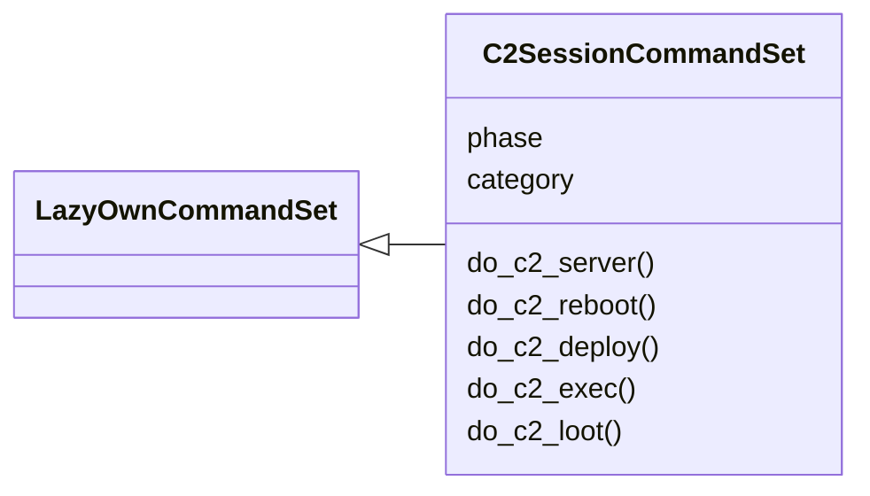
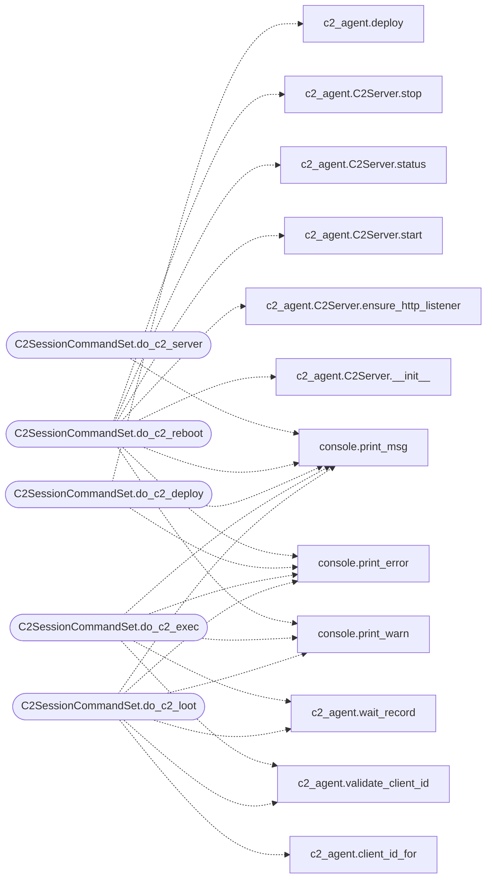

# `cli.commands.c2_session`

> Source: [cli/commands/c2_session.py:1](../../cli/commands/c2_session.py#L1) | language `py` | coverage 100.0% | [API index](../index.md)

C2 session CommandSet — headless server, agent deploy, exec, loot.

Every command is non-interactive and loop-routable: explicit arguments,
JSON-able results on stdout, staged artefacts under ``sessions/``.
Lab and in-scope targets only.

## Contents

- **Classes:** [`C2SessionCommandSet`](#c2sessioncommandset)
- **Constants:** [`CATEGORY`](#category)

## Type Diagram



## Call Graph

Solid arrows stay in this module, dashed arrows leave it.



## Classes

<a id="c2sessioncommandset"></a>

### `C2SessionCommandSet`

`class` | [cli/commands/c2_session.py:108](../../cli/commands/c2_session.py#L108)

```python
class C2SessionCommandSet(LazyOwnCommandSet)
```

Bases: [`LazyOwnCommandSet`](cli.commands._base.py.md#lazyowncommandset)

Headless C2 lifecycle + session ops: server, deploy, exec, loot.

**Attributes**

| Name | Type | Default | Description |
|---|---|---|---|
| [`phase`](#c2sessioncommandset-phase) |  | `'c2'` |  |
| [`category`](#c2sessioncommandset-category) |  | `CATEGORY` |  |

**Members**

| Member | Kind | Summary |
|---|---|---|
| [`do_c2_server`](#c2sessioncommandset-do_c2_server) | method | Manage the headless C2 server (lab use). |
| [`do_c2_reboot`](#c2sessioncommandset-do_c2_reboot) | method | Restart the headless C2 server with ROTATED operator credentials. |
| [`do_c2_deploy`](#c2sessioncommandset-do_c2_deploy) | method | Deploy the malleable agent to a lab target (needs root shell primitive). |
| [`do_c2_exec`](#c2sessioncommandset-do_c2_exec) | method | Run one command on a live C2 session and print its answer. |
| [`do_c2_loot`](#c2sessioncommandset-do_c2_loot) | method | Exfiltrate a remote file through a live C2 session into sessions/loot/. |

<a id="c2sessioncommandset-do_c2_server"></a>

#### `C2SessionCommandSet.do_c2_server`

`method` | [cli/commands/c2_session.py:115](../../cli/commands/c2_session.py#L115)

Decorators: `@cmd2.with_category(CATEGORY)`

```python
def do_c2_server(self, line: str)
```

Manage the headless C2 server (lab use).

Usage:
    c2_server start [--port 4444] [--http-port 8080]
    c2_server status
    c2_server stop

**Parameters**

| Name | Type | Default | Description |
|---|---|---|---|
| `line` | `str` |  |  |

*Calls:* [`print_msg`](core.console.py.md#print_msg)

<a id="c2sessioncommandset-do_c2_reboot"></a>

#### `C2SessionCommandSet.do_c2_reboot`

`method` | [cli/commands/c2_session.py:168](../../cli/commands/c2_session.py#L168)

Decorators: `@cmd2.with_category(CATEGORY)`

```python
def do_c2_reboot(self, line: str)
```

Restart the headless C2 server with ROTATED operator credentials.

Usage:
    c2_reboot [--port 4444] [--http-port 8080]

Stops the running server (when present), generates fresh lab
operator credentials, boots a new instance, re-attaches the lab
HTTP listener, and syncs every store (.c2_credentials.txt,
sessions/c2_lab.json, shell payload on next boot). Prints the
dashboard URLs, the new login, listener ports, AES key state
and pid. Non-interactive and loop-routable.

Note: ``c2_server start`` instead keeps existing credentials so
live agents stay valid; ``c2_reboot`` always rotates.

**Parameters**

| Name | Type | Default | Description |
|---|---|---|---|
| `line` | `str` |  |  |

*Calls:* [`print_error`](core.console.py.md#print_error), [`print_msg`](core.console.py.md#print_msg), [`print_warn`](core.console.py.md#print_warn), [`C2Server.__init__`](modules.c2_agent.py.md#c2server-__init__), [`C2Server.ensure_http_listener`](modules.c2_agent.py.md#c2server-ensure_http_listener), [`C2Server.start`](modules.c2_agent.py.md#c2server-start), [`C2Server.status`](modules.c2_agent.py.md#c2server-status), [`C2Server.stop`](modules.c2_agent.py.md#c2server-stop)

<a id="c2sessioncommandset-do_c2_deploy"></a>

#### `C2SessionCommandSet.do_c2_deploy`

`method` | [cli/commands/c2_session.py:251](../../cli/commands/c2_session.py#L251)

Decorators: `@cmd2.with_category(CATEGORY)`

```python
def do_c2_deploy(self, line: str)
```

Deploy the malleable agent to a lab target (needs root shell primitive).

Usage:
    c2_deploy <target> [--sleep 10]

**Parameters**

| Name | Type | Default | Description |
|---|---|---|---|
| `line` | `str` |  |  |

*Calls:* [`print_error`](core.console.py.md#print_error), [`print_msg`](core.console.py.md#print_msg), [`deploy`](modules.c2_agent.py.md#deploy)

<a id="c2sessioncommandset-do_c2_exec"></a>

#### `C2SessionCommandSet.do_c2_exec`

`method` | [cli/commands/c2_session.py:292](../../cli/commands/c2_session.py#L292)

Decorators: `@cmd2.with_category(CATEGORY)`

```python
def do_c2_exec(self, line: str)
```

Run one command on a live C2 session and print its answer.

Usage:
    c2_exec <client_id> <command...> [--timeout 60]

**Parameters**

| Name | Type | Default | Description |
|---|---|---|---|
| `line` | `str` |  |  |

*Calls:* [`print_error`](core.console.py.md#print_error), [`print_msg`](core.console.py.md#print_msg), [`print_warn`](core.console.py.md#print_warn), [`validate_client_id`](modules.c2_agent.py.md#validate_client_id), [`wait_record`](modules.c2_agent.py.md#wait_record)

<a id="c2sessioncommandset-do_c2_loot"></a>

#### `C2SessionCommandSet.do_c2_loot`

`method` | [cli/commands/c2_session.py:339](../../cli/commands/c2_session.py#L339)

Decorators: `@cmd2.with_category(CATEGORY)`

```python
def do_c2_loot(self, line: str)
```

Exfiltrate a remote file through a live C2 session into sessions/loot/.

Usage:
    c2_loot <client_id> <remote-path> [--timeout 90]

**Parameters**

| Name | Type | Default | Description |
|---|---|---|---|
| `line` | `str` |  |  |

*Calls:* [`print_error`](core.console.py.md#print_error), [`print_msg`](core.console.py.md#print_msg), [`print_warn`](core.console.py.md#print_warn), [`client_id_for`](modules.c2_agent.py.md#client_id_for), [`validate_client_id`](modules.c2_agent.py.md#validate_client_id), [`wait_record`](modules.c2_agent.py.md#wait_record)

---

## Constants

<a id="category"></a>

### `CATEGORY`

`constant` | [cli/commands/c2_session.py:20](../../cli/commands/c2_session.py#L20)

```python
CATEGORY = '10. Command & Control'
```

---
