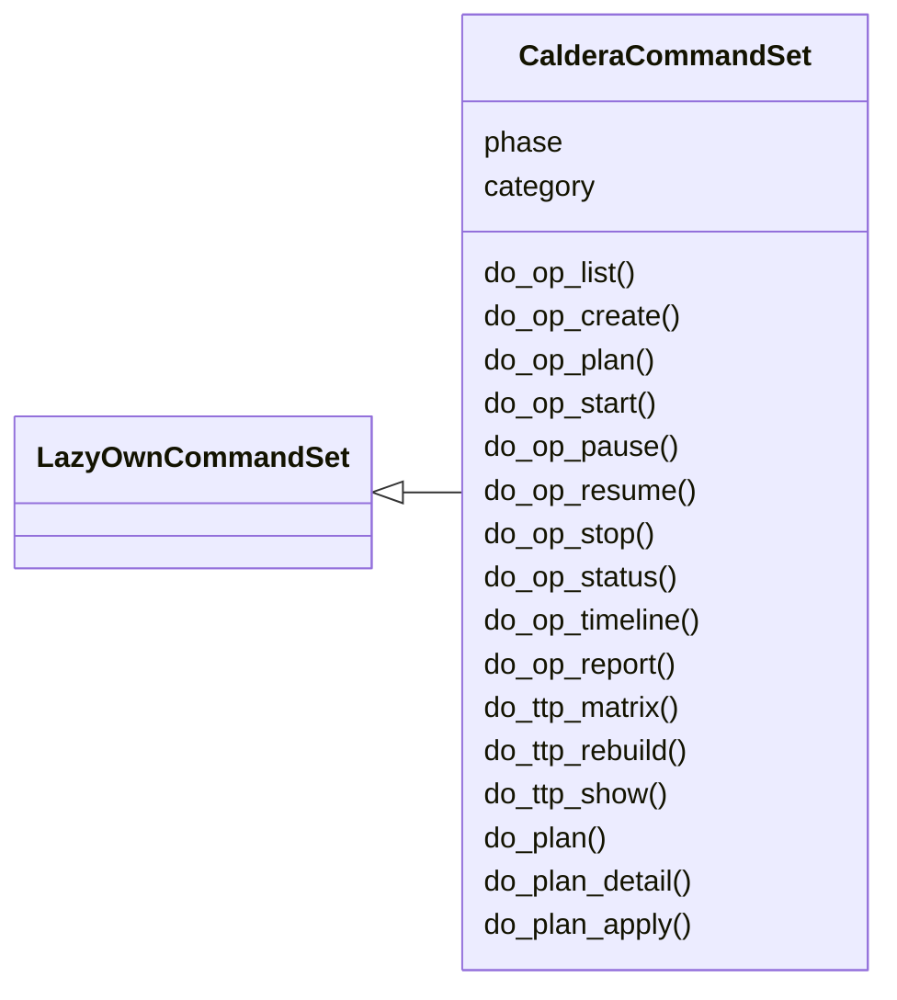
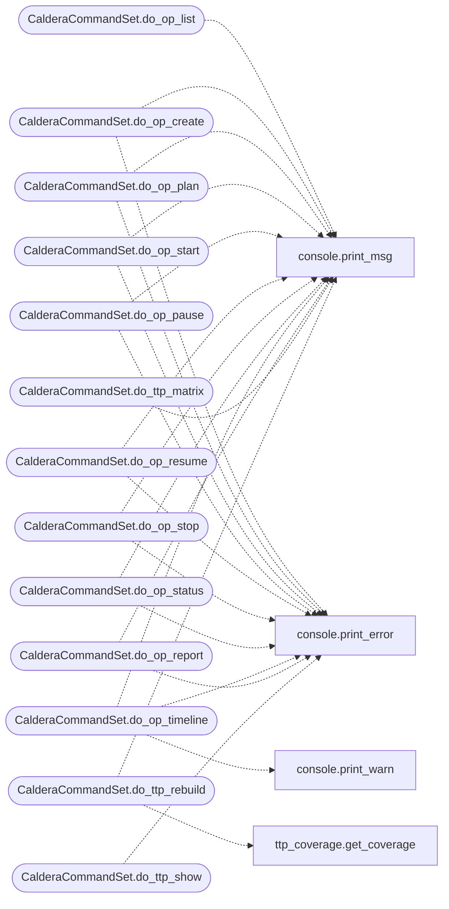

# `cli.commands.caldera`

> Source: [cli/commands/caldera.py:1](../../cli/commands/caldera.py#L1) | language `py` | coverage 100.0% | [API index](../index.md)

Caldera-style command set — operation lifecycle, TTP coverage, and planner.

Wires the new ``modules/operation``, ``modules/planner``, and
``modules/ttp_coverage`` modules into the LazyOwn shell.

Commands:
    op_list                  — list all operations
    op_create <name> <target> [apt]
    op_plan <id> [playbook]  — populate steps via playbook YAML or MITRE derive
    op_start <id>            — run all pending steps (no-op executor by default)
    op_pause <id>            — pause a running operation
    op_resume <id>           — resume a paused operation
    op_stop <id>             — stop a running operation
    op_status <id>           — show progress, coverage, fact count
    op_timeline <id>         — chronological event log
    op_report <id>           — full post-mortem

    ttp_matrix               — coverage matrix across all operations
    ttp_rebuild              — re-walk operations dir to refresh
    ttp_show <technique_id>  — detail for one technique

    plan <target>            — pick the next best technique to run
    plan_detail <target>     — full ranked list with scores

## Contents

- **Classes:** [`CalderaCommandSet`](#calderacommandset)

## Type Diagram



## Call Graph

Solid arrows stay in this module, dashed arrows leave it.



## Classes

<a id="calderacommandset"></a>

### `CalderaCommandSet`

`class` | [cli/commands/caldera.py:66](../../cli/commands/caldera.py#L66)

```python
class CalderaCommandSet(LazyOwnCommandSet)
```

Bases: [`LazyOwnCommandSet`](cli.commands._base.py.md#lazyowncommandset)

Operation lifecycle, TTP coverage, and fact-based planner.

**Attributes**

| Name | Type | Default | Description |
|---|---|---|---|
| [`phase`](#calderacommandset-phase) |  | `'caldera'` |  |
| [`category`](#calderacommandset-category) |  | `'12. Miscellaneous'` |  |

**Members**

| Member | Kind | Summary |
|---|---|---|
| [`do_op_list`](#calderacommandset-do_op_list) | method | List all operations. |
| [`do_op_create`](#calderacommandset-do_op_create) | method | Create a new planned operation. |
| [`do_op_plan`](#calderacommandset-do_op_plan) | method | Populate operation steps from a playbook YAML or via MITRE derive. |
| [`do_op_start`](#calderacommandset-do_op_start) | method | Start (or resume) an operation. |
| [`do_op_pause`](#calderacommandset-do_op_pause) | method | Pause a running operation. |
| [`do_op_resume`](#calderacommandset-do_op_resume) | method | Resume a paused operation. |
| [`do_op_stop`](#calderacommandset-do_op_stop) | method | Stop a running operation. |
| [`do_op_status`](#calderacommandset-do_op_status) | method | Show the status of an operation. |
| [`do_op_timeline`](#calderacommandset-do_op_timeline) | method | Show the event timeline of an operation. |
| [`do_op_report`](#calderacommandset-do_op_report) | method | Generate a full report for an operation. |
| [`do_ttp_matrix`](#calderacommandset-do_ttp_matrix) | method | Render the MITRE ATT&CK coverage matrix across all operations. |
| [`do_ttp_rebuild`](#calderacommandset-do_ttp_rebuild) | method | Re-walk the operations directory to refresh the coverage matrix. |
| [`do_ttp_show`](#calderacommandset-do_ttp_show) | method | Show details for a single MITRE technique. |
| [`do_plan`](#calderacommandset-do_plan) | method | Pick the next best technique to run for a target. |
| [`do_plan_detail`](#calderacommandset-do_plan_detail) | method | Show the full ranked plan (all candidates) for a target. |
| [`do_plan_apply`](#calderacommandset-do_plan_apply) | method | Run the planner, then auto-create and start an operation. |

<a id="calderacommandset-do_op_list"></a>

#### `CalderaCommandSet.do_op_list`

`method` | [cli/commands/caldera.py:80](../../cli/commands/caldera.py#L80)

Decorators: `@cmd2.with_category(miscellaneous_category)`

```python
def do_op_list(self, line)
```

List all operations.

Usage: op_list

**Parameters**

| Name | Type | Default | Description |
|---|---|---|---|
| `line` |  |  |  |

*Calls:* [`print_msg`](core.console.py.md#print_msg)

<a id="calderacommandset-do_op_create"></a>

#### `CalderaCommandSet.do_op_create`

`method` | [cli/commands/caldera.py:96](../../cli/commands/caldera.py#L96)

Decorators: `@cmd2.with_category(miscellaneous_category)`

```python
def do_op_create(self, line)
```

Create a new planned operation.

Usage: op_create <name> <target> [apt_name] [description]

**Parameters**

| Name | Type | Default | Description |
|---|---|---|---|
| `line` |  |  |  |

*Calls:* [`print_error`](core.console.py.md#print_error), [`print_msg`](core.console.py.md#print_msg)

<a id="calderacommandset-do_op_plan"></a>

#### `CalderaCommandSet.do_op_plan`

`method` | [cli/commands/caldera.py:114](../../cli/commands/caldera.py#L114)

Decorators: `@cmd2.with_category(miscellaneous_category)`

```python
def do_op_plan(self, line)
```

Populate operation steps from a playbook YAML or via MITRE derive.

Usage: op_plan <op_id> [path/to/playbook.yaml]

**Parameters**

| Name | Type | Default | Description |
|---|---|---|---|
| `line` |  |  |  |

*Calls:* [`print_error`](core.console.py.md#print_error), [`print_msg`](core.console.py.md#print_msg)

<a id="calderacommandset-do_op_start"></a>

#### `CalderaCommandSet.do_op_start`

`method` | [cli/commands/caldera.py:141](../../cli/commands/caldera.py#L141)

Decorators: `@cmd2.with_category(miscellaneous_category)`

```python
def do_op_start(self, line)
```

Start (or resume) an operation.

Usage: op_start <op_id>
Steps with empty commands run as no-ops. Wire the
``executor(callable)`` from outside the shell to actually
execute payloads (see ``modules/operation.py``).

**Parameters**

| Name | Type | Default | Description |
|---|---|---|---|
| `line` |  |  |  |

*Calls:* [`print_error`](core.console.py.md#print_error), [`print_msg`](core.console.py.md#print_msg)

<a id="calderacommandset-do_op_pause"></a>

#### `CalderaCommandSet.do_op_pause`

`method` | [cli/commands/caldera.py:166](../../cli/commands/caldera.py#L166)

Decorators: `@cmd2.with_category(miscellaneous_category)`

```python
def do_op_pause(self, line)
```

Pause a running operation.

Usage: op_pause <op_id>

**Parameters**

| Name | Type | Default | Description |
|---|---|---|---|
| `line` |  |  |  |

*Calls:* [`print_error`](core.console.py.md#print_error), [`print_msg`](core.console.py.md#print_msg)

<a id="calderacommandset-do_op_resume"></a>

#### `CalderaCommandSet.do_op_resume`

`method` | [cli/commands/caldera.py:183](../../cli/commands/caldera.py#L183)

Decorators: `@cmd2.with_category(miscellaneous_category)`

```python
def do_op_resume(self, line)
```

Resume a paused operation.

Usage: op_resume <op_id>

**Parameters**

| Name | Type | Default | Description |
|---|---|---|---|
| `line` |  |  |  |

*Calls:* [`print_error`](core.console.py.md#print_error), [`print_msg`](core.console.py.md#print_msg)

<a id="calderacommandset-do_op_stop"></a>

#### `CalderaCommandSet.do_op_stop`

`method` | [cli/commands/caldera.py:200](../../cli/commands/caldera.py#L200)

Decorators: `@cmd2.with_category(miscellaneous_category)`

```python
def do_op_stop(self, line)
```

Stop a running operation.

Usage: op_stop <op_id>

**Parameters**

| Name | Type | Default | Description |
|---|---|---|---|
| `line` |  |  |  |

*Calls:* [`print_error`](core.console.py.md#print_error), [`print_msg`](core.console.py.md#print_msg)

<a id="calderacommandset-do_op_status"></a>

#### `CalderaCommandSet.do_op_status`

`method` | [cli/commands/caldera.py:217](../../cli/commands/caldera.py#L217)

Decorators: `@cmd2.with_category(miscellaneous_category)`

```python
def do_op_status(self, line)
```

Show the status of an operation.

Usage: op_status <op_id>

**Parameters**

| Name | Type | Default | Description |
|---|---|---|---|
| `line` |  |  |  |

*Calls:* [`print_error`](core.console.py.md#print_error), [`print_msg`](core.console.py.md#print_msg)

<a id="calderacommandset-do_op_timeline"></a>

#### `CalderaCommandSet.do_op_timeline`

`method` | [cli/commands/caldera.py:249](../../cli/commands/caldera.py#L249)

Decorators: `@cmd2.with_category(miscellaneous_category)`

```python
def do_op_timeline(self, line)
```

Show the event timeline of an operation.

Usage: op_timeline <op_id>

**Parameters**

| Name | Type | Default | Description |
|---|---|---|---|
| `line` |  |  |  |

*Calls:* [`print_error`](core.console.py.md#print_error), [`print_msg`](core.console.py.md#print_msg), [`print_warn`](core.console.py.md#print_warn)

<a id="calderacommandset-do_op_report"></a>

#### `CalderaCommandSet.do_op_report`

`method` | [cli/commands/caldera.py:272](../../cli/commands/caldera.py#L272)

Decorators: `@cmd2.with_category(miscellaneous_category)`

```python
def do_op_report(self, line)
```

Generate a full report for an operation.

Usage: op_report <op_id>

**Parameters**

| Name | Type | Default | Description |
|---|---|---|---|
| `line` |  |  |  |

*Calls:* [`print_error`](core.console.py.md#print_error), [`print_msg`](core.console.py.md#print_msg)

<a id="calderacommandset-do_ttp_matrix"></a>

#### `CalderaCommandSet.do_ttp_matrix`

`method` | [cli/commands/caldera.py:290](../../cli/commands/caldera.py#L290)

Decorators: `@cmd2.with_category(miscellaneous_category)`

```python
def do_ttp_matrix(self, line)
```

Render the MITRE ATT&CK coverage matrix across all operations.

Usage: ttp_matrix

**Parameters**

| Name | Type | Default | Description |
|---|---|---|---|
| `line` |  |  |  |

*Calls:* [`print_msg`](core.console.py.md#print_msg)

<a id="calderacommandset-do_ttp_rebuild"></a>

#### `CalderaCommandSet.do_ttp_rebuild`

`method` | [cli/commands/caldera.py:299](../../cli/commands/caldera.py#L299)

Decorators: `@cmd2.with_category(miscellaneous_category)`

```python
def do_ttp_rebuild(self, line)
```

Re-walk the operations directory to refresh the coverage matrix.

Usage: ttp_rebuild

**Parameters**

| Name | Type | Default | Description |
|---|---|---|---|
| `line` |  |  |  |

*Calls:* [`print_msg`](core.console.py.md#print_msg), [`get_coverage`](modules.ttp_coverage.py.md#get_coverage)

<a id="calderacommandset-do_ttp_show"></a>

#### `CalderaCommandSet.do_ttp_show`

`method` | [cli/commands/caldera.py:309](../../cli/commands/caldera.py#L309)

Decorators: `@cmd2.with_category(miscellaneous_category)`

```python
def do_ttp_show(self, line)
```

Show details for a single MITRE technique.

Usage: ttp_show <T1234.001>

**Parameters**

| Name | Type | Default | Description |
|---|---|---|---|
| `line` |  |  |  |

*Calls:* [`print_error`](core.console.py.md#print_error), [`print_msg`](core.console.py.md#print_msg), [`print_warn`](core.console.py.md#print_warn)

<a id="calderacommandset-do_plan"></a>

#### `CalderaCommandSet.do_plan`

`method` | [cli/commands/caldera.py:336](../../cli/commands/caldera.py#L336)

Decorators: `@cmd2.with_category(miscellaneous_category)`

```python
def do_plan(self, line)
```

Pick the next best technique to run for a target.

Usage: plan <target>
Shows the chosen technique, its score, and a one-line rationale.

**Parameters**

| Name | Type | Default | Description |
|---|---|---|---|
| `line` |  |  |  |

*Calls:* [`print_error`](core.console.py.md#print_error), [`print_msg`](core.console.py.md#print_msg), [`print_warn`](core.console.py.md#print_warn)

<a id="calderacommandset-do_plan_detail"></a>

#### `CalderaCommandSet.do_plan_detail`

`method` | [cli/commands/caldera.py:364](../../cli/commands/caldera.py#L364)

Decorators: `@cmd2.with_category(miscellaneous_category)`

```python
def do_plan_detail(self, line)
```

Show the full ranked plan (all candidates) for a target.

Usage: plan_detail <target>

**Parameters**

| Name | Type | Default | Description |
|---|---|---|---|
| `line` |  |  |  |

*Calls:* [`print_error`](core.console.py.md#print_error), [`print_msg`](core.console.py.md#print_msg), [`print_warn`](core.console.py.md#print_warn)

<a id="calderacommandset-do_plan_apply"></a>

#### `CalderaCommandSet.do_plan_apply`

`method` | [cli/commands/caldera.py:391](../../cli/commands/caldera.py#L391)

Decorators: `@cmd2.with_category(miscellaneous_category)`

```python
def do_plan_apply(self, line)
```

Run the planner, then auto-create and start an operation.

Usage: plan_apply <target> [op_name] [apt_name]

**Parameters**

| Name | Type | Default | Description |
|---|---|---|---|
| `line` |  |  |  |

*Calls:* [`print_error`](core.console.py.md#print_error), [`print_msg`](core.console.py.md#print_msg), [`print_warn`](core.console.py.md#print_warn), [`OperationStep`](modules.operation.py.md#operationstep), [`PlaybookEngine.__init__`](modules.playbook_engine.py.md#playbookengine-__init__), [`PlaybookEngine.derive`](modules.playbook_engine.py.md#playbookengine-derive)

---
