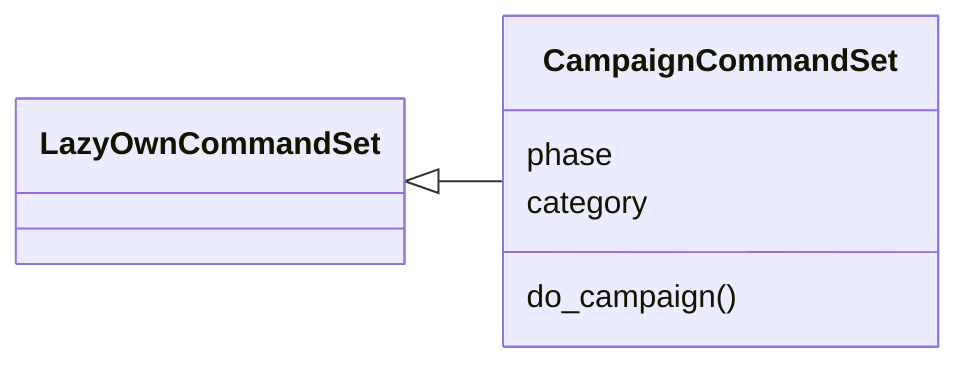
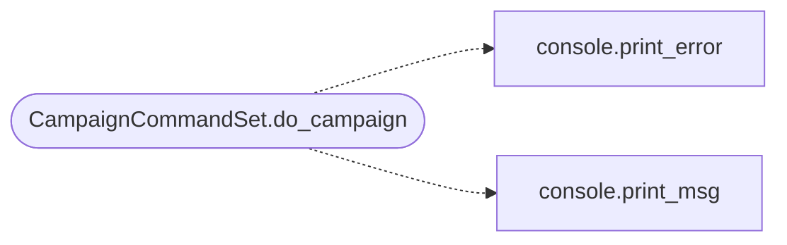

# `cli.commands.campaign`

> Source: [cli/commands/campaign.py:1](../../cli/commands/campaign.py#L1) | language `py` | coverage 100.0% | [API index](../index.md)

Campaign export/import commands — portable engagement packages.

Package a full campaign (database, sessions, world model, credentials,
notes, loot) into a single portable .zip file.  Import restores everything
into a new workspace so engagements can be shared, archived, or replayed.

## Contents

- **Classes:** [`CampaignCommandSet`](#campaigncommandset)
- **Constants:** [`BASE_DIR`](#base_dir), [`SESSIONS_DIR`](#sessions_dir), [`DB_PATH`](#db_path), [`EXPORTS_DIR`](#exports_dir), [`PACKAGE_VERSION`](#package_version)

## Type Diagram



## Call Graph

Solid arrows stay in this module, dashed arrows leave it.



## Classes

<a id="campaigncommandset"></a>

### `CampaignCommandSet`

`class` | [cli/commands/campaign.py:37](../../cli/commands/campaign.py#L37)

```python
class CampaignCommandSet(LazyOwnCommandSet)
```

Bases: [`LazyOwnCommandSet`](cli.commands._base.py.md#lazyowncommandset)

Export and import full campaign packages as portable archives.

**Attributes**

| Name | Type | Default | Description |
|---|---|---|---|
| [`phase`](#campaigncommandset-phase) |  | `'campaign'` |  |
| [`category`](#campaigncommandset-category) |  | `'12. Miscellaneous'` |  |

**Members**

| Member | Kind | Summary |
|---|---|---|
| [`do_campaign`](#campaigncommandset-do_campaign) | method | Export or import an entire campaign as a portable package. |

<a id="campaigncommandset-do_campaign"></a>

#### `CampaignCommandSet.do_campaign`

`method` | [cli/commands/campaign.py:44](../../cli/commands/campaign.py#L44)

Decorators: `@cmd2.with_category(miscellaneous_category)`

```python
def do_campaign(self, line)
```

Export or import an entire campaign as a portable package.

Usage:
    campaign export [name]     — package the current campaign
    campaign import <file>     — restore a campaign from a package
    campaign list              — list exported campaign packages
    campaign status            — show live shared campaign state

Export packages include:
  - SQLite database dump (all workspaces, hosts, services, vulns,
    creds, loot, notes)
  - sessions/ files (nmap scans, world model, objectives, events)
  - payload.json snapshot
  - campaign metadata (timestamp, operator, phase)

**Parameters**

| Name | Type | Default | Description |
|---|---|---|---|
| `line` |  |  |  |

**Example**

```python
campaign export
campaign export htb_machine_name
campaign import sessions/exports/htb_machine_name_20260730.zip
campaign list
```

*Calls:* [`print_error`](core.console.py.md#print_error), [`print_msg`](core.console.py.md#print_msg)

---

## Constants

<a id="base_dir"></a>

### `BASE_DIR`

`constant` | [cli/commands/campaign.py:29](../../cli/commands/campaign.py#L29)

```python
BASE_DIR = Path(__file__).resolve().parent.parent.parent
```

---

<a id="sessions_dir"></a>

### `SESSIONS_DIR`

`constant` | [cli/commands/campaign.py:30](../../cli/commands/campaign.py#L30)

```python
SESSIONS_DIR = BASE_DIR / 'sessions'
```

---

<a id="db_path"></a>

### `DB_PATH`

`constant` | [cli/commands/campaign.py:31](../../cli/commands/campaign.py#L31)

```python
DB_PATH = SESSIONS_DIR / 'db' / 'lazyown.db'
```

---

<a id="exports_dir"></a>

### `EXPORTS_DIR`

`constant` | [cli/commands/campaign.py:32](../../cli/commands/campaign.py#L32)

```python
EXPORTS_DIR = SESSIONS_DIR / 'exports'
```

---

<a id="package_version"></a>

### `PACKAGE_VERSION`

`constant` | [cli/commands/campaign.py:34](../../cli/commands/campaign.py#L34)

```python
PACKAGE_VERSION = 1
```

---
