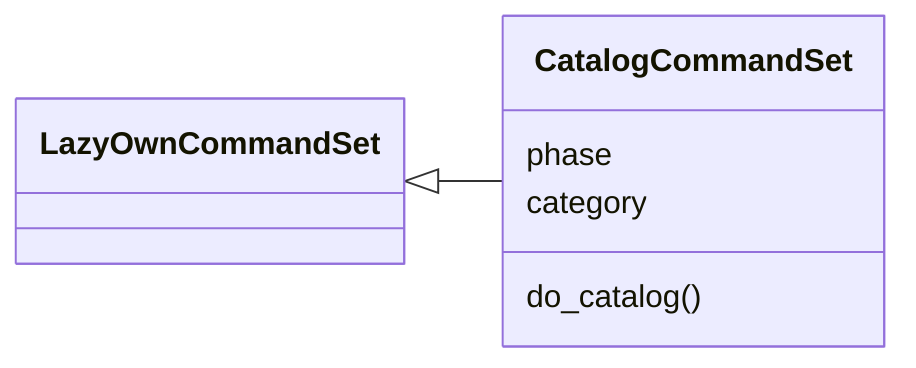
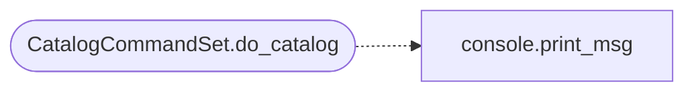

# `cli.commands.catalog`

> Source: [cli/commands/catalog.py:1](../../cli/commands/catalog.py#L1) | language `py` | coverage 100.0% | [API index](../index.md)

Command catalog — browse all registered commands by keyword, phase or category.

Backed by the auto-generated ``cli/command_index.json`` so the listing stays
in sync with the source tree. Addons and plugins registered at runtime are
shown by the `[`addons`](cli.exploration.py.md#explorationengine-addons)` view.

## Contents

- **Classes:** [`CatalogCommandSet`](#catalogcommandset)
- **Functions:** [`shlex_split`](#shlex_split)

## Type Diagram



## Call Graph

Solid arrows stay in this module, dashed arrows leave it.



## Classes

<a id="catalogcommandset"></a>

### `CatalogCommandSet`

`class` | [cli/commands/catalog.py:19](../../cli/commands/catalog.py#L19)

```python
class CatalogCommandSet(LazyOwnCommandSet)
```

Bases: [`LazyOwnCommandSet`](cli.commands._base.py.md#lazyowncommandset)

Browse the command catalog.

**Attributes**

| Name | Type | Default | Description |
|---|---|---|---|
| [`phase`](#catalogcommandset-phase) |  | `'misc'` |  |
| [`category`](#catalogcommandset-category) |  | `'12. Miscellaneous'` |  |

**Members**

| Member | Kind | Summary |
|---|---|---|
| [`do_catalog`](#catalogcommandset-do_catalog) | method | Browse the command catalog. |

<a id="catalogcommandset-do_catalog"></a>

#### `CatalogCommandSet.do_catalog`

`method` | [cli/commands/catalog.py:33](../../cli/commands/catalog.py#L33)

Decorators: `@cmd2.with_category(miscellaneous_category)`

```python
def do_catalog(self, line)
```

Browse the command catalog.

Usage:
  catalog                 show totals and commands by category
  catalog <keyword>       filter commands by keyword
  catalog --phase <p>     list commands in a phase (recon, enum, ...)
  catalog --category <c>  list commands in a category
  catalog --count         show totals only
  catalog --json <kw>     dump matching commands as JSON

**Parameters**

| Name | Type | Default | Description |
|---|---|---|---|
| `line` |  |  |  |

*Calls:* [`print_msg`](core.console.py.md#print_msg)

---

## Functions

<a id="shlex_split"></a>

### `shlex_split`

`function` | [cli/commands/catalog.py:111](../../cli/commands/catalog.py#L111)

```python
def shlex_split(text: str) -> list
```

Split text like shlex.split but handle empty strings gracefully.

**Parameters**

| Name | Type | Default | Description |
|---|---|---|---|
| `text` | `str` |  |  |

**Returns:** `list`

---
