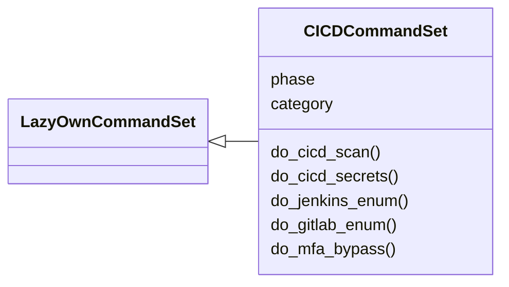
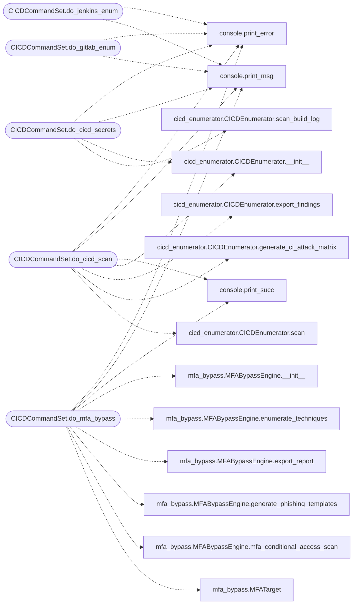

# `cli.commands.cicd`

> Source: [cli/commands/cicd.py:1](../../cli/commands/cicd.py#L1) | language `py` | coverage 100.0% | [API index](../index.md)

CI/CD Enumeration command set.

Phase 02/03 — commands for enumerating CI/CD platforms, scanning build logs
for secrets, and abusing pipeline misconfigurations.

## Contents

- **Classes:** [`CICDCommandSet`](#cicdcommandset)

## Type Diagram



## Call Graph

Solid arrows stay in this module, dashed arrows leave it.



## Classes

<a id="cicdcommandset"></a>

### `CICDCommandSet`

`class` | [cli/commands/cicd.py:27](../../cli/commands/cicd.py#L27)

```python
class CICDCommandSet(LazyOwnCommandSet)
```

Bases: [`LazyOwnCommandSet`](cli.commands._base.py.md#lazyowncommandset)

CI/CD pipeline enumeration and attack commands.

**Attributes**

| Name | Type | Default | Description |
|---|---|---|---|
| [`phase`](#cicdcommandset-phase) |  | `'recon'` |  |
| [`category`](#cicdcommandset-category) |  | `CICD_CATEGORY` |  |

**Members**

| Member | Kind | Summary |
|---|---|---|
| [`do_cicd_scan`](#cicdcommandset-do_cicd_scan) | method | Scan CI/CD platform for security misconfigurations. |
| [`do_cicd_secrets`](#cicdcommandset-do_cicd_secrets) | method | Scan build log for leaked secrets. |
| [`do_jenkins_enum`](#cicdcommandset-do_jenkins_enum) | method | Enumerate a Jenkins instance. |
| [`do_gitlab_enum`](#cicdcommandset-do_gitlab_enum) | method | Enumerate a GitLab instance. |
| [`do_mfa_bypass`](#cicdcommandset-do_mfa_bypass) | method | Enumerate and test MFA bypass techniques. |

<a id="cicdcommandset-do_cicd_scan"></a>

#### `CICDCommandSet.do_cicd_scan`

`method` | [cli/commands/cicd.py:34](../../cli/commands/cicd.py#L34)

Decorators: `@cmd2.with_category(CICD_CATEGORY)`

```python
def do_cicd_scan(self, line='')
```

Scan CI/CD platform for security misconfigurations.

Usage: cicd_scan --url <platform_url> [--type jenkins|gitlab|github|azure|bitbucket]

Enumerates:
- Exposed API endpoints
- Credential stores
- Pipeline configurations with potential secret leakage
- Unauthenticated access vectors

**Parameters**

| Name | Type | Default | Description |
|---|---|---|---|
| `line` |  | `''` |  |

*Calls:* [`print_error`](core.console.py.md#print_error), [`print_msg`](core.console.py.md#print_msg), [`print_succ`](core.console.py.md#print_succ), [`CICDEnumerator.__init__`](modules.cicd_enumerator.py.md#cicdenumerator-__init__), [`CICDEnumerator.export_findings`](modules.cicd_enumerator.py.md#cicdenumerator-export_findings), [`CICDEnumerator.generate_ci_attack_matrix`](modules.cicd_enumerator.py.md#cicdenumerator-generate_ci_attack_matrix), [`CICDEnumerator.scan`](modules.cicd_enumerator.py.md#cicdenumerator-scan)

<a id="cicdcommandset-do_cicd_secrets"></a>

#### `CICDCommandSet.do_cicd_secrets`

`method` | [cli/commands/cicd.py:97](../../cli/commands/cicd.py#L97)

Decorators: `@cmd2.with_category(CICD_CATEGORY)`

```python
def do_cicd_secrets(self, line='')
```

Scan build log for leaked secrets.

Usage: cicd_secrets [--file <path>] [--input <text>]

Scans provided text or file for common secret patterns:
passwords, API keys, tokens, SSH keys, AWS keys, database
connection strings, and package registry tokens.

**Parameters**

| Name | Type | Default | Description |
|---|---|---|---|
| `line` |  | `''` |  |

*Calls:* [`print_error`](core.console.py.md#print_error), [`print_msg`](core.console.py.md#print_msg), [`CICDEnumerator.__init__`](modules.cicd_enumerator.py.md#cicdenumerator-__init__), [`CICDEnumerator.scan_build_log`](modules.cicd_enumerator.py.md#cicdenumerator-scan_build_log)

<a id="cicdcommandset-do_jenkins_enum"></a>

#### `CICDCommandSet.do_jenkins_enum`

`method` | [cli/commands/cicd.py:140](../../cli/commands/cicd.py#L140)

Decorators: `@cmd2.with_category(CICD_CATEGORY)`

```python
def do_jenkins_enum(self, line='')
```

Enumerate a Jenkins instance.

Usage: jenkins_enum --url <jenkins_url>

Checks for: Script Console access, credential store exposure,
unauthenticated API, build agent enumeration, console output
with potential secret leakage.

**Parameters**

| Name | Type | Default | Description |
|---|---|---|---|
| `line` |  | `''` |  |

*Calls:* [`print_error`](core.console.py.md#print_error), [`print_msg`](core.console.py.md#print_msg)

<a id="cicdcommandset-do_gitlab_enum"></a>

#### `CICDCommandSet.do_gitlab_enum`

`method` | [cli/commands/cicd.py:185](../../cli/commands/cicd.py#L185)

Decorators: `@cmd2.with_category(CICD_CATEGORY)`

```python
def do_gitlab_enum(self, line='')
```

Enumerate a GitLab instance.

Usage: gitlab_enum --url <gitlab_url>

Checks for: Public projects, API accessibility, CI lint API,
runner enumeration, GraphQL API, version disclosure.

**Parameters**

| Name | Type | Default | Description |
|---|---|---|---|
| `line` |  | `''` |  |

*Calls:* [`print_error`](core.console.py.md#print_error), [`print_msg`](core.console.py.md#print_msg)

<a id="cicdcommandset-do_mfa_bypass"></a>

#### `CICDCommandSet.do_mfa_bypass`

`method` | [cli/commands/cicd.py:231](../../cli/commands/cicd.py#L231)

Decorators: `@cmd2.with_category(CICD_CATEGORY)`

```python
def do_mfa_bypass(self, line='')
```

Enumerate and test MFA bypass techniques.

Usage: mfa_bypass --domain <target.com> [--idp <okta|azure|duo>]

Analyzes target MFA posture and recommends bypass techniques:
- Session cookie theft and replay
- Push notification bombing/fatigue
- Legacy protocol enumeration (IMAP/POP3/SMTP)
- Conditional Access policy gaps
- SAML assertion forging
- Device code phishing templates

**Parameters**

| Name | Type | Default | Description |
|---|---|---|---|
| `line` |  | `''` |  |

*Calls:* [`print_error`](core.console.py.md#print_error), [`print_msg`](core.console.py.md#print_msg), [`print_succ`](core.console.py.md#print_succ), [`MFABypassEngine.__init__`](modules.mfa_bypass.py.md#mfabypassengine-__init__), [`MFABypassEngine.enumerate_techniques`](modules.mfa_bypass.py.md#mfabypassengine-enumerate_techniques), [`MFABypassEngine.export_report`](modules.mfa_bypass.py.md#mfabypassengine-export_report), [`MFABypassEngine.generate_phishing_templates`](modules.mfa_bypass.py.md#mfabypassengine-generate_phishing_templates), [`MFABypassEngine.mfa_conditional_access_scan`](modules.mfa_bypass.py.md#mfabypassengine-mfa_conditional_access_scan), [`MFATarget`](modules.mfa_bypass.py.md#mfatarget)

---
