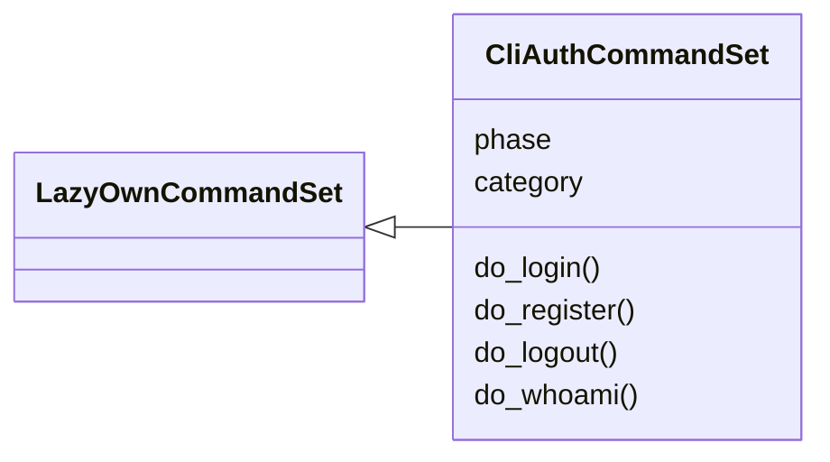
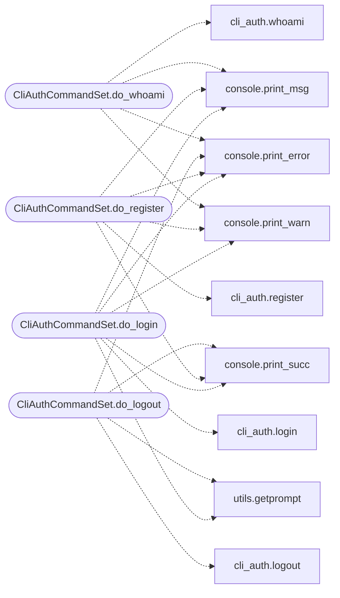

# `cli.commands.cli_auth`

> Source: [cli/commands/cli_auth.py:1](../../cli/commands/cli_auth.py#L1) | language `py` | coverage 100.0% | [API index](../index.md)

CLI authentication command set — login/logout/whoami.

Integrates with [`modules.cli_auth`](modules.cli_auth.py.md) to authenticate CLI operators
against the same ``users.json`` as lazyc2.py.

## Contents

- **Classes:** [`CliAuthCommandSet`](#cliauthcommandset)

## Type Diagram



## Call Graph

Solid arrows stay in this module, dashed arrows leave it.



## Classes

<a id="cliauthcommandset"></a>

### `CliAuthCommandSet`

`class` | [cli/commands/cli_auth.py:27](../../cli/commands/cli_auth.py#L27)

```python
class CliAuthCommandSet(LazyOwnCommandSet)
```

Bases: [`LazyOwnCommandSet`](cli.commands._base.py.md#lazyowncommandset)

CLI operator authentication — login, logout, whoami.

**Attributes**

| Name | Type | Default | Description |
|---|---|---|---|
| [`phase`](#cliauthcommandset-phase) |  | `'misc'` |  |
| [`category`](#cliauthcommandset-category) |  | `miscellaneous_category` |  |

**Members**

| Member | Kind | Summary |
|---|---|---|
| [`do_login`](#cliauthcommandset-do_login) | method | Authenticate against users.json (same users as lazyc2.py). |
| [`do_register`](#cliauthcommandset-do_register) | method | Register a new operator account in users.json. |
| [`do_logout`](#cliauthcommandset-do_logout) | method | Log out the current CLI operator and clear the remember-me token. |
| [`do_whoami`](#cliauthcommandset-do_whoami) | method | Show the currently logged-in CLI operator. |

<a id="cliauthcommandset-do_login"></a>

#### `CliAuthCommandSet.do_login`

`method` | [cli/commands/cli_auth.py:34](../../cli/commands/cli_auth.py#L34)

Decorators: `@cmd2.with_category(miscellaneous_category)`

```python
def do_login(self, line)
```

Authenticate against users.json (same users as lazyc2.py).

Usage:
    login                          — prompt for username and password
    login <username>               — login with specified username
    login --remember <username>     — persist login across shell restarts

Credentials are verified against the same users.json database
used by the C2 web dashboard. The password is never echoed.

With ``--remember``, a secure token is stored in payload.json
so you are automatically logged in on future shell starts.

**Parameters**

| Name | Type | Default | Description |
|---|---|---|---|
| `line` |  |  |  |

**Example**

```python
login
login grisun0
login --remember grisun0
```

*Calls:* [`print_error`](core.console.py.md#print_error), [`print_msg`](core.console.py.md#print_msg), [`print_succ`](core.console.py.md#print_succ), [`print_warn`](core.console.py.md#print_warn), [`login`](modules.cli_auth.py.md#login), [`getprompt`](utils.py.md#getprompt)

<a id="cliauthcommandset-do_register"></a>

#### `CliAuthCommandSet.do_register`

`method` | [cli/commands/cli_auth.py:117](../../cli/commands/cli_auth.py#L117)

Decorators: `@cmd2.with_category(miscellaneous_category)`

```python
def do_register(self, line)
```

Register a new operator account in users.json.

Usage:
    register                          — prompt for username and password
    register <username>               — register with specified username

First registered user becomes admin; subsequent users get the
user role. Password must be at least 12 characters.

After registration you can login immediately with the same
credentials, or use ``login --remember`` for persistent sessions.

**Parameters**

| Name | Type | Default | Description |
|---|---|---|---|
| `line` |  |  |  |

**Example**

```python
register
register newoperator
```

*Calls:* [`print_error`](core.console.py.md#print_error), [`print_msg`](core.console.py.md#print_msg), [`print_succ`](core.console.py.md#print_succ), [`print_warn`](core.console.py.md#print_warn), [`register`](modules.cli_auth.py.md#register)

<a id="cliauthcommandset-do_logout"></a>

#### `CliAuthCommandSet.do_logout`

`method` | [cli/commands/cli_auth.py:191](../../cli/commands/cli_auth.py#L191)

Decorators: `@cmd2.with_category(miscellaneous_category)`

```python
def do_logout(self, line)
```

Log out the current CLI operator and clear the remember-me token.

Usage:
    logout

Clears the CLI session and removes any stored remember-me token
from payload.json.

**Parameters**

| Name | Type | Default | Description |
|---|---|---|---|
| `line` |  |  |  |

*Calls:* [`print_error`](core.console.py.md#print_error), [`print_succ`](core.console.py.md#print_succ), [`logout`](modules.cli_auth.py.md#logout), [`getprompt`](utils.py.md#getprompt)

<a id="cliauthcommandset-do_whoami"></a>

#### `CliAuthCommandSet.do_whoami`

`method` | [cli/commands/cli_auth.py:224](../../cli/commands/cli_auth.py#L224)

Decorators: `@cmd2.with_category(miscellaneous_category)`

```python
def do_whoami(self, line)
```

Show the currently logged-in CLI operator.

Usage:
    whoami

Displays username, role, ELO score, and karma rank.

**Parameters**

| Name | Type | Default | Description |
|---|---|---|---|
| `line` |  |  |  |

*Calls:* [`print_error`](core.console.py.md#print_error), [`print_msg`](core.console.py.md#print_msg), [`print_warn`](core.console.py.md#print_warn), [`whoami`](modules.cli_auth.py.md#whoami)

---
