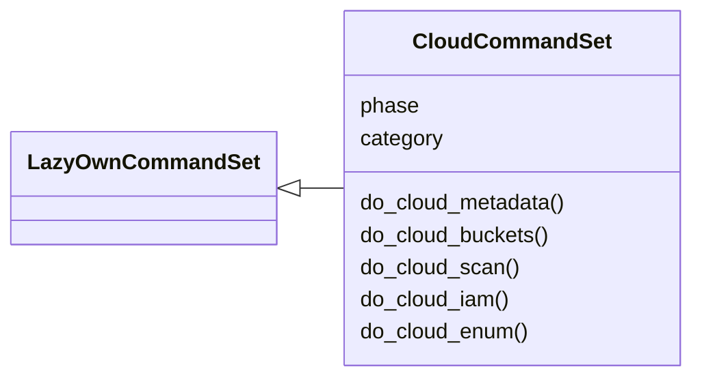
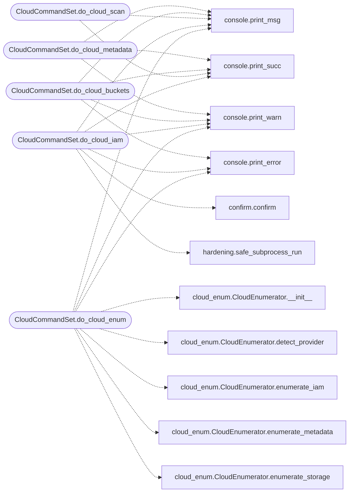

# `cli.commands.cloud`

> Source: [cli/commands/cloud.py:1](../../cli/commands/cloud.py#L1) | language `py` | coverage 100.0% | [API index](../index.md)

Cloud attack command set.

Commands for cloud provider enumeration, metadata harvesting, storage
bucket discovery, and IAM reconnaissance across AWS, Azure, and GCP.

## Contents

- **Classes:** [`CloudCommandSet`](#cloudcommandset)

## Type Diagram



## Call Graph

Solid arrows stay in this module, dashed arrows leave it.



## Classes

<a id="cloudcommandset"></a>

### `CloudCommandSet`

`class` | [cli/commands/cloud.py:30](../../cli/commands/cloud.py#L30)

```python
class CloudCommandSet(LazyOwnCommandSet)
```

Bases: [`LazyOwnCommandSet`](cli.commands._base.py.md#lazyowncommandset)

Cloud attack phase commands.

**Attributes**

| Name | Type | Default | Description |
|---|---|---|---|
| [`phase`](#cloudcommandset-phase) |  | `'cloud'` |  |
| [`category`](#cloudcommandset-category) |  | `CLOUD_CATEGORY` |  |

**Members**

| Member | Kind | Summary |
|---|---|---|
| [`do_cloud_metadata`](#cloudcommandset-do_cloud_metadata) | method | Harvest cloud instance metadata (AWS IMDS, Azure, GCP). |
| [`do_cloud_buckets`](#cloudcommandset-do_cloud_buckets) | method | Enumerate cloud storage buckets for a given prefix. |
| [`do_cloud_scan`](#cloudcommandset-do_cloud_scan) | method | Full cloud security scan: metadata + buckets + IAM enumeration. |
| [`do_cloud_iam`](#cloudcommandset-do_cloud_iam) | method | Enumerate cloud IAM roles and policies. |
| [`do_cloud_enum`](#cloudcommandset-do_cloud_enum) | method | Enumerate cloud provider metadata, storage, and IAM. |

<a id="cloudcommandset-do_cloud_metadata"></a>

#### `CloudCommandSet.do_cloud_metadata`

`method` | [cli/commands/cloud.py:49](../../cli/commands/cloud.py#L49)

Decorators: `@cmd2.with_category(CLOUD_CATEGORY)`

```python
def do_cloud_metadata(self, _line)
```

Harvest cloud instance metadata (AWS IMDS, Azure, GCP).

Attempts to read cloud instance metadata from all three major
providers. Discovers IAM credentials, SSH keys, user-data
scripts, and managed identity tokens.

Usage: cloud_metadata

**Parameters**

| Name | Type | Default | Description |
|---|---|---|---|
| `_line` |  |  |  |

*Calls:* [`print_msg`](core.console.py.md#print_msg), [`print_succ`](core.console.py.md#print_succ), [`print_warn`](core.console.py.md#print_warn)

<a id="cloudcommandset-do_cloud_buckets"></a>

#### `CloudCommandSet.do_cloud_buckets`

`method` | [cli/commands/cloud.py:98](../../cli/commands/cloud.py#L98)

Decorators: `@cmd2.with_category(CLOUD_CATEGORY)`

```python
def do_cloud_buckets(self, line)
```

Enumerate cloud storage buckets for a given prefix.

Checks AWS S3, Azure Blob Storage, and GCP Storage buckets
derived from the target prefix for public accessibility.

Usage:
    cloud_buckets <prefix>
    cloud_buckets mycompany

**Parameters**

| Name | Type | Default | Description |
|---|---|---|---|
| `line` |  |  |  |

*Calls:* [`print_error`](core.console.py.md#print_error), [`print_msg`](core.console.py.md#print_msg), [`print_succ`](core.console.py.md#print_succ), [`print_warn`](core.console.py.md#print_warn)

<a id="cloudcommandset-do_cloud_scan"></a>

#### `CloudCommandSet.do_cloud_scan`

`method` | [cli/commands/cloud.py:148](../../cli/commands/cloud.py#L148)

Decorators: `@cmd2.with_category(CLOUD_CATEGORY)`

```python
def do_cloud_scan(self, line)
```

Full cloud security scan: metadata + buckets + IAM enumeration.

Usage:
    cloud_scan <prefix>
    cloud_scan mycompany

**Parameters**

| Name | Type | Default | Description |
|---|---|---|---|
| `line` |  |  |  |

*Calls:* [`print_msg`](core.console.py.md#print_msg), [`print_succ`](core.console.py.md#print_succ)

<a id="cloudcommandset-do_cloud_iam"></a>

#### `CloudCommandSet.do_cloud_iam`

`method` | [cli/commands/cloud.py:187](../../cli/commands/cloud.py#L187)

Decorators: `@cmd2.with_category(CLOUD_CATEGORY)`

```python
def do_cloud_iam(self, _line)
```

Enumerate cloud IAM roles and policies.

Attempts to enumerate IAM users, roles, and policies when
valid cloud credentials are present in the environment.

Usage: cloud_iam

**Parameters**

| Name | Type | Default | Description |
|---|---|---|---|
| `_line` |  |  |  |

*Calls:* [`confirm`](cli.confirm.py.md#confirm), [`print_error`](core.console.py.md#print_error), [`print_msg`](core.console.py.md#print_msg), [`print_succ`](core.console.py.md#print_succ), [`print_warn`](core.console.py.md#print_warn), [`safe_subprocess_run`](core.hardening.py.md#safe_subprocess_run)

<a id="cloudcommandset-do_cloud_enum"></a>

#### `CloudCommandSet.do_cloud_enum`

`method` | [cli/commands/cloud.py:239](../../cli/commands/cloud.py#L239)

Decorators: `@cmd2.with_category(CLOUD_CATEGORY)`

```python
def do_cloud_enum(self, line)
```

Enumerate cloud provider metadata, storage, and IAM.

Usage: cloud_enum [provider]
Providers: aws, azure, gcp (auto-detect if omitted)

Performs full enumeration including IMDS metadata extraction,
storage bucket listing, IAM role enumeration, and privilege
escalation path detection.  Auto-installs dependencies if missing.

**Parameters**

| Name | Type | Default | Description |
|---|---|---|---|
| `line` |  |  |  |

*Calls:* [`print_error`](core.console.py.md#print_error), [`print_msg`](core.console.py.md#print_msg), [`print_warn`](core.console.py.md#print_warn), [`CloudEnumerator.__init__`](modules.cloud_enum.py.md#cloudenumerator-__init__), [`CloudEnumerator.detect_provider`](modules.cloud_enum.py.md#cloudenumerator-detect_provider), [`CloudEnumerator.enumerate_iam`](modules.cloud_enum.py.md#cloudenumerator-enumerate_iam), [`CloudEnumerator.enumerate_metadata`](modules.cloud_enum.py.md#cloudenumerator-enumerate_metadata), [`CloudEnumerator.enumerate_storage`](modules.cloud_enum.py.md#cloudenumerator-enumerate_storage)

---
