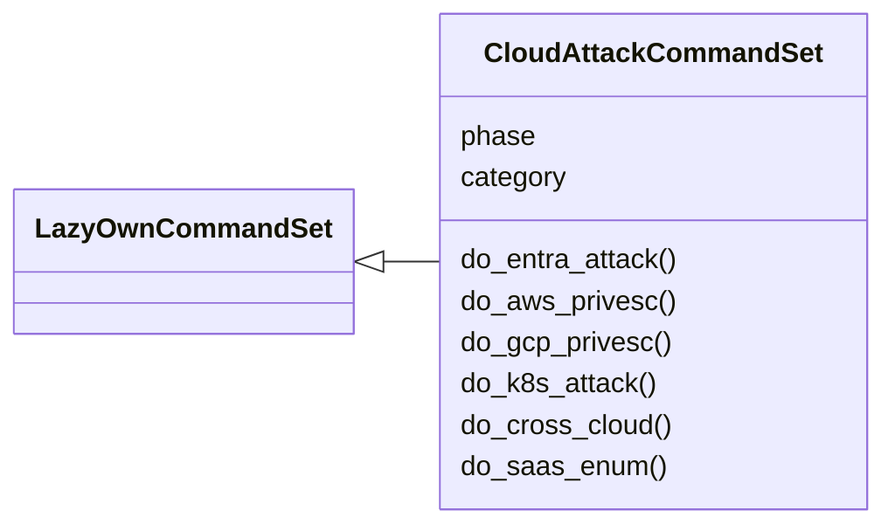

# `cli.commands.cloud_attacks`

> Source: [cli/commands/cloud_attacks.py:1](../../cli/commands/cloud_attacks.py#L1) | language `py` | coverage 100.0% | [API index](../index.md)

Cloud attack commands — Azure AD/Entra ID, AWS, GCP, Kubernetes, cross-cloud, SaaS.

Provides:
    entra_attack            — Entra ID device code phishing, OAuth consent, managed identity
    aws_privesc             — AWS IAM enumeration, Lambda backdoors, STS role chaining
    gcp_privesc             — GCP service account impersonation, Cloud Functions, GCS
    k8s_attack              — Kubernetes RBAC enum, pod escape, etcd, Helm Tiller
    cross_cloud             — Cross-cloud federation attacks (SAML/OIDC bridging)
    saas_enum               — SaaS platform enumeration (M365, Google Workspace, Salesforce, Slack)

## Contents

- **Classes:** [`CloudAttackCommandSet`](#cloudattackcommandset)

## Type Diagram



## Call Graph

Solid arrows stay in this module, dashed arrows leave it.

```mermaid
flowchart LR
    n_cli_commands_cloud_attacks_py__CloudAttackCommandSet_do_entra_attack(["CloudAttackCommandSet.do_entra_attack"])
    n_modules_entra_id_attacks_py__EntraIDAttackEngine___init__["entra_id_attacks.EntraIDAttackEngine.__init__"]
    n_modules_entra_id_attacks_py__EntraIDAttackEngine_conditional_access_bypass["entra_id_attacks.EntraIDAttackEngine.conditional_access_bypass"]
    n_modules_entra_id_attacks_py__EntraIDAttackEngine_device_code_phish["entra_id_attacks.EntraIDAttackEngine.device_code_phish"]
    n_modules_entra_id_attacks_py__EntraIDAttackEngine_entra_connect_sync_abuse["entra_id_attacks.EntraIDAttackEngine.entra_connect_sync_abuse"]
    n_modules_entra_id_attacks_py__EntraIDAttackEngine_enumerate_tenant["entra_id_attacks.EntraIDAttackEngine.enumerate_tenant"]
    n_modules_entra_id_attacks_py__EntraIDAttackEngine_managed_identity_abuse["entra_id_attacks.EntraIDAttackEngine.managed_identity_abuse"]
    n_modules_entra_id_attacks_py__EntraIDAttackEngine_oauth_consent_grant["entra_id_attacks.EntraIDAttackEngine.oauth_consent_grant"]
    n_modules_entra_id_attacks_py__EntraIDAttackEngine_service_principal_credential_theft["entra_id_attacks.EntraIDAttackEngine.service_principal_credential_theft"]
    n_cli_commands_cloud_attacks_py__CloudAttackCommandSet_do_aws_privesc(["CloudAttackCommandSet.do_aws_privesc"])
    n_modules_aws_attacks_py__AWSAttackEngine___init__["aws_attacks.AWSAttackEngine.__init__"]
    n_modules_aws_attacks_py__AWSAttackEngine_cloudformation_drift["aws_attacks.AWSAttackEngine.cloudformation_drift"]
    n_modules_aws_attacks_py__AWSAttackEngine_ec2_ssm_session_abuse["aws_attacks.AWSAttackEngine.ec2_ssm_session_abuse"]
    n_modules_aws_attacks_py__AWSAttackEngine_ec2_user_data_exfil["aws_attacks.AWSAttackEngine.ec2_user_data_exfil"]
    n_modules_aws_attacks_py__AWSAttackEngine_enumerate_iam_permissions["aws_attacks.AWSAttackEngine.enumerate_iam_permissions"]
    n_modules_aws_attacks_py__AWSAttackEngine_lambda_backdoor["aws_attacks.AWSAttackEngine.lambda_backdoor"]
    n_modules_aws_attacks_py__AWSAttackEngine_s3_enumeration["aws_attacks.AWSAttackEngine.s3_enumeration"]
    n_modules_aws_attacks_py__AWSAttackEngine_sts_role_chain["aws_attacks.AWSAttackEngine.sts_role_chain"]
    n_cli_commands_cloud_attacks_py__CloudAttackCommandSet_do_gcp_privesc(["CloudAttackCommandSet.do_gcp_privesc"])
    n_modules_gcp_attacks_py__GCPAttackEngine___init__["gcp_attacks.GCPAttackEngine.__init__"]
    n_modules_gcp_attacks_py__GCPAttackEngine_cloud_functions_backdoor["gcp_attacks.GCPAttackEngine.cloud_functions_backdoor"]
    n_modules_gcp_attacks_py__GCPAttackEngine_cloudbuild_abuse["gcp_attacks.GCPAttackEngine.cloudbuild_abuse"]
    n_modules_gcp_attacks_py__GCPAttackEngine_compute_engine_metadata_exfil["gcp_attacks.GCPAttackEngine.compute_engine_metadata_exfil"]
    n_modules_gcp_attacks_py__GCPAttackEngine_enumerate_iam_policy["gcp_attacks.GCPAttackEngine.enumerate_iam_policy"]
    n_modules_gcp_attacks_py__GCPAttackEngine_gcs_enumeration["gcp_attacks.GCPAttackEngine.gcs_enumeration"]
    n_modules_gcp_attacks_py__GCPAttackEngine_organization_escalation["gcp_attacks.GCPAttackEngine.organization_escalation"]
    n_modules_gcp_attacks_py__GCPAttackEngine_service_account_impersonation["gcp_attacks.GCPAttackEngine.service_account_impersonation"]
    n_cli_commands_cloud_attacks_py__CloudAttackCommandSet_do_entra_attack -.-> n_modules_entra_id_attacks_py__EntraIDAttackEngine___init__
    n_cli_commands_cloud_attacks_py__CloudAttackCommandSet_do_entra_attack -.-> n_modules_entra_id_attacks_py__EntraIDAttackEngine_conditional_access_bypass
    n_cli_commands_cloud_attacks_py__CloudAttackCommandSet_do_entra_attack -.-> n_modules_entra_id_attacks_py__EntraIDAttackEngine_device_code_phish
    n_cli_commands_cloud_attacks_py__CloudAttackCommandSet_do_entra_attack -.-> n_modules_entra_id_attacks_py__EntraIDAttackEngine_entra_connect_sync_abuse
    n_cli_commands_cloud_attacks_py__CloudAttackCommandSet_do_entra_attack -.-> n_modules_entra_id_attacks_py__EntraIDAttackEngine_enumerate_tenant
    n_cli_commands_cloud_attacks_py__CloudAttackCommandSet_do_entra_attack -.-> n_modules_entra_id_attacks_py__EntraIDAttackEngine_managed_identity_abuse
    n_cli_commands_cloud_attacks_py__CloudAttackCommandSet_do_entra_attack -.-> n_modules_entra_id_attacks_py__EntraIDAttackEngine_oauth_consent_grant
    n_cli_commands_cloud_attacks_py__CloudAttackCommandSet_do_entra_attack -.-> n_modules_entra_id_attacks_py__EntraIDAttackEngine_service_principal_credential_theft
    n_cli_commands_cloud_attacks_py__CloudAttackCommandSet_do_aws_privesc -.-> n_modules_aws_attacks_py__AWSAttackEngine___init__
    n_cli_commands_cloud_attacks_py__CloudAttackCommandSet_do_aws_privesc -.-> n_modules_aws_attacks_py__AWSAttackEngine_cloudformation_drift
    n_cli_commands_cloud_attacks_py__CloudAttackCommandSet_do_aws_privesc -.-> n_modules_aws_attacks_py__AWSAttackEngine_ec2_ssm_session_abuse
    n_cli_commands_cloud_attacks_py__CloudAttackCommandSet_do_aws_privesc -.-> n_modules_aws_attacks_py__AWSAttackEngine_ec2_user_data_exfil
    n_cli_commands_cloud_attacks_py__CloudAttackCommandSet_do_aws_privesc -.-> n_modules_aws_attacks_py__AWSAttackEngine_enumerate_iam_permissions
    n_cli_commands_cloud_attacks_py__CloudAttackCommandSet_do_aws_privesc -.-> n_modules_aws_attacks_py__AWSAttackEngine_lambda_backdoor
    n_cli_commands_cloud_attacks_py__CloudAttackCommandSet_do_aws_privesc -.-> n_modules_aws_attacks_py__AWSAttackEngine_s3_enumeration
    n_cli_commands_cloud_attacks_py__CloudAttackCommandSet_do_aws_privesc -.-> n_modules_aws_attacks_py__AWSAttackEngine_sts_role_chain
    n_cli_commands_cloud_attacks_py__CloudAttackCommandSet_do_gcp_privesc -.-> n_modules_gcp_attacks_py__GCPAttackEngine___init__
    n_cli_commands_cloud_attacks_py__CloudAttackCommandSet_do_gcp_privesc -.-> n_modules_gcp_attacks_py__GCPAttackEngine_cloud_functions_backdoor
    n_cli_commands_cloud_attacks_py__CloudAttackCommandSet_do_gcp_privesc -.-> n_modules_gcp_attacks_py__GCPAttackEngine_cloudbuild_abuse
    n_cli_commands_cloud_attacks_py__CloudAttackCommandSet_do_gcp_privesc -.-> n_modules_gcp_attacks_py__GCPAttackEngine_compute_engine_metadata_exfil
    n_cli_commands_cloud_attacks_py__CloudAttackCommandSet_do_gcp_privesc -.-> n_modules_gcp_attacks_py__GCPAttackEngine_enumerate_iam_policy
    n_cli_commands_cloud_attacks_py__CloudAttackCommandSet_do_gcp_privesc -.-> n_modules_gcp_attacks_py__GCPAttackEngine_gcs_enumeration
    n_cli_commands_cloud_attacks_py__CloudAttackCommandSet_do_gcp_privesc -.-> n_modules_gcp_attacks_py__GCPAttackEngine_organization_escalation
    n_cli_commands_cloud_attacks_py__CloudAttackCommandSet_do_gcp_privesc -.-> n_modules_gcp_attacks_py__GCPAttackEngine_service_account_impersonation
```



## Classes

<a id="cloudattackcommandset"></a>

### `CloudAttackCommandSet`

`class` | [cli/commands/cloud_attacks.py:17](../../cli/commands/cloud_attacks.py#L17)

```python
class CloudAttackCommandSet(LazyOwnCommandSet)
```

Bases: [`LazyOwnCommandSet`](cli.commands._base.py.md#lazyowncommandset)

Cloud and SaaS attack operations.

**Attributes**

| Name | Type | Default | Description |
|---|---|---|---|
| [`phase`](#cloudattackcommandset-phase) |  | `'enumeration'` |  |
| [`category`](#cloudattackcommandset-category) |  | `'06. Cloud Attacks'` |  |

**Members**

| Member | Kind | Summary |
|---|---|---|
| [`do_entra_attack`](#cloudattackcommandset-do_entra_attack) | method | Microsoft Entra ID / Azure AD attack operations. |
| [`do_aws_privesc`](#cloudattackcommandset-do_aws_privesc) | method | AWS privilege escalation and enumeration. |
| [`do_gcp_privesc`](#cloudattackcommandset-do_gcp_privesc) | method | GCP privilege escalation and enumeration. |
| [`do_k8s_attack`](#cloudattackcommandset-do_k8s_attack) | method | Kubernetes attack — RBAC enumeration, pod escape, etcd, persistence. |
| [`do_cross_cloud`](#cloudattackcommandset-do_cross_cloud) | method | Cross-cloud identity federation attacks. |
| [`do_saas_enum`](#cloudattackcommandset-do_saas_enum) | method | Enumerate SaaS platforms — M365, Google Workspace, Salesforce, Slack, ServiceNow. |

<a id="cloudattackcommandset-do_entra_attack"></a>

#### `CloudAttackCommandSet.do_entra_attack`

`method` | [cli/commands/cloud_attacks.py:23](../../cli/commands/cloud_attacks.py#L23)

```python
def do_entra_attack(self, line: str) -> None
```

Microsoft Entra ID / Azure AD attack operations.

Usage: entra_attack <method> [options]

Methods:
    device_code   — Initiate device code phishing flow
    consent_grant — Generate OAuth consent grant phishing URL
    spn_cred_theft — Service principal credential theft plan
    managed_identity — Managed identity abuse from compromised VM/container
    connect_sync  — Entra Connect Sync abuse (on-prem ↔ cloud)
    ca_bypass     — Conditional Access bypass techniques
    tenant_enum   — Enumerate tenant via Graph API

**Parameters**

| Name | Type | Default | Description |
|---|---|---|---|
| `line` | `str` |  |  |

**Example**

```python
entra_attack device_code
entra_attack consent_grant
entra_attack tenant_enum
```

*Calls:* [`EntraIDAttackEngine.__init__`](modules.entra_id_attacks.py.md#entraidattackengine-__init__), [`EntraIDAttackEngine.conditional_access_bypass`](modules.entra_id_attacks.py.md#entraidattackengine-conditional_access_bypass), [`EntraIDAttackEngine.device_code_phish`](modules.entra_id_attacks.py.md#entraidattackengine-device_code_phish), [`EntraIDAttackEngine.entra_connect_sync_abuse`](modules.entra_id_attacks.py.md#entraidattackengine-entra_connect_sync_abuse), [`EntraIDAttackEngine.enumerate_tenant`](modules.entra_id_attacks.py.md#entraidattackengine-enumerate_tenant), [`EntraIDAttackEngine.managed_identity_abuse`](modules.entra_id_attacks.py.md#entraidattackengine-managed_identity_abuse), [`EntraIDAttackEngine.oauth_consent_grant`](modules.entra_id_attacks.py.md#entraidattackengine-oauth_consent_grant), [`EntraIDAttackEngine.service_principal_credential_theft`](modules.entra_id_attacks.py.md#entraidattackengine-service_principal_credential_theft)

<a id="cloudattackcommandset-do_aws_privesc"></a>

#### `CloudAttackCommandSet.do_aws_privesc`

`method` | [cli/commands/cloud_attacks.py:125](../../cli/commands/cloud_attacks.py#L125)

```python
def do_aws_privesc(self, line: str) -> None
```

AWS privilege escalation and enumeration.

Usage: aws_privesc <method>

Methods:
    iam_enum        — Enumerate IAM permissions and privesc paths
    lambda_backdoor — Backdoor a Lambda function for role credential theft
    sts_chain       — Enumerate STS AssumeRole privesc chains
    ec2_data        — Extract EC2 instance user data and metadata
    s3_enum         — Enumerate S3 buckets and permissions
    cf_drift        — CloudFormation drift exploitation
    ssm_abuse       — SSM session abuse for EC2 shell access

**Parameters**

| Name | Type | Default | Description |
|---|---|---|---|
| `line` | `str` |  |  |

**Example**

```python
aws_privesc iam_enum
aws_privesc lambda_backdoor
```

*Calls:* [`AWSAttackEngine.__init__`](modules.aws_attacks.py.md#awsattackengine-__init__), [`AWSAttackEngine.cloudformation_drift`](modules.aws_attacks.py.md#awsattackengine-cloudformation_drift), [`AWSAttackEngine.ec2_ssm_session_abuse`](modules.aws_attacks.py.md#awsattackengine-ec2_ssm_session_abuse), [`AWSAttackEngine.ec2_user_data_exfil`](modules.aws_attacks.py.md#awsattackengine-ec2_user_data_exfil), [`AWSAttackEngine.enumerate_iam_permissions`](modules.aws_attacks.py.md#awsattackengine-enumerate_iam_permissions), [`AWSAttackEngine.lambda_backdoor`](modules.aws_attacks.py.md#awsattackengine-lambda_backdoor), [`AWSAttackEngine.s3_enumeration`](modules.aws_attacks.py.md#awsattackengine-s3_enumeration), [`AWSAttackEngine.sts_role_chain`](modules.aws_attacks.py.md#awsattackengine-sts_role_chain)

<a id="cloudattackcommandset-do_gcp_privesc"></a>

#### `CloudAttackCommandSet.do_gcp_privesc`

`method` | [cli/commands/cloud_attacks.py:215](../../cli/commands/cloud_attacks.py#L215)

```python
def do_gcp_privesc(self, line: str) -> None
```

GCP privilege escalation and enumeration.

Usage: gcp_privesc <method>

Methods:
    iam_enum        — Enumerate GCP IAM policies
    sa_impersonate  — Service account impersonation attack
    cloud_function  — Cloud Functions backdoor
    metadata_exfil  — Compute Engine metadata exfiltration
    gcs_enum        — Cloud Storage bucket enumeration
    cloudbuild      — Cloud Build abuse
    org_escalation  — Organization-level escalation paths

**Parameters**

| Name | Type | Default | Description |
|---|---|---|---|
| `line` | `str` |  |  |

**Example**

```python
gcp_privesc iam_enum
gcp_privesc metadata_exfil
```

*Calls:* [`GCPAttackEngine.__init__`](modules.gcp_attacks.py.md#gcpattackengine-__init__), [`GCPAttackEngine.cloud_functions_backdoor`](modules.gcp_attacks.py.md#gcpattackengine-cloud_functions_backdoor), [`GCPAttackEngine.cloudbuild_abuse`](modules.gcp_attacks.py.md#gcpattackengine-cloudbuild_abuse), [`GCPAttackEngine.compute_engine_metadata_exfil`](modules.gcp_attacks.py.md#gcpattackengine-compute_engine_metadata_exfil), [`GCPAttackEngine.enumerate_iam_policy`](modules.gcp_attacks.py.md#gcpattackengine-enumerate_iam_policy), [`GCPAttackEngine.gcs_enumeration`](modules.gcp_attacks.py.md#gcpattackengine-gcs_enumeration), [`GCPAttackEngine.organization_escalation`](modules.gcp_attacks.py.md#gcpattackengine-organization_escalation), [`GCPAttackEngine.service_account_impersonation`](modules.gcp_attacks.py.md#gcpattackengine-service_account_impersonation)

<a id="cloudattackcommandset-do_k8s_attack"></a>

#### `CloudAttackCommandSet.do_k8s_attack`

`method` | [cli/commands/cloud_attacks.py:302](../../cli/commands/cloud_attacks.py#L302)

```python
def do_k8s_attack(self, line: str) -> None
```

Kubernetes attack — RBAC enumeration, pod escape, etcd, persistence.

Usage: k8s_attack <method>

Methods:
    rbac_enum       — Enumerate RBAC permissions
    pod_escape      — Privileged pod escape plan (hostPID, hostPath, docker socket)
    token_theft     — Service account token theft across namespaces
    kubelet_abuse   — Kubelet anonymous auth abuse
    etcd            — etcd database exploitation
    helm            — Helm Tiller abuse (v2+v3)
    persistence     — K8s persistence techniques

**Parameters**

| Name | Type | Default | Description |
|---|---|---|---|
| `line` | `str` |  |  |

**Example**

```python
k8s_attack rbac_enum
k8s_attack pod_escape
k8s_attack persistence
```

*Calls:* [`K8SAttackEngine.__init__`](modules.k8s_attacks.py.md#k8sattackengine-__init__), [`K8SAttackEngine.enumerate_rbac`](modules.k8s_attacks.py.md#k8sattackengine-enumerate_rbac), [`K8SAttackEngine.etcd_access_exploitation`](modules.k8s_attacks.py.md#k8sattackengine-etcd_access_exploitation), [`K8SAttackEngine.helm_tiller_abuse`](modules.k8s_attacks.py.md#k8sattackengine-helm_tiller_abuse), [`K8SAttackEngine.kubelet_anonymous_auth_abuse`](modules.k8s_attacks.py.md#k8sattackengine-kubelet_anonymous_auth_abuse), [`K8SAttackEngine.persistence_techniques`](modules.k8s_attacks.py.md#k8sattackengine-persistence_techniques), [`K8SAttackEngine.privileged_pod_escape`](modules.k8s_attacks.py.md#k8sattackengine-privileged_pod_escape), [`K8SAttackEngine.service_account_token_theft`](modules.k8s_attacks.py.md#k8sattackengine-service_account_token_theft), [`K8sConfig`](modules.k8s_attacks.py.md#k8sconfig)

<a id="cloudattackcommandset-do_cross_cloud"></a>

#### `CloudAttackCommandSet.do_cross_cloud`

`method` | [cli/commands/cloud_attacks.py:387](../../cli/commands/cloud_attacks.py#L387)

```python
def do_cross_cloud(self, line: str) -> None
```

Cross-cloud identity federation attacks.

Usage: cross_cloud <method>

Methods:
    azure_to_aws   — Azure AD SAML → AWS role assumption
    gcp_to_azure   — GCP OIDC → Azure AD token exchange
    aws_to_gcp     — AWS OIDC → GCP workload identity federation
    imds_harvest   — Multi-cloud IMDS metadata harvesting (6 providers)
    detect_federation — Detect cross-cloud federation configurations

**Parameters**

| Name | Type | Default | Description |
|---|---|---|---|
| `line` | `str` |  |  |

**Example**

```python
cross_cloud azure_to_aws
cross_cloud imds_harvest
cross_cloud detect_federation
```

*Calls:* [`CrossCloudAttackEngine.__init__`](modules.cross_cloud.py.md#crosscloudattackengine-__init__), [`CrossCloudAttackEngine.aws_oidc_to_gcp`](modules.cross_cloud.py.md#crosscloudattackengine-aws_oidc_to_gcp), [`CrossCloudAttackEngine.azure_saml_to_aws`](modules.cross_cloud.py.md#crosscloudattackengine-azure_saml_to_aws), [`CrossCloudAttackEngine.detect_cross_cloud_federation`](modules.cross_cloud.py.md#crosscloudattackengine-detect_cross_cloud_federation), [`CrossCloudAttackEngine.gcp_oidc_to_azure`](modules.cross_cloud.py.md#crosscloudattackengine-gcp_oidc_to_azure), [`CrossCloudAttackEngine.multi_cloud_imds_harvesting`](modules.cross_cloud.py.md#crosscloudattackengine-multi_cloud_imds_harvesting)

<a id="cloudattackcommandset-do_saas_enum"></a>

#### `CloudAttackCommandSet.do_saas_enum`

`method` | [cli/commands/cloud_attacks.py:470](../../cli/commands/cloud_attacks.py#L470)

```python
def do_saas_enum(self, line: str) -> None
```

Enumerate SaaS platforms — M365, Google Workspace, Salesforce, Slack, ServiceNow.

Usage: saas_enum <platform>

Platforms: m365, google_workspace, salesforce, servicenow, slack, all

**Parameters**

| Name | Type | Default | Description |
|---|---|---|---|
| `line` | `str` |  |  |

**Example**

```python
saas_enum m365
saas_enum slack
saas_enum all
```

*Calls:* [`SaaSAttackEngine.__init__`](modules.saas_attacks.py.md#saasattackengine-__init__), [`SaaSAttackEngine.enumerate_all`](modules.saas_attacks.py.md#saasattackengine-enumerate_all), [`SaaSAttackEngine.slack_data_mining`](modules.saas_attacks.py.md#saasattackengine-slack_data_mining), [`SaaSEnumerationTools.google_workspace_commands`](modules.saas_attacks.py.md#saasenumerationtools-google_workspace_commands), [`SaaSEnumerationTools.microsoft365_commands`](modules.saas_attacks.py.md#saasenumerationtools-microsoft365_commands), [`SaaSEnumerationTools.salesforce_commands`](modules.saas_attacks.py.md#saasenumerationtools-salesforce_commands), [`SaaSEnumerationTools.servicenow_commands`](modules.saas_attacks.py.md#saasenumerationtools-servicenow_commands)

---
