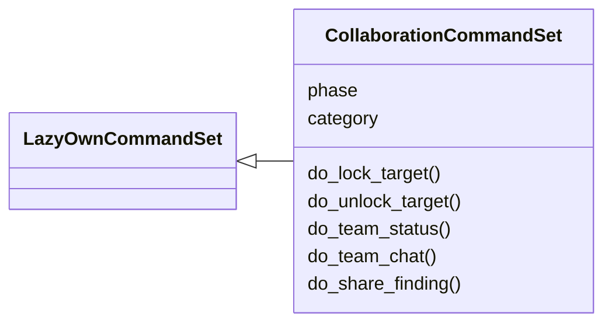
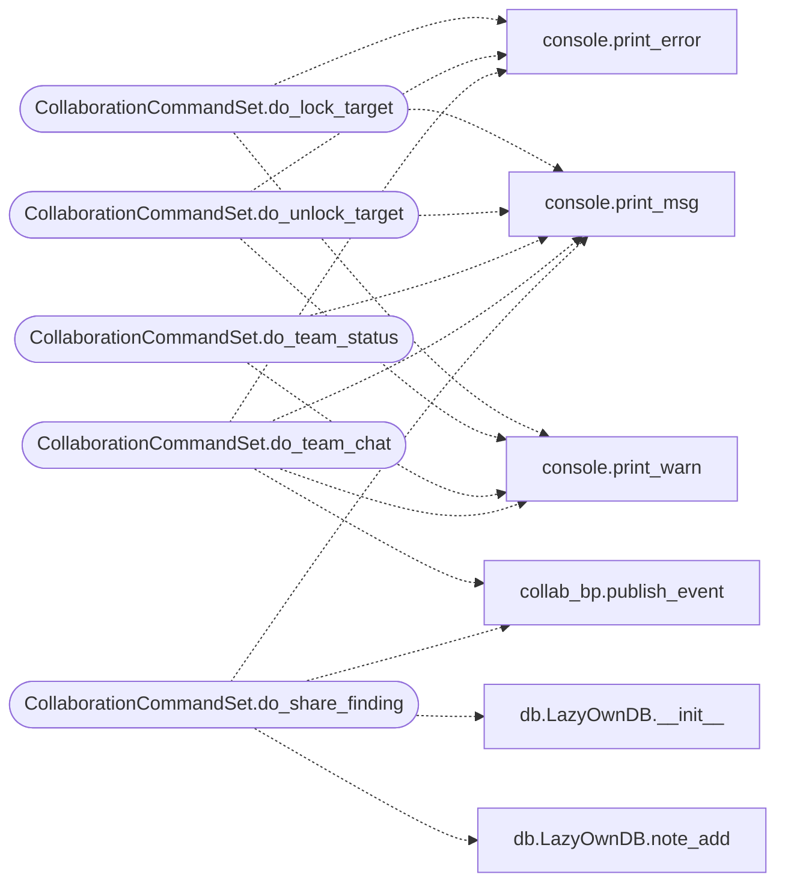

# `cli.commands.collaboration`

> Source: [cli/commands/collaboration.py:1](../../cli/commands/collaboration.py#L1) | language `py` | coverage 100.0% | [API index](../index.md)

Collaboration CLI commands — multi-operator teamwork from the shell.

Exposes the real-time collaboration layer (target locks, operator presence,
event sharing) that currently lives only in the C2 web dashboard.

## Contents

- **Classes:** [`CollaborationCommandSet`](#collaborationcommandset)

## Type Diagram



## Call Graph

Solid arrows stay in this module, dashed arrows leave it.



## Classes

<a id="collaborationcommandset"></a>

### `CollaborationCommandSet`

`class` | [cli/commands/collaboration.py:20](../../cli/commands/collaboration.py#L20)

```python
class CollaborationCommandSet(LazyOwnCommandSet)
```

Bases: [`LazyOwnCommandSet`](cli.commands._base.py.md#lazyowncommandset)

Multi-operator collaboration commands for the CLI.

**Attributes**

| Name | Type | Default | Description |
|---|---|---|---|
| [`phase`](#collaborationcommandset-phase) |  | `'collaboration'` |  |
| [`category`](#collaborationcommandset-category) |  | `'12. Miscellaneous'` |  |

**Members**

| Member | Kind | Summary |
|---|---|---|
| [`do_lock_target`](#collaborationcommandset-do_lock_target) | method | Acquire an advisory lock on a target to prevent tool collisions. |
| [`do_unlock_target`](#collaborationcommandset-do_unlock_target) | method | Release an advisory lock on a target. |
| [`do_team_status`](#collaborationcommandset-do_team_status) | method | Show active operators and target locks. |
| [`do_team_chat`](#collaborationcommandset-do_team_chat) | method | Send a message to all connected operators. |
| [`do_share_finding`](#collaborationcommandset-do_share_finding) | method | Share a finding or credential discovery with the team. |

<a id="collaborationcommandset-do_lock_target"></a>

#### `CollaborationCommandSet.do_lock_target`

`method` | [cli/commands/collaboration.py:48](../../cli/commands/collaboration.py#L48)

Decorators: `@cmd2.with_category(miscellaneous_category)`

```python
def do_lock_target(self, line)
```

Acquire an advisory lock on a target to prevent tool collisions.

Usage:
    lock_target [target_ip]
    lock_target 10.10.11.5

Without an argument, locks the current rhost from payload.json.
Active locks are visible to all connected operators via 'team_status'.
Locks auto-expire after 5 minutes unless refreshed.

**Parameters**

| Name | Type | Default | Description |
|---|---|---|---|
| `line` |  |  |  |

*Calls:* [`print_error`](core.console.py.md#print_error), [`print_msg`](core.console.py.md#print_msg), [`print_warn`](core.console.py.md#print_warn)

<a id="collaborationcommandset-do_unlock_target"></a>

#### `CollaborationCommandSet.do_unlock_target`

`method` | [cli/commands/collaboration.py:89](../../cli/commands/collaboration.py#L89)

Decorators: `@cmd2.with_category(miscellaneous_category)`

```python
def do_unlock_target(self, line)
```

Release an advisory lock on a target.

Usage:
    unlock_target [target_ip]
    unlock_target 10.10.11.5

**Parameters**

| Name | Type | Default | Description |
|---|---|---|---|
| `line` |  |  |  |

*Calls:* [`print_error`](core.console.py.md#print_error), [`print_msg`](core.console.py.md#print_msg), [`print_warn`](core.console.py.md#print_warn)

<a id="collaborationcommandset-do_team_status"></a>

#### `CollaborationCommandSet.do_team_status`

`method` | [cli/commands/collaboration.py:114](../../cli/commands/collaboration.py#L114)

Decorators: `@cmd2.with_category(miscellaneous_category)`

```python
def do_team_status(self, line)
```

Show active operators and target locks.

Usage:
    team_status

Displays who is online, which targets are locked, and by whom.
Requires the C2 server to be running.

**Parameters**

| Name | Type | Default | Description |
|---|---|---|---|
| `line` |  |  |  |

*Calls:* [`print_msg`](core.console.py.md#print_msg), [`print_warn`](core.console.py.md#print_warn)

<a id="collaborationcommandset-do_team_chat"></a>

#### `CollaborationCommandSet.do_team_chat`

`method` | [cli/commands/collaboration.py:169](../../cli/commands/collaboration.py#L169)

Decorators: `@cmd2.with_category(miscellaneous_category)`

```python
def do_team_chat(self, line)
```

Send a message to all connected operators.

Usage:
    team_chat <message>
    team_chat Found SMB signing disabled on 10.10.11.5, starting relay

Messages are broadcast in real-time via the C2 event bus.

**Parameters**

| Name | Type | Default | Description |
|---|---|---|---|
| `line` |  |  |  |

*Calls:* [`print_error`](core.console.py.md#print_error), [`print_msg`](core.console.py.md#print_msg), [`print_warn`](core.console.py.md#print_warn), [`publish_event`](modules.collab_bp.py.md#publish_event)

<a id="collaborationcommandset-do_share_finding"></a>

#### `CollaborationCommandSet.do_share_finding`

`method` | [cli/commands/collaboration.py:199](../../cli/commands/collaboration.py#L199)

Decorators: `@cmd2.with_category(miscellaneous_category)`

```python
def do_share_finding(self, line)
```

Share a finding or credential discovery with the team.

Usage:
    share_finding <text>
    share_finding Default admin:admin credentials on port 8080

Broadcasts via team event bus for real-time visibility.

**Parameters**

| Name | Type | Default | Description |
|---|---|---|---|
| `line` |  |  |  |

*Calls:* [`print_msg`](core.console.py.md#print_msg), [`publish_event`](modules.collab_bp.py.md#publish_event), [`LazyOwnDB.__init__`](modules.db.py.md#lazyowndb-__init__), [`LazyOwnDB.note_add`](modules.db.py.md#lazyowndb-note_add)

---
