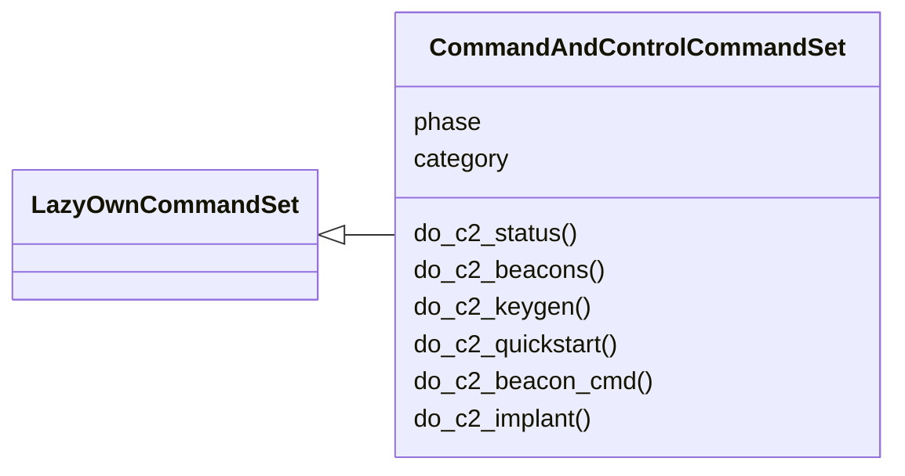
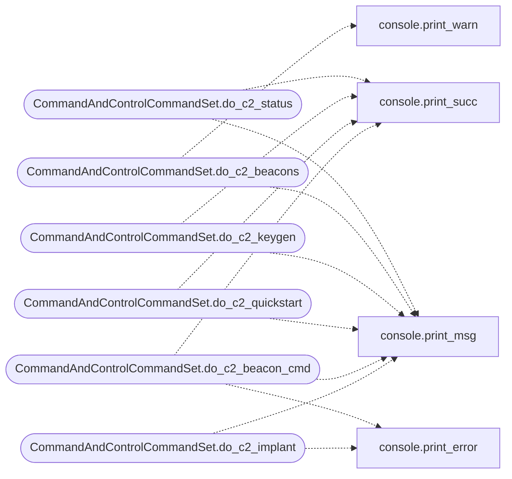

# `cli.commands.command_and_control`

> Source: [cli/commands/command_and_control.py:1](../../cli/commands/command_and_control.py#L1) | language `py` | coverage 100.0% | [API index](../index.md)

Command & Control command set.

Phase-scoped home for the C2 / beacon operator commands (category
``10. Command & Control``). This module is intentionally an empty, active
``CommandSet`` scaffold: migrate one ``do_*`` method at a time out of
``lazyown.py`` into this class.

Migration rule
--------------
When you paste a ``do_<name>`` method here you MUST delete the original copy
from ``lazyown.py`` in the same change. Registering the same command name on
both the shell and an active ``CommandSet`` raises a duplicate-command error
at startup. Decorate migrated methods with
``@cmd2.with_category(command_and_control_category)`` so they keep their help
grouping, and rely on [`cli.commands._base.LazyOwnCommandSet`](cli.commands._base.py.md#lazyowncommandset) to forward
``self.params`` / ``self.cmd`` / other shell state once registered.

Discovery is automatic: [`cli.registry.register_command_sets`](cli.registry.py.md#register_command_sets) finds this
class at startup, so no wiring change is needed as commands are added.

## Contents

- **Classes:** [`CommandAndControlCommandSet`](#commandandcontrolcommandset)

## Type Diagram



## Call Graph

Solid arrows stay in this module, dashed arrows leave it.



## Classes

<a id="commandandcontrolcommandset"></a>

### `CommandAndControlCommandSet`

`class` | [cli/commands/command_and_control.py:34](../../cli/commands/command_and_control.py#L34)

```python
class CommandAndControlCommandSet(LazyOwnCommandSet)
```

Bases: [`LazyOwnCommandSet`](cli.commands._base.py.md#lazyowncommandset)

Command & Control phase commands (migrate ``do_*`` here one at a time).

**Attributes**

| Name | Type | Default | Description |
|---|---|---|---|
| [`phase`](#commandandcontrolcommandset-phase) |  | `'c2'` |  |
| [`category`](#commandandcontrolcommandset-category) |  | `command_and_control_category` |  |

**Members**

| Member | Kind | Summary |
|---|---|---|
| [`do_c2_status`](#commandandcontrolcommandset-do_c2_status) | method | Show consolidated C2 status: listeners, beacons, implants, and sessions. |
| [`do_c2_beacons`](#commandandcontrolcommandset-do_c2_beacons) | method | List all active beacon sessions with their last-seen timestamps. |
| [`do_c2_keygen`](#commandandcontrolcommandset-do_c2_keygen) | method | Generate a fresh AES-256 key for beacon encryption. |
| [`do_c2_quickstart`](#commandandcontrolcommandset-do_c2_quickstart) | method | Quick C2 setup: generate key, prepare implant dir, print beacon commands. |
| [`do_c2_beacon_cmd`](#commandandcontrolcommandset-do_c2_beacon_cmd) | method | Queue a command for execution on a connected beacon. |
| [`do_c2_implant`](#commandandcontrolcommandset-do_c2_implant) | method | Generate a compiled implant payload for the target platform. |

<a id="commandandcontrolcommandset-do_c2_status"></a>

#### `CommandAndControlCommandSet.do_c2_status`

`method` | [cli/commands/command_and_control.py:41](../../cli/commands/command_and_control.py#L41)

Decorators: `@cmd2.with_category(command_and_control_category)`

```python
def do_c2_status(self, _line)
```

Show consolidated C2 status: listeners, beacons, implants, and sessions.

**Parameters**

| Name | Type | Default | Description |
|---|---|---|---|
| `_line` |  |  |  |

*Calls:* [`print_msg`](core.console.py.md#print_msg), [`print_succ`](core.console.py.md#print_succ)

<a id="commandandcontrolcommandset-do_c2_beacons"></a>

#### `CommandAndControlCommandSet.do_c2_beacons`

`method` | [cli/commands/command_and_control.py:98](../../cli/commands/command_and_control.py#L98)

Decorators: `@cmd2.with_category(command_and_control_category)`

```python
def do_c2_beacons(self, _line)
```

List all active beacon sessions with their last-seen timestamps.

**Parameters**

| Name | Type | Default | Description |
|---|---|---|---|
| `_line` |  |  |  |

*Calls:* [`print_msg`](core.console.py.md#print_msg), [`print_warn`](core.console.py.md#print_warn)

<a id="commandandcontrolcommandset-do_c2_keygen"></a>

#### `CommandAndControlCommandSet.do_c2_keygen`

`method` | [cli/commands/command_and_control.py:134](../../cli/commands/command_and_control.py#L134)

Decorators: `@cmd2.with_category(command_and_control_category)`

```python
def do_c2_keygen(self, _line)
```

Generate a fresh AES-256 key for beacon encryption.

**Parameters**

| Name | Type | Default | Description |
|---|---|---|---|
| `_line` |  |  |  |

*Calls:* [`print_msg`](core.console.py.md#print_msg), [`print_succ`](core.console.py.md#print_succ)

<a id="commandandcontrolcommandset-do_c2_quickstart"></a>

#### `CommandAndControlCommandSet.do_c2_quickstart`

`method` | [cli/commands/command_and_control.py:151](../../cli/commands/command_and_control.py#L151)

Decorators: `@cmd2.with_category(command_and_control_category)`

```python
def do_c2_quickstart(self, _line)
```

Quick C2 setup: generate key, prepare implant dir, print beacon commands.

One-shot setup that prepares everything needed for a C2 session:
AES key, implant staging directory, and ready-to-use beacon commands
for both Linux and Windows targets.

**Parameters**

| Name | Type | Default | Description |
|---|---|---|---|
| `_line` |  |  |  |

*Calls:* [`print_msg`](core.console.py.md#print_msg), [`print_succ`](core.console.py.md#print_succ)

<a id="commandandcontrolcommandset-do_c2_beacon_cmd"></a>

#### `CommandAndControlCommandSet.do_c2_beacon_cmd`

`method` | [cli/commands/command_and_control.py:198](../../cli/commands/command_and_control.py#L198)

Decorators: `@cmd2.with_category(command_and_control_category)`

```python
def do_c2_beacon_cmd(self, line)
```

Queue a command for execution on a connected beacon.

Usage:
    c2_beacon_cmd <client_id> <command>
    c2_beacon_cmd abc123 id

**Parameters**

| Name | Type | Default | Description |
|---|---|---|---|
| `line` |  |  |  |

*Calls:* [`print_error`](core.console.py.md#print_error), [`print_msg`](core.console.py.md#print_msg), [`print_succ`](core.console.py.md#print_succ)

<a id="commandandcontrolcommandset-do_c2_implant"></a>

#### `CommandAndControlCommandSet.do_c2_implant`

`method` | [cli/commands/command_and_control.py:233](../../cli/commands/command_and_control.py#L233)

Decorators: `@cmd2.with_category(command_and_control_category)`

```python
def do_c2_implant(self, line)
```

Generate a compiled implant payload for the target platform.

Usage:
    c2_implant <linux|windows> [output_name]
    c2_implant linux mybeacon

**Parameters**

| Name | Type | Default | Description |
|---|---|---|---|
| `line` |  |  |  |

*Calls:* [`print_error`](core.console.py.md#print_error), [`print_msg`](core.console.py.md#print_msg)

---
