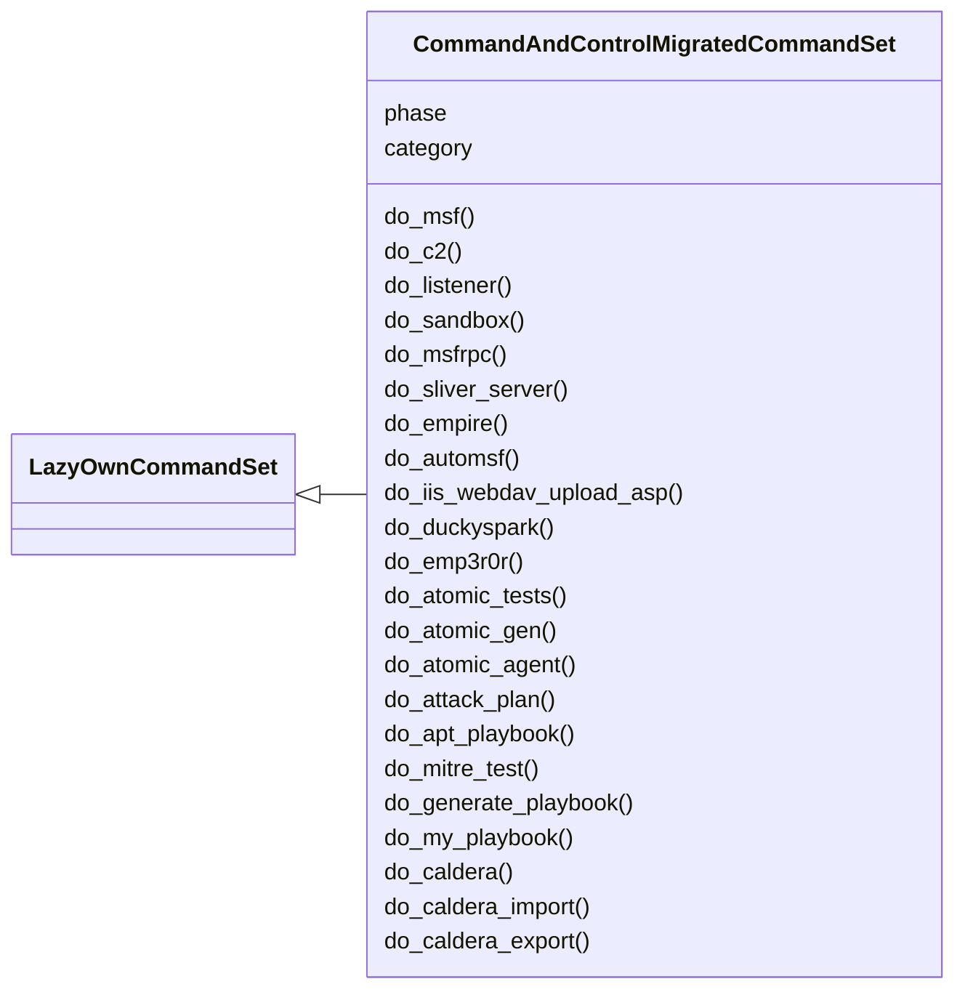
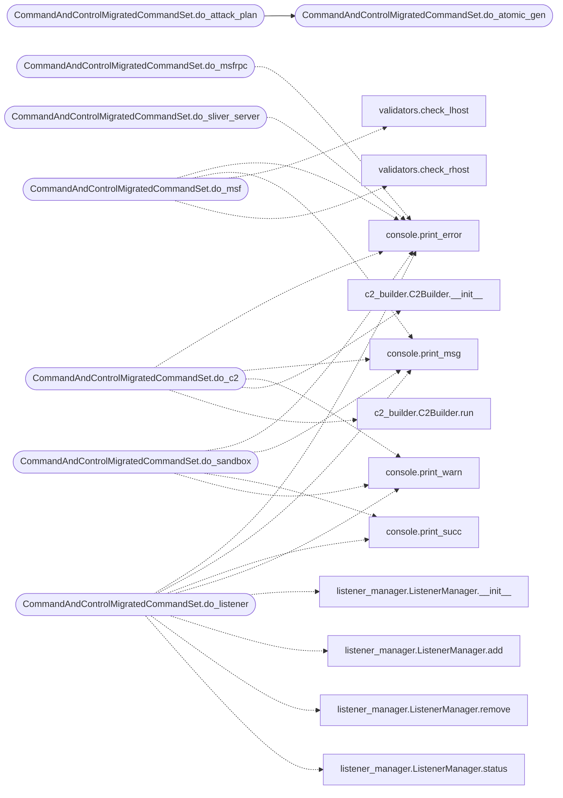

# `cli.commands.command_and_control_migrated`

> Source: [cli/commands/command_and_control_migrated.py:1](../../cli/commands/command_and_control_migrated.py#L1) | language `py` | coverage 95.8% | [API index](../index.md)

command_and_control commands migrated from lazyown.py.

Auto-generated by scripts/migrate_lazyown.py.

## Contents

- **Classes:** [`CommandAndControlMigratedCommandSet`](#commandandcontrolmigratedcommandset)

## Type Diagram



## Call Graph

Solid arrows stay in this module, dashed arrows leave it.



## Classes

<a id="commandandcontrolmigratedcommandset"></a>

### `CommandAndControlMigratedCommandSet`

`class` | [cli/commands/command_and_control_migrated.py:39](../../cli/commands/command_and_control_migrated.py#L39)

```python
class CommandAndControlMigratedCommandSet(LazyOwnCommandSet)
```

Bases: [`LazyOwnCommandSet`](cli.commands._base.py.md#lazyowncommandset)

**Attributes**

| Name | Type | Default | Description |
|---|---|---|---|
| [`phase`](#commandandcontrolmigratedcommandset-phase) |  | `'command_and_control'` |  |
| [`category`](#commandandcontrolmigratedcommandset-category) |  | `'10. Command & Control'` |  |

**Members**

| Member | Kind | Summary |
|---|---|---|
| [`do_msf`](#commandandcontrolmigratedcommandset-do_msf) | method | Automates various Metasploit tasks including scanning for vulnerabilities, setting up reverse shells, and creating payloads. |
| [`do_c2`](#commandandcontrolmigratedcommandset-do_c2) | method | Handle C2 server setup and agent compilation. |
| [`do_listener`](#commandandcontrolmigratedcommandset-do_listener) | method | Manage C2 listeners: list, add, start, stop, remove. |
| [`do_sandbox`](#commandandcontrolmigratedcommandset-do_sandbox) | method | Toggle or query Docker sandbox mode. |
| [`do_msfrpc`](#commandandcontrolmigratedcommandset-do_msfrpc) | method | Connects to the msfrpcd daemon and allows remote control of Metasploit. |
| [`do_sliver_server`](#commandandcontrolmigratedcommandset-do_sliver_server) | method | Starts the Sliver server and generates a client configuration file for connecting clients. |
| [`do_empire`](#commandandcontrolmigratedcommandset-do_empire) | method | Generates payloads using PowerShell Empire with various options. |
| [`do_automsf`](#commandandcontrolmigratedcommandset-do_automsf) | method | Try to check if Vulnerable using the module passed by argument of lazyown example automsf exploit/windows/iis/iis_webdav_upload_asp to use in metasploit |
| [`do_iis_webdav_upload_asp`](#commandandcontrolmigratedcommandset-do_iis_webdav_upload_asp) | method | (CVE-2017-7269). |
| [`do_duckyspark`](#commandandcontrolmigratedcommandset-do_duckyspark) | method | duckyspark Compiles and uploads an .ino sketch to a Digispark device using Arduino CLI and Micronucleus. |
| [`do_emp3r0r`](#commandandcontrolmigratedcommandset-do_emp3r0r) | method | Command emp3r0r Downloads and sets up the Emperor server for local exploitation. |
| [`do_atomic_tests`](#commandandcontrolmigratedcommandset-do_atomic_tests) | method | Executes Atomic Red Team tests based on user-selected platform and test. |
| [`do_atomic_gen`](#commandandcontrolmigratedcommandset-do_atomic_gen) | method | Generates test and cleanup scripts for a given Atomic Red Team technique ID. |
| [`do_atomic_agent`](#commandandcontrolmigratedcommandset-do_atomic_agent) | method | Generates and synchronizes atomic agent scripts. |
| [`do_attack_plan`](#commandandcontrolmigratedcommandset-do_attack_plan) | method | Executes a multi-step APT simulation plan based on Atomic Red Team test IDs. |
| [`do_apt_playbook`](#commandandcontrolmigratedcommandset-do_apt_playbook) | method | List, validate, and run APT playbooks based on public threat reports. |
| [`do_mitre_test`](#commandandcontrolmigratedcommandset-do_mitre_test) | method | Interacts with the MITRE ATT&CK framework using the STIX 2.0 format. |
| [`do_generate_playbook`](#commandandcontrolmigratedcommandset-do_generate_playbook) | method | Generates a playbook that integrates Atomic Red Team tests and MITRE ATT&CK techniques. |
| [`do_my_playbook`](#commandandcontrolmigratedcommandset-do_my_playbook) | method | Generates a playbook from your custom technique database. |
| [`do_caldera`](#commandandcontrolmigratedcommandset-do_caldera) | method | Installs and starts the Caldera server. |
| [`do_caldera_import`](#commandandcontrolmigratedcommandset-do_caldera_import) | method | Import CALDERA abilities into LazyOwn playbooks. |
| [`do_caldera_export`](#commandandcontrolmigratedcommandset-do_caldera_export) | method | Export a LazyOwn playbook to CALDERA ability YAML. |

<a id="commandandcontrolmigratedcommandset-do_msf"></a>

#### `CommandAndControlMigratedCommandSet.do_msf`

`method` | [cli/commands/command_and_control_migrated.py:44](../../cli/commands/command_and_control_migrated.py#L44)

Decorators: `@cmd2.with_category('10. Command & Control')`

```python
def do_msf(self, line)
```

Automates various Metasploit tasks including scanning for vulnerabilities, setting up reverse shells, and creating payloads.

1. If no arguments are provided:
    - Retrieves the target IP (`self.params['rhost']`) from parameters.
    - Checks if the IP is valid using [`check_rhost`](core.validators.py.md#check_rhost). If invalid, exits the function.
    - Creates a Metasploit resource script (`/tmp/scan_vulnerabilities.rc`) that includes commands for scanning ports, enumerating services, and checking for known vulnerabilities.
    - Executes Metasploit with the created resource script and then deletes the temporary file.
    - Prints a shutdown message after running the scan.

2. If the argument starts with "rev":
    - Sets up a reverse shell payload based on the specified platform and user choice (with or without meterpreter).
    - Creates a Metasploit resource script (`/tmp/handler.rc`) for handling incoming reverse shell connections.
    - Executes Metasploit with the created resource script and then deletes the temporary file.
    - Prints a shutdown message after setting up the handler.

3. If the argument starts with "lnk":
    - Configures parameters (`self.params['lhost']`, `lport`) for creating a payload.
    - Uses `msfvenom` to generate a payload executable and saves it in the `sessions` directory.
    - Creates an XML file (`download_payload.xml`) that will be used to download and execute the payload on a target machine.
    - Creates a PowerShell script (`create_lnk.ps1`) to generate a shortcut file (`.lnk`) pointing to the payload.
    - Prints instructions and generates a command to copy to the clipboard for setting up the payload and files.

4. If the argument starts with "autoroute":
    - Configures parameters for setting up a Metasploit session and autorouting.
    - Creates a Metasploit resource script (`/tmp/autoroute.rc`) to handle exploit sessions and assign up autorouting.
    - Executes Metasploit with the resource script and starts a SOCKS proxy for routing traffic.
    - Configures proxychains to use the Metasploit SOCKS proxy and prints instructions for using proxychains with tools.


Manual execution:
To manually run these tasks, you would need to:
- For scanning: Create and run the resource script using `msfconsole -r /tmp/scan_vulnerabilities.rc`.
- For reverse shells: Configure and run the resource script with the appropriate payload settings.
- For payload generation and shortcuts: Use `msfvenom` and create XML and PowerShell scripts as specified.
- For autorouting: Create and run the resource script for autorouting and configure proxychains.

Note: Ensure all required parameters (`self.params['lhost']`, `lport`, etc.) are assign before running these tasks.

**Parameters**

| Name | Type | Default | Description |
|---|---|---|---|
| `line` | `str` |  | The command line input that determines which Metasploit task to automate. |

**Returns:** None

*Calls:* [`print_error`](core.console.py.md#print_error), [`print_msg`](core.console.py.md#print_msg), [`check_lhost`](core.validators.py.md#check_lhost), [`check_rhost`](core.validators.py.md#check_rhost)

<a id="commandandcontrolmigratedcommandset-do_c2"></a>

#### `CommandAndControlMigratedCommandSet.do_c2`

`method` | [cli/commands/command_and_control_migrated.py:394](../../cli/commands/command_and_control_migrated.py#L394)

Decorators: `@cmd2.with_category('10. Command & Control')`

```python
def do_c2(self, line)
```

Handle C2 server setup and agent compilation.

This method manages the process of setting up a Command and Control (C2)
server and compiling a corresponding agent for various platforms.

Example Usage:
    c2 victim-1  # Compiles a Windows PowerShell agent
    c2 victim-2 2 # Compiles a Linux Shell agent
    c2 victim-3 1 1 # Compiles a Windows PowerShell agent with Cloudflare tunnel

**Parameters**

| Name | Type | Default | Description |
|---|---|---|---|
| `line` | `str` |  | Specifies the victim ID and optional C2 server configurations. - Victim ID: The identifier for the target agent. - Tunnel Option (optional): Append '1' to use a Cloudflare tunnel. - Target Choice (optional): A number from '1' to '7' to specify the agent platform (default is '1' for Windows PowerShell). - '1': Windows PowerShell - '2': Linux Shell - '3': Windows Batch - '4': macOS Shell - '5': Android Shell - '6': iOS Shell - '7': WebAssembly Shell - Tunnel Toggle (optional): After the victim ID and target choice, you can append '1' to enable the Cloudflare tunnel or '0' to disable it. |

**Returns:** None

**Raises**

- `None`

> **Note:** - Ensure the 'self.params['lhost']' and 'self.params['c2_port']' parameters are correctly set in the
> `payload.json` config file before calling this method.
> - The `modules/run` file and files in `modules/backdoor/` and
> `modules/rootkit/` directories must exist for the agent compilation
> process.
> - The go artifactory is ofuscated by garble if is installed

*Calls:* [`print_error`](core.console.py.md#print_error), [`print_msg`](core.console.py.md#print_msg), [`print_warn`](core.console.py.md#print_warn), [`C2Builder.__init__`](modules.c2_builder.py.md#c2builder-__init__), [`C2Builder.run`](modules.c2_builder.py.md#c2builder-run)

<a id="commandandcontrolmigratedcommandset-do_listener"></a>

#### `CommandAndControlMigratedCommandSet.do_listener`

`method` | [cli/commands/command_and_control_migrated.py:516](../../cli/commands/command_and_control_migrated.py#L516)

Decorators: `@cmd2.with_category('10. Command & Control')`

```python
def do_listener(self, line)
```

Manage C2 listeners: list, add, start, stop, remove.

Usage:
    listener list                  - Show all configured listeners
    listener add <port> [ssl]      - Add a new listener (ssl: true/false)
    listener start <id>            - Start a listener via C2 API
    listener stop <id>             - Stop a listener via C2 API
    listener remove <id>           - Remove a listener

**Parameters**

| Name | Type | Default | Description |
|---|---|---|---|
| `line` |  |  |  |

**Example**

```python
listener add 4445 true
listener start listener-4445
listener stop default
```

*Calls:* [`print_error`](core.console.py.md#print_error), [`print_msg`](core.console.py.md#print_msg), [`print_succ`](core.console.py.md#print_succ), [`print_warn`](core.console.py.md#print_warn), [`ListenerManager.__init__`](modules.listener_manager.py.md#listenermanager-__init__), [`ListenerManager.add`](modules.listener_manager.py.md#listenermanager-add), [`ListenerManager.remove`](modules.listener_manager.py.md#listenermanager-remove), [`ListenerManager.status`](modules.listener_manager.py.md#listenermanager-status)

<a id="commandandcontrolmigratedcommandset-do_sandbox"></a>

#### `CommandAndControlMigratedCommandSet.do_sandbox`

`method` | [cli/commands/command_and_control_migrated.py:644](../../cli/commands/command_and_control_migrated.py#L644)

Decorators: `@cmd2.with_category('10. Command & Control')`

```python
def do_sandbox(self, line)
```

Toggle or query Docker sandbox mode.

When ``sandboxed`` is ``true`` in ``payload.json``, the framework
automatically runs inside a Docker container on the next launch.

Usage:
    sandbox         - Show current sandbox status
    sandbox on      - Enable sandbox mode
    sandbox off     - Disable sandbox mode

**Parameters**

| Name | Type | Default | Description |
|---|---|---|---|
| `line` |  |  |  |

*Calls:* [`print_error`](core.console.py.md#print_error), [`print_msg`](core.console.py.md#print_msg), [`print_succ`](core.console.py.md#print_succ), [`print_warn`](core.console.py.md#print_warn)

<a id="commandandcontrolmigratedcommandset-do_msfrpc"></a>

#### `CommandAndControlMigratedCommandSet.do_msfrpc`

`method` | [cli/commands/command_and_control_migrated.py:686](../../cli/commands/command_and_control_migrated.py#L686)

Decorators: `@cmd2.with_category('10. Command & Control')`

```python
def do_msfrpc(self, line)
```

Connects to the msfrpcd daemon and allows remote control of Metasploit.

Usage:
    msfrpc -a <IP address> -p <port> -U <username> -P <password> [-S]

This command will prompt the user for necessary information to connect to msfrpcd.

**Parameters**

| Name | Type | Default | Description |
|---|---|---|---|
| `line` |  |  |  |

*Calls:* [`print_error`](core.console.py.md#print_error)

<a id="commandandcontrolmigratedcommandset-do_sliver_server"></a>

#### `CommandAndControlMigratedCommandSet.do_sliver_server`

`method` | [cli/commands/command_and_control_migrated.py:710](../../cli/commands/command_and_control_migrated.py#L710)

Decorators: `@cmd2.with_category('10. Command & Control')`

```python
def do_sliver_server(self, line)
```

Starts the Sliver server and generates a client configuration file for connecting clients.

Provides options to download the Sliver client for Windows, Linux, or macOS.

Usage:
    sliver-server [flags]
    sliver-client [command]

This function installs Sliver if it is not already installed, starts the Sliver server,
generates the necessary certificates, and creates a client configuration file.
It also provides options to download the client for different operating systems.

**Parameters**

| Name | Type | Default | Description |
|---|---|---|---|
| `line` | `str` |  | The command line input for the function (not used directly in the current implementation). |

**Returns:** None

**Example**

```python
To start the Sliver server, generate the necessary certificates, and download the client,
run this function. Choose the appropriate client download option based on the operating system.
```

*Calls:* [`print_error`](core.console.py.md#print_error), [`print_msg`](core.console.py.md#print_msg), [`print_warn`](core.console.py.md#print_warn), [`is_binary_present`](core.process.py.md#is_binary_present), [`check_lhost`](core.validators.py.md#check_lhost), [`check_lport`](core.validators.py.md#check_lport), [`check_rhost`](core.validators.py.md#check_rhost), [`copy2clip`](utils.py.md#copy2clip)

<a id="commandandcontrolmigratedcommandset-do_empire"></a>

#### `CommandAndControlMigratedCommandSet.do_empire`

`method` | [cli/commands/command_and_control_migrated.py:827](../../cli/commands/command_and_control_migrated.py#L827)

Decorators: `@cmd2.with_category('10. Command & Control')`

```python
def do_empire(self, line)
```

Generates payloads using PowerShell Empire with various options.

**Parameters**

| Name | Type | Default | Description |
|---|---|---|---|
| `line` |  |  | Not used in this implementation but reserved for future use. |

**Returns:** None

*Calls:* [`print_error`](core.console.py.md#print_error), [`print_msg`](core.console.py.md#print_msg), [`print_warn`](core.console.py.md#print_warn), [`is_binary_present`](core.process.py.md#is_binary_present)

<a id="commandandcontrolmigratedcommandset-do_automsf"></a>

#### `CommandAndControlMigratedCommandSet.do_automsf`

`method` | [cli/commands/command_and_control_migrated.py:877](../../cli/commands/command_and_control_migrated.py#L877)

Decorators: `@cmd2.with_category('10. Command & Control')`

```python
def do_automsf(self, line)
```

Try to check if Vulnerable using the module passed by argument of lazyown example automsf exploit/windows/iis/iis_webdav_upload_asp to use in metasploit

**Parameters**

| Name | Type | Default | Description |
|---|---|---|---|
| `line` | `str` |  | Command line input that provides the LHOST and RHOST. |

**Returns:** None

*Calls:* [`print_error`](core.console.py.md#print_error), [`print_msg`](core.console.py.md#print_msg), [`print_warn`](core.console.py.md#print_warn)

<a id="commandandcontrolmigratedcommandset-do_iis_webdav_upload_asp"></a>

#### `CommandAndControlMigratedCommandSet.do_iis_webdav_upload_asp`

`method` | [cli/commands/command_and_control_migrated.py:922](../../cli/commands/command_and_control_migrated.py#L922)

Decorators: `@cmd2.with_category('10. Command & Control')`

```python
def do_iis_webdav_upload_asp(self, line)
```

(CVE-2017-7269).

Vulnerable using the module iis_webdav_upload_asp of metasploit

**Parameters**

| Name | Type | Default | Description |
|---|---|---|---|
| `line` | `str` |  | Command line input that provides the LHOST and RHOST. |

**Returns:** None

*Calls:* [`print_msg`](core.console.py.md#print_msg), [`print_warn`](core.console.py.md#print_warn)

<a id="commandandcontrolmigratedcommandset-do_duckyspark"></a>

#### `CommandAndControlMigratedCommandSet.do_duckyspark`

`method` | [cli/commands/command_and_control_migrated.py:957](../../cli/commands/command_and_control_migrated.py#L957)

Decorators: `@cmd2.with_category('10. Command & Control')`

```python
def do_duckyspark(self, line)
```

duckyspark Compiles and uploads an .ino sketch to a Digispark device using Arduino CLI and Micronucleus.

duckyspark method checks if Arduino CLI and Micronucleus are installed on the system.
If they are not available, it installs them. It then compiles a Digispark sketch
and uploads the generated .hex file to the Digispark device.

The method duckyspark performs the following actions:
1. Checks for the presence of Arduino CLI and installs it if not available.
2. Configures Arduino CLI for Digispark if not already configured.
3. Generates a reverse shell payload and prepares the sketch for Digispark.
4. Compiles the prepared Digispark sketch using Arduino CLI.
5. Checks for the presence of Micronucleus and installs it if not available.
6. Uploads the compiled .hex file to the Digispark device using Micronucleus.

**Parameters**

| Name | Type | Default | Description |
|---|---|---|---|
| `line` | `str` |  | Command line input provided by the user, which may contain additional parameters. |

**Returns:** `None` - The function does not return any value but may modify the state of the system
by executing commands.

*Calls:* [`print_error`](core.console.py.md#print_error), [`print_msg`](core.console.py.md#print_msg), [`print_warn`](core.console.py.md#print_warn), [`is_binary_present`](core.process.py.md#is_binary_present), [`check_lhost`](core.validators.py.md#check_lhost), [`is_exist`](utils.py.md#is_exist)

<a id="commandandcontrolmigratedcommandset-do_emp3r0r"></a>

#### `CommandAndControlMigratedCommandSet.do_emp3r0r`

`method` | [cli/commands/command_and_control_migrated.py:1158](../../cli/commands/command_and_control_migrated.py#L1158)

Decorators: `@cmd2.with_category('10. Command & Control')`

```python
def do_emp3r0r(self, line)
```

Command emp3r0r Downloads and sets up the Emperor server for local exploitation.

This function performs the following tasks:
1. Checks if Emperor is already downloaded.
2. Downloads the Emperor tar.xz file if not already present.
3. Extracts the contents into the sessions directory.
4. Executes the Emperor server.
5. Prepares the agent download command based on the OS Host and copies it to the clipboard.

**Parameters**

| Name | Type | Default | Description |
|---|---|---|---|
| `line` | `str` |  | Optional arguments to specify port Relay |

**Returns:** None

**Example**

```python
emp3r0r 6666
```

> **Note:** - Ensure that the required dependencies are installed.

*Calls:* [`print_msg`](core.console.py.md#print_msg), [`print_warn`](core.console.py.md#print_warn), [`copy2clip`](utils.py.md#copy2clip)

<a id="commandandcontrolmigratedcommandset-do_atomic_tests"></a>

#### `CommandAndControlMigratedCommandSet.do_atomic_tests`

`method` | [cli/commands/command_and_control_migrated.py:1222](../../cli/commands/command_and_control_migrated.py#L1222)

Decorators: `@cmd2.with_category('10. Command & Control')`

```python
def do_atomic_tests(self, line)
```

Executes Atomic Red Team tests based on user-selected platform and test.

This function performs the following actions:
1. Verifies the presence of the Atomic Red Team repository; if not present, it clones it locally.
2. Prompts the user to select a target platform, filtering the available tests to only those compatible.
3. Displays the filtered tests, including their description and platform compatibility.
4. Allows the user to select and execute a test or specify parameters directly.

line (str): Command-line arguments for specifying a test ID or additional parameters.
            If not provided, interactive input will be used.

None

**Parameters**

| Name | Type | Default | Description |
|---|---|---|---|
| `line` |  |  |  |

*Calls:* [`print_error`](core.console.py.md#print_error), [`print_msg`](core.console.py.md#print_msg), [`print_warn`](core.console.py.md#print_warn), [`copy2clip`](utils.py.md#copy2clip), [`get_credentials`](utils.py.md#get_credentials), [`replace_variables`](utils.py.md#replace_variables)

<a id="commandandcontrolmigratedcommandset-do_atomic_gen"></a>

#### `CommandAndControlMigratedCommandSet.do_atomic_gen`

`method` | [cli/commands/command_and_control_migrated.py:1382](../../cli/commands/command_and_control_migrated.py#L1382)

Decorators: `@cmd2.with_category('10. Command & Control')`

```python
def do_atomic_gen(self, line)
```

Generates test and cleanup scripts for a given Atomic Red Team technique ID.

line (str): The technique ID.

None

**Parameters**

| Name | Type | Default | Description |
|---|---|---|---|
| `line` |  |  |  |

*Calls:* [`print_msg`](core.console.py.md#print_msg), [`print_warn`](core.console.py.md#print_warn), [`replace_variables`](utils.py.md#replace_variables)

*Called by:* [`CommandAndControlMigratedCommandSet.do_attack_plan`](#commandandcontrolmigratedcommandset-do_attack_plan)

<a id="commandandcontrolmigratedcommandset-do_atomic_agent"></a>

#### `CommandAndControlMigratedCommandSet.do_atomic_agent`

`method` | [cli/commands/command_and_control_migrated.py:1566](../../cli/commands/command_and_control_migrated.py#L1566)

Decorators: `@cmd2.with_category('10. Command & Control')`

```python
def do_atomic_agent(self, line)
```

Generates and synchronizes atomic agent scripts.

line (str): Command-line arguments (not used in this function).

None

**Parameters**

| Name | Type | Default | Description |
|---|---|---|---|
| `line` |  |  |  |

*Calls:* [`print_error`](core.console.py.md#print_error), [`print_msg`](core.console.py.md#print_msg), [`print_warn`](core.console.py.md#print_warn), [`set_sshpass_env`](core.hardening.py.md#set_sshpass_env)

<a id="commandandcontrolmigratedcommandset-do_attack_plan"></a>

#### `CommandAndControlMigratedCommandSet.do_attack_plan`

`method` | [cli/commands/command_and_control_migrated.py:1666](../../cli/commands/command_and_control_migrated.py#L1666)

Decorators: `@cmd2.with_category('10. Command & Control')`

```python
def do_attack_plan(self, line)
```

Executes a multi-step APT simulation plan based on Atomic Red Team test IDs.

line (str) optional: Path to the YAML plan file. Append --auto to execute
                      generated scripts immediately instead of just generating.

None

**Parameters**

| Name | Type | Default | Description |
|---|---|---|---|
| `line` |  |  |  |

*Calls:* [`CommandAndControlMigratedCommandSet.do_atomic_gen`](#commandandcontrolmigratedcommandset-do_atomic_gen), [`print_msg`](core.console.py.md#print_msg), [`print_warn`](core.console.py.md#print_warn)

<a id="commandandcontrolmigratedcommandset-do_apt_playbook"></a>

#### `CommandAndControlMigratedCommandSet.do_apt_playbook`

`method` | [cli/commands/command_and_control_migrated.py:1790](../../cli/commands/command_and_control_migrated.py#L1790)

Decorators: `@cmd2.with_category('10. Command & Control')`

```python
def do_apt_playbook(self, line)
```

List, validate, and run APT playbooks based on public threat reports.

Usage:
    apt_playbook list                  - Show available APT playbooks
    apt_playbook info <apt_name>       - Show phases and techniques
    apt_playbook validate <apt_name>   - Check atomic tests availability
    apt_playbook run <apt_name>        - Generate attack_plan.yaml
    apt_playbook report <apt_name>     - Write JSON report to sessions/

**Parameters**

| Name | Type | Default | Description |
|---|---|---|---|
| `line` |  |  |  |

**Example**

```python
apt_playbook list
apt_playbook info apt29
apt_playbook run apt28
```

*Calls:* [`print_error`](core.console.py.md#print_error), [`print_msg`](core.console.py.md#print_msg), [`print_warn`](core.console.py.md#print_warn), [`AptPlaybookEngine.__init__`](modules.apt_playbooks.py.md#aptplaybookengine-__init__), [`AptPlaybookEngine.generate_attack_plan`](modules.apt_playbooks.py.md#aptplaybookengine-generate_attack_plan), [`AptPlaybookEngine.get`](modules.apt_playbooks.py.md#aptplaybookengine-get), [`AptPlaybookEngine.list_playbooks`](modules.apt_playbooks.py.md#aptplaybookengine-list_playbooks), [`AptPlaybookEngine.report_json`](modules.apt_playbooks.py.md#aptplaybookengine-report_json), [`AptPlaybookEngine.validate`](modules.apt_playbooks.py.md#aptplaybookengine-validate)

<a id="commandandcontrolmigratedcommandset-do_mitre_test"></a>

#### `CommandAndControlMigratedCommandSet.do_mitre_test`

`method` | [cli/commands/command_and_control_migrated.py:1910](../../cli/commands/command_and_control_migrated.py#L1910)

Decorators: `@cmd2.with_category('10. Command & Control')`

```python
def do_mitre_test(self, line)
```

Interacts with the MITRE ATT&CK framework using the STIX 2.0 format.

This function connects to a locally cached or downloaded ATT&CK dataset in STIX 2.0 format.
It allows the user to explore tactics, techniques, and procedures (TTPs) and filter them
based on specific criteria, such as platform or tactic.

Usage:
    mitre_test list             # Lists all tactics and techniques
    mitre_test tactic <name>    # Lists techniques for a specific tactic
    mitre_test technique <id>   # Shows details of a specific technique

**Parameters**

| Name | Type | Default | Description |
|---|---|---|---|
| `line` | `str` |  | User input, which may specify filters or actions, such as a tactic name or technique ID. |

*Calls:* [`print_error`](core.console.py.md#print_error), [`print_msg`](core.console.py.md#print_msg), [`print_warn`](core.console.py.md#print_warn)

<a id="commandandcontrolmigratedcommandset-do_generate_playbook"></a>

#### `CommandAndControlMigratedCommandSet.do_generate_playbook`

`method` | [cli/commands/command_and_control_migrated.py:2013](../../cli/commands/command_and_control_migrated.py#L2013)

Decorators: `@cmd2.with_category('10. Command & Control')`

```python
def do_generate_playbook(self, line)
```

Generates a playbook that integrates Atomic Red Team tests and MITRE ATT&CK techniques.

This function creates a playbook by combining tests from the Atomic Red Team repository
and techniques from the MITRE ATT&CK framework. The playbook includes detailed information
about each test and technique, making it a comprehensive resource for emulating adversary
behaviors.

line (str): Command-line arguments for specifying the playbook name and optional filters.
            The filters can be applied to various attributes of the tests and techniques,
            including but not limited to:
            - name: Filter by the name of the test or technique.
            - description: Filter by keywords in the description of the test or technique.
            - mitre_id: Filter by the MITRE ATT&CK technique ID.
            - platforms: Filter by the supported platforms (e.g., windows, linux, macos).
            - tactic: Filter by the MITRE ATT&CK tactic associated with the technique.
            - data_sources: Filter by the data sources mentioned in the technique.
            - defensive_measures: Filter by the defensive measures mentioned in the technique.
            - examples: Filter by examples mentioned in the technique.
            - references: Filter by references or URLs mentioned in the technique.
            - related_techniques: Filter by related techniques mentioned in the technique.
            - mitigations: Filter by mitigations mentioned in the technique.

None

Example Usage:
do_generate_playbook("ExamplePlaybook persistence lateral_movement windows")
This command will generate a playbook named "ExamplePlaybook" that includes tests and
techniques related to "persistence", "lateral_movement", and the "windows" platform.

**Parameters**

| Name | Type | Default | Description |
|---|---|---|---|
| `line` |  |  |  |

*Calls:* [`print_msg`](core.console.py.md#print_msg), [`print_warn`](core.console.py.md#print_warn)

<a id="commandandcontrolmigratedcommandset-do_my_playbook"></a>

#### `CommandAndControlMigratedCommandSet.do_my_playbook`

`method` | [cli/commands/command_and_control_migrated.py:2192](../../cli/commands/command_and_control_migrated.py#L2192)

Decorators: `@cmd2.with_category('10. Command & Control')`

```python
def do_my_playbook(self, line)
```

Generates a playbook from your custom technique database.

Usage: my_playbook <name> [filter] Example: my_playbook KerberosAttack password spray

**Parameters**

| Name | Type | Default | Description |
|---|---|---|---|
| `line` |  |  |  |

*Calls:* [`print_msg`](core.console.py.md#print_msg), [`print_warn`](core.console.py.md#print_warn)

<a id="commandandcontrolmigratedcommandset-do_caldera"></a>

#### `CommandAndControlMigratedCommandSet.do_caldera`

`method` | [cli/commands/command_and_control_migrated.py:2249](../../cli/commands/command_and_control_migrated.py#L2249)

Decorators: `@cmd2.with_category('10. Command & Control')`

```python
def do_caldera(self, line)
```

Installs and starts the Caldera server.

This function:
    - Clones the Caldera repository recursively.
    - Installs the required dependencies.
    - Optionally installs GoLang (1.19+).
    - Starts the Caldera server with the provided parameters.

Behavior:
    - Requires `git`, `python3`, and `pip3` to be installed.
    - Uses parameters from `self.params` for version/release.

Usage:
    caldera

**Parameters**

| Name | Type | Default | Description |
|---|---|---|---|
| `line` |  |  |  |

*Calls:* [`print_error`](core.console.py.md#print_error), [`print_msg`](core.console.py.md#print_msg), [`create_caldera_config`](utils.py.md#create_caldera_config)

<a id="commandandcontrolmigratedcommandset-do_caldera_import"></a>

#### `CommandAndControlMigratedCommandSet.do_caldera_import`

`method` | [cli/commands/command_and_control_migrated.py:2298](../../cli/commands/command_and_control_migrated.py#L2298)

Decorators: `@cmd2.with_category('10. Command & Control')`

```python
def do_caldera_import(self, line)
```

Import CALDERA abilities into LazyOwn playbooks.

Usage:
    caldera_import <ability_id> [playbook_name]
    caldera_import all

**Parameters**

| Name | Type | Default | Description |
|---|---|---|---|
| `line` |  |  |  |

**Example**

```python
caldera_import 4e97e699-93d7-4046-b5b3-94968bf4ac1e
caldera_import all
```

*Calls:* [`print_error`](core.console.py.md#print_error), [`print_succ`](core.console.py.md#print_succ), [`print_warn`](core.console.py.md#print_warn)

<a id="commandandcontrolmigratedcommandset-do_caldera_export"></a>

#### `CommandAndControlMigratedCommandSet.do_caldera_export`

`method` | [cli/commands/command_and_control_migrated.py:2390](../../cli/commands/command_and_control_migrated.py#L2390)

Decorators: `@cmd2.with_category('10. Command & Control')`

```python
def do_caldera_export(self, line)
```

Export a LazyOwn playbook to CALDERA ability YAML.

Usage:
    caldera_export <playbook_name> [ability_id_prefix]

**Parameters**

| Name | Type | Default | Description |
|---|---|---|---|
| `line` |  |  |  |

**Example**

```python
caldera_export apt29
caldera_export fin7 lazyown-
```

*Calls:* [`print_error`](core.console.py.md#print_error), [`print_succ`](core.console.py.md#print_succ)

---
