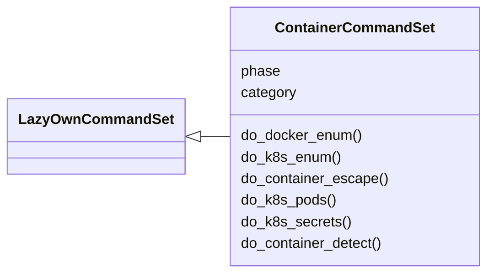
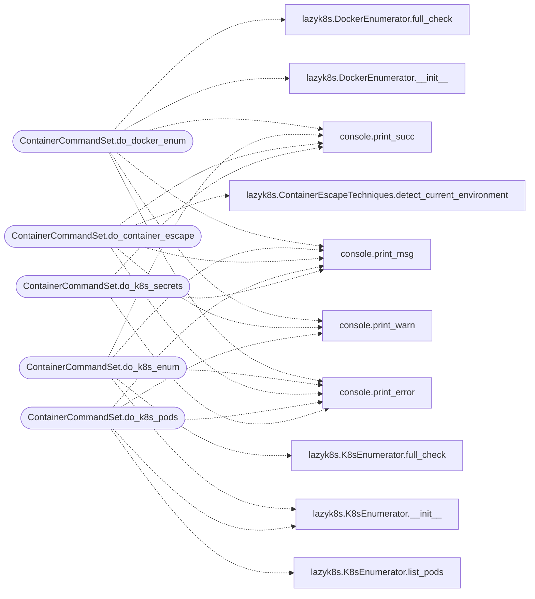

# `cli.commands.containers`

> Source: [cli/commands/containers.py:1](../../cli/commands/containers.py#L1) | language `py` | coverage 100.0% | [API index](../index.md)

Container and Kubernetes attack command set.

Commands for Docker enumeration, Kubernetes cluster reconnaissance,
pod escape detection, and container privilege escalation.

## Contents

- **Classes:** [`ContainerCommandSet`](#containercommandset)

## Type Diagram



## Call Graph

Solid arrows stay in this module, dashed arrows leave it.



## Classes

<a id="containercommandset"></a>

### `ContainerCommandSet`

`class` | [cli/commands/containers.py:30](../../cli/commands/containers.py#L30)

```python
class ContainerCommandSet(LazyOwnCommandSet)
```

Bases: [`LazyOwnCommandSet`](cli.commands._base.py.md#lazyowncommandset)

Container and Kubernetes attack commands.

**Attributes**

| Name | Type | Default | Description |
|---|---|---|---|
| [`phase`](#containercommandset-phase) |  | `'container'` |  |
| [`category`](#containercommandset-category) |  | `CONTAINER_CATEGORY` |  |

**Members**

| Member | Kind | Summary |
|---|---|---|
| [`do_docker_enum`](#containercommandset-do_docker_enum) | method | Enumerate Docker host: containers, images, privileges, mounts. |
| [`do_k8s_enum`](#containercommandset-do_k8s_enum) | method | Enumerate Kubernetes cluster: pods, secrets, SAs, RBAC. |
| [`do_container_escape`](#containercommandset-do_container_escape) | method | Check current container for known escape vectors. |
| [`do_k8s_pods`](#containercommandset-do_k8s_pods) | method | List Kubernetes pods with security-relevant details. |
| [`do_k8s_secrets`](#containercommandset-do_k8s_secrets) | method | List and decode Kubernetes secrets. |
| [`do_container_detect`](#containercommandset-do_container_detect) | method | Auto-detect container runtime and escape primitives. |

<a id="containercommandset-do_docker_enum"></a>

#### `ContainerCommandSet.do_docker_enum`

`method` | [cli/commands/containers.py:37](../../cli/commands/containers.py#L37)

Decorators: `@cmd2.with_category(CONTAINER_CATEGORY)`

```python
def do_docker_enum(self, _line)
```

Enumerate Docker host: containers, images, privileges, mounts.

Checks for:
- Privileged containers
- Docker socket mounts (escape vector)
- Sensitive host path mounts
- Dangerous Linux capabilities

Usage: docker_enum

**Parameters**

| Name | Type | Default | Description |
|---|---|---|---|
| `_line` |  |  |  |

*Calls:* [`print_error`](core.console.py.md#print_error), [`print_msg`](core.console.py.md#print_msg), [`print_succ`](core.console.py.md#print_succ), [`print_warn`](core.console.py.md#print_warn), [`DockerEnumerator.__init__`](modules.lazyk8s.py.md#dockerenumerator-__init__), [`DockerEnumerator.full_check`](modules.lazyk8s.py.md#dockerenumerator-full_check)

<a id="containercommandset-do_k8s_enum"></a>

#### `ContainerCommandSet.do_k8s_enum`

`method` | [cli/commands/containers.py:101](../../cli/commands/containers.py#L101)

Decorators: `@cmd2.with_category(CONTAINER_CATEGORY)`

```python
def do_k8s_enum(self, _line)
```

Enumerate Kubernetes cluster: pods, secrets, SAs, RBAC.

Checks for:
- All namespaces and pods
- Secrets (kubeconfig, tokens, credentials)
- Service accounts with cluster-admin
- Pod escape vectors (hostPID, privileged, mounts)

Usage: k8s_enum

**Parameters**

| Name | Type | Default | Description |
|---|---|---|---|
| `_line` |  |  |  |

*Calls:* [`print_error`](core.console.py.md#print_error), [`print_msg`](core.console.py.md#print_msg), [`print_succ`](core.console.py.md#print_succ), [`K8sEnumerator.__init__`](modules.lazyk8s.py.md#k8senumerator-__init__), [`K8sEnumerator.full_check`](modules.lazyk8s.py.md#k8senumerator-full_check)

<a id="containercommandset-do_container_escape"></a>

#### `ContainerCommandSet.do_container_escape`

`method` | [cli/commands/containers.py:169](../../cli/commands/containers.py#L169)

Decorators: `@cmd2.with_category(CONTAINER_CATEGORY)`

```python
def do_container_escape(self, _line)
```

Check current container for known escape vectors.

Detects:
- Docker socket mounted
- Privileged mode
- Host PID namespace shared
- Dangerous capabilities (SYS_ADMIN, SYS_PTRACE)
- Service account tokens (K8s)
- Sensitive host mounts

Usage: container_escape

**Parameters**

| Name | Type | Default | Description |
|---|---|---|---|
| `_line` |  |  |  |

*Calls:* [`print_error`](core.console.py.md#print_error), [`print_msg`](core.console.py.md#print_msg), [`print_succ`](core.console.py.md#print_succ), [`print_warn`](core.console.py.md#print_warn), [`ContainerEscapeTechniques.detect_current_environment`](modules.lazyk8s.py.md#containerescapetechniques-detect_current_environment)

<a id="containercommandset-do_k8s_pods"></a>

#### `ContainerCommandSet.do_k8s_pods`

`method` | [cli/commands/containers.py:239](../../cli/commands/containers.py#L239)

Decorators: `@cmd2.with_category(CONTAINER_CATEGORY)`

```python
def do_k8s_pods(self, line)
```

List Kubernetes pods with security-relevant details.

Shows pod status, hostNetwork, hostPID, privileged status,
and namespace for each pod.

Usage:
    k8s_pods
    k8s_pods <namespace>

**Parameters**

| Name | Type | Default | Description |
|---|---|---|---|
| `line` |  |  |  |

*Calls:* [`print_error`](core.console.py.md#print_error), [`print_msg`](core.console.py.md#print_msg), [`print_warn`](core.console.py.md#print_warn), [`K8sEnumerator.__init__`](modules.lazyk8s.py.md#k8senumerator-__init__), [`K8sEnumerator.list_pods`](modules.lazyk8s.py.md#k8senumerator-list_pods)

<a id="containercommandset-do_k8s_secrets"></a>

#### `ContainerCommandSet.do_k8s_secrets`

`method` | [cli/commands/containers.py:283](../../cli/commands/containers.py#L283)

Decorators: `@cmd2.with_category(CONTAINER_CATEGORY)`

```python
def do_k8s_secrets(self, line)
```

List and decode Kubernetes secrets.

Extracts and decodes all secrets from the cluster, writing
credentials and tokens to sessions/k8s_secrets_*.txt files.

Usage:
    k8s_secrets
    k8s_secrets <namespace>

**Parameters**

| Name | Type | Default | Description |
|---|---|---|---|
| `line` |  |  |  |

*Calls:* [`print_error`](core.console.py.md#print_error), [`print_msg`](core.console.py.md#print_msg), [`print_succ`](core.console.py.md#print_succ), [`print_warn`](core.console.py.md#print_warn), [`K8sEnumerator.__init__`](modules.lazyk8s.py.md#k8senumerator-__init__), [`K8sEnumerator.list_secrets`](modules.lazyk8s.py.md#k8senumerator-list_secrets)

<a id="containercommandset-do_container_detect"></a>

#### `ContainerCommandSet.do_container_detect`

`method` | [cli/commands/containers.py:334](../../cli/commands/containers.py#L334)

Decorators: `@cmd2.with_category(CONTAINER_CATEGORY)`

```python
def do_container_detect(self, _line)
```

Auto-detect container runtime and escape primitives.

Detects the container runtime (Docker, containerd, CRI-O, Podman,
LXC, Kubernetes, systemd-nspawn), then enumerates dangerous mounts,
capabilities, and applicable escape techniques.

Usage: container_detect

**Parameters**

| Name | Type | Default | Description |
|---|---|---|---|
| `_line` |  |  |  |

*Calls:* [`print_error`](core.console.py.md#print_error), [`print_msg`](core.console.py.md#print_msg), [`print_succ`](core.console.py.md#print_succ), [`print_warn`](core.console.py.md#print_warn), [`ContainerRuntimeDetector.auto_detect_all`](modules.lazyk8s.py.md#containerruntimedetector-auto_detect_all)

---
