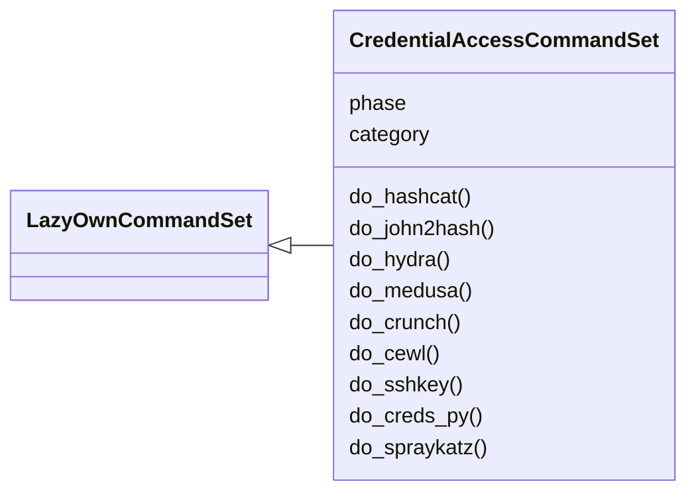
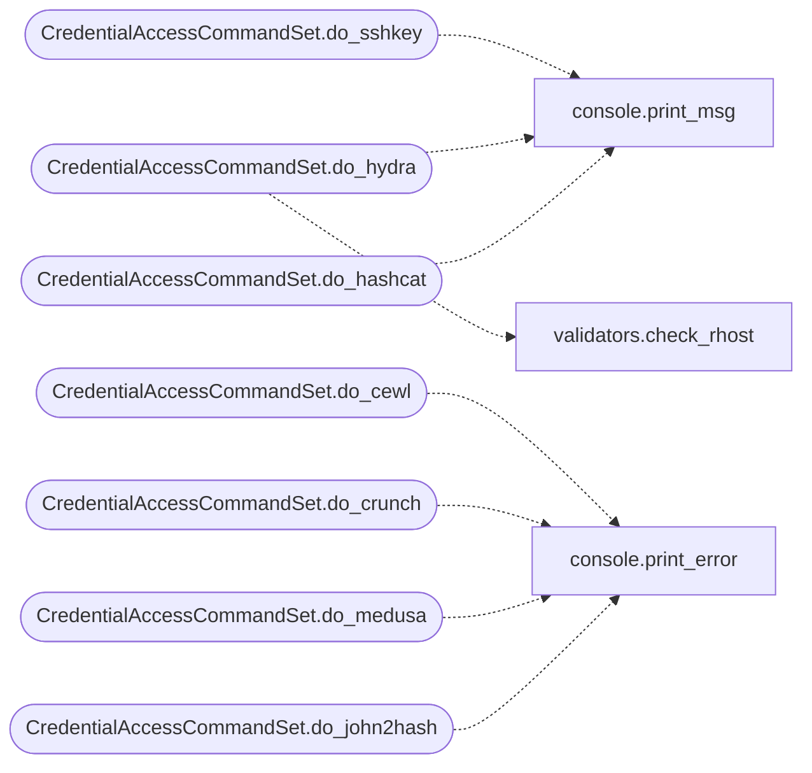

# `cli.commands.cred`

> Source: [cli/commands/cred.py:1](../../cli/commands/cred.py#L1) | language `py` | coverage 100.0% | [API index](../index.md)

Credential Access command set (pending).

Phase 07 — commands for credential access: password cracking,
hash manipulation, dictionary generation, and credential harvesting.

Pending status: inherits from [`PendingCommandSet`](cli.commands._dormancy.py.md#pendingcommandset). Promote to
[`LazyOwnCommandSet`](cli.commands._base.py.md#lazyowncommandset) once originals are deleted from ``lazyown.py``.

## Contents

- **Classes:** [`CredentialAccessCommandSet`](#credentialaccesscommandset)

## Type Diagram



## Call Graph

Solid arrows stay in this module, dashed arrows leave it.



## Classes

<a id="credentialaccesscommandset"></a>

### `CredentialAccessCommandSet`

`class` | [cli/commands/cred.py:23](../../cli/commands/cred.py#L23)

```python
class CredentialAccessCommandSet(LazyOwnCommandSet)
```

Bases: [`LazyOwnCommandSet`](cli.commands._base.py.md#lazyowncommandset)

Credential Access phase commands (pending).

**Attributes**

| Name | Type | Default | Description |
|---|---|---|---|
| [`phase`](#credentialaccesscommandset-phase) |  | `'cred'` |  |
| [`category`](#credentialaccesscommandset-category) |  | `'07. Credential Access'` |  |

**Members**

| Member | Kind | Summary |
|---|---|---|
| [`do_hashcat`](#credentialaccesscommandset-do_hashcat) | method | Run hashcat password cracking. |
| [`do_john2hash`](#credentialaccesscommandset-do_john2hash) | method | Convert a hash to John the Ripper format. |
| [`do_hydra`](#credentialaccesscommandset-do_hydra) | method | Run Hydra for online password attacks. |
| [`do_medusa`](#credentialaccesscommandset-do_medusa) | method | Run Medusa for online password attacks. |
| [`do_crunch`](#credentialaccesscommandset-do_crunch) | method | Generate wordlists with crunch. |
| [`do_cewl`](#credentialaccesscommandset-do_cewl) | method | Generate a wordlist from a website with cewl. |
| [`do_sshkey`](#credentialaccesscommandset-do_sshkey) | method | Generate an SSH key pair. |
| [`do_creds_py`](#credentialaccesscommandset-do_creds_py) | method | Extract credentials from a file or command output. |
| [`do_spraykatz`](#credentialaccesscommandset-do_spraykatz) | method | Run SprayKatz for credential spraying. |

<a id="credentialaccesscommandset-do_hashcat"></a>

#### `CredentialAccessCommandSet.do_hashcat`

`method` | [cli/commands/cred.py:30](../../cli/commands/cred.py#L30)

Decorators: `@cmd2.with_category(credential_access_category)`

```python
def do_hashcat(self, line)
```

Run hashcat password cracking.

**Parameters**

| Name | Type | Default | Description |
|---|---|---|---|
| `line` |  |  |  |

*Calls:* [`print_msg`](core.console.py.md#print_msg)

<a id="credentialaccesscommandset-do_john2hash"></a>

#### `CredentialAccessCommandSet.do_john2hash`

`method` | [cli/commands/cred.py:39](../../cli/commands/cred.py#L39)

Decorators: `@cmd2.with_category(credential_access_category)`

```python
def do_john2hash(self, line)
```

Convert a hash to John the Ripper format.

**Parameters**

| Name | Type | Default | Description |
|---|---|---|---|
| `line` |  |  |  |

*Calls:* [`print_error`](core.console.py.md#print_error)

<a id="credentialaccesscommandset-do_hydra"></a>

#### `CredentialAccessCommandSet.do_hydra`

`method` | [cli/commands/cred.py:47](../../cli/commands/cred.py#L47)

Decorators: `@cmd2.with_category(credential_access_category)`

```python
def do_hydra(self, line)
```

Run Hydra for online password attacks.

**Parameters**

| Name | Type | Default | Description |
|---|---|---|---|
| `line` |  |  |  |

*Calls:* [`print_msg`](core.console.py.md#print_msg), [`check_rhost`](core.validators.py.md#check_rhost)

<a id="credentialaccesscommandset-do_medusa"></a>

#### `CredentialAccessCommandSet.do_medusa`

`method` | [cli/commands/cred.py:59](../../cli/commands/cred.py#L59)

Decorators: `@cmd2.with_category(credential_access_category)`

```python
def do_medusa(self, line)
```

Run Medusa for online password attacks.

**Parameters**

| Name | Type | Default | Description |
|---|---|---|---|
| `line` |  |  |  |

*Calls:* [`print_error`](core.console.py.md#print_error)

<a id="credentialaccesscommandset-do_crunch"></a>

#### `CredentialAccessCommandSet.do_crunch`

`method` | [cli/commands/cred.py:67](../../cli/commands/cred.py#L67)

Decorators: `@cmd2.with_category(credential_access_category)`

```python
def do_crunch(self, line)
```

Generate wordlists with crunch.

**Parameters**

| Name | Type | Default | Description |
|---|---|---|---|
| `line` |  |  |  |

*Calls:* [`print_error`](core.console.py.md#print_error)

<a id="credentialaccesscommandset-do_cewl"></a>

#### `CredentialAccessCommandSet.do_cewl`

`method` | [cli/commands/cred.py:75](../../cli/commands/cred.py#L75)

Decorators: `@cmd2.with_category(credential_access_category)`

```python
def do_cewl(self, line)
```

Generate a wordlist from a website with cewl.

**Parameters**

| Name | Type | Default | Description |
|---|---|---|---|
| `line` |  |  |  |

*Calls:* [`print_error`](core.console.py.md#print_error)

<a id="credentialaccesscommandset-do_sshkey"></a>

#### `CredentialAccessCommandSet.do_sshkey`

`method` | [cli/commands/cred.py:87](../../cli/commands/cred.py#L87)

Decorators: `@cmd2.with_category(credential_access_category)`

```python
def do_sshkey(self, line)
```

Generate an SSH key pair.

**Parameters**

| Name | Type | Default | Description |
|---|---|---|---|
| `line` |  |  |  |

*Calls:* [`print_msg`](core.console.py.md#print_msg)

<a id="credentialaccesscommandset-do_creds_py"></a>

#### `CredentialAccessCommandSet.do_creds_py`

`method` | [cli/commands/cred.py:93](../../cli/commands/cred.py#L93)

Decorators: `@cmd2.with_category(credential_access_category)`

```python
def do_creds_py(self, line)
```

Extract credentials from a file or command output.

**Parameters**

| Name | Type | Default | Description |
|---|---|---|---|
| `line` |  |  |  |

<a id="credentialaccesscommandset-do_spraykatz"></a>

#### `CredentialAccessCommandSet.do_spraykatz`

`method` | [cli/commands/cred.py:98](../../cli/commands/cred.py#L98)

Decorators: `@cmd2.with_category(credential_access_category)`

```python
def do_spraykatz(self, line)
```

Run SprayKatz for credential spraying.

**Parameters**

| Name | Type | Default | Description |
|---|---|---|---|
| `line` |  |  |  |

---
