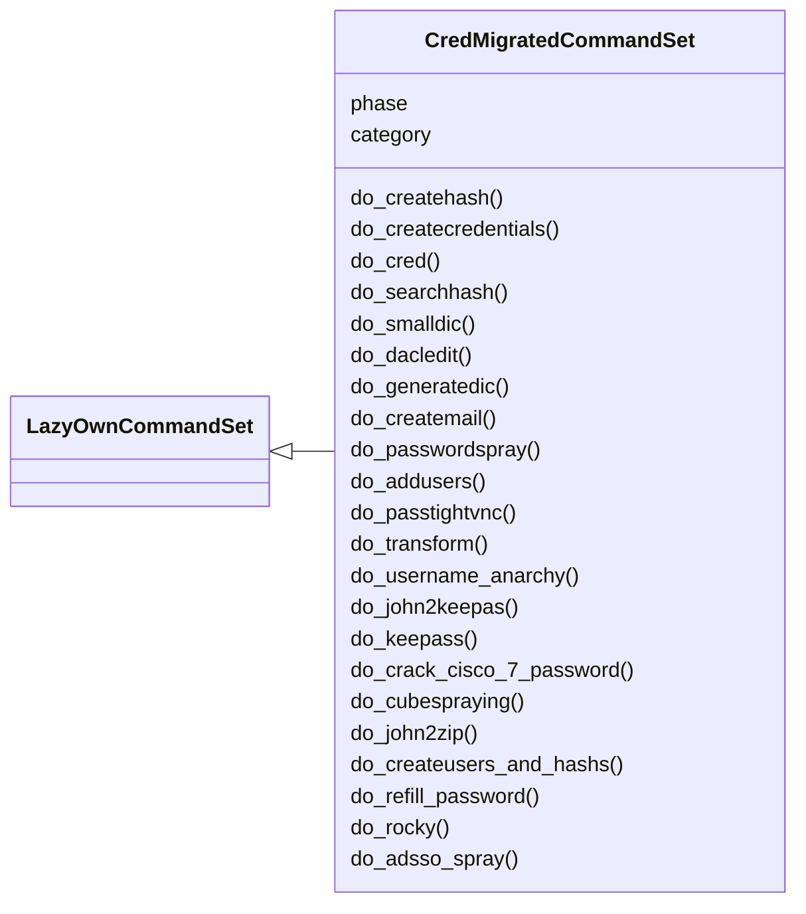
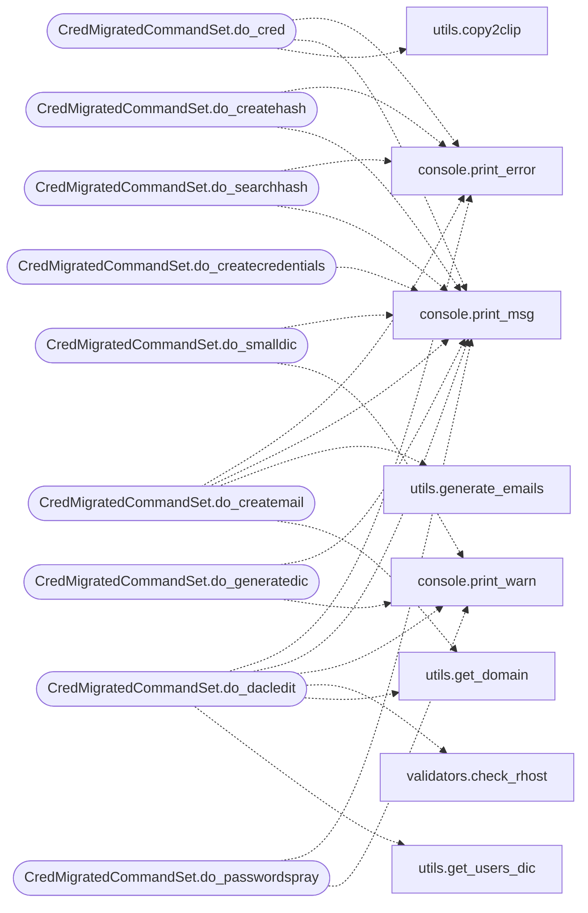

# `cli.commands.cred_migrated`

> Source: [cli/commands/cred_migrated.py:1](../../cli/commands/cred_migrated.py#L1) | language `py` | coverage 95.8% | [API index](../index.md)

cred commands migrated from lazyown.py.

Auto-generated by scripts/migrate_lazyown.py.

## Contents

- **Classes:** [`CredMigratedCommandSet`](#credmigratedcommandset)

## Type Diagram



## Call Graph

Solid arrows stay in this module, dashed arrows leave it.



## Classes

<a id="credmigratedcommandset"></a>

### `CredMigratedCommandSet`

`class` | [cli/commands/cred_migrated.py:30](../../cli/commands/cred_migrated.py#L30)

```python
class CredMigratedCommandSet(LazyOwnCommandSet)
```

Bases: [`LazyOwnCommandSet`](cli.commands._base.py.md#lazyowncommandset)

**Attributes**

| Name | Type | Default | Description |
|---|---|---|---|
| [`phase`](#credmigratedcommandset-phase) |  | `'cred'` |  |
| [`category`](#credmigratedcommandset-category) |  | `'07. Credential Access'` |  |

**Members**

| Member | Kind | Summary |
|---|---|---|
| [`do_createhash`](#credmigratedcommandset-do_createhash) | method | Creates a `hash.txt` file in the `sessions` directory with the specified hash value and analyzes it using `Name-the-hash`. |
| [`do_createcredentials`](#credmigratedcommandset-do_createcredentials) | method | Creates a `credentials.txt` file in the `sessions` directory with the specified username and password. |
| [`do_cred`](#credmigratedcommandset-do_cred) | method | Display the credentials stored in the `credentials.txt` file and copy the password to the clipboard. |
| [`do_searchhash`](#credmigratedcommandset-do_searchhash) | method | Helps to find hash types in Hashcat by searching through its help output. |
| [`do_smalldic`](#credmigratedcommandset-do_smalldic) | method | Handles the creation of temporary files for users and passwords based on a small dictionary. |
| [`do_dacledit`](#credmigratedcommandset-do_dacledit) | method | Execute the dacledit.py command for a specific user or all users listed in the users.txt file. |
| [`do_generatedic`](#credmigratedcommandset-do_generatedic) | method | Generates a wordlist based on a target name and a list of characters, with various combinations. |
| [`do_createmail`](#credmigratedcommandset-do_createmail) | method | Generate email permutations based on a full name and self.params['domain'], then save them to a file. |
| [`do_passwordspray`](#credmigratedcommandset-do_passwordspray) | method | Perform password spraying using crackmapexec with the provided parameters. |
| [`do_addusers`](#credmigratedcommandset-do_addusers) | method | Opens or creates the users.txt file in the sessions directory for editing using nano. |
| [`do_passtightvnc`](#credmigratedcommandset-do_passtightvnc) | method | Decrypts TightVNC passwords using Metasploit. |
| [`do_transform`](#credmigratedcommandset-do_transform) | method | Transforms the input string based on user-defined casing style. |
| [`do_username_anarchy`](#credmigratedcommandset-do_username_anarchy) | method | Generate usernames using the username-anarchy tool based on user input. |
| [`do_john2keepas`](#credmigratedcommandset-do_john2keepas) | method | List all .kdbx files in the 'sessions' directory, let the user select one, and run the command `sudo keepass2john {user_file} > sessions/hash.txt`. |
| [`do_keepass`](#credmigratedcommandset-do_keepass) | method | Open a .kdbx file and print the titles and contents of all entries. |
| [`do_crack_cisco_7_password`](#credmigratedcommandset-do_crack_cisco_7_password) | method | Crack a Cisco Type 7 password hash and display the plaintext. |
| [`do_cubespraying`](#credmigratedcommandset-do_cubespraying) | method | Command cubespraying: Automates the installation and usage of CubeSpraying for performing credential spraying attacks. |
| [`do_john2zip`](#credmigratedcommandset-do_john2zip) | method | List all .zip files in the 'sessions' directory, let the user select one, and run the command `zip2john {selected_file} > sessions/hash.txt`. |
| [`do_createusers_and_hashs`](#credmigratedcommandset-do_createusers_and_hashs) | method | Command createusers_and_hashs: Extracts usernames and hashes from a dump file. |
| [`do_refill_password`](#credmigratedcommandset-do_refill_password) | method | Generate a list of possible passwords by filling each asterisk in the input with user-specified characters. |
| [`do_rocky`](#credmigratedcommandset-do_rocky) | method | Reduces a wordlist based on the specified password length. |
| [`do_adsso_spray`](#credmigratedcommandset-do_adsso_spray) | method | Performs a password spray attack on Azure Active Directory Seamless Single Sign-On (SSO) using a specified list of users. |

<a id="credmigratedcommandset-do_createhash"></a>

#### `CredMigratedCommandSet.do_createhash`

`method` | [cli/commands/cred_migrated.py:62](../../cli/commands/cred_migrated.py#L62)

Decorators: `@cmd2.with_category('07. Credential Access')`

```python
def do_createhash(self, line)
```

Creates a `hash.txt` file in the `sessions` directory with the specified hash value and analyzes it using `Name-the-hash`.

This function performs the following actions:
1. Validates the input line to ensure it is not empty.
2. Backs up the existing `hash.txt` file if it exists, renaming it to `hash_{timestamp}.txt` based on the current timestamp.
3. Writes the provided hash value to `sessions/hash.txt`.
4. Analyzes the hash value using `Name-the-hash`.

Usage:
    createhash <hash>


Manual execution:
1. Creates or overwrites the file `sessions/hash.txt` with the specified hash value.
2. Analyzes the hash value using the `nth` command.

Dependencies:
- `sessions/hash.txt` will be created in the `sessions` directory.
- `Name-the-hash` must be installed and accessible via the command `nth`.

Example:
    createhash 5f4dcc3b5aa765d61d8327deb882cf99

Note:
    - Ensure the hash value is correct before running the analysis.
    - The hash value should be provided as a single argument without extra characters or spaces.

**Parameters**

| Name | Type | Default | Description |
|---|---|---|---|
| `line` | `str` |  | The hash value to be written to `hash.txt` and analyzed. |

**Returns:** None

*Calls:* [`print_error`](core.console.py.md#print_error), [`print_msg`](core.console.py.md#print_msg)

<a id="credmigratedcommandset-do_createcredentials"></a>

#### `CredMigratedCommandSet.do_createcredentials`

`method` | [cli/commands/cred_migrated.py:116](../../cli/commands/cred_migrated.py#L116)

Decorators: `@cmd2.with_category('07. Credential Access')`

```python
def do_createcredentials(self, line)
```

Creates a `credentials.txt` file in the `sessions` directory with the specified username and password.

This function performs the following actions:
1. Validates the input line to ensure it contains a colon (`:`), indicating the presence of both a username and password.
2. Backs up the existing `credentials.txt` file if it exists, renaming it to `credentials_{username}.txt` based on the existing username.
3. Writes the valid input to `sessions/credentials.txt`.

Usage:
    createcredentials user:password


Manual execution:
1. Creates or overwrites the file `sessions/credentials.txt` with the specified username and password.

Dependencies:
- `sessions/credentials.txt` will be created in the `sessions` directory.

Example:
    createcredentials administrator:passwordadministrator123&!

Note:
    - Ensure the input format is correct: `user:password`.
    - The credentials should be properly formatted with a colon separating the username and password.

**Parameters**

| Name | Type | Default | Description |
|---|---|---|---|
| `line` | `str` |  | The input line containing the username and password in the format `user:password`. |

**Returns:** None

*Calls:* [`print_msg`](core.console.py.md#print_msg)

<a id="credmigratedcommandset-do_cred"></a>

#### `CredMigratedCommandSet.do_cred`

`method` | [cli/commands/cred_migrated.py:164](../../cli/commands/cred_migrated.py#L164)

Decorators: `@cmd2.with_category('07. Credential Access')`

```python
def do_cred(self, line)
```

Display the credentials stored in the `credentials.txt` file and copy the password to the clipboard.

This function reads the stored credentials from a file named `credentials.txt` located in the `sessions` directory.
The file should be in the format `username:password`. If the file does not exist, an error message will be printed
instructing the user to create the credentials file first. The function extracts the username and password from the file,
prints them, and copies the password to the clipboard using `xclip`.


Manual execution:
To manually perform the equivalent actions, follow these steps:

    1. Ensure the file `sessions/credentials.txt` exists and contains credentials in the format `username:password`.
    2. Read the file and extract the username and password.
    3. Print the username and password to the console.
    4. Use the `xclip` tool to copy the password to the clipboard. Example command:

        echo '<password>' | xclip -sel clip

Example:
If `sessions/credentials.txt` contains `admin:password123`, the function will print:

    User : admin
    Pass : password123

The password `password123` will be copied to the clipboard.

Note:
Ensure `xclip` is installed on your system for copying to the clipboard. The function assumes that `xclip` is available
and correctly configured.

**Parameters**

| Name | Type | Default | Description |
|---|---|---|---|
| `line` |  |  | A string parameter that is not used in this function. It is included for compatibility with command-line interface functions. |

**Returns:** None

*Calls:* [`print_error`](core.console.py.md#print_error), [`print_msg`](core.console.py.md#print_msg), [`copy2clip`](utils.py.md#copy2clip)

<a id="credmigratedcommandset-do_searchhash"></a>

#### `CredMigratedCommandSet.do_searchhash`

`method` | [cli/commands/cred_migrated.py:217](../../cli/commands/cred_migrated.py#L217)

Decorators: `@cmd2.with_category('07. Credential Access')`

```python
def do_searchhash(self, line)
```

Helps to find hash types in Hashcat by searching through its help output.

1. Checks if an argument is provided:
- If no argument is given, displays an error message indicating the need to pass a hash type.

2. Executes a command to search for hash types:
- Runs `hashcat -h` to display Hashcat help information and pipes it to [`grep`](cli.cli_enhancements.py.md#transcriptstore-grep) to search for the provided argument.
- Prints a message with the command being executed and provides further instructions for running Hashcat.

3. Prints a message suggesting the next step:
- Provides a suggestion for running Hashcat with the found hash types.


Manual execution:
To manually run these tasks, you would need to:
- Run `hashcat -h` to display the help information.
- Use [`grep`](cli.cli_enhancements.py.md#transcriptstore-grep) to search for the specific hash type or keyword within the help output.
- Run Hashcat with the appropriate parameters based on the search results.

Note: Ensure that `hashcat` is installed and accessible in the system's PATH.

**Parameters**

| Name | Type | Default | Description |
|---|---|---|---|
| `line` | `str` |  | The hash type or keyword to search for in the Hashcat help output. |

**Returns:** None

*Calls:* [`print_error`](core.console.py.md#print_error), [`print_msg`](core.console.py.md#print_msg)

<a id="credmigratedcommandset-do_smalldic"></a>

#### `CredMigratedCommandSet.do_smalldic`

`method` | [cli/commands/cred_migrated.py:253](../../cli/commands/cred_migrated.py#L253)

Decorators: `@cmd2.with_category('07. Credential Access')`

```python
def do_smalldic(self, list)
```

Handles the creation of temporary files for users and passwords based on a small dictionary.

This function prompts the user to decide whether to use a small dictionary for generating
user and password lists. If the user agrees, it loads the credentials from a JSON file and
writes them into temporary files. If the user declines, the process is aborted.

list (str): Not used in this function, but kept for compatibility with cmd command input.

None

**Parameters**

| Name | Type | Default | Description |
|---|---|---|---|
| `list` |  |  |  |

*Calls:* [`print_msg`](core.console.py.md#print_msg), [`print_warn`](core.console.py.md#print_warn)

<a id="credmigratedcommandset-do_dacledit"></a>

#### `CredMigratedCommandSet.do_dacledit`

`method` | [cli/commands/cred_migrated.py:291](../../cli/commands/cred_migrated.py#L291)

Decorators: `@cmd2.with_category('07. Credential Access')`

```python
def do_dacledit(self, line)
```

Execute the dacledit.py command for a specific user or all users listed in the users.txt file.

This function interacts with the DACL editor to modify access control lists in an Active Directory environment.
It allows the user to select a specific user from the list or execute the command for all users.
Install impacket suit to get this script in the examples
Workflow:
    1. Extract parameters and assign up paths.
    2. Check the reachability of the remote host.
    3. Prompt the user for an OU if not provided.
    4. Check if the users.txt file exists and read the list of users.
    5. Display the list of users and prompt the user to select a specific user.
    6. Execute the dacledit.py command for the selected user or all users.

**Parameters**

| Name | Type | Default | Description |
|---|---|---|---|
| `line` | `str` |  | The organizational unit (OU) in the format 'OU=EXAMPLE,DC=DOMAIN,DC=EXT'. If not provided, the user is prompted to enter it. |

**Returns:** None

**Raises**

- `FileNotFoundError`: If the users.txt file does not exist.

**Example**

```python
To execute the command for a specific user:
>>> do_dacledit("MARKETING DIGITAL")

To execute the command for all users:
>>> do_dacledit("")
```

*Calls:* [`print_error`](core.console.py.md#print_error), [`print_msg`](core.console.py.md#print_msg), [`print_warn`](core.console.py.md#print_warn), [`check_rhost`](core.validators.py.md#check_rhost), [`get_domain`](utils.py.md#get_domain), [`get_users_dic`](utils.py.md#get_users_dic)

<a id="credmigratedcommandset-do_generatedic"></a>

#### `CredMigratedCommandSet.do_generatedic`

`method` | [cli/commands/cred_migrated.py:361](../../cli/commands/cred_migrated.py#L361)

Decorators: `@cmd2.with_category('07. Credential Access')`

```python
def do_generatedic(self, line)
```

Generates a wordlist based on a target name and a list of characters, with various combinations.

This function prompts the user for a target name and a wordlist name, then generates various combinations
of the target name with a given list of characters. The combinations include single, double, triple, fourth,
fifth, sixth, and intercalated character variations. The generated passwords are saved to the specified
wordlist file.


Manual execution:
To manually generate a wordlist, run the script and follow the prompts to enter the target name,
wordlist name, and additional characters if desired.

For example:
    Enter target name(Ex. john) ::: john
    Enter wordlist name ::: my_wordlist.txt
    Char List ::: 1 2 3 4 5 6 7 8 9 0 ! @ # $
    Do you want to add more characters in char List[y/n] ::: y
    Enter characters by commas(Ex. : ^,&,*,) ::: ^,&,*

**Parameters**

| Name | Type | Default | Description |
|---|---|---|---|
| `line` |  |  | Not used in this function. |

**Returns:** None

*Calls:* [`print_msg`](core.console.py.md#print_msg), [`print_warn`](core.console.py.md#print_warn)

<a id="credmigratedcommandset-do_createmail"></a>

#### `CredMigratedCommandSet.do_createmail`

`method` | [cli/commands/cred_migrated.py:626](../../cli/commands/cred_migrated.py#L626)

Decorators: `@cmd2.with_category('07. Credential Access')`

```python
def do_createmail(self, line)
```

Generate email permutations based on a full name and self.params['domain'], then save them to a file.

This function prompts the user for a full name and self.params['domain'], generates various email
permutations based on that information, and saves the results in a text file located
in the `sessions` directory.

line (str): used as Fullname.

Internal Variables:
full_name (str): The full name entered by the user, defaulting to 'John Doe'.
self.params['domain'] (str): The self.params['domain'] entered by the user, defaulting to 'example.com'.

None

Example Usage:
- To generate emails using default values: `createmail`
- To specify a full name and self.params['domain']: `createmail`

- The generated emails will be stored in a file named `emails_{full_name}_{self.params['domain']}.txt`
  within the `sessions` directory.

**Parameters**

| Name | Type | Default | Description |
|---|---|---|---|
| `line` |  |  |  |

*Calls:* [`print_error`](core.console.py.md#print_error), [`print_msg`](core.console.py.md#print_msg), [`generate_emails`](utils.py.md#generate_emails), [`get_domain`](utils.py.md#get_domain)

<a id="credmigratedcommandset-do_passwordspray"></a>

#### `CredMigratedCommandSet.do_passwordspray`

`method` | [cli/commands/cred_migrated.py:674](../../cli/commands/cred_migrated.py#L674)

Decorators: `@cmd2.with_category('07. Credential Access')`

```python
def do_passwordspray(self, line)
```

Perform password spraying using crackmapexec with the provided parameters.

Manual execution:
To manually run `crackmapexec` for password spraying, use the following command:

    crackmapexec smb <IP Address> -u <users_file> -p <password> --continue-on-success

This function prompts the user for IP address, user file, and password.

**Parameters**

| Name | Type | Default | Description |
|---|---|---|---|
| `line` |  |  | This parameter is not used in the function but can be reserved for future use. |

**Returns:** None

*Calls:* [`print_msg`](core.console.py.md#print_msg), [`print_warn`](core.console.py.md#print_warn), [`is_binary_present`](core.process.py.md#is_binary_present)

<a id="credmigratedcommandset-do_addusers"></a>

#### `CredMigratedCommandSet.do_addusers`

`method` | [cli/commands/cred_migrated.py:706](../../cli/commands/cred_migrated.py#L706)

Decorators: `@cmd2.with_category('07. Credential Access')`

```python
def do_addusers(self, line)
```

Opens or creates the users.txt file in the sessions directory for editing using nano.

**Parameters**

| Name | Type | Default | Description |
|---|---|---|---|
| `line` |  |  | Not used directly but reserved for future use. |

**Returns:** None

*Calls:* [`print_msg`](core.console.py.md#print_msg), [`print_warn`](core.console.py.md#print_warn)

<a id="credmigratedcommandset-do_passtightvnc"></a>

#### `CredMigratedCommandSet.do_passtightvnc`

`method` | [cli/commands/cred_migrated.py:728](../../cli/commands/cred_migrated.py#L728)

Decorators: `@cmd2.with_category('07. Credential Access')`

```python
def do_passtightvnc(self, line)
```

Decrypts TightVNC passwords using Metasploit.

This function demonstrates how TightVNC passwords can be decrypted using the known hardcoded DES key
from the program and Metasploit's `Rex::Proto::RFB::Cipher.decrypt` function.

Steps:
- Receives the password in hexadecimal format from the command line input.
- Creates a Metasploit resource script that includes commands to decrypt the TightVNC password.
- Executes Metasploit with the created resource script and then deletes the temporary file.
- Prints the decrypted password.


Manual execution:
To manually decrypt a TightVNC password, you would need to:
- Use Metasploit's `Rex::Proto::RFB::Cipher.decrypt` function with the hardcoded DES key and the hexadecimal password.

Example:
passtightvnc D7A514D8C556AADE

**Parameters**

| Name | Type | Default | Description |
|---|---|---|---|
| `line` | `str` |  | The TightVNC password in hexadecimal format. |

**Returns:** None

*Calls:* [`print_error`](core.console.py.md#print_error), [`print_msg`](core.console.py.md#print_msg), [`print_warn`](core.console.py.md#print_warn), [`copy2clip`](utils.py.md#copy2clip)

<a id="credmigratedcommandset-do_transform"></a>

#### `CredMigratedCommandSet.do_transform`

`method` | [cli/commands/cred_migrated.py:775](../../cli/commands/cred_migrated.py#L775)

Decorators: `@cmd2.with_category('07. Credential Access')`

```python
def do_transform(self, line)
```

Transforms the input string based on user-defined casing style.

This command asks the user for a casing style (e.g., lower, upper, camel, pascal)
and transforms the input string accordingly.

**Parameters**

| Name | Type | Default | Description |
|---|---|---|---|
| `line` | `str` |  | Input string to be transformed. |

*Calls:* [`print_error`](core.console.py.md#print_error), [`print_msg`](core.console.py.md#print_msg), [`print_warn`](core.console.py.md#print_warn), [`copy2clip`](utils.py.md#copy2clip), [`detect_delimiter`](utils.py.md#detect_delimiter), [`handle`](utils.py.md#handle), [`transform`](utils.py.md#transform)

<a id="credmigratedcommandset-do_username_anarchy"></a>

#### `CredMigratedCommandSet.do_username_anarchy`

`method` | [cli/commands/cred_migrated.py:803](../../cli/commands/cred_migrated.py#L803)

Decorators: `@cmd2.with_category('07. Credential Access')`

```python
def do_username_anarchy(self, line)
```

Generate usernames using the username-anarchy tool based on user input.

This function prompts the user to either provide names directly or select
options such as auto-generation based on country datasets, input files, and
specific username formats. It then constructs the command for `username-anarchy`
and executes it.

**Parameters**

| Name | Type | Default | Description |
|---|---|---|---|
| `line` |  |  | is optional you can pass the name and lastname as an argument example: username_anarchy firstname lastname |

**Returns:** None

*Calls:* [`print_error`](core.console.py.md#print_error), [`print_msg`](core.console.py.md#print_msg), [`print_warn`](core.console.py.md#print_warn), [`get_users_dic`](utils.py.md#get_users_dic), [`is_exist`](utils.py.md#is_exist)

<a id="credmigratedcommandset-do_john2keepas"></a>

#### `CredMigratedCommandSet.do_john2keepas`

`method` | [cli/commands/cred_migrated.py:904](../../cli/commands/cred_migrated.py#L904)

Decorators: `@cmd2.with_category('07. Credential Access')`

```python
def do_john2keepas(self, line)
```

List all .kdbx files in the 'sessions' directory, let the user select one, and run the command `sudo keepass2john {user_file} > sessions/hash.txt`.

If 'sessions/hash.txt' already exists, it will be backed up with a timestamp to avoid overwriting.

line (str): An optional string parameter. This can be used for any additional input,
            though it's not needed in this specific command.

None

**Parameters**

| Name | Type | Default | Description |
|---|---|---|---|
| `line` |  |  |  |

*Calls:* [`print_error`](core.console.py.md#print_error), [`print_msg`](core.console.py.md#print_msg), [`print_warn`](core.console.py.md#print_warn)

<a id="credmigratedcommandset-do_keepass"></a>

#### `CredMigratedCommandSet.do_keepass`

`method` | [cli/commands/cred_migrated.py:953](../../cli/commands/cred_migrated.py#L953)

Decorators: `@cmd2.with_category('07. Credential Access')`

```python
def do_keepass(self, line)
```

Open a .kdbx file and print the titles and contents of all entries.

The password can be provided through the 'line' parameter, via user input, or from a 'credentials.txt' file in the 'sessions' directory.

If the file 'credentials.txt' exists in the 'sessions' directory, the first password from it
will be used automatically.

line (str): An optional string parameter to pass the password. If not provided, the user will
            be prompted to input the password.

None

**Parameters**

| Name | Type | Default | Description |
|---|---|---|---|
| `line` |  |  |  |

*Calls:* [`print_error`](core.console.py.md#print_error), [`print_msg`](core.console.py.md#print_msg), [`get_credentials`](utils.py.md#get_credentials)

<a id="credmigratedcommandset-do_crack_cisco_7_password"></a>

#### `CredMigratedCommandSet.do_crack_cisco_7_password`

`method` | [cli/commands/cred_migrated.py:1017](../../cli/commands/cred_migrated.py#L1017)

Decorators: `@cmd2.with_category('07. Credential Access')`

```python
def do_crack_cisco_7_password(self, line)
```

Crack a Cisco Type 7 password hash and display the plaintext.

This command takes an encrypted Cisco Type 7 password hash as input,
processes it to recover the original plaintext password, and prints the
result to the console.

**Parameters**

| Name | Type | Default | Description |
|---|---|---|---|
| `line` | `str` |  | The encrypted password hash in Cisco Type 7 format. |

**Returns:** `None` - The function prints the plaintext password directly to the console.

*Calls:* [`print_msg`](core.console.py.md#print_msg), [`print_warn`](core.console.py.md#print_warn), [`crack_password`](utils.py.md#crack_password)

<a id="credmigratedcommandset-do_cubespraying"></a>

#### `CredMigratedCommandSet.do_cubespraying`

`method` | [cli/commands/cred_migrated.py:1039](../../cli/commands/cred_migrated.py#L1039)

Decorators: `@cmd2.with_category('07. Credential Access')`

```python
def do_cubespraying(self, line)
```

Command cubespraying: Automates the installation and usage of CubeSpraying for performing credential spraying attacks.

This function performs the following tasks:
1. Clones and installs CubeSpraying if not already installed.
2. Prompts the user for the target URL, username file, password file, and optional parameters like verbosity and timeout.
3. Executes CubeSpraying for credential spraying attacks against the target URL.

**Parameters**

| Name | Type | Default | Description |
|---|---|---|---|
| `line` | `str` |  | Optional argument for specifying the target URL, username file, password file, and additional CubeSpraying options. |

**Returns:** None

**Example**

```python
cubespraying --url http://example.com --usernames users.txt --passwords passwords.txt --verbose --timeout 5
```

*Calls:* [`print_msg`](core.console.py.md#print_msg), [`print_warn`](core.console.py.md#print_warn), [`get_users_dic`](utils.py.md#get_users_dic)

<a id="credmigratedcommandset-do_john2zip"></a>

#### `CredMigratedCommandSet.do_john2zip`

`method` | [cli/commands/cred_migrated.py:1101](../../cli/commands/cred_migrated.py#L1101)

Decorators: `@cmd2.with_category('07. Credential Access')`

```python
def do_john2zip(self, line)
```

List all .zip files in the 'sessions' directory, let the user select one, and run the command `zip2john {selected_file} > sessions/hash.txt`.

Then, run John the Ripper to crack the hash using the RockYou wordlist with multiple forks.

line (str): An optional string parameter. This can be used for any additional input, though
            it's not needed in this specific command.

None

**Parameters**

| Name | Type | Default | Description |
|---|---|---|---|
| `line` |  |  |  |

*Calls:* [`print_error`](core.console.py.md#print_error), [`print_msg`](core.console.py.md#print_msg), [`print_warn`](core.console.py.md#print_warn), [`rockyou_wordlist`](core.defaults.py.md#rockyou_wordlist), [`is_binary_present`](core.process.py.md#is_binary_present), [`get_users_dic`](utils.py.md#get_users_dic)

<a id="credmigratedcommandset-do_createusers_and_hashs"></a>

#### `CredMigratedCommandSet.do_createusers_and_hashs`

`method` | [cli/commands/cred_migrated.py:1162](../../cli/commands/cred_migrated.py#L1162)

Decorators: `@cmd2.with_category('07. Credential Access')`

```python
def do_createusers_and_hashs(self, line)
```

Command createusers_and_hashs: Extracts usernames and hashes from a dump file.

This function opens a nano editor for the user to input the contents of a
file in the format:

    username:UID:LM_HASH:NT_HASH:::

Once the data is entered and saved, the function generates:
1. A file named `usernames_{self.params['rhost']}.txt` containing all usernames.
2. Individual files named `hash_{username}.txt` for each user, containing
the user's LM and NT hash in the format `LM_HASH:NT_HASH`.

**Parameters**

| Name | Type | Default | Description |
|---|---|---|---|
| `line` | `str` |  | Unused parameter, kept for consistency. |

**Returns:** None

*Calls:* [`print_msg`](core.console.py.md#print_msg), [`get_domain`](utils.py.md#get_domain)

<a id="credmigratedcommandset-do_refill_password"></a>

#### `CredMigratedCommandSet.do_refill_password`

`method` | [cli/commands/cred_migrated.py:1205](../../cli/commands/cred_migrated.py#L1205)

Decorators: `@cmd2.with_category('07. Credential Access')`

```python
def do_refill_password(self, line)
```

Generate a list of possible passwords by filling each asterisk in the input with user-specified characters.

Process:
Prompts the user to enter characters to replace each asterisk, creates all possible combinations,
and saves them to 'sessions/passwords_refilled.txt'. If this file exists, the previous version is
renamed with a timestamp suffix.

**Parameters**

| Name | Type | Default | Description |
|---|---|---|---|
| `line` |  |  | A string containing asterisks (e.g., WebAO***7) for generating variations. |

**Returns:** None

*Calls:* [`print_msg`](core.console.py.md#print_msg)

<a id="credmigratedcommandset-do_rocky"></a>

#### `CredMigratedCommandSet.do_rocky`

`method` | [cli/commands/cred_migrated.py:1241](../../cli/commands/cred_migrated.py#L1241)

Decorators: `@cmd2.with_category('07. Credential Access')`

```python
def do_rocky(self, line)
```

Reduces a wordlist based on the specified password length.

This function filters the provided wordlist to only include passwords
that match the specified length. If no length is provided, it defaults
to 4. The function constructs a grep command to achieve this and executes
it.

Usage:
    do_rocky(line: str)


Example:
    do_rocky('8')
    # Executes: grep '^.\{8\}$' /usr/share/wordlists/rockyou.txt > sessions/lazypass_mini_rocky.txt

**Parameters**

| Name | Type | Default | Description |
|---|---|---|---|
| `line` | `str` |  | The length of the passwords to filter in the wordlist. This parameter should be a string representing a positive integer. If not provided, the function prompts the user for input. |

**Raises**

- `ValueError`: If the provided length is not a valid positive integer.

*Calls:* [`print_error`](core.console.py.md#print_error), [`print_msg`](core.console.py.md#print_msg)

<a id="credmigratedcommandset-do_adsso_spray"></a>

#### `CredMigratedCommandSet.do_adsso_spray`

`method` | [cli/commands/cred_migrated.py:1277](../../cli/commands/cred_migrated.py#L1277)

Decorators: `@cmd2.with_category('07. Credential Access')`

```python
def do_adsso_spray(self, line)
```

Performs a password spray attack on Azure Active Directory Seamless Single Sign-On (SSO) using a specified list of users.

This function automates the process of spraying a given password across multiple user accounts in a target self.params['domain']. It utilizes
a user list in the form of a text file, targeting Azure AD Seamless SSO endpoints. The results are processed and saved to
a specified output file, providing insights into which accounts were successful or failed during the attack.

Requirements:
    - A valid self.params['domain'] and URL for the target Azure AD instance. (assing url https://url.com)
    - A user dictionary file containing usernames (without the self.params['domain']) to be sprayed.

Behavior:
    - Loads the self.params['domain'] and URL from the configuration stored in `self.params`.
    - Reads the user list from a file specified in [`get_users_dic`](utils.py.md#get_users_dic).
    - Sprays the specified password to all users and processes the results.
    - Saves the successful and failed attempts to the output file.

**Parameters**

| Name | Type | Default | Description |
|---|---|---|---|
| `line` | `str` |  | Command-line input passed to the function (not currently used in the function). |

**Example**

```python
- Perform a password spray attack with the password "admin" and save the results:
    >>> adsso_spray
- Customize the password or user list by modifying `self.params` before invoking the function.
```

*Calls:* [`ProcessResults`](utils.py.md#processresults), [`Spray`](utils.py.md#spray), [`get_users_dic`](utils.py.md#get_users_dic)

---
