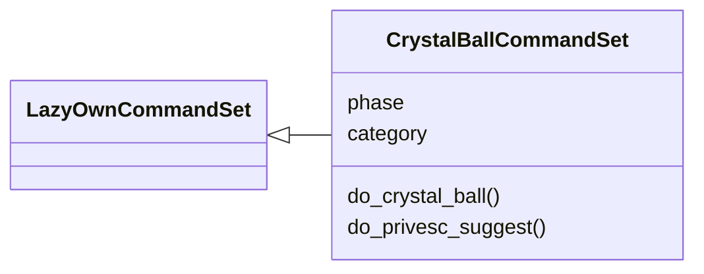
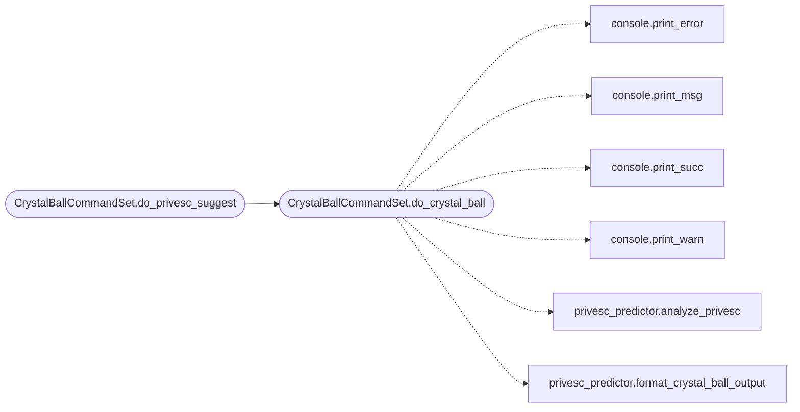

# `cli.commands.crystal_ball`

> Source: [cli/commands/crystal_ball.py:1](../../cli/commands/crystal_ball.py#L1) | language `py` | coverage 100.0% | [API index](../index.md)

Crystal Ball CLI command set — privilege escalation vector prediction.

Parses linpeas/winpeas output and suggests ranked privesc vectors
with exact commands, CVE references, and MITRE ATT&CK mapping.

## Contents

- **Classes:** [`CrystalBallCommandSet`](#crystalballcommandset)

## Type Diagram



## Call Graph

Solid arrows stay in this module, dashed arrows leave it.



## Classes

<a id="crystalballcommandset"></a>

### `CrystalBallCommandSet`

`class` | [cli/commands/crystal_ball.py:20](../../cli/commands/crystal_ball.py#L20)

```python
class CrystalBallCommandSet(LazyOwnCommandSet)
```

Bases: [`LazyOwnCommandSet`](cli.commands._base.py.md#lazyowncommandset)

Crystal Ball — privesc vector prediction and ranking.

**Attributes**

| Name | Type | Default | Description |
|---|---|---|---|
| [`phase`](#crystalballcommandset-phase) |  | `'privesc'` |  |
| [`category`](#crystalballcommandset-category) |  | `'06. Privilege Escalation'` |  |

**Members**

| Member | Kind | Summary |
|---|---|---|
| [`do_crystal_ball`](#crystalballcommandset-do_crystal_ball) | method | Analyze linpeas/winpeas output and rank privesc vectors with exact commands. |
| [`do_privesc_suggest`](#crystalballcommandset-do_privesc_suggest) | method | Quick alias for crystal_ball --auto. |

<a id="crystalballcommandset-do_crystal_ball"></a>

#### `CrystalBallCommandSet.do_crystal_ball`

`method` | [cli/commands/crystal_ball.py:27](../../cli/commands/crystal_ball.py#L27)

Decorators: `@cmd2.with_category('06. Privilege Escalation')`

```python
def do_crystal_ball(self, line)
```

Analyze linpeas/winpeas output and rank privesc vectors with exact commands.

Usage:
    crystal_ball <file>               Analyse enumeration output file
    crystal_ball --text "<output>"     Analyse raw text from clipboard
    crystal_ball --auto                Auto-detect linpeas/winpeas in sessions/

Matches kernel CVEs, SUID binaries (GTFOBins), capabilities, sudo rules,
group memberships (docker/lxd), and cron jobs. When an LLM backend is
configured, additional context-aware vectors are suggested.

**Parameters**

| Name | Type | Default | Description |
|---|---|---|---|
| `line` |  |  |  |

**Example**

```python
crystal_ball sessions/linpeas_10.0.2.15.txt
crystal_ball --auto
```

*Calls:* [`print_error`](core.console.py.md#print_error), [`print_msg`](core.console.py.md#print_msg), [`print_succ`](core.console.py.md#print_succ), [`print_warn`](core.console.py.md#print_warn), [`analyze_privesc`](modules.privesc_predictor.py.md#analyze_privesc), [`format_crystal_ball_output`](modules.privesc_predictor.py.md#format_crystal_ball_output)

*Called by:* [`CrystalBallCommandSet.do_privesc_suggest`](#crystalballcommandset-do_privesc_suggest)

<a id="crystalballcommandset-do_privesc_suggest"></a>

#### `CrystalBallCommandSet.do_privesc_suggest`

`method` | [cli/commands/crystal_ball.py:110](../../cli/commands/crystal_ball.py#L110)

Decorators: `@cmd2.with_category('06. Privilege Escalation')`

```python
def do_privesc_suggest(self, line)
```

Quick alias for crystal_ball --auto.

Usage:
    privesc_suggest

**Parameters**

| Name | Type | Default | Description |
|---|---|---|---|
| `line` |  |  |  |

*Calls:* [`CrystalBallCommandSet.do_crystal_ball`](#crystalballcommandset-do_crystal_ball)

---
