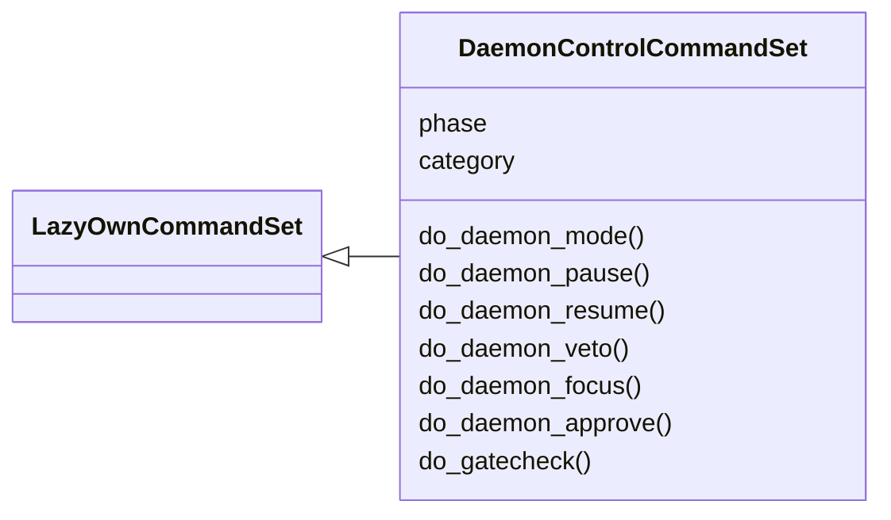
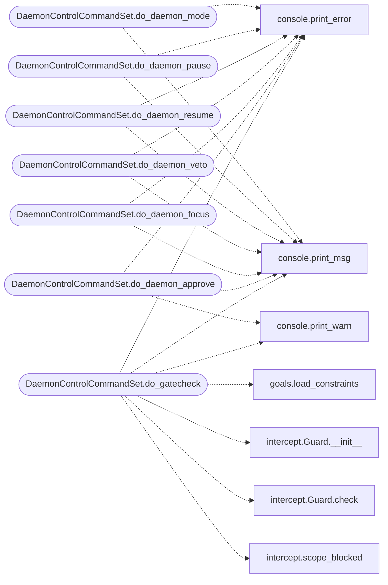

# `cli.commands.daemon_ctl`

> Source: [cli/commands/daemon_ctl.py:1](../../cli/commands/daemon_ctl.py#L1) | language `py` | coverage 100.0% | [API index](../index.md)

Autonomous daemon control extracted from the miscellaneous cluster.

Pending status: originals deleted from ``cli/commands/misc_migrated.py``;
this set is registered by `[`cli.registry`](cli.registry.py.md)`.

## Contents

- **Classes:** [`DaemonControlCommandSet`](#daemoncontrolcommandset)

## Type Diagram



## Call Graph

Solid arrows stay in this module, dashed arrows leave it.



## Classes

<a id="daemoncontrolcommandset"></a>

### `DaemonControlCommandSet`

`class` | [cli/commands/daemon_ctl.py:17](../../cli/commands/daemon_ctl.py#L17)

```python
class DaemonControlCommandSet(LazyOwnCommandSet)
```

Bases: [`LazyOwnCommandSet`](cli.commands._base.py.md#lazyowncommandset)

Autonomous daemon control commands.

**Attributes**

| Name | Type | Default | Description |
|---|---|---|---|
| [`phase`](#daemoncontrolcommandset-phase) |  | `'misc'` |  |
| [`category`](#daemoncontrolcommandset-category) |  | `'12. Miscellaneous'` |  |

**Members**

| Member | Kind | Summary |
|---|---|---|
| [`do_daemon_mode`](#daemoncontrolcommandset-do_daemon_mode) | method | Switch the autonomous daemon between auto, approval and paused modes. |
| [`do_daemon_pause`](#daemoncontrolcommandset-do_daemon_pause) | method | Pause the autonomous daemon before its next step. |
| [`do_daemon_resume`](#daemoncontrolcommandset-do_daemon_resume) | method | Resume the autonomous daemon (switch mode to auto). |
| [`do_daemon_veto`](#daemoncontrolcommandset-do_daemon_veto) | method | Add or clear vetoed command first-tokens for the autonomous daemon. |
| [`do_daemon_focus`](#daemoncontrolcommandset-do_daemon_focus) | method | Restrict the autonomous daemon to a set of focus targets. |
| [`do_daemon_approve`](#daemoncontrolcommandset-do_daemon_approve) | method | Approve or veto the daemon's currently-pending action. |
| [`do_gatecheck`](#daemoncontrolcommandset-do_gatecheck) | method | Dry-run the safety gate against one command line. |

<a id="daemoncontrolcommandset-do_daemon_mode"></a>

#### `DaemonControlCommandSet.do_daemon_mode`

`method` | [cli/commands/daemon_ctl.py:24](../../cli/commands/daemon_ctl.py#L24)

Decorators: `@cmd2.with_category('12. Miscellaneous')`

```python
def do_daemon_mode(self, line)
```

Switch the autonomous daemon between auto, approval and paused modes.

Usage:
    daemon_mode auto       Run without operator gating (default).
    daemon_mode approval   Require operator approval per command.
    daemon_mode paused     Block the loop before the next step.

The selected mode is persisted to
``sessions/daemon_control.json`` and read by the daemon before
every step. No daemon restart is required.

**Parameters**

| Name | Type | Default | Description |
|---|---|---|---|
| `line` |  |  | Whitespace-stripped mode name. |

**Returns:** None.

*Calls:* [`print_error`](core.console.py.md#print_error), [`print_msg`](core.console.py.md#print_msg)

<a id="daemoncontrolcommandset-do_daemon_pause"></a>

#### `DaemonControlCommandSet.do_daemon_pause`

`method` | [cli/commands/daemon_ctl.py:63](../../cli/commands/daemon_ctl.py#L63)

Decorators: `@cmd2.with_category('12. Miscellaneous')`

```python
def do_daemon_pause(self, line)
```

Pause the autonomous daemon before its next step.

Equivalent to ``daemon_mode paused``. The daemon polls the
control file between steps and resumes once the mode flips back
to auto or approval.

**Parameters**

| Name | Type | Default | Description |
|---|---|---|---|
| `line` |  |  | Ignored. |

*Calls:* [`print_error`](core.console.py.md#print_error), [`print_msg`](core.console.py.md#print_msg)

<a id="daemoncontrolcommandset-do_daemon_resume"></a>

#### `DaemonControlCommandSet.do_daemon_resume`

`method` | [cli/commands/daemon_ctl.py:82](../../cli/commands/daemon_ctl.py#L82)

Decorators: `@cmd2.with_category('12. Miscellaneous')`

```python
def do_daemon_resume(self, line)
```

Resume the autonomous daemon (switch mode to auto).

**Parameters**

| Name | Type | Default | Description |
|---|---|---|---|
| `line` |  |  | Ignored. |

*Calls:* [`print_error`](core.console.py.md#print_error), [`print_msg`](core.console.py.md#print_msg)

<a id="daemoncontrolcommandset-do_daemon_veto"></a>

#### `DaemonControlCommandSet.do_daemon_veto`

`method` | [cli/commands/daemon_ctl.py:97](../../cli/commands/daemon_ctl.py#L97)

Decorators: `@cmd2.with_category('12. Miscellaneous')`

```python
def do_daemon_veto(self, line)
```

Add or clear vetoed command first-tokens for the autonomous daemon.

Usage:
    daemon_veto add <command>       Block <command> on future steps.
    daemon_veto remove <command>    Remove a previously-blocked command.
    daemon_veto clear               Drop every veto entry.
    daemon_veto                     List the current vetoes.

**Parameters**

| Name | Type | Default | Description |
|---|---|---|---|
| `line` |  |  | Sub-command plus optional command token. |

*Calls:* [`print_error`](core.console.py.md#print_error), [`print_msg`](core.console.py.md#print_msg)

<a id="daemoncontrolcommandset-do_daemon_focus"></a>

#### `DaemonControlCommandSet.do_daemon_focus`

`method` | [cli/commands/daemon_ctl.py:141](../../cli/commands/daemon_ctl.py#L141)

Decorators: `@cmd2.with_category('12. Miscellaneous')`

```python
def do_daemon_focus(self, line)
```

Restrict the autonomous daemon to a set of focus targets.

Usage:
    daemon_focus <ip_or_host> [<ip_or_host> ...]
    daemon_focus clear         Drop the focus list (run anywhere).
    daemon_focus               Print the current focus targets.

**Parameters**

| Name | Type | Default | Description |
|---|---|---|---|
| `line` |  |  | Whitespace-separated list of targets or sub-command. |

*Calls:* [`print_error`](core.console.py.md#print_error), [`print_msg`](core.console.py.md#print_msg)

<a id="daemoncontrolcommandset-do_daemon_approve"></a>

#### `DaemonControlCommandSet.do_daemon_approve`

`method` | [cli/commands/daemon_ctl.py:175](../../cli/commands/daemon_ctl.py#L175)

Decorators: `@cmd2.with_category('12. Miscellaneous')`

```python
def do_daemon_approve(self, line)
```

Approve or veto the daemon's currently-pending action.

Usage:
    daemon_approve                   Approve the active pending action.
    daemon_approve veto              Veto the active pending action.
    daemon_approve show              Print the pending action (no decision).

The active action lives in ``sessions/daemon_control.json``
under ``pending`` and is created by the daemon when running in
approval mode.

**Parameters**

| Name | Type | Default | Description |
|---|---|---|---|
| `line` |  |  | Optional sub-command. |

*Calls:* [`print_error`](core.console.py.md#print_error), [`print_msg`](core.console.py.md#print_msg), [`print_warn`](core.console.py.md#print_warn)

<a id="daemoncontrolcommandset-do_gatecheck"></a>

#### `DaemonControlCommandSet.do_gatecheck`

`method` | [cli/commands/daemon_ctl.py:224](../../cli/commands/daemon_ctl.py#L224)

Decorators: `@cmd2.with_category('12. Miscellaneous')`

```python
def do_gatecheck(self, line)
```

Dry-run the safety gate against one command line.

Usage:
    gatecheck lazynmap 127.0.0.1
    gatecheck "rm -rf /"
    gatecheck mimikatz sekurlsa::logonpasswords

Runs the exact pre-execution chain the autonomous loops use —
payload constraints (deny wins), the global scope deny list,
then the intercept guard rules — and prints the verdict plus
what the loop would do with it. Nothing is executed.

**Parameters**

| Name | Type | Default | Description |
|---|---|---|---|
| `line` |  |  | Command line to evaluate. |

**Returns:** None.

*Calls:* [`print_error`](core.console.py.md#print_error), [`print_msg`](core.console.py.md#print_msg), [`print_warn`](core.console.py.md#print_warn), [`load_constraints`](modules.goals.py.md#load_constraints), [`Guard.__init__`](modules.intercept.py.md#guard-__init__), [`Guard.check`](modules.intercept.py.md#guard-check), [`scope_blocked`](modules.intercept.py.md#scope_blocked)

---
