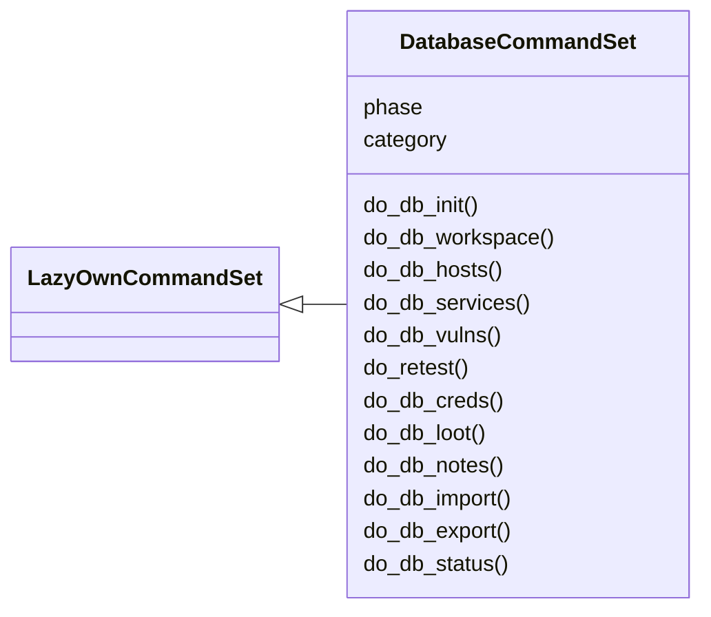
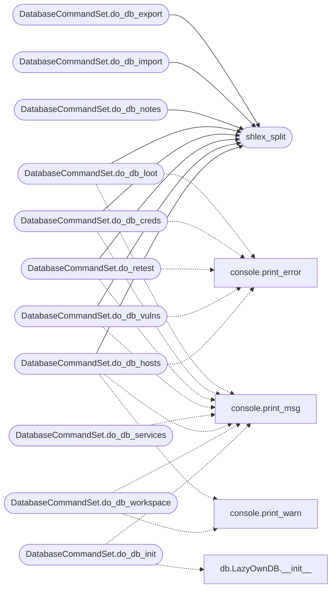

# `cli.commands.database`

> Source: [cli/commands/database.py:1](../../cli/commands/database.py#L1) | language `py` | coverage 100.0% | [API index](../index.md)

Database commands — workspace isolation, host/service/vuln management, nmap import, export, and status reporting.

Mirrors the Metasploit ``db_*`` workflow. The backing store is
[`modules.db.LazyOwnDB`](modules.db.py.md#lazyowndb) (SQLite in ``sessions/db/lazyown.db``).

## Contents

- **Classes:** [`DatabaseCommandSet`](#databasecommandset)
- **Functions:** [`shlex_split`](#shlex_split)
- **Constants:** [`RETEST_TIMEOUT_S`](#retest_timeout_s)

## Type Diagram



## Call Graph

Solid arrows stay in this module, dashed arrows leave it.



## Classes

<a id="databasecommandset"></a>

### `DatabaseCommandSet`

`class` | [cli/commands/database.py:26](../../cli/commands/database.py#L26)

```python
class DatabaseCommandSet(LazyOwnCommandSet)
```

Bases: [`LazyOwnCommandSet`](cli.commands._base.py.md#lazyowncommandset)

Database commands for campaign state management.

**Attributes**

| Name | Type | Default | Description |
|---|---|---|---|
| [`phase`](#databasecommandset-phase) |  | `'database'` |  |
| [`category`](#databasecommandset-category) |  | `'12. Miscellaneous'` |  |

**Members**

| Member | Kind | Summary |
|---|---|---|
| [`do_db_init`](#databasecommandset-do_db_init) | method | Initialize the database (creates schema if not exists). |
| [`do_db_workspace`](#databasecommandset-do_db_workspace) | method | Manage workspaces (list, create, switch, delete). |
| [`do_db_hosts`](#databasecommandset-do_db_hosts) | method | List or add hosts in the active workspace. |
| [`do_db_services`](#databasecommandset-do_db_services) | method | List all services in the active workspace. |
| [`do_db_vulns`](#databasecommandset-do_db_vulns) | method | List or add vulnerabilities. |
| [`do_retest`](#databasecommandset-do_retest) | method | Re-verify a finding in an isolated session (LAZY retester). |
| [`do_db_creds`](#databasecommandset-do_db_creds) | method | List or add credentials. |
| [`do_db_loot`](#databasecommandset-do_db_loot) | method | List or add loot items. |
| [`do_db_notes`](#databasecommandset-do_db_notes) | method | List or add notes. |
| [`do_db_import`](#databasecommandset-do_db_import) | method | Import scan results into the database. |
| [`do_db_export`](#databasecommandset-do_db_export) | method | Export database table to CSV. |
| [`do_db_status`](#databasecommandset-do_db_status) | method | Show entity counts for the active workspace. |

<a id="databasecommandset-do_db_init"></a>

#### `DatabaseCommandSet.do_db_init`

`method` | [cli/commands/database.py:57](../../cli/commands/database.py#L57)

Decorators: `@cmd2.with_category(miscellaneous_category)`

```python
def do_db_init(self, line)
```

Initialize the database (creates schema if not exists).

Usage: db_init [path]
The database is created at sessions/db/lazyown.db by default.

**Parameters**

| Name | Type | Default | Description |
|---|---|---|---|
| `line` |  |  |  |

*Calls:* [`print_msg`](core.console.py.md#print_msg), [`LazyOwnDB.__init__`](modules.db.py.md#lazyowndb-__init__)

<a id="databasecommandset-do_db_workspace"></a>

#### `DatabaseCommandSet.do_db_workspace`

`method` | [cli/commands/database.py:75](../../cli/commands/database.py#L75)

Decorators: `@cmd2.with_category(miscellaneous_category)`

```python
def do_db_workspace(self, line)
```

Manage workspaces (list, create, switch, delete).

Usage:
    db_workspace             — list workspaces
    db_workspace <name>      — create/switch to workspace
    db_workspace -d <name>   — delete workspace
    db_workspace -r <name>   — rename workspace (not yet supported)

**Parameters**

| Name | Type | Default | Description |
|---|---|---|---|
| `line` |  |  |  |

*Calls:* [`print_msg`](core.console.py.md#print_msg), [`print_warn`](core.console.py.md#print_warn)

<a id="databasecommandset-do_db_hosts"></a>

#### `DatabaseCommandSet.do_db_hosts`

`method` | [cli/commands/database.py:124](../../cli/commands/database.py#L124)

Decorators: `@cmd2.with_category(miscellaneous_category)`

```python
def do_db_hosts(self, line)
```

List or add hosts in the active workspace.

Usage:
    db_hosts                          — list all hosts
    db_hosts -a <ip> [hostname] [os]  — add a host
    db_hosts -d <id>                  — delete a host
    db_hosts -s <query>               — search (by IP, hostname, OS)

**Parameters**

| Name | Type | Default | Description |
|---|---|---|---|
| `line` |  |  |  |

*Calls:* [`shlex_split`](#shlex_split), [`print_error`](core.console.py.md#print_error), [`print_msg`](core.console.py.md#print_msg), [`print_warn`](core.console.py.md#print_warn)

<a id="databasecommandset-do_db_services"></a>

#### `DatabaseCommandSet.do_db_services`

`method` | [cli/commands/database.py:185](../../cli/commands/database.py#L185)

Decorators: `@cmd2.with_category(miscellaneous_category)`

```python
def do_db_services(self, line)
```

List all services in the active workspace.

Usage: db_services [host_id]

**Parameters**

| Name | Type | Default | Description |
|---|---|---|---|
| `line` |  |  |  |

*Calls:* [`print_msg`](core.console.py.md#print_msg)

<a id="databasecommandset-do_db_vulns"></a>

#### `DatabaseCommandSet.do_db_vulns`

`method` | [cli/commands/database.py:213](../../cli/commands/database.py#L213)

Decorators: `@cmd2.with_category(miscellaneous_category)`

```python
def do_db_vulns(self, line)
```

List or add vulnerabilities.

Usage:
    db_vulns                      — list all vulns
    db_vulns -a <host_id> <name>  — add a vuln
    db_vulns -s <severity>        — filter by severity

**Parameters**

| Name | Type | Default | Description |
|---|---|---|---|
| `line` |  |  |  |

*Calls:* [`shlex_split`](#shlex_split), [`print_error`](core.console.py.md#print_error), [`print_msg`](core.console.py.md#print_msg)

<a id="databasecommandset-do_retest"></a>

#### `DatabaseCommandSet.do_retest`

`method` | [cli/commands/database.py:267](../../cli/commands/database.py#L267)

Decorators: `@cmd2.with_category(miscellaneous_category)`

```python
def do_retest(self, line)
```

Re-verify a finding in an isolated session (LAZY retester).

Usage:
    retest <finding_id> [command]   — re-run PoC or command away
    from the live session, then record reproducible / fixed /
    inconclusive. Only a fixed conclusion flips status.

The verification runs through a fresh runner process carrying a
retest session id, so the live world model is never touched.

**Parameters**

| Name | Type | Default | Description |
|---|---|---|---|
| `line` |  |  |  |

*Calls:* [`shlex_split`](#shlex_split), [`print_error`](core.console.py.md#print_error), [`print_msg`](core.console.py.md#print_msg)

<a id="databasecommandset-do_db_creds"></a>

#### `DatabaseCommandSet.do_db_creds`

`method` | [cli/commands/database.py:349](../../cli/commands/database.py#L349)

Decorators: `@cmd2.with_category(miscellaneous_category)`

```python
def do_db_creds(self, line)
```

List or add credentials.

Usage:
    db_creds                          — list all creds
    db_creds -a <host_id> <user> <pass> [type]

**Parameters**

| Name | Type | Default | Description |
|---|---|---|---|
| `line` |  |  |  |

*Calls:* [`shlex_split`](#shlex_split), [`print_error`](core.console.py.md#print_error), [`print_msg`](core.console.py.md#print_msg)

<a id="databasecommandset-do_db_loot"></a>

#### `DatabaseCommandSet.do_db_loot`

`method` | [cli/commands/database.py:393](../../cli/commands/database.py#L393)

Decorators: `@cmd2.with_category(miscellaneous_category)`

```python
def do_db_loot(self, line)
```

List or add loot items.

Usage:
    db_loot                           — list all loot
    db_loot -a <name> <path> [type]   — add a loot entry

**Parameters**

| Name | Type | Default | Description |
|---|---|---|---|
| `line` |  |  |  |

*Calls:* [`shlex_split`](#shlex_split), [`print_error`](core.console.py.md#print_error), [`print_msg`](core.console.py.md#print_msg)

<a id="databasecommandset-do_db_notes"></a>

#### `DatabaseCommandSet.do_db_notes`

`method` | [cli/commands/database.py:433](../../cli/commands/database.py#L433)

Decorators: `@cmd2.with_category(miscellaneous_category)`

```python
def do_db_notes(self, line)
```

List or add notes.

Usage:
    db_notes                      — list all notes
    db_notes -a <text> [type]     — add a note

**Parameters**

| Name | Type | Default | Description |
|---|---|---|---|
| `line` |  |  |  |

*Calls:* [`shlex_split`](#shlex_split), [`print_error`](core.console.py.md#print_error), [`print_msg`](core.console.py.md#print_msg)

<a id="databasecommandset-do_db_import"></a>

#### `DatabaseCommandSet.do_db_import`

`method` | [cli/commands/database.py:471](../../cli/commands/database.py#L471)

Decorators: `@cmd2.with_category(miscellaneous_category)`

```python
def do_db_import(self, line)
```

Import scan results into the database.

Usage: db_import <file>
Supported formats: Nmap XML (.nmap, .xml)

**Parameters**

| Name | Type | Default | Description |
|---|---|---|---|
| `line` |  |  |  |

*Calls:* [`shlex_split`](#shlex_split), [`print_error`](core.console.py.md#print_error), [`print_msg`](core.console.py.md#print_msg), [`print_warn`](core.console.py.md#print_warn)

<a id="databasecommandset-do_db_export"></a>

#### `DatabaseCommandSet.do_db_export`

`method` | [cli/commands/database.py:509](../../cli/commands/database.py#L509)

Decorators: `@cmd2.with_category(miscellaneous_category)`

```python
def do_db_export(self, line)
```

Export database table to CSV.

Usage: db_export <table> [output_file]
Tables: hosts, services, vulns, creds, loot, notes

**Parameters**

| Name | Type | Default | Description |
|---|---|---|---|
| `line` |  |  |  |

*Calls:* [`shlex_split`](#shlex_split), [`print_error`](core.console.py.md#print_error), [`print_msg`](core.console.py.md#print_msg)

<a id="databasecommandset-do_db_status"></a>

#### `DatabaseCommandSet.do_db_status`

`method` | [cli/commands/database.py:543](../../cli/commands/database.py#L543)

Decorators: `@cmd2.with_category(miscellaneous_category)`

```python
def do_db_status(self, line)
```

Show entity counts for the active workspace.

Usage: db_status

**Parameters**

| Name | Type | Default | Description |
|---|---|---|---|
| `line` |  |  |  |

*Calls:* [`print_msg`](core.console.py.md#print_msg)

---

## Functions

<a id="shlex_split"></a>

### `shlex_split`

`function` | [cli/commands/database.py:560](../../cli/commands/database.py#L560)

```python
def shlex_split(text: str) -> list
```

Split text like shlex.split but handle empty strings gracefully.

**Parameters**

| Name | Type | Default | Description |
|---|---|---|---|
| `text` | `str` |  |  |

**Returns:** `list`

*Called by:* [`DatabaseCommandSet.do_db_creds`](#databasecommandset-do_db_creds), [`DatabaseCommandSet.do_db_export`](#databasecommandset-do_db_export), [`DatabaseCommandSet.do_db_hosts`](#databasecommandset-do_db_hosts), [`DatabaseCommandSet.do_db_import`](#databasecommandset-do_db_import), [`DatabaseCommandSet.do_db_loot`](#databasecommandset-do_db_loot), [`DatabaseCommandSet.do_db_notes`](#databasecommandset-do_db_notes), [`DatabaseCommandSet.do_db_vulns`](#databasecommandset-do_db_vulns), [`DatabaseCommandSet.do_retest`](#databasecommandset-do_retest)

---

## Constants

<a id="retest_timeout_s"></a>

### `RETEST_TIMEOUT_S`

`constant` | [cli/commands/database.py:23](../../cli/commands/database.py#L23)

```python
RETEST_TIMEOUT_S = 120
```

---
