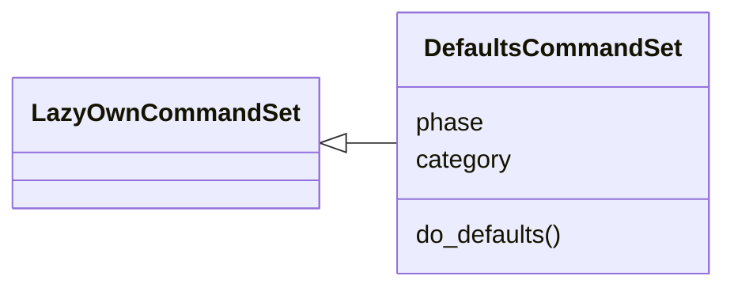
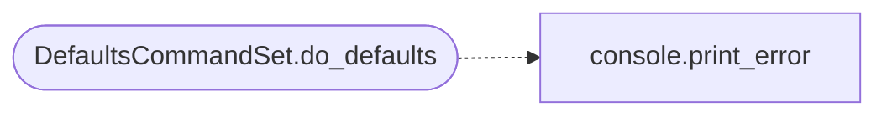

# `cli.commands.defaults`

> Source: [cli/commands/defaults.py:1](../../cli/commands/defaults.py#L1) | language `py` | coverage 100.0% | [API index](../index.md)

Build-defaults inspection and override command set.

Phase-scoped home for the `[`defaults`](cli.banner_config.py.md#bannersettings-defaults)` operator command (category
``12. Miscellaneous``). Build-time fallbacks live in
``config/defaults.toml`` and are read through `[`core.defaults`](core.defaults.py.md)`;
this command shows effective values and writes per-engagement
overrides into ``payload.json`` through the canonical ``assign``
path, so the TOML file itself is never rewritten at runtime.

Usage:
    defaults show
    defaults show wordlists
    defaults set wordlist /path/to/list.txt
    defaults set lport 4444
    defaults set rport 443

## Contents

- **Classes:** [`DefaultsCommandSet`](#defaultscommandset)

## Type Diagram



## Call Graph

Solid arrows stay in this module, dashed arrows leave it.



## Classes

<a id="defaultscommandset"></a>

### `DefaultsCommandSet`

`class` | [cli/commands/defaults.py:38](../../cli/commands/defaults.py#L38)

```python
class DefaultsCommandSet(LazyOwnCommandSet)
```

Bases: [`LazyOwnCommandSet`](cli.commands._base.py.md#lazyowncommandset)

Inspect and override build-time default constants.

**Attributes**

| Name | Type | Default | Description |
|---|---|---|---|
| [`phase`](#defaultscommandset-phase) |  | `'config'` |  |
| [`category`](#defaultscommandset-category) |  | `miscellaneous_category` |  |

**Members**

| Member | Kind | Summary |
|---|---|---|
| [`do_defaults`](#defaultscommandset-do_defaults) | method | Show or override build-time defaults (TOML + payload.json). |

<a id="defaultscommandset-do_defaults"></a>

#### `DefaultsCommandSet.do_defaults`

`method` | [cli/commands/defaults.py:45](../../cli/commands/defaults.py#L45)

Decorators: `@cmd2.with_category(miscellaneous_category)`

```python
def do_defaults(self, line)
```

Show or override build-time defaults (TOML + payload.json).

**Parameters**

| Name | Type | Default | Description |
|---|---|---|---|
| `line` |  |  | 'show [section]' or 'set <name> <value>'. |

*Calls:* [`print_error`](core.console.py.md#print_error)

---
