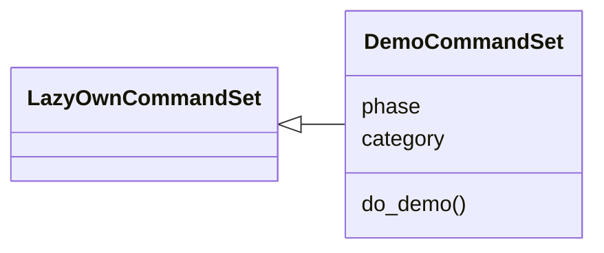
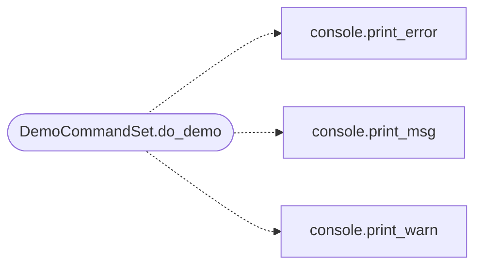

# `cli.commands.demo`

> Source: [cli/commands/demo.py:1](../../cli/commands/demo.py#L1) | language `py` | coverage 100.0% | [API index](../index.md)

End-to-end demo command — MCP registration plus the golden path.

Runs the documented first-shift flow in one shot so a new operator (or a
recorded demo) sees every surface working together:

    mcp add  ->  session init (sitrep)  ->  recommend_next  ->  lazynmap

The MCP step only prints the registration command — the operator runs it
in their AI client (Claude Code / Hermes). The remaining three steps
execute inside this shell via `[`onecmd`](core.command_bridge.py.md#commandbridge-onecmd)` delegation, so ``demo`` behaves
exactly like typing each command by hand (and composes with ``&&``).

## Contents

- **Classes:** [`DemoCommandSet`](#democommandset)

## Type Diagram



## Call Graph

Solid arrows stay in this module, dashed arrows leave it.



## Classes

<a id="democommandset"></a>

### `DemoCommandSet`

`class` | [cli/commands/demo.py:22](../../cli/commands/demo.py#L22)

```python
class DemoCommandSet(LazyOwnCommandSet)
```

Bases: [`LazyOwnCommandSet`](cli.commands._base.py.md#lazyowncommandset)

One-shot golden-path demo: MCP wiring plus sitrep/recommend/scan.

**Attributes**

| Name | Type | Default | Description |
|---|---|---|---|
| [`phase`](#democommandset-phase) |  | `'recon'` |  |
| [`category`](#democommandset-category) |  | `miscellaneous_category` |  |

**Members**

| Member | Kind | Summary |
|---|---|---|
| [`do_demo`](#democommandset-do_demo) | method | Run the end-to-end demo: MCP registration, session init, recommend, scan. |

<a id="democommandset-do_demo"></a>

#### `DemoCommandSet.do_demo`

`method` | [cli/commands/demo.py:29](../../cli/commands/demo.py#L29)

Decorators: `@cmd2.with_category(miscellaneous_category)`

```python
def do_demo(self, line)
```

Run the end-to-end demo: MCP registration, session init, recommend, scan.

Usage:
    demo                 — full flow (ends with a live lazynmap scan)
    demo --dry-run       — preview every step without scanning
    demo --skip-scan     — session init + recommend_next only

Steps:
  1. Prints the MCP registration for AI clients
     (``mcp add lazyown python3 ./skills/lazyown_mcp.py``).
  2. Session init — runs ``sitrep`` (CLI equivalent of the MCP
     tool ``lazyown_session_init``).
  3. Runs ``recommend_next`` (CLI equivalent of
     ``lazyown_recommend_next``).
  4. Runs ``lazynmap`` against the current rhost (CLI equivalent
     of ``lazyown_run_command('lazynmap')``).

**Parameters**

| Name | Type | Default | Description |
|---|---|---|---|
| `line` |  |  |  |

*Calls:* [`print_error`](core.console.py.md#print_error), [`print_msg`](core.console.py.md#print_msg), [`print_warn`](core.console.py.md#print_warn)

---
