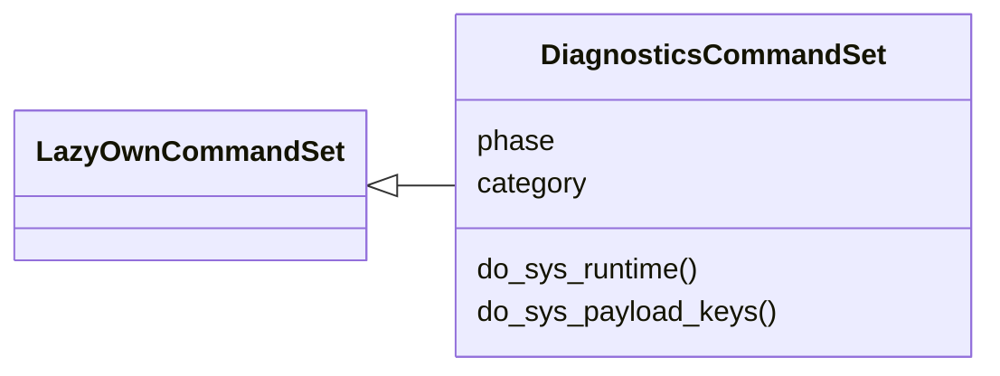

# `cli.commands.diagnostics`

> Source: [cli/commands/diagnostics.py:1](../../cli/commands/diagnostics.py#L1) | language `py` | coverage 100.0% | [API index](../index.md)

Diagnostics CommandSet (Tier 2 pilot).

A small, low-risk phase module that proves the ``CommandSet`` registration
flow works end-to-end against a live `[`LazyOwnShell`](lazyown.py.md#lazyownshell)` instance. It exposes
read-only commands operators can use to inspect the framework's runtime
state without mutating anything.

Subsequent tiers migrate the ~280 legacy ``do_*`` methods from
``lazyown.py`` into similar phase-scoped modules.

## Contents

- **Classes:** [`DiagnosticsCommandSet`](#diagnosticscommandset)

## Type Diagram



## Classes

<a id="diagnosticscommandset"></a>

### `DiagnosticsCommandSet`

`class` | [cli/commands/diagnostics.py:23](../../cli/commands/diagnostics.py#L23)

```python
class DiagnosticsCommandSet(LazyOwnCommandSet)
```

Bases: [`LazyOwnCommandSet`](cli.commands._base.py.md#lazyowncommandset)

Operator-facing diagnostics commands.

**Attributes**

| Name | Type | Default | Description |
|---|---|---|---|
| [`phase`](#diagnosticscommandset-phase) |  | `'diagnostics'` |  |
| [`category`](#diagnosticscommandset-category) |  | `'Diagnostics'` |  |

**Members**

| Member | Kind | Summary |
|---|---|---|
| [`do_sys_runtime`](#diagnosticscommandset-do_sys_runtime) | method | Print interpreter, platform and core LazyOwn paths. |
| [`do_sys_payload_keys`](#diagnosticscommandset-do_sys_payload_keys) | method | List the keys currently present in the parent shell's payload. |

<a id="diagnosticscommandset-do_sys_runtime"></a>

#### `DiagnosticsCommandSet.do_sys_runtime`

`method` | [cli/commands/diagnostics.py:30](../../cli/commands/diagnostics.py#L30)

Decorators: `@with_category('Diagnostics')`

```python
def do_sys_runtime(self, _statement) -> None
```

Print interpreter, platform and core LazyOwn paths.

**Parameters**

| Name | Type | Default | Description |
|---|---|---|---|
| `_statement` |  |  |  |

<a id="diagnosticscommandset-do_sys_payload_keys"></a>

#### `DiagnosticsCommandSet.do_sys_payload_keys`

`method` | [cli/commands/diagnostics.py:41](../../cli/commands/diagnostics.py#L41)

Decorators: `@with_category('Diagnostics')`

```python
def do_sys_payload_keys(self, _statement) -> None
```

List the keys currently present in the parent shell's payload.

**Parameters**

| Name | Type | Default | Description |
|---|---|---|---|
| `_statement` |  |  |  |

---
